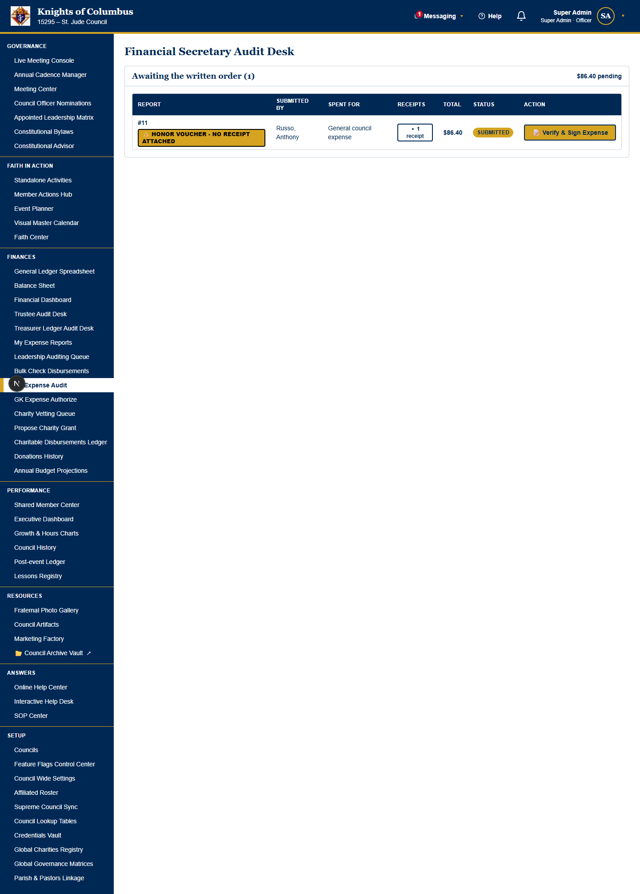
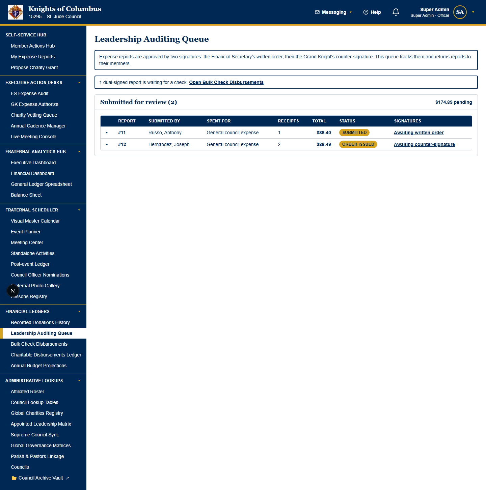
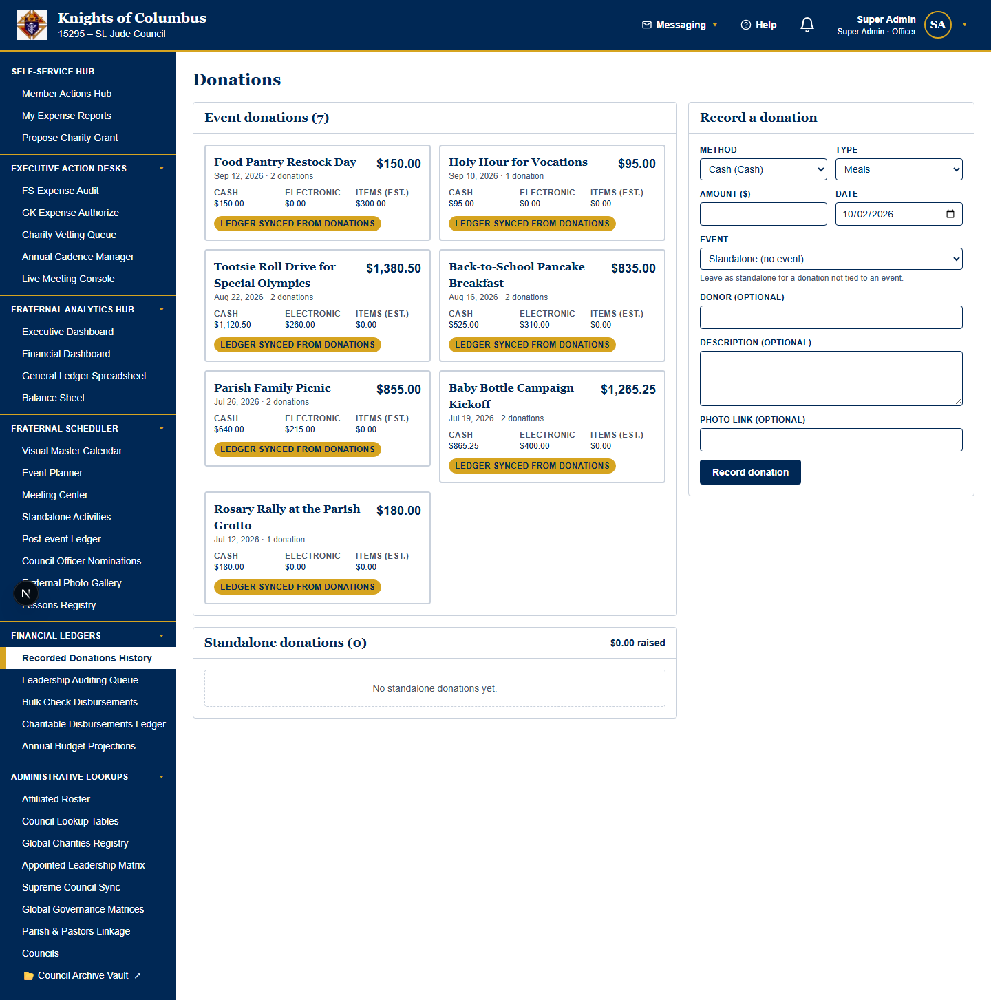
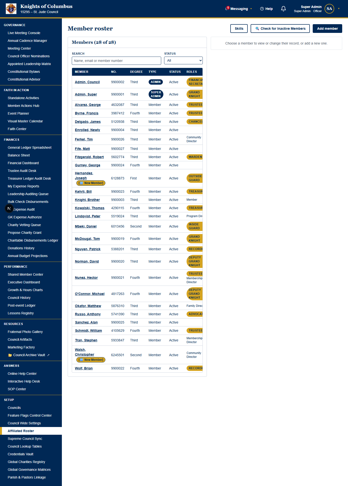
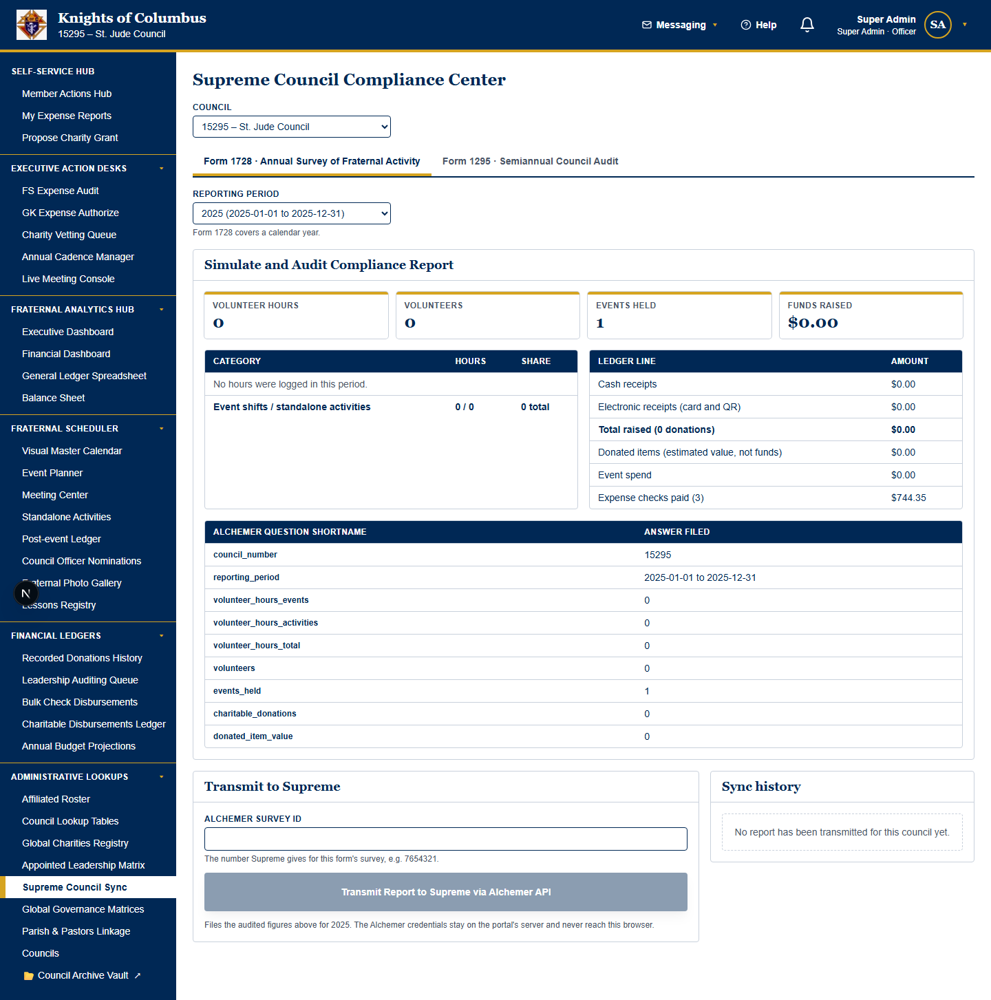

# Knights of Columbus Tracking Platform — Administrator User Guide

**Audience:** Council Admins, Super Admins, the Grand Knight (GK), the Deputy Grand Knight (DGK), the Financial Secretary (FS), the Treasurer, Trustees and other council officers.

**Covers:** the management pages of the web portal. Part 2 maps the left navigation first, then the desks and the phone tabs.

> **Every administrator is also a member.** Signing up, logging hours and taking donations are in the [Member User Guide](MEMBER_USER_GUIDE.md).
> The full access table is in the [Role Permissions Matrix](ROLE_PERMISSIONS_MATRIX.md).

---

## Contents

1. [Roles and access](#1-roles-and-access)
2. [Left navigation map](#2-left-navigation-map)
3. [Module feature flags](#3-module-feature-flags)
4. [Governance](#4-governance)
5. [Faith In Action](#5-faith-in-action)
6. [Finances](#6-finances)
7. [Performance](#7-performance)
8. [Resources and the Google Drive archive vault](#8-resources-and-the-google-drive-archive-vault)
9. [Answers](#9-answers)
10. [System Settings and the Supreme roster sync](#10-system-settings-and-the-supreme-roster-sync)
11. [Data protection rules](#11-data-protection-rules)
12. [Troubleshooting reference](#12-troubleshooting-reference)
13. [Automated messages reference](#13-automated-messages-reference)
14. [Member engagement and the roster lifecycle](#14-member-engagement-and-the-roster-lifecycle)
15. [Flagged hours review](#15-flagged-hours-review)
16. [Council Wide Settings and platform settings](#16-council-wide-settings-and-platform-settings)
17. [Access requests, check payments, asset photos, impersonation and remote help](#17-access-requests-check-payments-asset-photos-impersonation-and-remote-help)
18. [Annual roadmap, meeting check-in and meeting photos](#18-annual-roadmap-meeting-check-in-and-meeting-photos)
19. [The Active Desks dashboard](#19-the-active-desks-dashboard)
20. [The Cross-Council Loaner Library and the colour-coded calendar](#20-the-cross-council-loaner-library-and-the-colour-coded-calendar)
21. [Planning workflows and bilateral council affiliations](#21-planning-workflows-and-bilateral-council-affiliations)
22. [The Operations Knowledge Archive](#22-the-operations-knowledge-archive)
23. [Parish fundraiser splits](#23-parish-fundraiser-splits)
24. [Batch coding and cash box audits](#24-batch-coding-and-cash-box-audits)
25. [Account ownership, parish-held revenue, feedback loops and the Super Admin Desk](#25-account-ownership-parish-held-revenue-feedback-loops-and-the-super-admin-desk)
26. [The global search bar](#26-the-global-search-bar)
27. [The Navigation Guide screen](#27-the-navigation-guide-screen)
28. [Appendix: QR code files](#appendix-qr-code-files)

### How to read a tutorial

Every tutorial starts with a **Prerequisite (who can do this)** line. The line states the access privilege that the task needs. Stop when your role is not on the line.

Every tutorial then has five parts: **Goal**, **Start point**, **Steps**, **Expected result** and **Common problems**.
A **Warning** line comes before the steps when the task deletes data, sends messages, posts money or cannot be undone.

---

## 1. Roles and access

### 1.1 Member types and officer roles

A member has one member type. A member may also hold one or more officer roles.

| Member type | Scope |
| --- | --- |
| **Member** | The member's own records and the shared member pages. |
| **Admin** | The Admin's own council only. |
| **Super Admin** | Every council. |

| Officer role | Extra access |
| --- | --- |
| **Grand Knight** and **Deputy Grand Knight** | The executive dashboard and the charity vetting desk. Both counter-sign expenses, appoint officers and keep the cadence, the agenda templates, the bylaws, the meeting check-in and the base dues rate. The Deputy Grand Knight (DGK) has the same access as the Grand Knight (GK). |
| **Financial Secretary** | Issues payment requests on expenses. Posts to the general ledger. Pays checks. |
| **Treasurer** | Posts to the general ledger. Pays checks. |
| **Trustee** | Vets charity requests. Follows up on grants after 6 months. |
| **Recorder** | Edits the live agenda. Records hand tallies. |
| Any other seated officer | Reads the dashboards. Schedules meetings. Runs the live console. |

### 1.2 Access rules

- An Admin acts only on the Admin's own council. A Super Admin acts on any council.
- The data service checks every rule. A refused action shows a message and changes nothing.
- Nobody signs or pays an expense report that the same person submitted. The rule includes Super Admins.
- One person never signs both lines of the same expense report.

> **Caution:** finance access follows the role names **Treasurer** and **Financial Secretary**.
> A renamed role removes finance access from the officers who hold the role. Keep both names exactly as written.

<!-- KEEP_IMAGE: member actions hub with the role-filtered sidebar -->

<!-- /KEEP_IMAGE -->

### 1.3 Choose the council

Most management pages have a **Council** selector at the top.

- An Admin sees the Admin's own council.
- A Super Admin may choose any council.

The navy header shows your own council, your name, your member type and your officer status.

---

## 2. Left navigation map

This part maps every link of the left navigation, then the **Active Desks** tabs, then the timed settings, then the phone app. Each category is a collapsible block. Only the overview is open. Select a category title to open it. Select the title again to close it.

### 2.1 Overview: how the left navigation works

📍 Overview — read this first

- **Everyone lands on Home.** After you sign in, the portal opens on the **Home** tab of the **Active Desks** row. This is true for every member, officer, Admin and Super Admin, every time you sign in, even when you had another tab open before. **Home** shows the newsletters, the feast days, your reminders, today's agenda, the honor board and the prayer list. The only button on **Home** is **[ 🙏 Praying Hands ]** (section 19.2).
- **Your volunteer check-in is on the Member Actions Hub.** Select **Member Actions Hub** in the **Faith In Action** pillar. The page opens at its own address, `/member-actions`, under the heading **[ 🙋 Member Actions Hub ]**. It holds only the four tabs of the Volunteer Check-In & Service Center: **My active shifts**, **Registration desk**, **Fraternal roster** and **Hour ledger** (section 19.8). The shift trackers, your charity requests and your open sheets are on the **Member Desk** tab.
- **The Navigation Guide follows your role.** A member reads a short summary of each page that the member can open. Officers, Admins and Super Admins read the full map (section 2.7).
- **The sidebar shows only your links.** A link that your role cannot open does not show. The sidebar never shows a locked or greyed-out link. A pillar with no allowed links does not show.
- **Seven pillars, always open.** The sidebar groups its links into seven pillars: **Governance**, **Faith In Action**, **Finances**, **Performance**, **Resources**, **Answers** and **System Settings**. Section 2.3 lists the links of each pillar.
- **The Navigation Guide is at the top.** It explains each link that your sidebar shows (sections 2.7 and 2.8).
- **Three pages open from the header.** **Messaging** (envelope icon) opens **Council Messages & Alerts** and **My Distribution Lists**. **Help** (question-mark icon) opens the **Online Help Center**. Your name opens **My Profile**.
- **The Active Desks row is on every page.** It holds **Home** and the desks that your seat clears (section 2.4).
- **Switched-off modules are gone.** A module that your council switched off has no link (section 3).

### 2.2 Left navigation by category

The categories group the links by the work you do. A link can sit in a different pillar from its category. The **Pillar** column names where to find the link in the sidebar.

🏠 Dashboard

| Link | Pillar | Who sees it | What it holds | Section |
| --- | --- | --- | --- | --- |
| **Home** | Faith In Action | Every member | The newsletters feed, the verse, your reminders (read only), the feast days, today's agenda, the Top 5 honor board and the prayer list with **[ 🙏 Praying Hands ]** | 19.2 |
| **Member Actions Hub** | Faith In Action | Every member | Its own page, `/member-actions`: the four Volunteer Check-In & Service Center tabs - **My active shifts**, **Registration desk**, **Fraternal roster** and **Hour ledger** | 19.8 |
| **Executive Dashboard** | Performance | Officers, Admins, the Council Historian | The roadmap ribbon and the **Executive Summary** | 19.13 |
| **Council Dashboard** | Performance | Every member | The council's engagement, the leaderboards and the membership history | 14.1 |
| **Financial Dashboard** | Finances | General ledger readers | The council's money at a glance | 6.6 |
| **Growth & Hours Charts** | Performance | Officers, Admins | Membership growth and service hours by month | 7.2 |

📅 Calendars

| Link | Pillar | Who sees it | What it holds | Section |
| --- | --- | --- | --- | --- |
| **Visual Master Calendar** | Faith In Action | Every member | Events, shifts, meetings and birthdays by date, in mission colours | 20.4 |
| **Event Planner** | Faith In Action | Event planners, Admins | Event dates, shifts and sign-up targets | 5 |
| **Recurring Meetings** | Governance | Officers, Admins | The year's meeting pattern | 4.4 |
| **Meeting Center** | Governance | Every member | Meetings, invitations and minutes | 4 |
| **Live Meeting Console** | Governance | Officers, Admins | The live agenda, check-ins, ballots and hand tallies | 4.1 |

👥 Rosters

Council roster

| Link | Pillar | Who sees it | What it holds | Section |
| --- | --- | --- | --- | --- |
| **Affiliated Roster** | System Settings | Admins, roster keepers | Members, member types and skills | 14 |
| **Supreme Council Sync** | System Settings | Admins, finance officers | The roster sync with Supreme | 10.4 |
| **Member Actions Hub** → **Fraternal roster** tab | Faith In Action | Every member | The phone and email of active brothers | 19.8 |

Officer seats and connected councils

| Link | Pillar | Who sees it | What it holds | Section |
| --- | --- | --- | --- | --- |
| **Council Officer Nominations** | Governance | Every member | Nominations for elected offices | 4.7 |
| **Appointed Leadership Matrix** | Governance | The GK, the DGK, Admins | The appointed seats | 4.7 |
| **Connected Councils** | System Settings | The GK, the DGK, Admins | Affiliation invites and the connected councils | 21.5 |

✅ Vetting

Expense signatures

| Link | Pillar | Who sees it | What it holds | Section |
| --- | --- | --- | --- | --- |
| **FS Expense Audit** | Finances | The FS, Admins | Reports that wait for a payment request | 19.6 |
| **Treasurer Ledger Audit Desk** | Finances | The Treasurer, Admins | Reports to code to a budget line and a GL account | 19.7 |
| **GK Expense Authorize** | Finances | The GK, the DGK, Admins | Reports that wait for the final signature | 19.5 |

Charity grants

| Link | Pillar | Who sees it | What it holds | Section |
| --- | --- | --- | --- | --- |
| **Propose Charity Grant** | Finances | Every member | The charity proposal form | 6.8 |
| **Charity Vetting Queue** | Finances | Officers, Trustees, Admins | Proposals to vet | 6.8 |
| **Charity Payments Made Ledger** | Finances | Finance officers, Super Admins | Approved grants and their checks | 6.9 |

Audits

| Link | Pillar | Who sees it | What it holds | Section |
| --- | --- | --- | --- | --- |
| **Trustee Audit Desk** | Finances | Trustees, general ledger readers | The semiannual audit and its period locks | 6 |

📒 Ledgers

Money ledgers

| Link | Pillar | Who sees it | What it holds | Section |
| --- | --- | --- | --- | --- |
| **General Ledger Spreadsheet** | Finances | General ledger readers | The chart of accounts and every posting | 6.6 |
| **Balance Sheet** | Finances | General ledger readers | Assets, liabilities and net worth | 6.6 |
| **My Expense Reports** | Finances | Every member | Your own expense reports and their status | 6.1 |
| **Bulk Check Payments Made** | Finances | Finance officers, Super Admins | Approved reports paid by check | 6.5 |
| **Donations History** | Finances | Officers, Admins | Recorded donations | 6.10 |
| **Annual Budget Projections** | Finances | Every member reads it | The council's annual budget | 6.11 |

Service and asset ledgers

| Link | Pillar | Who sees it | What it holds | Section |
| --- | --- | --- | --- | --- |
| **Post-event Ledger** | Performance | Every member | Event results that event owners record | 7.3 |
| **Member Actions Hub** → **Hour ledger** tab | Faith In Action | Every member | Your logged service hours | 19.8 |
| **Cross-Council Loaner Library** | Resources | Every member | The items the council and its connected councils lend | 20.1 |

🗄️ Archives

| Link | Pillar | Who sees it | What it holds | Section |
| --- | --- | --- | --- | --- |
| **Council History** | Performance | Every member | Annals, the diary, oral histories and the In Memoriam roll | 7 |
| **Operations Knowledge Archive** | System Settings | Officers, Admins | Every lesson the councils filed | 22.3 |
| **Lessons Registry** | Performance | Officers, Admins | Lessons from past events | 7.5 |
| **Fraternal Photo Gallery** | Resources | Every member | Event and meeting photos | 8.4 |
| **Council Artifacts** | Resources | Every member | Flyers, minutes and photo albums filed in Google Drive | 8.4 |
| **Constitutional Bylaws** | Governance | Every member | The council's bylaws | 4.8 |
| **SOP Center** | Answers | Every member | The standard operating procedures | 9.2 |

⚙️ Settings, planning and help

Planning and faith

| Link | Pillar | Who sees it | What it holds | Section |
| --- | --- | --- | --- | --- |
| **Standalone Activities** | Faith In Action | Admins, activity keepers | The council's standing activities | 5.4 |
| **Faith Center** | Faith In Action | Every member | The feast day, the daily verse and the prayer intentions | 5 |
| **Marketing Factory** | Resources | Officers, Admins | Event flyers | 8.5 |
| **Constitutional Advisor** | Governance | Officers, Admins, Super Admins | Parliamentary answers with citations | 4 |

Help

| Link | Pillar | Who sees it | What it holds | Section |
| --- | --- | --- | --- | --- |
| **Online Help Center** | Answers | Every member | Answers to common questions | 9 |
| **Interactive Help Desk** | Answers | Every member | Task search over the member guide | 9 |
| **Navigation Guide** | Top of the sidebar | Every member | Your own collapsible map, at your role's depth | 2.7 |

System Settings

| Link | Who sees it | What it holds | Section |
| --- | --- | --- | --- |
| **Council Wide Settings** | Officers, Admins, Super Admins | Four tabs: Standard Bank Accounts, Global Revenue Splits, User Access & Roster Control, System Flags & Toggles | 16 |
| **Council Lookup Tables** | Admins, finance officers | Payment methods, lists and the email gateway | 10.7 |
| **Credentials Vault** | Officers, Admins, Super Admins | Sealed keys for Drive, mail and receipt reading | 10.8 |
| **Feature Flags Control Center** | Super Admins | The module switches of each council | 3 |
| **Global System Parameters** | Super Admins | Dues, organization type and platform settings | 16.5 |
| **Councils** | Super Admins | The council list | 10.9 |
| **Global Charities Registry** | Super Admins | The shared charity list | 10.9 |
| **Global Governance Matrices** | Super Admins | The global lookup tables | 10.9 |
| **Parish & Pastors Linkage** | Admins | Parishes and their pastors | 10.9 |
| **Remote Assistance Desk** | Super Admins | Co-watching help sessions | 17.9 |
| **View-As Member Lookup** | Super Admins | View the portal as one member | 17.7 |
| **Administrative Feedback Loops** | Admins, Super Admins | Notes to the platform owner | 25.4 |

### 2.3 The links of each pillar

📋 The seven pillars, in sidebar order

| Pillar | Links, in sidebar order |
| --- | --- |
| **Governance** | Live Meeting Console, Recurring Meetings, Meeting Center, Council Officer Nominations, Appointed Leadership Matrix, Constitutional Bylaws, Constitutional Advisor |
| **Faith In Action** | Standalone Activities, Home, Member Actions Hub, Event Planner, Visual Master Calendar, Faith Center |
| **Finances** | General Ledger Spreadsheet, Balance Sheet, Financial Dashboard, Trustee Audit Desk, Treasurer Ledger Audit Desk, My Expense Reports, Bulk Check Payments Made, FS Expense Audit, GK Expense Authorize, Charity Vetting Queue, Propose Charity Grant, Charity Payments Made Ledger, Donations History, Annual Budget Projections |
| **Performance** | Council Dashboard, Executive Dashboard, Growth & Hours Charts, Council History, Post-event Ledger, Lessons Registry |
| **Resources** | Fraternal Photo Gallery, Council Artifacts, Marketing Factory, Cross-Council Loaner Library |
| **Answers** | Online Help Center, Interactive Help Desk, SOP Center |
| **System Settings** | Councils, Feature Flags Control Center, Global System Parameters, Remote Assistance Desk, View-As Member Lookup, Administrative Feedback Loops, Council Wide Settings, Connected Councils, Operations Knowledge Archive, Affiliated Roster, Supreme Council Sync, Council Lookup Tables, Credentials Vault, Global Charities Registry, Global Governance Matrices, Parish & Pastors Linkage |

The **System Settings** pillar had the name **Setup** in earlier versions of the portal.

### 2.4 Desks map: the Active Desks tabs

🗂️ The desk tabs and their drawers

| Tab | Who gets the tab | Drawers or sections | Section |
| --- | --- | --- | --- |
| **Home** | Every member | **[ 📰 Latest Council Newsletters & Bulletins ]**, Bible Verse of the Day, Live Actionable Reminders, Liturgical Feast Day Tracker, [ 📅 Upcoming Event Agenda ], Top 5 Fraternal Volunteers, Community Prayer Request List. No links into the desks; the only button is **[ 🙏 Praying Hands ]**. | 19.2 |
| **Super Admin Desk** | The platform owner only | Feedback Communication Center, Council Access Request Approval Queue, System Feature Flag Control Panel | 25 |
| **Grand Knight Desk** | The GK, the DGK, Admins, Super Admins | Approved Expenses, Flagged Hours Review, Shifts Awaiting Hours, Inbound Council Mail Center, Charitable Grant Requests Vetting Board, FS/GK Compliance Endorsements, [ 📈 Council Goals & Targets ], Shared Loaner Library, Affiliation Invites, Connected Councils, Constitutional Advisor Panels; **[ 📖 Reference Workflows ]**: Charitable Donation Workflow, Planning & Budgeting Workflow, [ 🗳️ Council Election Workflow ] | 19.5 |
| **Financial Secretary Desk** | The FS, Admins, Super Admins | Auditing & Return Queue, Expense Report (ER) Routing Track, Charitable Donation Records, Church Disbursement Requests, FS/GK Compliance Endorsements, Charity Check Issuance Console, Excel Roster Imports; **[ 📖 Reference Workflows ]**: Expense Report (ER) Workflow, Charitable Donation Workflow (outgoing charity grants) | 19.6 |
| **Treasurer Desk** | The Treasurer, Admins, Super Admins | Ledger Line Coder, Expense Report (ER) Settlement, Charitable Contribution Matches, Cash Box Audit Closure Panel, High-Volume Batch Transaction Coder, Annual Budget vs Actuals Ledger Grid, Bank Statement Match-Window, Parish Fundraiser Revenue Split Console; **[ 🔧 Accounting Configuration ]**: Chart of Accounts & GL Setup; **[ 📖 Reference Workflows ]**: Expense Report (ER) Workflow, Charitable Donation Workflow, Planning & Budgeting Workflow | 19.7 |
| **Recorder Desk** | The Recorder, Admins, Super Admins | Historical Meeting Minutes Archive, Meeting Minutes Entry Desk, Start Live Meeting Sequence, Council Resolutions and Motions Ledger; **[ 📖 Reference Workflows ]**: [ 🗳️ Council Election Workflow ] | 19.10 |
| **Historian Desk** | The Council Historian, Admins, Super Admins | Fraternal Diary Entry Logs, Monthly Newsletters, Meeting Photos, Oral History Recordings, Google Drive Media Gallery Sync Board; **[ 📖 Reference Workflows ]**: [ 🗳️ Council Election Workflow ] | 19.12 |
| **Member Desk** | Every member | **[ 🚗 Open Shifts Needing Volunteers ]** and **My shifts** side by side at the top, **[ 📥 My Charity Requests ]**, **My open expense sheets** | 19.8 |

### 2.5 Timed settings map

⏱️ The time windows and reminder days

| Setting | Default | Where it is set | Who changes it | Section |
| --- | --- | --- | --- | --- |
| **Days after an event or meeting to submit expenses** | 30 days | **Council Wide Settings** → **System Flags & Toggles** → **Financial Submissions** | Officers, Admins, Super Admins | 16.3 |
| **Days back a member may log volunteer time** | 90 days | **Council Wide Settings** → **System Flags & Toggles** → **Volunteer & Meeting Operations** | Officers, Admins, Super Admins | 16.3 |
| **Hours before an event that gate donations open** | 2 hours | **Council Wide Settings** → **System Flags & Toggles** → **Volunteer & Meeting Operations** | Officers, Admins, Super Admins | 16.3 |
| **Days after a meeting that the minutes are due** | 7 days | **Council Wide Settings** → **System Flags & Toggles** → **Volunteer & Meeting Operations** | Officers, Admins, Super Admins | 16.3 |
| **Days without service before a member counts as inactive** | 365 days | **Council Wide Settings** → **System Flags & Toggles** → **Volunteer & Meeting Operations** | Officers, Admins, Super Admins | 14.9 |
| **Days after a shift before the first hours reminder** | 5 days | **Council Wide Settings** → **System Flags & Toggles** → **Reminder Cadences** | Officers, Admins, Super Admins | 16.3 |
| **Days between follow-up hours reminders** | 7 days | **Council Wide Settings** → **System Flags & Toggles** → **Reminder Cadences** | Officers, Admins, Super Admins | 16.3 |
| Invitation lead time, sign-in length, record retention | See section 16.6 | **Global System Parameters** → **Platform Settings** | Super Admins | 16.6 |

The settings marked **Not used yet** on the page are saved for future features (section 16.3). Your own **Navigation Guide** shows the numbers in force for your council now.

### 2.6 Mobile lines: the phone app tabs

📱 The five phone tabs

| Tab | Use the tab to | Can the council switch it off? |
| --- | --- | --- |
| **Home** | See your upcoming shifts and your expense report summary | No |
| **Mtgs** | Answer meeting invitations and read agendas | Yes, with **Meeting management** |
| **Signup** | Find shifts in the next 30 days and sign up | Yes, with **Event shifts** |
| **Report** | Log hours for a council activity or a shift | No |
| **Collect** | Record cash, card, QR-code and item donations | Yes, with **Fundraising inflow** |

The navy header of the phone holds the **envelope** (messages) and **your name** (**Settings**, large text and **Sign out**). The member guide explains each phone task.

### 2.7 Concept: the Navigation Guide

The **Navigation Guide** link is at the top of the sidebar, above the seven pillars. Every member sees the link.

The **Navigation Guide** page is a collapsible map in the same order as this part: the sidebar categories, your desks, your time limits and the phone tabs. Only the **📍 Overview** block is open. Select a block title to open it. Chapter 27 explains the screen in full.

The page reads your member type and your officer roles. The page then lists only the links and desks that you can open. The depth of the map follows your role.

| You sign in as | Depth | The guide shows |
| --- | --- | --- |
| Member | Summary | One short sentence for each page that you can open, for example **Home**, **Member Actions Hub**, **Visual Master Calendar** and the **Member Desk**. No leadership, finance desk or settings page. |
| Council Officer | Full | The member pages and the desks of your office, with the sidebar pillar of each link and every drawer of each desk. For example **GK Expense Authorize** and the **Grand Knight Desk** drawers for the Grand Knight. |
| Council Admin | Full | The member pages and the leadership, finance and settings pages of your council, with every drawer of each desk. |
| Super Admin | Full | Every page, including **Global System Parameters**, and the **Super Admin Desk** for the platform owner. |

A few pages read differently for leaders. For example, a member reads that **Annual Budget Projections** shows the budget. A leader also reads that budget keepers draft and approve the budget there.
A module that your council switched off is not in the guide, because the module is not in your sidebar.

The **Your time limits** part of the guide lists the time windows and reminder days in force for you now. The guide reads the numbers from your council's settings and the platform settings each time the page opens. A member sees the limits that a member meets: the expense window, the logging window, the hours reminders, the invitation lead time and the sign-in length. A leader also sees every other time setting. The settings that no feature uses yet are listed last under **Saved for future features (not used yet)**.

### 2.8 Read your Navigation Guide

> **Prerequisite (who can do this):** Every signed-in member.

**Goal:** Learn what each link in your sidebar does.

**Start point:** Sidebar → **Navigation Guide** (at the top, above the pillars).

**Steps:**
1. Select **Navigation Guide**.
2. Read the first line. The line shows how you are signed in, for example *You are signed in as: Council Officer (Grand Knight)*.
3. Read **In the top bar** in the open **📍 Overview** block for the Messaging menu and your name menu.
4. Select a category title, for example **📅 Calendars**, to open it. Select the title again to close it.
5. Select a link name to open that page.
6. Open **🗂️ Your desks** to see your desk tabs. Officers and Admins also see every drawer of each desk.
7. Open **⏱️ Your time limits** for your council's time windows and reminder days.
8. Open **📱 Phone app tabs** for the phone tabs that your council has on.

**Expected result:** The page lists every link and desk that you can open, at the depth of your role. **⏱️ Your time limits** shows your council's current numbers.

**Common problems:**
| Problem | Cause | Fix |
| --- | --- | --- |
| A page that a colleague uses is not in your guide. | Your role cannot open the page. | Ask a council Admin about your role. |
| A whole module is missing from the guide. | Your council switched the module off (section 3). | Ask a Super Admin to switch the module on. |

---

## 3. Module feature flags

### 3.1 Concept: backend logic of the flags

Each council row has twelve on/off columns. Each column is a module feature flag. A new council has every flag on.

| Flag column | Label in the Feature Flags Control Center | Web pages hidden when off | Phone items hidden when off |
| --- | --- | --- | --- |
| `flag_mobile_elections` | **Officer elections** | Council Officer Nominations, Appointed Leadership Matrix | None |
| `flag_fundraising_inflow` | **Fundraising inflow** | Donations History | **Collect** |
| `flag_charity_proposals` | **Charity proposals** | Propose Charity Grant, Charity Vetting Queue | None |
| `flag_complex_shifts` | **Event shifts** | Event Planner, the shift tabs of the Member Actions Hub | **Signup**, and the shift mode of **Report** |
| `flag_meeting_management` | **Meeting management** | Meeting Center, Recurring Meetings, Live Meeting Console | **Mtgs** |
| `feature_expense_reporting` | **Expense reporting** | My Expense Reports, Leadership Auditing Queue, FS Expense Audit, Treasurer Ledger Audit Desk, GK Expense Authorize, Bulk Check Payments Made | The expense screen and the **Expense reports** card on **Home** |
| `feature_faith_center` | **Faith Center** | Faith Center | The feast-day banner, the Daily Bible Quote, the praying hands and the prayer intentions |
| `feature_constitutional_advisor` | **Constitutional Advisor** | Constitutional Advisor | None |
| `feature_council_bylaws` | **Council bylaws** | Constitutional Bylaws | None |
| `feature_council_history` | **Council history** | Council history (Team Legacy) | None |
| `feature_live_meeting_console` | **Live meeting console** | Live Meeting Console | None |
| `feature_volunteer_quarantine` | **Flagged hours review** | The **Flagged Hours Review** drawer on the **Grand Knight Desk** of the dashboard. Members' hours also stop going to review (section 15). | None |

The flags follow four rules.

1. A flag that is off hides the module from every member of the council. The rule includes Admins.
2. A hidden desk is gone from the sidebar.
3. A hidden page refuses a typed web address. The phone sends a member on a hidden screen back to **Home**.
4. A flag never deletes data. A flag that is switched back on restores the module with all records.

The general ledger, the budget and the activity hour log have no flag. They stay on for every council.

### 3.2 Switch a module on or off

> **Prerequisite (who can do this):** You must have Super Admin privileges. Council Admins do not see the Feature Flags Control Center.
> **Warning:** a switched-off module disappears at once for every member of the council, on the web and on the phone.

**Goal:** Turn one optional module on or off for one council.

**Start point:** Sidebar → System Settings → **Feature Flags Control Center**.

**Steps:**
1. Find the row of the module. Each row shows the label, the flag column and the pages the flag hides.
2. Find the column of the council. Each column shows the council number and how many modules are on.
3. Clear the box to hide the module. Select the box to show the module.

**Expected result:** The platform saves each switch at once. Members of the council see the change the next time each page loads.

**Common problems:**
| Problem | Cause | Fix |
| --- | --- | --- |
| A member still sees a phone tab. | The phone read the flags before the change. | Ask the member to sign out and sign in again. |
| *"… is not a feature flag"* | The request named an unknown flag. | Use one of the twelve flags in 3.1. |

---

## 4. Governance

### 4.1 Run a live meeting

> **Prerequisite (who can do this):** You must be a seated officer of the council, a council Admin, the meeting owner or a Super Admin. Other members do not see this desk.
> **Warning:** **Passed**, **Failed** and **Tabled** record the council's decision on the motion.

**Goal:** Chair a council meeting from one screen.

**Start point:** Sidebar → Governance → **Live Meeting Console**.

**Steps:**
1. Choose the meeting in **Meeting**.
2. Select **Start live console**.
3. Check in members in **Live attendance**. Use **Find a member** to search.
4. Select a line in **Order of Business** to put the line on the floor.
5. Set **Allotted minutes** for the topic.
6. For a motion, select **Launch secret smartphone ballot**. Members vote **Approve**, **Deny** or **Abstain** on their phones.
7. Select **Passed**, **Failed** or **Tabled**.
8. Select **Close the console** after the last item.

<!-- KEEP_IMAGE: live meeting console capture -->

<!-- /KEEP_IMAGE -->

**Expected result:** The top bar shows **Now on the floor** and the countdown. Phones that follow the agenda show the same line.

**Common problems:**
| Problem | Cause | Fix |
| --- | --- | --- |
| *"Start the console first"* | The console is not live. | Select **Start live console**. |
| *"Decide the open ballot first"* | A ballot is still open. | Decide the open motion. Then continue. |
| **Passed** is greyed out. | The smartphone ballot has no more Approve votes than Deny votes. | Select **Failed** or **Tabled**. |
| *"No meeting from the past week on is yours to run."* | No meeting is in range for you. | Schedule the meeting in the **Meeting Center**. |

### 4.2 Record a hand tally

> **Prerequisite (who can do this):** You must be the council's Grand Knight, Deputy Grand Knight or Recorder, a council Admin or a Super Admin.
> **Warning:** **Save tally & decide the motion** decides the motion. A tie fails the motion.

**Goal:** Record a vote by raised hands.

**Start point:** Sidebar → Governance → **Live Meeting Console** → the motion → **Record Hand Tally**.

**Steps:**
1. Count the hands for the motion. Enter the count in **Approved hands**.
2. Count the hands against the motion. Enter the count in **Denied hands**.
3. Select **Save tally & decide the motion**.
4. Optional: for a passed motion that releases money, choose the posting in **General-ledger posting**. Select **Save link**.

**Expected result:** The motion shows **Passed** or **Failed**. A linked motion shows **Ledger linked**.

**Common problems:**
| Problem | Cause | Fix |
| --- | --- | --- |
| *"Type both counts; at least one hand."* | A count is empty, or both counts are 0. | Enter both counts. |
| The hand tally is refused. | A smartphone ballot already opened on the motion. | Decide the motion from the ballot result. |

### 4.3 Correct a live agenda line

> **Prerequisite (who can do this):** You must be the council's Grand Knight, Deputy Grand Knight or Recorder, a council Admin or a Super Admin.

**Goal:** Fix or add an agenda line during the meeting.

**Start point:** Sidebar → Governance → **Live Meeting Console** → **Order of Business**.

**Steps:**
1. Select the line. The line opens for editing.
2. Correct the text. Press Enter to save. Press Escape to cancel.
3. For a new topic, select **Blank last-minute line - click to write it**.

**Expected result:** The corrected line shows on the console and on members' phones.

**Common problems:**
| Problem | Cause | Fix |
| --- | --- | --- |
| A line does not open for editing. | The DGK and other officers do not edit the agenda. | Ask the GK or the Recorder. |

### 4.4 Lay down the year's meetings with a cadence

> **Prerequisite (who can do this):** You must be a council Admin, the Grand Knight, the Deputy Grand Knight or a Super Admin. Other members do not see this desk.
> **Warning:** **Populate the year** creates up to 12 meetings and their invitations.

**Goal:** Create the fraternal year's regular meetings in one step.

**Start point:** Sidebar → Governance → **Recurring Meetings**.

**Steps:**
1. Select **Add cadence**.
2. Choose the **Meeting type**.
3. Set **Recurrence pattern: week** and **Recurrence pattern: day**, for example First and Tuesday.
4. Set **Start time**, **Default location** and **Default recipient group**.
5. Select **Save cadence**.
6. Choose the **Fraternal year**. Select **Populate the year**.

<!-- KEEP_IMAGE: annual cadence manager capture -->

<!-- /KEEP_IMAGE -->

**Expected result:** The platform creates one meeting per month, July through June. Each meeting lasts 120 minutes.
Invitations are released 5 days before each meeting by default. A Super Admin sets the number of days for every council (section 16.6).

**Common problems:**
| Problem | Cause | Fix |
| --- | --- | --- |
| A month has no new meeting. | A meeting of the same type already exists on that date. | No action. The platform skips the date. |

### 4.5 Schedule a single meeting

> **Prerequisite (who can do this):** You must be a seated officer of the council, a council Admin or a Super Admin.
> **Warning:** **Schedule meeting** sends invitations at once.

**Goal:** Create one meeting and invite members.

**Start point:** Sidebar → Governance → **Meeting Center**.

**Steps:**
1. Select **New meeting**.
2. Fill in **Meeting name**, **Type**, **Date**, **Location**, **Starts** and **Ends**.
3. Check the **Agenda**. The **Type** fills the agenda from the council's template.
4. For a meeting over several days, tick **Multi-Day Assembly / Extended Event**. Set the **End date**.
5. Choose the invitees: **All active members**, **Officers only** or **Choose members…**.
6. Select **Schedule meeting**.
7. After the meeting, select **Upload minutes**. Tick each attendee. Save.

<!-- KEEP_IMAGE: meeting center capture -->

<!-- /KEEP_IMAGE -->

**Expected result:** A message shows *"Meeting scheduled and invitations sent."*

**Common problems:**
| Problem | Cause | Fix |
| --- | --- | --- |
| New members are not invited. | The members joined after the meeting was scheduled. | Select **Invite all active members**. |
| A multi-day assembly adds no hours. | Multi-day assemblies add no meeting hours by design. | No action. |

### 4.6 Keep the meeting agenda templates

> **Prerequisite (who can do this):** You must be a council Admin, the Grand Knight, the Deputy Grand Knight or a Super Admin.

**Goal:** Set the default agenda for one meeting type.

**Start point:** Sidebar → System Settings → **Council Lookup Tables** → **Meeting Agenda Templates**.

**Steps:**
1. Choose the **Meeting type**.
2. Write the outline in **Default agenda outline**.
3. Select **Save template**.
4. To remove a template, clear the text. Select **Save template**.

**Expected result:** A new meeting of the type starts with the outline.

**Common problems:**
| Problem | Cause | Fix |
| --- | --- | --- |
| A meeting kept the old agenda. | The officer typed an agenda before choosing the type. | Select **Use the template** on the meeting form. |

### 4.7 Manage nominations and appointments

> **Prerequisite (who can do this):** You must be an active member to nominate. You must be the Grand Knight, the Deputy Grand Knight or a Super Admin to appoint officers.

**Goal:** Fill the council's elected and appointed seats.

**Start point:** Sidebar → Governance → **Council Officer Nominations** or **Appointed Leadership Matrix**.

**Steps:**
1. Open **Council Officer Nominations** to nominate a Brother Knight for office.
2. Open **Appointed Leadership Matrix** to fill an appointed seat.
3. Choose the member for each vacant seat. Save.

<!-- KEEP_IMAGE: nominations and elections capture -->

<!-- /KEEP_IMAGE -->

<!-- KEEP_IMAGE: appointed positions capture -->

<!-- /KEEP_IMAGE -->

**Expected result:** The seat shows the member's name.

**Common problems:**
| Problem | Cause | Fix |
| --- | --- | --- |
| Both pages are missing. | The council switched off **Officer elections**. | Ask a Super Admin (section 3). |

### 4.8 Concept: the Council Bylaws Data Vault

The vault holds one bylaws document per council. Every member of the council reads the bylaws.

- The vault stores the bylaws as text in the `Council.BylawsMarkdown` column. The limit is 100,000 characters.
- The vault also stores the save time in `BylawsUpdatedAt`.
- A line that starts with `# ` starts an article. A line that starts with `## ` starts a section.
- The vault splits the text into clauses. The clause id `A2.S3` means article 2, section 3. The id `A0` holds text before the first article.
- The **Parliamentary engine feed** panel lists every clause with its id, heading and word count.
- The parliamentary engines read the same clauses. A motion or a ruling cites a clause by the clause id.

### 4.9 Edit the council bylaws

> **Prerequisite (who can do this):** You must be the council's Grand Knight or Deputy Grand Knight, a council Admin or a Super Admin. Other members see no **Edit bylaws** button.
> **Warning:** **Save bylaws** replaces the stored text for every member. The vault keeps no earlier version.

**Goal:** Change the council bylaws.

**Start point:** Sidebar → Governance → **Constitutional Bylaws**.

**Steps:**
1. Copy the current text to a file as a backup.
2. Select **Edit bylaws**. An empty vault starts from an outline.
3. Change the text in **Bylaws text**.
4. Check the **Preview** panel.
5. Check the clause ids in **Parliamentary engine feed**.
6. Select **Save bylaws**.

**Expected result:** A message shows *"The bylaws are saved."*

**Common problems:**
| Problem | Cause | Fix |
| --- | --- | --- |
| A section has no clause id. | The heading has no `## ` at the start. | Add `## ` and a space at the start of the line. |
| The text stops at the limit. | The text has 100,000 characters. | Shorten the text. |

The SOP Center holds the same procedure: **Answers → SOP Center → Edit the council bylaws**.

---

## 5. Faith In Action

### 5.1 Create an event

> **Prerequisite (who can do this):** You must have council Admin privileges for the council, or Super Admin privileges.

**Goal:** Create an event that volunteers can sign up for.

**Start point:** Sidebar → Faith In Action → **Event Planner**.

**Steps:**
1. Select **New event**.
2. Fill in **Event name**, **Description**, **Starts**, **Ends** and **Location**.
3. Choose the **Category** and the **Owner**.
4. Optional: enter **Budget ($)** and **Planned attendees**.
5. Tick each council in **Councils sharing this event**.
6. Tick **Is Annual** for an event that repeats each year (see 6.12).
7. Save.

<!-- KEEP_IMAGE: event planner capture -->

<!-- /KEEP_IMAGE -->

<!-- KEEP_IMAGE: council calendar capture -->

<!-- /KEEP_IMAGE -->

**Expected result:** A message shows *"Event created. Add its shifts below."*

**Common problems:**
| Problem | Cause | Fix |
| --- | --- | --- |
| The date is refused. | **Ends** is before **Starts**. | Correct the dates. |
| The save is refused. | No council is ticked. | Tick at least one council. |

### 5.2 Add shifts to an event

> **Prerequisite (who can do this):** You must have council Admin privileges for the council, or Super Admin privileges.
> **Warning:** a shift with sign-ups or logged hours cannot be deleted.

**Goal:** Give the event the time slots that volunteers fill.

**Start point:** Sidebar → Faith In Action → **Event Planner** → the event → **Shifts** panel.

**Steps:**
1. Enter the **Shift name**.
2. Enter a **Date** inside the event dates.
3. Enter the start time and the end time.
4. Enter **Volunteers needed**.
5. Select **Add shift**.
6. Repeat steps 1 to 5 for each day and time slot.

<!-- KEEP_IMAGE: shift grid placeholder -->
![Image: Shift Grid]
<!-- /KEEP_IMAGE -->

**Expected result:** The shift shows in the grid with a status pill.

| Pill | Meaning |
| --- | --- |
| **Full** (navy) | The shift has its volunteers. Extra members may join as honorary volunteers. |
| **Needs *n* soon** (red) | The shift starts within 48 hours and needs volunteers. |
| **Needs *n*** (gold) | Nobody has signed up, or the shift starts within 7 days. |
| **Needs *n*** (outline) | The shift has time to fill. |

**Common problems:**
| Problem | Cause | Fix |
| --- | --- | --- |
| The shift date is refused. | The date is outside the event dates. | Change the shift date or the event dates. |
| **Delete** is refused. | Members signed up or logged hours. | Keep the shift. |

### 5.3 Copy an event as a twin

> **Prerequisite (who can do this):** You must have council Admin privileges for the council, or Super Admin privileges.

**Goal:** Repeat a past event with the same shift pattern.

**Start point:** Sidebar → Faith In Action → **Event Planner** → the past event → **Copy as a twin**.

**Steps:**
1. Check **New event name**. Change the name if needed.
2. Set **New first day**.
3. Select **Copy event**.
4. Check every shift of the twin.

<!-- KEEP_IMAGE: copy as twin placeholder -->
![Image: Copy As Twin]
<!-- /KEEP_IMAGE -->

**Expected result:** A message shows *"Copied. The twin is open on the right."*

| Copied | Not copied |
| --- | --- |
| Details, councils, owner, budget, the **Is Annual** tag | Sign-ups and logged hours |
| Every shift, moved by the same number of days | Post-event results and lessons |

**Common problems:**
| Problem | Cause | Fix |
| --- | --- | --- |
| A shift is on the wrong weekday. | The new first day is on a different weekday. | Pick a first day on the same weekday. |

### 5.4 Keep the council activities

> **Prerequisite (who can do this):** You must have council Admin privileges for the council, or Super Admin privileges.

**Goal:** Keep the list of ongoing activities that members log time against.

**Start point:** Sidebar → Faith In Action → **Standalone Activities**.

**Steps:**
1. Add an activity with a name, a description and a category.
2. Save.

<!-- KEEP_IMAGE: activities catalog capture -->

<!-- /KEEP_IMAGE -->

**Expected result:** The activity shows as a tile on the phone **Report** tab.

**Common problems:**
| Problem | Cause | Fix |
| --- | --- | --- |
| A sister council does not see the activity. | Activities belong to one council. | Add the activity in each council. |

---

## 6. Finances

### 6.1 Concept: the two-signature expense path

| Step | Who acts | Where | Status tag |
| --- | --- | --- | --- |
| 1. File | The member | **My Expense Reports** | **Submitted** |
| 2. Payment request | The Financial Secretary | **FS Expense Audit** → **📝 Verify & Sign Expense** | **RECORDED BY FS** |
| 3. Categorize | The Treasurer | **Treasurer Ledger Audit Desk** → **🏷️ Categorize & Lock Expense** | **CODED BY TREASURER** |
| 4. Final release | The Grand Knight | **GK Expense Authorize** → **✍️ Final Release for Payment** | **Approved** |
| 5. Pay | The FS or the Treasurer | **Bulk Check Payments Made** | **Reimbursed** |
| Return | Council leadership | **Leadership Auditing Queue** → **Reject & Return** | **Returned** |

- A Super Admin may sign either line, but never both lines of the same report.
- Each signer chooses the budget line in **Assign Ledger Budget Line Item**. The report saves the line.
- The budget counts the report only against the saved line.
- The Treasurer chooses the ledger account before the Grand Knight signs. The account decides the budget line. A green line on the **Ledger Line Coder** names the line, for example **[ Inferred Budget: Automatically Mapped to Monthly Council Meetings ]**. **🏷️ Categorize & Lock Expense** locks the account and the line.
- The officer who issued the order sees a **🔒 Collusion Guard** tag. That officer sees no **✍️ Final Release for Payment** button.
- Council Admins open both desks to follow the work. Only the seat holders or a Super Admin sign.
- A signer sees no button on a report the signer cannot sign. A tag tells who signs the report.
- A return clears both signatures and the saved budget line.

<!-- KEEP_IMAGE: my expense reports capture -->

<!-- /KEEP_IMAGE -->

### 6.2 Issue a payment request

> **Prerequisite (who can do this):** You must be the council's Financial Secretary or a Super Admin. Council Admins read the desk only.
> **Warning:** the order is a signature. The report moves to the Grand Knight.

**Goal:** Approve a report's receipts as the first signature.

**Start point:** Sidebar → Finances → **FS Expense Audit**.

**Steps:**
1. Open the submitted report.
2. Check each receipt against its line.
3. Check the line in **Assign Ledger Budget Line Item**. A meeting report starts on the fraternal activities meetings line, for example **Monthly Council Meetings**.
4. Select **📝 Verify & Sign Expense**.

<!-- KEEP_IMAGE: FS audit desk capture -->

<!-- /KEEP_IMAGE -->

**Expected result:** The report leaves the desk. The member sees **RECORDED BY FS**.

**Common problems:**
| Problem | Cause | Fix |
| --- | --- | --- |
| No **📝 Verify & Sign Expense** button shows. | You submitted the report, or you do not hold the seat. | Another signer must act. |
| **📝 Verify & Sign Expense** is not available. | No budget line is chosen. | Choose a line in **Assign Ledger Budget Line Item**. |

### 6.3 Give the final release for payment

> **Prerequisite (who can do this):** You must be the council's Grand Knight or Deputy Grand Knight, or a Super Admin. Council Admins read the desk only.
> **Warning:** the final release approves the report for payment.

**Goal:** Give the second signature, which releases the report for payment.

**Start point:** Sidebar → Finances → **GK Expense Authorize**.

**Steps:**
1. Open the ordered report.
2. Check the order and the receipts.
3. Check the line in **Assign Ledger Budget Line Item**. The line starts on the Treasurer's choice.
4. Select **✍️ Final Release for Payment**.

<!-- KEEP_IMAGE: GK authorization desk capture -->

<!-- /KEEP_IMAGE -->

**Expected result:** The member sees **Approved**. The report shows in **Bulk Check Payments Made**.

**Common problems:**
| Problem | Cause | Fix |
| --- | --- | --- |
| **🔒 Collusion Guard** shows. | You issued the payment request. | Another signer must give the final release. |

### 6.4 Return a report to the member

> **Prerequisite (who can do this):** You must be a council Admin, the Financial Secretary, the Treasurer or a Super Admin.
> **Warning:** a return clears both signatures.

**Goal:** Send a report back for correction.

**Start point:** **Active Desks** row → **Financial Secretary Desk** → **Open the auditing queue**. The queue is not in the sidebar.

**Steps:**
1. Find the report.
2. Select **Reject & Return**.
3. Write the reason. The member reads the reason.
4. Confirm.

<!-- KEEP_IMAGE: leadership auditing queue capture -->

<!-- /KEEP_IMAGE -->

**Expected result:** The member sees a red **Returned** tag with the reason.

**Common problems:**
| Problem | Cause | Fix |
| --- | --- | --- |
| The reason is too vague. | The member cannot fix the report. | Name the receipt and the change. |

### 6.5 Pay approved reports by check

> **Prerequisite (who can do this):** You must be the council's Financial Secretary or Treasurer, or a Super Admin. An Admin without a finance role does not see the page.
> **Warning:** a recorded check is permanent money out of the council's books.

**Goal:** Record the checks for dual-signed reports.

**Start point:** Sidebar → Finances → **Bulk Check Payments Made**.

**Steps:**
1. Tick the reports to pay. The page lists only reports with both signatures.
2. Enter the check number and the payout date for each report.
3. Save.

<!-- KEEP_IMAGE: bulk check payments made capture -->

<!-- /KEEP_IMAGE -->

**Expected result:** The member sees **Reimbursed** with the check number.

**Common problems:**
| Problem | Cause | Fix |
| --- | --- | --- |
| A report is missing. | The report lacks a signature. | Follow the report in the auditing queue (section 6.4). |

### 6.6 Concept: the general ledger

The general ledger is a double-entry ledger. Every transaction has debit lines and credit lines that balance.
A shared transaction id groups the lines.

| Page | Shows |
| --- | --- |
| **General Ledger Spreadsheet** | The chart of accounts with every posting |
| **Balance Sheet** | Assets against liabilities and equity |
| **Financial Dashboard** | Cash flow liquidity, the balance sheet summary, **Quick actions** and the **Electronic bank statement audit** |

Seated officers and Admins read the three pages. Only the FS, the Treasurer and Super Admins post, transfer or upload bank statements.

<!-- KEEP_IMAGE: financial dashboard capture -->

<!-- /KEEP_IMAGE -->

<!-- KEEP_IMAGE: general ledger spreadsheet capture -->

<!-- /KEEP_IMAGE -->

<!-- KEEP_IMAGE: balance sheet capture -->

<!-- /KEEP_IMAGE -->

### 6.7 Post to the ledger or reconcile a bank statement

> **Prerequisite (who can do this):** You must be the council's Financial Secretary or Treasurer, or a Super Admin.
> **Warning:** a posting changes the council's books for every reader.

**Goal:** Record a transaction, move funds or match a bank statement.

**Start point:** Sidebar → Finances → **Financial Dashboard** → **Quick actions**.

**Steps:**
1. To post: choose the debit account and the credit account. Enter the amount and the description. Save.
2. To transfer: choose two asset accounts. Enter the amount. Save.
3. To reconcile: open **Electronic bank statement audit**. Upload the bank CSV file.
4. Read the matched rows and the unmatched rows.

**Expected result:** The dashboard shows **✓ Ledger Balanced (Zero Leaks)** when debits equal credits.

**Common problems:**
| Problem | Cause | Fix |
| --- | --- | --- |
| The transfer is refused. | The amount exceeds the source account balance. | Lower the amount. |
| The CSV file is refused. | The file has no Date column, or no Amount or Withdrawal/Deposit columns. | Export the statement again with a header row. |
| A bank row stays unmatched. | No posting has the same check number, or the same amount within 5 days. | Post the missing transaction. Upload again. |

### 6.8 Vet a charity request

> **Prerequisite (who can do this):** You must be a seated officer, a Trustee or an Admin of the council, or a Super Admin. The Knight Shepherd never vets the Shepherd's own request.
> **Warning:** a decline stops the request.

**Goal:** Review a member's charity request and move the request forward.

**Start point:** **Active Desks** → **Grand Knight Desk** → **Charitable Grant Requests Vetting Board** folder. Other vetting officers use Sidebar → Finances → **Charity Vetting Queue**.

**Steps:**
1. Claim the request.
2. Check the organization, the 501(c)(3) status and the amount.
3. Advance the request, or decline the request.
4. For an advanced request, select **Place on next agenda**.

<!-- KEEP_IMAGE: propose charity grant capture -->

<!-- /KEEP_IMAGE -->

<!-- KEEP_IMAGE: charity vetting queue capture -->

<!-- /KEEP_IMAGE -->

**Expected result:** The request goes on a Monthly meeting at least 10 days away. The council votes in the **Live Meeting Console**.

**Common problems:**
| Problem | Cause | Fix |
| --- | --- | --- |
| **Place on next agenda** is refused. | No Monthly meeting is at least 10 days away. | Schedule the meeting. |
| The desk is missing. | The council switched off **Charity proposals**. | Ask a Super Admin. |

### 6.8.1 Endorse an approved charity grant for payment

> **Who can do this:** the council's Financial Secretary (FS), Grand Knight (GK) or Deputy Grand Knight (DGK), or a Super Admin. The Knight Shepherd of the request cannot endorse it.
> **Warning:** you cannot undo an endorsement. The officer who endorses a request cannot also write its check.

**Goal:** Clear a grant that the council approved for its check. This is the **[ ✍️ FS/GK Compliance Endorsement ]** step.

**Start point:** **Active Desks** → **Financial Secretary Desk** or **Grand Knight Desk** → **FS/GK Compliance Endorsements**.

**Steps:**
1. Select the **FS/GK Compliance Endorsements** folder. A red border means that an approved request waits for your endorsement. The folder then moves to the top of the spine.
2. Find the request under **[ ✍️ FS/GK Compliance Endorsement ]**.
3. Check the organization and the approved amount.
4. Select **✍️ Endorse for payment**. You cannot undo the endorsement.

**Expected result:** The request moves to **[ ⛪ Treasurer Check Settlement ]**. The Treasurer sees it in the **Charity Check Issuance Console** with its endorsement date.

**Common problems:**
| Problem | Cause | Fix |
| --- | --- | --- |
| The request shows "You shepherd this request". | You are the Knight Shepherd of the request. | Ask another FS, GK or DGK to endorse it. |
| The endorse button does not show. | You are not the FS, GK or DGK of this council. | Ask one of these officers to endorse it. |
| The request is not in the endorsement step. | The council has not passed the motion yet. | Wait for the vote (section 6.8). |

### 6.9 Pay an approved charity grant

> **Prerequisite (who can do this):** You must be the council's Financial Secretary or Treasurer, or a Super Admin. You cannot pay a request that you endorsed or that you shepherd.
> **Warning:** the check is permanent money out of the council's books.

**Goal:** Pay a grant that the council approved and an FS or GK endorsed. This is the **[ ⛪ Treasurer Check Settlement ]** step.

**Start point:** **Active Desks** → **Treasurer Desk** → **Charitable Contribution Matches**, or **Financial Secretary Desk** → **Charity Check Issuance Console**. The same console is on Sidebar → Finances → **Charity Payments Made Ledger**.

**Steps:**
1. Find the request in **Approved requests awaiting payment**. A request without its endorsement shows **Waiting for the FS/GK compliance endorsement** and has no pay button (section 6.8.1).
2. Click **Pay approved request**.
3. Type the **Check number**. Check the **Payout date**.
4. Choose the **Charity type (if not registered yet)**. The portal uses it only when the organization is not in the Global Charities Registry.
5. Optional: type **Notes (optional)**.
6. Click **Issue check for** the approved amount.

The check is always for the amount the council approved. The Knight Shepherd of the request cannot pay it.

<!-- KEEP_IMAGE: charity funding queue capture -->

<!-- /KEEP_IMAGE -->

**Expected result:** The request leaves **Approved requests awaiting payment**. The check is listed against the charity, the charity is added to the registry if it was not there, the request's target budget line is charged, and the Shepherd's **My requests** shows the request as paid.

**Common problems:**
| Problem | Cause | Fix |
| --- | --- | --- |
| The request is missing. | The council has not passed the motion. | Check the motion in the meeting. |
| The request shows **Waiting for the FS/GK compliance endorsement**. | No FS, GK or DGK has endorsed it. | Ask one of them to endorse it (section 6.8.1). |
| The request shows "You endorsed this request". | The officer who endorses a request cannot pay it. | Ask another finance officer to write the check. |
| The check is refused with "already recorded check". | The council used that check number before. | Type the next unused check number. |
| The check is refused with "choose its charity type". | The organization is not in the registry yet. | Choose the **Charity type (if not registered yet)**. |

### 6.10 Record or correct a donation

> **Prerequisite (who can do this):** You must be a council Admin, the Treasurer, the Financial Secretary or a Super Admin. The recorder and the event owner may also correct a donation.

**Goal:** Keep the council's donation records complete.

**Start point:** Sidebar → Finances → **Donations History**.

**Steps:**
1. Choose the **Method**, the **Type** and the **Amount**. For items, enter **Estimated value ($)**.
2. Choose the **Date** and the **Event**, or *Standalone (no event)*.
3. Optional: add the **Donor**, a **Description** and a **Photo link**. Items need a description.
4. Save.

<!-- KEEP_IMAGE: recorded donations history capture -->

<!-- /KEEP_IMAGE -->

**Expected result:** The donation shows under **Event donations** or **Standalone donations**. An event card with cash or electronic donations shows **✓ Automatically Logged to Treasury Ledger**.

To see the donations of one event, select its card. The card gets a thick gold border. The page scrolls down to the list of donations for that event.

**Common problems:**
| Problem | Cause | Fix |
| --- | --- | --- |
| The date is refused. | An event donation is dated before the event start. | Use a date on or after the event start. |
| The council or the recorder cannot change. | The platform fixes both fields. | Delete the donation. Record the donation again. |

### 6.11 Concept: the annual budget

The budget covers one fraternal year, July 1 to June 30.

| Badge | When | What editors can do |
| --- | --- | --- |
| **Not Yet Open** | Before May 1 | Read only |
| **Draft** | May 1 (00:00) to June 30 (midnight) | Run the rollup, add lines, edit proposed amounts |
| **Finalized** | From July 1 | Read only |
| **Approved** | After the council vote | Frozen for everyone |

- Every member reads the budget. Non-editors see a **Transparency view** marked **Read only**.
- Editors are the council Admins, the Treasurer, the FS, the **Designated Budget Director** and Super Admins.
- Only a Super Admin override changes a budget outside the window. No override reopens an approved budget.

<!-- KEEP_IMAGE: annual budget projections capture -->

<!-- /KEEP_IMAGE -->

### 6.12 Prepare the budget with the rollup

> **Prerequisite (who can do this):** You must be a council Admin, the Treasurer, the Financial Secretary, the Designated Budget Director or a Super Admin. The year must be in **Draft**.

**Goal:** Fill the next year's budget from last year's actual spend.

**Start point:** Sidebar → Finances → **Annual Budget Projections**.

**Steps:**
1. Choose the **Fraternal year**.
2. Select **Initialize Automated Prior Year Baseline Rollup**.
3. Type the proposed amount and **Notes** on each line. Each change saves when you leave the box.
4. Pick the **Category** of each line.
5. For a running cost, select **+ Add Custom Council Operational Line**. Enter the **Line item name** and the **Proposed budget amount**.

**Expected result:** Each line shows a **Pre-Populated Baseline**. The rollup reads three sources.

| Source | Baseline |
| --- | --- |
| Each event tagged **Is Annual** | Last year's approved expenses linked to the event |
| Each charity tagged **Is Annual** | Last year's charity checks |
| Last year's custom lines | Last year's approved amount |

A new rollup refreshes the baselines only. The rollup never changes proposed amounts, approved amounts or notes.

**Common problems:**
| Problem | Cause | Fix |
| --- | --- | --- |
| *"The … budget opens for drafting on May 1"* | The window has not opened. | Wait for May 1. |
| An annual event is missing. | The event has no **Is Annual** tag, or the event started outside last year. | Tick **Is Annual**. Run the rollup again. |
| *"…already has a line named…"* | The custom line exists. | Edit the existing line. |

### 6.13 Approve and finalize the budget

> **Prerequisite (who can do this):** You must be a council Admin, the Treasurer, the Financial Secretary or a Super Admin. The Designated Budget Director cannot approve.
> **Warning:** approval freezes the whole year for everyone. Nothing reopens an approved budget.

**Goal:** Record the council's vote on the budget.

**Start point:** Sidebar → Finances → **Annual Budget Projections**.

**Steps:**
1. Check every proposed amount.
2. Select **Approve & Finalize Entire Budget**.
3. Select **Yes, approve and finalize**. You cannot undo this step.

**Expected result:** Each proposed amount becomes the approved amount. The year shows **Approved**. The dashboard gauges use the approved amounts as caps.

**Common problems:**
| Problem | Cause | Fix |
| --- | --- | --- |
| The button is greyed out. | The year has no lines, or the year opens after May 1. | Run the rollup first. |

### 6.14 Concept: receipts, split tickets and Honorary Expenses

A report holds one or more receipts. Each receipt has a merchant, a gross total and a receipt file. Each line item names the receipt it comes from.

| Item | What it means | What the signers see |
| --- | --- | --- |
| Receipt | One ticket from one merchant, with its full total and its file. | A **Receipts** table with **R1**, **R2** and so on. |
| Split ticket | One receipt with council items and personal items. The member lists all items and ticks **Personal** on the member's own items. | Personal lines are struck through. The total reads **Council reimburses**. |
| Honorary Expense | The member has no receipt. The member ticks **⚠️ I have no receipt (Honorary Expense)** and writes the reason. | **⚠️ HONORARY EXPENSE - NO RECEIPT ATTACHED** with the member's reason. |

- The council pays only the lines without **Personal**. Checks, budgets, asset costs and the balance sheet leave personal lines out.
- On a submitted report, the lines of each receipt must add up to the receipt's gross total.
- On a submitted report, each receipt needs its file. An Honorary Expense lifts this rule. The reason is mandatory.
- The **⚠️ HONORARY EXPENSE - NO RECEIPT ATTACHED** badge also shows on a report that has no receipt file at all.
- When receipt reading is connected (10.8), **🔍 Read receipt** fills in the merchant, the total and the lines from the attached photo. The member checks every figure before saving.

> **Warning:** check the reason on every Honorary Expense before you sign. The badge shows on the FS, Treasurer and GK desks and in the **Leadership Auditing Queue**.

---

## 7. Performance

### 7.1 Read the executive dashboard

> **Prerequisite (who can do this):** You must be a seated officer or an Admin of the council, or a Super Admin. Only Admins and Super Admins see the audits.

**Goal:** Review one month of council activity.

**Start point:** Sidebar → Performance → **Executive Dashboard**. The **Executive Summary** page opens.

**Steps:**
1. Choose the **Month** and the **Year**.
2. Read the four scorecard tiles.
3. Read the **Budget tracking** gauges.
4. Admins: read **Executive audits** for no-shows and shifts that need hours.

<!-- KEEP_IMAGE: executive dashboard capture -->

<!-- /KEEP_IMAGE -->

<!-- KEEP_IMAGE: executive audits placeholder -->
![Image: Executive Audits]
<!-- /KEEP_IMAGE -->

**Expected result:** The tiles show four measures.

| Tile | Measures |
| --- | --- |
| **Total labor hours** | Shift hours plus activity hours in the month |
| **Unique Knights participating** | Members who logged any time in the month |
| **Net balance** | Funds raised minus the month's approved expenses and charity checks |
| **Community outreach** | Actual attendees at the month's events |

A budget gauge turns gold at 85% of the cap. The gauge turns red past 100%.

**Common problems:**
| Problem | Cause | Fix |
| --- | --- | --- |
| The hours look low. | Members log hours up to 90 days later, by default (section 16.3). | Check the month again later. |
| The gauges show no caps. | The budget is not approved. | Approve the budget (6.13). |

### 7.2 Read the growth and hours charts

> **Prerequisite (who can do this):** You must be a seated officer or an Admin of the council, or a Super Admin.

**Goal:** See membership growth and labor hours over 12 months.

**Start point:** Sidebar → Performance → **Growth & Hours Charts**.

**Steps:**
1. Read the new-members chart. The chart counts active members by join month.
2. Read the labor-hours chart.

**Expected result:** Each chart shows one bar per month.

**Common problems:**
| Problem | Cause | Fix |
| --- | --- | --- |
| A new member is missing. | The member has no join date. | Run the Supreme roster sync (10.3). |

### 7.3 Record an event's results

> **Prerequisite (who can do this):** You must be the event owner, an elected officer or Admin of a council linked to the event, or a Super Admin. Other members do not see the event on the ledger.

**Goal:** Close out an event with attendance, funds and lessons.

**Start point:** Sidebar → Performance → **Post-event Ledger** → **Active queue**.

**Steps:**
1. Choose the event with **Results needed**.
2. Enter **Actual attendees**. The event's costs come from the expense reports linked to it, not from this page.
3. Enter **Cash raised ($)** and **Electronic raised ($)** if the fields are open.
4. Write **Highlights** for the monthly summary.
5. Select **Save results**.
6. Add lessons: choose a **Category**. Write **What did we learn?**. Select **Add lesson**.

<!-- KEEP_IMAGE: post-event ledger capture -->

<!-- /KEEP_IMAGE -->

**Expected result:** A message shows *"Results saved."* The event moves to **Historic archive**.

**Common problems:**
| Problem | Cause | Fix |
| --- | --- | --- |
| The cash fields show **Synced from donations**. | Donations drive the totals. | Correct the donations (6.10). |

### 7.4 Mark or clear a no-show

> **Prerequisite (who can do this):** You must be an Admin of a council linked to the event, or a Super Admin.
> **Warning:** a no-show shows in the member's history and in the executive audits.

**Goal:** Record that a volunteer missed a shift.

**Start point:** Sidebar → Performance → **Post-event Ledger** → the event → **Fraternal Volunteer Turnout Summary**.

**Steps:**
1. Select **Mark no-show** on the volunteer's row.
2. Choose the reason.
3. Select **Confirm**.
4. To remove a mistake, select **Clear** on the row.

**Expected result:** The row shows a red edge and a **No-show** pill.

**Common problems:**
| Problem | Cause | Fix |
| --- | --- | --- |
| **Mark no-show** is missing. | The volunteer logged hours, or the event is not linked to your council. | Correct the hours first. |

### 7.5 Search the lessons registry

> **Prerequisite (who can do this):** You must have council Admin privileges for the council, or Super Admin privileges.

**Goal:** Learn from other councils' events.

**Start point:** Sidebar → Performance → **Lessons Registry**.

**Steps:**
1. Filter by text, dates, councils or categories.
2. Read the lessons. Your council's lessons show in gold.

<!-- KEEP_IMAGE: lessons registry capture -->

<!-- /KEEP_IMAGE -->

**Expected result:** The newest events show first.

**Common problems:**
| Problem | Cause | Fix |
| --- | --- | --- |
| You cannot edit a lesson here. | The registry is read only. | Edit the lesson on the **Post-event Ledger**. |

---

## 8. Resources and the Google Drive archive vault

### 8.1 Concept: backend logic of the Drive archive vault

The vault files council documents in the council's shared Google Drive. The vault has one root folder and three sub-folders.

| Folder path | Holds | Filled from | Accepted files |
| --- | --- | --- | --- |
| `Fraternal Enterprise Suite / Minutes` | Meeting minutes | **Meeting Center** → **Upload minutes** | PDF, text, Word |
| `Fraternal Enterprise Suite / Vouchers` | Expense receipts | **My Expense Reports** | PDF, images |
| `Fraternal Enterprise Suite / Media` | Event photos and video | **Fraternal Photo Gallery** | Images, video, PDF |

The vault follows five rules.

1. Only Admin and Super Admin uploads go to the vault.
2. The largest accepted file is 25 MB.
3. The record stores only the Drive file id. The id goes in the record's existing link column.
4. The web server holds the Drive credentials. The browser never sees the credentials.
5. Live uploads are off by default. The server needs four settings to turn uploads on.

| Server setting | Value |
| --- | --- |
| `GOOGLE_DRIVE_CLIENT_EMAIL` | The service account email |
| `GOOGLE_DRIVE_PRIVATE_KEY` | The service account private key |
| `GOOGLE_DRIVE_SHARED_DRIVE_ID` | The shared drive id. The service account must be a Content manager. |
| `DRIVE_VAULT_LIVE` | `1` |

> **Security warning:** the portal has no server-side sessions yet. The upload route cannot confirm that the caller is an Admin.
> Set `DRIVE_VAULT_LIVE=1` only behind an authenticating proxy. Without the four settings, the screen keeps a browser link for the file.

### 8.2 Turn on live Drive uploads

> **Prerequisite (who can do this):** You must be the platform's server operator. A Super Admin approves the change.
> **Warning:** an open upload route lets anyone who reaches the server write files to the shared drive.

**Goal:** Send Admin uploads to the shared Google Drive.

**Start point:** The web server's environment settings.

**Steps:**
1. Create a Google service account.
2. Add the service account to the shared drive as a Content manager.
3. Set `GOOGLE_DRIVE_CLIENT_EMAIL`, `GOOGLE_DRIVE_PRIVATE_KEY` and `GOOGLE_DRIVE_SHARED_DRIVE_ID`.
4. Put the portal behind an authenticating proxy.
5. Set `DRIVE_VAULT_LIVE` to `1`.
6. Restart the web server.

**Expected result:** A new Admin upload creates a file under `Fraternal Enterprise Suite`.

A council can use its own Drive private key instead of the server key. A council Admin saves the key on the **Credentials Vault** page (10.8).

**Common problems:**
| Problem | Cause | Fix |
| --- | --- | --- |
| Files stay as browser links. | A setting is missing, or `DRIVE_VAULT_LIVE` is not `1`. | Check all four settings. |
| *"… is larger than 25 MB."* | The file is too large. | Compress or split the file. |

### 8.3 Open the Council Archive Vault folder

> **Prerequisite (who can do this):** You must be a seated officer, a council Admin or a Super Admin. Members do not see the link.

**Goal:** Open the council's shared Google Drive folder.

**Start point:** Sidebar → Resources → **📂 Council Archive Vault**.

**Steps:**
1. Select **📂 Council Archive Vault**.

**Expected result:** The Drive folder opens in a new browser tab.

**Common problems:**
| Problem | Cause | Fix |
| --- | --- | --- |
| Google Drive refuses access. | Drive sharing settings decide who opens the folder. | Ask the folder owner to share the folder with you. |

### 8.4 Share photos and council artifacts

> **Prerequisite (who can do this):** You must be a signed-in member to read both pages. You must be an Admin or a Super Admin to upload to the gallery vault.

**Goal:** Publish event photos, flyers and minutes for the council.

**Start point:** **Active Desks** → **Historian Desk** → **Google Drive Media Gallery Sync Board** folder, or Sidebar → Resources → **Council Artifacts**.

**Steps:**
1. In the gallery, choose the **Event**.
2. Drag photos onto **Drag and drop photos here**.
3. In **Council Artifacts**, filter the cards with **Show**.

<!-- KEEP_IMAGE: photo gallery capture -->

<!-- /KEEP_IMAGE -->

**Expected result:** The photos show in the gallery mosaic. Select a photo to open it in the viewer. **Council Artifacts** shows a card for each meeting flyer, set of minutes, event flyer and event photo album.

**Common problems:**
| Problem | Cause | Fix |
| --- | --- | --- |
| A council artifact card is missing. | The meeting or the event has no Drive link. | Add the link on the meeting or the event. |

### 8.5 Ask the Microsoft Co-Pilot for collateral

> **Prerequisite (who can do this):** You must be a seated officer, a council Admin or a Super Admin. Other members do not see the **Marketing Factory**.
> **Warning:** the Microsoft Co-Pilot is an AI service from Microsoft (Copilot Studio). The portal sends your request and the facts of the chosen event to Microsoft.

**Goal:** Get a draft of a notice, a post or other collateral for a council event.

**Start point:** Sidebar → Resources → **Marketing Factory**.

**Steps:**
1. Choose the **Event**.
2. In **🤖 Ask Microsoft Co-Pilot to Design Advanced Collateral**, type what you need. The limit is 2,000 characters.
3. Select **Design Advanced Collateral**. The answer can take up to 30 seconds.
4. Read **The co-pilot's draft**. Check every fact, date and name.
5. Select **Copy the draft**.

**Expected result:** The draft shows under the prompt box.

**Common problems:**
| Problem | Cause | Fix |
| --- | --- | --- |
| **Design Advanced Collateral** is grey. Its tooltip says *"The Microsoft Co-Pilot is not connected yet"*. | The council has no Co-Pilot key in the Credentials Vault. | Select the tooltip's link to the Credentials Vault. A council Admin saves the key there (10.8). |
| *"Microsoft refused the saved Co-Pilot key."* | The key was changed or removed in Copilot Studio. | Ask a council Admin to save the new key (10.8). |
| *"The Microsoft Co-Pilot did not answer in time."* | The agent took more than 30 seconds. | Type a shorter request. Try again. |
| **Rewrite in plain, warm words** shows. | The draft uses business jargon. | Edit the words before you use the draft. |

---

## 9. Answers

### 9.1 Read the feedback inbox

> **Prerequisite (who can do this):** You must have Super Admin privileges.

**Goal:** Read the notes and bug reports that council Admins send.

**Start point:** Sidebar → System Settings → **Administrative Feedback Loops** → **Feedback inbox**. The platform owner also reads the notes on the **Super Admin Desk** (25.6).

**Steps:**
1. Scroll below **Send a Note to the Platform Owner**.
2. Read each note. The newest note shows first.

The Online Help Center has no feedback form since Sprint 8O. Section 25.4 explains the change.

<!-- KEEP_IMAGE: online help center capture -->

<!-- /KEEP_IMAGE -->

**Expected result:** Each report shows the sender's name, council, phone, email and time (UTC).

**Common problems:**
| Problem | Cause | Fix |
| --- | --- | --- |
| The inbox is missing. | Only Super Admins see the inbox. | Ask a Super Admin. |
| The inbox is not on the Online Help Center. | The inbox moved to **Administrative Feedback Loops** in Sprint 8O. | Open Sidebar → System Settings → **Administrative Feedback Loops**. |

### 9.2 Publish a standard operating procedure

> **Prerequisite (who can do this):** You must be a platform maintainer with write access to the code repository.
> **Warning:** the SOP Center reads the files when the portal is built. A new SOP shows only after a rebuild.

**Goal:** Add a procedure to the **SOP Center**.

**Start point:** The repository folder `docs/sop/`.

**Steps:**
1. Create a Markdown file in `docs/sop/`.
2. Start the file with a `# ` title.
3. Write each task with **Goal**, **Start point**, **Steps**, **Expected result** and **Common problems**.
4. Rebuild the web portal.

**Expected result:** The SOP shows in Sidebar → Answers → **SOP Center**.

**Common problems:**
| Problem | Cause | Fix |
| --- | --- | --- |
| The SOP is missing. | The portal was not rebuilt. | Run the web build again. |
| A test fails. | The SOP lacks a title or one of the five headings. | Add the missing heading. |

The SOP Center holds the full procedure: **Publish a standard operating procedure**.

---

## 10. System Settings and the Supreme roster sync

### 10.1 Add a member

> **Prerequisite (who can do this):** You must have council Admin privileges for the council, or Super Admin privileges.
> **Warning:** **Add member** sends a welcome email with a setup code at once.

**Goal:** Put a new Brother Knight on the roster.

**Start point:** Sidebar → System Settings → **Affiliated Roster**.

**Steps:**
1. Select **Add member**.
2. Fill in the form. **Email (also the login)** is the member's sign-in name.
3. Choose the **Member type**. Admins grant Admin or Member. Only a Super Admin grants Super Admin.
4. Optional: tick **Designated Budget Director**.
5. Select **Add member**.

<!-- KEEP_IMAGE: affiliated roster capture -->

<!-- /KEEP_IMAGE -->

**Expected result:** A message confirms that a welcome email was queued. The member shows a **🆕 New Member** badge for 180 days.

**Common problems:**
| Problem | Cause | Fix |
| --- | --- | --- |
| The new member cannot create a password. | The setup code expired after 14 days, or the email is wrong. | Check the email. Select **Send new setup code**. |
| You cannot move a member to another council. | Admins act on their own council only. | Ask a Super Admin. |

### 10.2 Send a new setup code

> **Prerequisite (who can do this):** You must have council Admin privileges for the council, or Super Admin privileges.
> **Warning:** a new code replaces the old code.

**Goal:** Help a member who lost or used up the setup code.

**Start point:** Sidebar → System Settings → **Affiliated Roster** → the member.

**Steps:**
1. Open the member's record.
2. Select **Send new setup code**.

**Expected result:** The member gets a new welcome email. The new code is valid for 14 days.

**Common problems:**
| Problem | Cause | Fix |
| --- | --- | --- |
| The member already has a password. | A registered member does not need a code. | Tell the member to use **Forgot Password?**. |

### 10.3 Concept: backend logic of the Supreme roster sync

The sync reads the roster export from Supreme Headquarters. The sync adds new members and updates join dates.

- The input is a CSV file with a header row. Save the Supreme Excel export as CSV first.
- The columns are Member Number, First Name, Last Name, Email, Phone, Street, Street 2, City, State, Zip, Birth Date, Degree, Date Joined and Charter Member.
- Admins can download a ready Excel roster template with drop-down lists (14.8).
- Header case and spacing do not matter.
- The file must have the member number, the names, the email and the join date columns.

| Row type | What the sync does |
| --- | --- |
| A new member number | Adds the member with the join date. Sends the welcome email with the Expo Go steps and a setup code. |
| A member number already on the roster | Updates the join date only. Other fields stay unchanged. |
| A row that fails a check | Skips the row. The result names the reason. |

A setup code has 20 characters, expires after 14 days and works one time. The platform stores only a hash of the code.
The platform has no background scheduler. An Admin runs the sync by hand.

### 10.4 Run the Supreme roster sync

> **Prerequisite (who can do this):** You must have council Admin privileges for the council, or Super Admin privileges. The Treasurer and the FS see the page but not the roster panel.
> **Warning:** each new row sends a welcome email at once.

**Goal:** Bring the Supreme roster into the platform.

**Start point:** Sidebar → System Settings → **Supreme Council Sync** → **Supreme roster sync - new member onboarding**.

**Steps:**
1. Save the Supreme Excel export as a CSV file.
2. Choose the file in **Roster file**. You can also paste the rows in **…or paste the export**.
3. Check the row count on the button.
4. Select **Sync *n* roster rows from Supreme**.
5. Read the skipped rows and the reasons.

<!-- KEEP_IMAGE: supreme sync capture -->

<!-- /KEEP_IMAGE -->

**Expected result:** A message counts the new members, the updated join dates and the skipped rows. Each new member shows a **🆕 New Member** badge.

**Common problems:**
| Problem | Cause | Fix |
| --- | --- | --- |
| The file is refused. | A required column is missing. | Add the missing column header. |
| A row is skipped. | The row has a bad email or a missing value. | Correct the row. Sync again. |

### 10.5 File Form 1728 or Form 1295 with Supreme

> **Prerequisite (who can do this):** You must be a council Admin, the Financial Secretary, the Treasurer or a Super Admin.
> **Warning:** **Transmit Report to Supreme via Alchemer API** sends the report to Supreme.

**Goal:** File a Supreme report from the council's records.

**Start point:** Sidebar → System Settings → **Supreme Council Sync**.

**Steps:**
1. Choose the **Supreme form**.
2. Choose a completed **Reporting period**. Form 1728 covers a calendar year. Form 1295 covers a half-year.
3. Check the figures in **Simulate and Audit Compliance Report**.
4. Enter the **Alchemer survey id**.
5. Select **Transmit Report to Supreme via Alchemer API**.

**Expected result:** The attempt shows in **Sync history**. A gold dot marks success. A red dot marks a failure with the reason.

**Common problems:**
| Problem | Cause | Fix |
| --- | --- | --- |
| The period is not offered. | The period has not ended. | Wait for the period end. |
| *"The transmission failed and was logged"* | Supreme refused the post. | Read the reason. Correct the figures. Transmit again. |

### 10.6 Find members with a trade skill

> **Prerequisite (who can do this):** You must have council Admin privileges for the council, or Super Admin privileges.
> **Warning:** **Send to *n* members** sends a message at once.

**Goal:** Find and message members with a skill.

**Start point:** Sidebar → System Settings → **Affiliated Roster** → **Skills**.

**Steps:**
1. Choose a skill in the **Council skills** drawer.
2. Read **Members with *skill***.
3. Optional: write a note. Select **Send to *n* members**.

<!-- KEEP_IMAGE: skills filter drawer placeholder -->
![Image: Skills Filter Drawer]
<!-- /KEEP_IMAGE -->

**Expected result:** Active members with the skill get the message. Replies arrive in **Council Messages & Alerts**.

**Common problems:**
| Problem | Cause | Fix |
| --- | --- | --- |
| *"No member of this council has recorded a skill yet."* | Members have no skills on file. | Ask members to add skills in **My Profile**. |

### 10.7 Keep the council lookup tables

> **Prerequisite (who can do this):** You must be a council Admin or a Super Admin for every tab. The Treasurer and the FS may edit the donation tabs and **Budget categories** only.
> **Warning:** **Save changes** saves every row together. One refused row saves nothing.

**Goal:** Keep the council's own lists.

**Start point:** Sidebar → System Settings → **Council Lookup Tables**.

**Steps:**
1. Open the tab: **Activities**, **Donation types**, **Enabled donation methods**, **Budget categories** or **Meeting Agenda Templates**.
2. Edit the rows. Each changed row shows **Edited**.
3. For a QR method, paste the image link in **QR code image URL**.
4. Select **Save changes**.

<!-- KEEP_IMAGE: council lookup tables capture -->

<!-- /KEEP_IMAGE -->

**Expected result:** The changes save. Phones show the new values on the next load.

The outbound email settings are not on this page. Set them on the **Credentials Vault** page (10.8). The base dues rate is not on this page either. A Super Admin sets the rate on **Global System Parameters** (16.8).

**Common problems:**
| Problem | Cause | Fix |
| --- | --- | --- |
| *"Your role cannot maintain this council's lookups."* | You are on another council, or you have no finance role. | Ask a council Admin. |
| A budget category will not delete. | Budget lines use the category. | Move the lines to another category. |

### 10.8 Connect the council email, Google Drive, Microsoft Co-Pilot and receipt reading

> **Prerequisite (who can do this):** You must be a council Admin or a Super Admin to save or remove a connection. Seated officers see the status lines only. Other members do not see the **Credentials Vault**.
> **Warning:** **Remove** deletes the saved password or key at once. The council goes back to the portal default.

**Goal:** Connect the council's own mail account, Google Drive, Copilot Studio agent and Azure receipt reader.

**Start point:** Sidebar → System Settings → **Credentials Vault**.

**Steps:**
1. Read the status lines at the top. A line with ✓ is a connection that is on.
2. For email, go to the **Outbound email** panel.
3. Choose the **Email service**. Google Workspace and Microsoft 365 fill in the **Mail server**.
4. Enter the **Sign-in email** and the **Password**. Use an app password if the service asks for one.
5. Select **Save**.
6. For Google Drive, paste the key in **Drive key** in the **Google Drive** panel. Select **Save**.
7. For the Microsoft Co-Pilot, paste the Direct Line secret in **Co-Pilot key**. Select **Save**. Copilot Studio shows the secret under Settings → Security → Web channel security.
8. For receipt reading, open the council's Azure Document Intelligence resource in the Azure portal. Go to **Keys and Endpoint**.
9. Paste the endpoint in **Azure endpoint**. Select **Save**. The endpoint looks like `https://name.cognitiveservices.azure.com/`.
10. Paste **KEY 1** in **Azure key**. Select **Save**.

**Expected result:** The status line of each saved connection shows ✓. **Receipt reading** shows ✓ only when both Azure values are saved. The page never shows a saved password or key again.

**Common problems:**
| Problem | Cause | Fix |
| --- | --- | --- |
| The panels are missing. | You are an officer but not an Admin. | Ask a council Admin. |
| A message about the mail server or the sign-in email shows. | The mail server name or the email is not valid. | Copy both values from your mail service. |
| Saved keys stop working after a server restart. | The server has no fixed vault secret. | Ask the server operator to set `CREDENTIALS_VAULT_SECRET`. Save the keys again. |
| A message says the endpoint must be a cognitiveservices.azure.com address. | The value is not the Azure endpoint. | Copy **Endpoint** from **Keys and Endpoint**. |

### 10.9 Keep the global lists, councils, parishes and charities

> **Prerequisite (who can do this):** You must be a Super Admin for **Global Governance Matrices** and **Councils**. You must be a council Admin or a Super Admin for **Parish & Pastors Linkage**. You must be a charity registry keeper for **Global Charities Registry**.
> **Warning:** a value marked **Built in** cannot be renamed or deleted.

**Goal:** Keep the lists that every council shares.

**Start point:** Sidebar → System Settings.

**Steps:**
1. Open the page.
2. Edit the row.
3. Save.

<!-- KEEP_IMAGE: global governance matrices capture -->

<!-- /KEEP_IMAGE -->

<!-- KEEP_IMAGE: councils capture -->

<!-- /KEEP_IMAGE -->

<!-- KEEP_IMAGE: parishes and pastors capture -->

<!-- /KEEP_IMAGE -->

<!-- KEEP_IMAGE: global charities registry capture -->

<!-- /KEEP_IMAGE -->

The base dues rate, the tenant type and the **Platform Settings** are not on **Global Governance Matrices**. A Super Admin sets them on **Global System Parameters** (sections 16.5 to 16.8).

**Expected result:** Every council sees the new value.

**Common problems:**
| Problem | Cause | Fix |
| --- | --- | --- |
| Finance officers lost access. | A role named Treasurer or Financial Secretary was renamed. | Restore the exact role name. |

---

## 11. Data protection rules

- **Nothing cascades.** The platform refuses to delete a record that other records use. The message names the record in use.
- Examples: a shift with sign-ups, a member with logged hours, a lookup value in use.
- One exception: a deleted distribution list also deletes the list's member entries.
- **Time windows** protect records. Shift hours and activity hours close after the council's logging window. The default is 90 days (section 16.3).
- **Approved budgets** are frozen for everyone.

---

## 12. Troubleshooting reference

| Symptom or message | Cause | Fix |
| --- | --- | --- |
| A page is missing from the sidebar | Your role has no access, or a feature flag is off. | Check section 1 and section 3. |
| An officer desk is missing from the sidebar | Your role cannot open the desk. | Ask the seat holder. |
| *"…cannot …"* refusal on save | You act outside your council or role. | Switch the **Council** selector, or ask a Super Admin. |
| Delete refused (record in use) | Other records depend on the record. | Clear the dependants first, or keep the record. |
| Shift date refused | The date is outside the event dates. | Adjust the shift date or the event dates. |
| Cash fields locked on the ledger | Donations drive the totals. | Correct the donations. |
| Budget inputs greyed out | The year is **Not Yet Open**, **Finalized** or **Approved**. | Edit only from May 1 to June 30. |
| **Transparency view** on the budget | You are not a budget editor. | Ask a council Admin to tick **Designated Budget Director**. Sign in again. |
| New member cannot create a password | The setup code expired or the email is wrong. | Select **Send new setup code**. |
| Roster sync file refused | A required column is missing. | Check the CSV header (10.3). |
| Drive uploads stay as browser links | Live uploads are off. | See 8.2. |
| **Edit bylaws** missing | You are not the GK or an Admin. | Ask the Grand Knight. |
| *"Decide the open ballot first"* | A ballot is still open. | Decide the open motion. |

Quick answers are also in **Answers → Online Help Center**.

---

## 13. Automated messages reference

> **Delivery in this version:** the platform prepares emails and texts. The email and text services are not connected yet.
> High-priority alerts always reach each recipient's bell. Use the screens in the **Where to follow** column.

> **Hybrid messaging rule:** an email or a text is only a short nudge. The nudge sends the member back to the platform.
> Conversations stay in **Council Messages & Alerts**. Audit notes stay in the **General Ledger** and on the desks.
> Decisions stay on the status tags and desks. No dollar amount, audit finding or private reason goes by email or text.

### Charity grant requests

| Step | Message | Recipient | Where to follow |
| --- | --- | --- | --- |
| Request filed | A tracking message with the three steps and the follow-up date | The Knight Shepherd | **Charity Vetting Queue** |
| 1. Vetting | None | — | **Charity Vetting Queue** |
| 2. Presentation | None | — | The meeting agenda and the **Live Meeting Console** |
| 3. Payment Made | None | — | **Charity Payments Made Ledger** |
| 6 months after filing | The Trustees ask the Shepherd for a status report. The app sends no reminder. | The Trustees | The date in the Shepherd's tracking message |

### Expense reports

The platform sends no message when an expense report changes status. The member reads the status tag. Officers follow the desks (6.1).

### Volunteer service and onboarding

| Trigger | Message | Recipient | Where to follow |
| --- | --- | --- | --- |
| A shift starts in 24 hours | A reminder email with a calendar file | Every volunteer on the shift | The event's shift roster |
| A meeting starts in 24 hours | A reminder email with a calendar file and the agenda | Every invitee | **Meeting Center** |
| Day 5 after a shift with no hours (the council can change the day, section 16.3) | A text reminder | The volunteer | **Active Desks** row → **Grand Knight Desk** → **Shifts Awaiting Hours** drawer, or the **Executive Dashboard** page |
| Every 7 days after that (the council can change the days, section 16.3) | A follow-up text, until the shift is older than the logging window (90 days by default) | The volunteer | Same panel. The row shows **Closed** when the window ends. |
| An officer sends an urgent alert | A phone push alert and a bell entry, kept 6 months | Members with the chosen skills or shifts | **Council Messages & Alerts** → **Dispatch High-Priority Push Notification Alert** |
| A member is added or synced | A welcome email with the app steps and a setup code | The new member | The confirmation on **Affiliated Roster** or **Supreme Council Sync** |
| A member requests a password reset | An email with a 6-digit code, valid 15 minutes | The member | None. The member resets the password alone. |

Only the Financial Secretary, the Treasurer, council Admins and Super Admins see the urgent alert tile.

<!-- KEEP_IMAGE: council messages and alerts capture -->

<!-- /KEEP_IMAGE -->

<!-- KEEP_IMAGE: distribution lists capture -->

<!-- /KEEP_IMAGE -->

---

## 14. Member engagement and the roster lifecycle

### 14.1 Concept: the Council Dashboard

The **Council Dashboard** shows every member how the council is doing. The page has no money on it.
Cash, budgets and the general ledger stay on the **Executive Dashboard** and the Finances pages. Plain members cannot open those pages.

| Card | What the card shows |
| --- | --- |
| **Council volunteers** | The month's volunteer count, the hours served and the name of each member who served |
| **Our combined devotions** | The rosaries, hours of adoration and confessions of all members, added together |
| **Top 5 Volunteers Leaderboard** | The 5 active members with the most hours ever logged at council events and activities |
| **My impact** | The reader's own events attended, personal hours, canonization shield and council history |

- The combined devotions show only totals. No card shows the devotions of one member.
- Members with equal hours share a place on the leaderboard.
- The **Top 5 Fraternal Volunteers** card on the dashboard **Home** desk is a different list. That card counts only the hours of the current month (section 19.2).
- A white-label organization does not see the devotions card or the shield.

### 14.2 Open the Council Dashboard

> **Prerequisite (who can do this):** Every active member of the council. A Super Admin opens the page for the Super Admin's own council.

**Goal:** See the council's month and your own impact.

**Start point:** Sidebar → Performance → **Council Dashboard**. On the phone: Home → **Open the Council Dashboard**.

**Steps:**
1. Choose the **Month** and the **Year**. The phone always shows the current month.
2. Read the **Council volunteers** card.
3. Read **Our combined devotions** and the **Top 5 Volunteers Leaderboard**.
4. Read the **My impact** card.

**Expected result:** The cards show the month's volunteers and your own figures.

**Common problems:**
| Problem | Cause | Fix |
| --- | --- | --- |
| A volunteer is missing from the month. | The volunteer did not log hours yet. | Ask the volunteer to log the hours. Hours close after the logging window, 90 days by default. |
| The devotions card shows 0. | No member logged devotions on the phone. | Tell members about the **[ 📖 Daily Devotional Drawer ]** on the phone Home screen. |

### 14.3 Concept: personal impact and the canonization shield

The **My impact** card shows three personal measures.

| Measure | How the platform counts the measure |
| --- | --- |
| **Events attended** | The events where the member logged shift hours, each event counted one time |
| **Personal hours** | All shift hours and activity hours the member logged |
| Canonization shield | The member's level, from the logged hours and events against the council's thresholds |

The shield has four levels. A member reaches a level when both the hours and the events meet the level's share.

| Level | Share of both thresholds |
| --- | --- |
| Servant of God | The starting level |
| Venerable | One third |
| Blessed | Two thirds |
| Saint | The full thresholds |

- The default thresholds are 100 hours and 10 events.
- Devotions do not change the shield. The shield counts logged service only.
- The member logs devotions on the phone: Home → **[ 📖 Daily Devotional Drawer ]** → **Log devotions**. Only the member sees the member's own tally.

### 14.4 Set the canonization shield thresholds

> **Prerequisite (who can do this):** You must have council Admin privileges for the council, or Super Admin privileges.

**Goal:** Set the hours and events that make a Saint in your council.

The thresholds are the Canonization Rank benchmarks. You change the benchmarks on **Council Wide Settings** only. Every other page shows the benchmarks as read-only text.

**Start point:** Sidebar → System Settings → **Council Wide Settings** → **User Access & Roster Control** → **Canonization Rank Benchmarks** card.

**Steps:**
1. Find the **Canonization Rank Benchmarks** card under the **Roster Inactivity Sweep** card.
2. Enter the **Hours**. Use a whole number from 1 to 10,000.
3. Enter the **Events**. Use a whole number from 1 to 1,000.
4. Select **Save**.

**Expected result:** The message **Shield thresholds saved.** shows. Every member's shield uses the new thresholds at once.

**Common problems:**
| Problem | Cause | Fix |
| --- | --- | --- |
| The thresholds are refused. | A value is 0, a decimal or too large. | Enter a whole number in the allowed range. |
| The card shows the benchmarks as text only. | Only Admins and Super Admins set the thresholds. | Ask a council Admin. |

### 14.5 Read the monthly activity overview

> **Prerequisite (who can do this):** You must be a seated officer or an Admin of the council, or a Super Admin.

**Goal:** See the month's volunteers next to the cash collected.

**Start point:** Sidebar → Performance → **Executive Dashboard**. Scroll down to the navy overview card.

**Steps:**
1. Choose the **Month** and the **Year**.
2. Read the navy **Monthly activity overview** card.
3. Read the **Top 5 Volunteers Leaderboard** beside the overview.

**Expected result:** The overview shows the volunteer count, the cash collected, the hours served and each volunteer's name.

**Common problems:**
| Problem | Cause | Fix |
| --- | --- | --- |
| The cash collected differs from the deposits. | The overview counts the cash raised at the month's events. | Check the **Financial ledger** panel on the same page. |

### 14.6 Concept: the council membership history

The platform keeps a history of every council that a member belongs to. The history does not change when a member moves.

| Event | What the history records |
| --- | --- |
| A member is added or synced | A new membership in the council, from the join date when known |
| A Super Admin moves a member to another council | The old membership closes as **Former**. A new **Active** membership opens in the new council. |
| A status changes in the same council | The open membership shows the new status. **Deceased** or **Former** also closes the membership. |

- A transferred member is always **Active** in the new council.
- A transfer takes the member off the old council's distribution lists.
- A transfer puts the member on the new council's council-wide distribution lists.
- A member marked **Deceased** or **Former** leaves every distribution list.
- A new member joins the council-wide distribution lists of the member's council.
- A member added before the history began shows the current council only, from the join date.

### 14.7 Read a member's council membership history

> **Prerequisite (who can do this):** You must have council Admin privileges for the member's council, or Super Admin privileges. A member reads the member's own history on the **Council Dashboard**.

**Goal:** See every council a member belonged to.

**Start point:** Sidebar → System Settings → **Affiliated Roster** → the member.

**Steps:**
1. Select the member's name in the roster.
2. Read the **Council membership history** card under the member form.

**Expected result:** The card lists each council, oldest first, with the status, the date joined and the date left. The current membership shows **current**.

**Common problems:**
| Problem | Cause | Fix |
| --- | --- | --- |
| You cannot move a member to another council. | Only a Super Admin moves members between councils. | Ask a Super Admin. |
| The join date shows **Not recorded**. | The member has no join date. | Enter the **Date joined council** on the member form. |

### 14.8 Download the Excel roster template

> **Prerequisite (who can do this):** You must have council Admin privileges for the council, or Super Admin privileges.
> **Warning:** each new row sends a welcome email at once when you sync the roster.

**Goal:** Build a roster file by hand in Excel and load the file.

**Start point:** Sidebar → System Settings → **Supreme Council Sync** → **Supreme roster sync - new member onboarding**.

**Steps:**
1. Select **Download the Excel roster template**.
2. Open the file in Excel. Row 2 is a sample. Replace the sample with a real member.
3. Fill one row for each member. Use the drop-down lists for **Role**, **Degree** and **Charter Member**.
4. Read the **Instructions** sheet for the rules of each column.
5. Save the **Roster** sheet as CSV (File → Save As → CSV UTF-8).
6. Load the CSV file in **Roster file**.
7. Select **Sync *n* roster rows from Supreme**. Each new member gets a welcome email at once.

**Expected result:** A message counts the new members, the updated join dates and the skipped rows.

**Common problems:**
| Problem | Cause | Fix |
| --- | --- | --- |
| A member's office is not set. | The sync does not assign offices from the **Role** column. | Fill offices through the elections and the Grand Knight's appointments. |
| Excel refuses a value. | The value is not on the drop-down list or is not a date. | Choose a value from the list. Enter dates as YYYY-MM-DD. |
| A **Charter Member** mark is missing. | The cell was not **Yes**. | Tick **Charter member** on the member form. |

### 14.9 Check for inactive members (the inactivity sweep)

> **Prerequisite (who can do this):** You must have council Admin privileges for the council, or Super Admin privileges.
> **Warning:** the check changes the status of many members at once. The check has no undo button.

**Goal:** Mark members **Inactive** after more days without logged service than the council allows.

**Start point:** Sidebar → System Settings → **Council Wide Settings** → **User Access & Roster Control** → **Roster Inactivity Sweep** card.

The **Roster Inactivity Sweep** card is the only place to run the check. The roster page and the **Financial Secretary Desk** do not show the button.

**Steps:**
1. Check the number of days in **Days without service before a member counts as inactive** (section 16.3). The default is 365 days.
2. Scroll to the **Roster Inactivity Sweep** card.
3. Select **🔍 Check for Inactive Members**. The check starts at once. You cannot undo the check.
4. Read the message. The message names each member marked **Inactive**.

**Expected result:** Each named member shows **Inactive** in the roster.

The sweep follows these rules:
- The sweep checks active members of the type **Member** only. The sweep never changes an Admin or a Super Admin.
- The sweep counts shift hours and activity hours. A member with no hours is measured from the join date.
- The sweep skips a member with no hours and no join date.
- The platform has no background scheduler. An Admin runs the check by hand.
- The council sets the number of days in **Days without service before a member counts as inactive**.

**Common problems:**
| Problem | Cause | Fix |
| --- | --- | --- |
| A member was marked **Inactive** by mistake. | The member served but did not log hours. | Set the member's **Status** to **Active** on the member form. Ask the member to log hours. |
| A quiet member stays **Active**. | The member has no join date, or is an Admin. | Enter the **Date joined council**. Change an Admin's status by hand. |
| The card says *"Only the council's Admins and Super Admins run the sweep."* | Officers may open **Council Wide Settings**, but only Admins run the check. | Ask a council Admin to run the check. |

---

## 15. Flagged hours review

### 15.1 Concept: the flagged hours review

The flagged hours review protects the council's hour totals from over-reporting.
The platform holds some hour entries for leadership review. A held entry is flagged for review.
A held entry does not count anywhere until a leader clears it. The rule covers these totals:

- The council's monthly summary and the **Executive Dashboard** hours.
- The member's canonization shield and personal hours.
- The **Top 5 Volunteers Leaderboard** and the **Council Dashboard**.

The member sees this message when the platform holds an entry: "... hours sent to leadership review before they count toward your totals."
The message also gives the reason.

### 15.2 Concept: the 5/5 over-reporting rules

The platform holds a regular member's entry when either 5/5 rule applies.
The numbers 5 and 5.0 are the defaults. Each council can change them in **Council Wide Settings** (section 16.3).

| Rule | The platform holds the entry when | Example |
| --- | --- | --- |
| **5 activities** | The entry is the member's sixth different activity on the same day. | A member logs 5 activities on Saturday. The sixth activity on Saturday goes to review. |
| **5.0 hours** | The entry puts more than 5.0 hours against one activity on one day. | A member logs 3 hours of **Food drive**. A second entry of 2.25 hours on the same day goes to review. |

The two rules count in this way:
- A shift counts on the shift date. A council activity counts on the activity date.
- Held entries count toward both rules. A member cannot split hours to get past a rule.
- A second entry on an activity that the member already logged that day is not a new activity.
- On the phone **Report** tab, taps past a rule go to one held entry. The hours logged before the limit still count.

### 15.3 Concept: the +1 hour shift padding rule

A regular member may report up to 1.0 hour more than the scheduled shift. Set-up and clean-up often take extra time.
The 1.0 hour is the default. Each council can change it in **Extra hours allowed past a scheduled shift** (section 16.3).
The platform holds a shift report that is more than 1.0 hour over the scheduled length.

| Scheduled shift | Largest report that counts at once | Report that goes to review |
| --- | --- | --- |
| 08:00 to 11:00 (3 hours) | 4 hours | 4.25 hours or more |
| 18:00 to 20:00 (2 hours) | 3 hours | 3.25 hours or more |

A shift report of more than 5.0 hours also goes to review under the 5.0-hour rule. A new report on the same shift replaces the member's report that waits for review.

### 15.4 Concept: who the rules do not apply to

The rules apply to regular members only. These members are exempt. The platform always logs their hours at once:

| Exempt member | Why |
| --- | --- |
| Admins and Super Admins | They keep the council records. |
| Elected officers: Grand Knight (GK), Deputy Grand Knight (DGK), Chancellor, Recorder, Treasurer, Warden, Advocate, Inside Guard and Outside Guard | The council elected them to lead. |
| Trustees 1, 2 and 3 | The council elected them too. |
| The owner of the event | The owner runs the shift. The exemption covers only the shifts of the owner's own event. |

Appointed officers, such as the Financial Secretary (FS), follow the rules.

A Super Admin can switch the flagged hours review off. The Super Admin turns off **Flagged hours review** in the Feature Flags Control Center (section 3).
When the switch is off, every entry counts at once. The desk is hidden. Entries that wait for review stay flagged until the switch is on again.

### 15.5 Approve or reject held volunteer time

> **Prerequisite (who can do this):** The Grand Knight (GK), the Deputy Grand Knight (DGK) or an Admin of the council, or a Super Admin. Other members do not see the desk.
> **Warning:** an approval is final. A rejected entry goes back to the member. It returns to the desk only when the member resubmits it.

**Goal:** Decide each held entry, so that true hours count and false hours never count.

**Start point:** **Active Desks** row → **Grand Knight Desk** → **Flagged Hours Review** drawer. The tile has a red border while an entry waits for review.

**Steps:**
1. Read the count of pending entries in the desk header.
2. Read each entry: the member name, the shift or activity, the date and the hours.
3. Read the **Description** that the member wrote. Read the red reason under the description.
4. Ask the member or the event owner about the time when the entry is not clear.
5. Select **[ 🟢 Approve & Add to Time Log ]** for true hours. The hours count in every total at once.
6. Select **[ 🔴 Reject & Return to Member ]** for wrong hours. The field **Reason for returning time report (required)** opens.
7. Type the reason. Tell the member what to correct. Select **Send back to member**. You cannot send an entry back without a reason.
8. The entry goes back to the member as a draft. The hours do not count. The member sees your reason on the phone **Report Hours** screen, corrects the hours and resubmits. The entry then comes back to the desk for a new decision.

**Expected result:** The entry leaves the desk. A message confirms the decision. An approved entry shows in the council's hours and on the member's shield.

**Common problems:**
| Problem | Cause | Fix |
| --- | --- | --- |
| The desk is not on the dashboard. | Your role is not GK, DGK or Admin, or the flagged hours review switch is off. | Ask a Super Admin to check your role and the **Flagged hours review** switch. |
| The desk says "has switched Flagged hours review off". | A Super Admin opened another council, and that council has the switch off. | Turn the switch on for that council, or choose another council. |
| An approved shift report replaced other hours. | A member has one report for each shift. Approval writes the held report over the old one. | Ask the member to report the correct hours again. |
| An approved activity entry is missing. | Someone deleted the activity after the member logged the time. | Restore the activity. Ask the member to log the time again. |
| A member says the hours are lost. | The entry waits on the desk. | Decide the entry. Tell the member that held hours count after a leader approves them. |

---

## 16. Council Wide Settings and platform settings

### 16.1 Concept: council settings and platform settings

Some numbers belong to one council. Other numbers belong to every council at once.

| Kind | Who changes it | Where | What it holds |
| --- | --- | --- | --- |
| Council Wide Settings | The council's Admins and officers, or a Super Admin | Sidebar → System Settings → **Council Wide Settings** | The volunteer time limits, the time windows and the reminder timing of one council. The **Roster Inactivity Sweep** card (council Admins and Super Admins run it). |
| Platform Settings | Super Admins only | Sidebar → System Settings → **Global System Parameters** → **Platform Settings** | The invitation lead time, the sign-in length, the record retention, the recording time limit and two character limits for every council |
| Base dues rate and tenant type | Super Admins only | Sidebar → System Settings → **Global System Parameters** → **Global Council Parameters Dashboard** | The dues rate and the organization type of one council |

A new council starts with the default values. A change applies to the next entry that a member saves. A change never moves hours that are already logged or held.

The time windows and reminder days were fixed numbers in earlier versions. Each council now sets its own numbers.

The page address is `/system-settings/council-settings`. Every administration and setup page sits under the System Settings pillar. An old bookmark to `/setup/council-settings` opens the new address.

### 16.2 Concept: the setting cards and the (i) help

Both settings pages group the fields into cards. Each card has a navy title bar and its own save button.

| Page | Cards, in order |
| --- | --- |
| **Council Wide Settings** | **Financial Submissions**, **Volunteer & Meeting Operations**, **Reminder Cadences** |
| **Global System Parameters** → **Platform Settings** | **Reminder Cadences**, **Sign-in & Records**, **Recording & Text Limits** |

Each field has a round **(i)** button beside its label. Select **(i)** to open a help window. The help window tells where the number is used and what the number changes. The help window also shows the allowed values. Select **Close**, press **Esc** or select outside the window to close it.

Some fields show a red **Not used yet** tag. The portal saves the number for a future feature. The number changes nothing today. The help window of the field says the same.

<!-- KEEP_IMAGE: council wide settings capture -->

<!-- /KEEP_IMAGE -->

The screenshot above shows the page before the cards were added. The fields and their labels are the same.

### 16.2.1 Concept: the settings filing cabinet

**Council Wide Settings** is a filing cabinet. A rail of four tabs is on the left. The cards of the selected tab show on the right. The page opens on **Standard Bank Accounts**. Select a tab to show its cards. On a narrow screen, the tabs are above the cards.

A number that you typed but did not save stays in its card when you select a different tab. Save each card before you leave the page.

| Tab | What the tab holds |
| --- | --- |
| **Standard Bank Accounts** | The **Payment & Account Settings** links and the read-only **Council Instance Record**. |
| **Global Revenue Splits** | The **Parish Fundraiser Split** card and the **Annual Budget Planner** banner. |
| **User Access & Roster Control** | The **Meeting Check-In**, **Roster Inactivity Sweep** and **Canonization Rank Benchmarks** cards. |
| **System Flags & Toggles** | The **Financial Submissions**, **Volunteer & Meeting Operations** and **Reminder Cadences** cards (section 16.3), the **Council Feature Deployment Matrix** (section 16.2.2), the **Cross-Council Loaner Library Sharing** card, the **Module & Platform Switches** links, the **Reference Archives** links and the **Custom User Guides** card. |

The text in each card wraps inside the card. On a narrow screen, the **Council Feature Deployment Matrix** scrolls sideways. Its columns keep their width, so no column stacks its words one per line.

The **Payment & Account Settings** links show only the pages that you may open: **Council Lookups** (payment methods and their account owners, and the email gateway) and **Credentials Vault**. The **Module & Platform Switches** links show **Feature Flags Control Center** and **Global System Parameters** to Super Admins.

The **Council Instance Record** shows the council number and name, the organization type, the district, the EIN, the base dues rate, the email gateway, the date the bylaws were last saved and the database schema version. You cannot change these facts here. Each fact changes on its own page.

The **Reference Archives** links show only the pages that you may open: **Operations Knowledge Archive**, **System Lookups** and **Supreme Sync**.

### 16.2.2 Concept: the Council Feature Deployment Matrix

The **Council Feature Deployment Matrix** is on the **System Flags & Toggles** tab. The matrix shows which advanced capabilities and modules are on for the council. Each row has a status badge.

| Badge | Meaning |
| --- | --- |
| **🟢 DEPLOYED** | The capability or module is on for this council. |
| **⚪ AVAILABLE / OFF** | The platform has the capability, but this council has it off. |

**Advanced capabilities** rows:

| Row | 🟢 DEPLOYED when | Where it is switched |
| --- | --- | --- |
| **Parametric Parish Splits** | The parish split is on. | **Parish Fundraiser Split** card, on the **Global Revenue Splits** tab |
| **Cross-Council Shared Asset Libraries** | Loaner library sharing is on. | **Cross-Council Loaner Library Sharing** card, on the **System Flags & Toggles** tab |
| **Biometric Authentication** | Members may sign in on the phone with Face ID or a fingerprint. This is the default. | The **Turn off** or **Turn on** button in the row (section 16.4.1) |
| **Geofenced Meeting Check-In** | The council has a meeting point. | **Meeting Check-In** card, on the **User Access & Roster Control** tab |
| **Council Email Gateway** | The council has an outgoing mail server. | **Council Lookups** → **Email Gateway** |

**Council modules** rows: one row for each of the twelve module switches (section 3). A Super Admin changes them on the **Feature Flags Control Center**.

The card counts the rows that are on, for example *"14 of 17 deployed"*. The matrix changes nothing by itself, except the **Biometric Authentication** button.

### 16.3 Concept: the council settings

**Financial Submissions** card:

| On-screen label | Default | Allowed values | What the setting controls |
| --- | --- | --- | --- |
| **Days after an event or meeting to submit expenses** | 30 days | 1 to 365 | The expense filing window (section 6). A report that names an event or a meeting can be submitted from its first day through this many days after it ends. |
| **Days before an unsubmitted expense draft expires** | 90 days | 7 to 730 | **Not used yet.** Drafts do not expire today. |
| **Days a charity proposal stays open for a vote** | 14 days | 1 to 90 | **Not used yet.** The council votes at the next Monthly meeting at least 10 days away. |

**Volunteer & Meeting Operations** card:

| On-screen label | Default | Allowed values | What the setting controls |
| --- | --- | --- | --- |
| **Most activities a member may report in one day** | 5 | 1 to 24 | The 5-activity rule (section 15.2) |
| **Most hours a member may report on one activity in one day** | 5.0 hours | 0.25 to 24, in quarter hours | The 5.0-hour rule (section 15.2) |
| **Extra hours allowed past a scheduled shift** | 1.0 hour | 0 to 8, in quarter hours | The shift padding rule (section 15.3) |
| **Days without service before a member counts as inactive** | 365 days | 30 to 3,650 | **🔍 Check for Inactive Members** (section 14.9) |
| **Days back a member may log volunteer time** | 90 days | 7 to 730 | The logging window. A member may log shift time and activity time this many days back. |
| **Hours before an event that gate donations open** | 2 hours | 0 to 72, in quarter hours | How long before an event begins the phone's **Collect** screen offers it for gate donations. With 0, an event is offered only once it is under way. Members may still sign up until a shift ends. |
| **Days after a meeting that the minutes are due** | 7 days | 1 to 60 | The **Recorder Desk** counts down to the due date: the meeting's last day plus this number. Minutes not published by then show as overdue. |
| **Days of notice before a special election** | 60 days | 1 to 365 | **Not used yet.** A mid-year nomination stays open for 14 days. |

**Reminder Cadences** card:

| On-screen label | Default | Allowed values | What the setting controls |
| --- | --- | --- | --- |
| **Days after a shift before the first hours reminder** | 5 days | 1 to 60 | The first text reminder to a volunteer with no logged hours (section 13) |
| **Days between follow-up hours reminders** | 7 days | 1 to 60 | The follow-up text reminders (section 13) |
| **Days before an officer is reminded to sign an expense report** | 3 days | 1 to 60 | **Not used yet.** No signature reminder is sent today. |

A value of 0 for **Extra hours allowed past a scheduled shift** sends every report longer than the scheduled shift to review.

The logging window replaces two older limits: 3 months for shift time and 6 months for activity time. A council that wants the old activity limit can enter `183` days.

The logging window also ends the hours reminders. A shift older than the window shows **Closed** on the **Shifts awaiting hours** panel, and the reminders stop.

### 16.4 Change the Council Wide Settings

> **Prerequisite (who can do this):** You must be a council Admin or a council officer of the council, or a Super Admin. Other members do not see this page.

**Goal:** Set your council's volunteer time limits, time windows and reminder timing.

**Start point:** Sidebar → System Settings → **Council Wide Settings**.

**Steps:**
1. Super Admins only: choose the council in **Council** at the top of the page.
2. Select the **System Flags & Toggles** tab. Find the card that holds the setting (section 16.3).
3. Optional: select **(i)** beside the field to read what the setting does. Select **Close**.
4. Enter the new number.
5. Select the save button of the card, for example **Save Financial Submissions**.

**Expected result:** A message says "Saved for council" with the council number. The new numbers apply from now on.

**Common problems:**
| Problem | Cause | Fix |
| --- | --- | --- |
| The page is not in the sidebar. | You are not an Admin or an officer of the council. | Ask a council Admin to make the change. |
| A number in another card went back to its old value. | Each card saves only its own fields. | Enter the number again and select the save button of that card. |
| The message says the value "must be a multiple of 0.25 hours". | Hours use 15-minute steps. | Enter a value such as `4.5` or `4.75`. |
| The message says the value must be "from" one number "to" another. | The value is outside the allowed range (section 16.3). | Enter a value inside the range. |
| The message says "Nothing changed." | Every number in the card is the same as the saved value. | Change a number, then save. |
| A field with **Not used yet** has no effect. | No feature reads the number yet. | No fix is needed. Keep the default. |
| You cannot find the cards. | A different tab is selected. | Select the tab that holds the card (section 16.2.1). |

### 16.4.1 Turn biometric sign-in on or off for the council

> **Prerequisite (who can do this):** You must be a council Admin or a council officer of the council, or a Super Admin.

**Goal:** Allow or stop Face ID and fingerprint sign-in on the phones of the council's members.

**Start point:** Sidebar → System Settings → **Council Wide Settings** → **System Flags & Toggles** → **Council Feature Deployment Matrix**.

**Steps:**
1. Super Admins only: choose the council in **Council** at the top of the page.
2. Find the **Biometric Authentication** row.
3. Select **Turn off** to stop biometric sign-in. Select **Turn on** to allow it again.

**Expected result:** The badge changes to **⚪ AVAILABLE / OFF** or **🟢 DEPLOYED**. While it is off, a phone makes no new biometric key for a member of the council. A key that a phone already holds is deleted at its next use, and the member signs in with the password.

**Common problems:**
| Problem | Cause | Fix |
| --- | --- | --- |
| The row has no button. | You are not an Admin or an officer of the council. | Ask a council Admin to make the change. |
| A member still sees the **[ 🔘 Enable FaceID / Biometric Login ]** switch. | The phone does not know the member's council before the sign-in. | No action. The phone makes no key after the sign-in. |
| A member reads *"Your council has turned off biometric sign-in."* | Biometric sign-in is off for the council. | The member signs in with the password. |

### 16.5 Concept: the Global System Parameters page

The **Global System Parameters** page holds the numbers that sit above the settings of one council. Only Super Admins see the page.

| Card | What the card holds | Applies to |
| --- | --- | --- |
| **Global Council Parameters Dashboard** | The base dues rate and the tenant type (Knights of Columbus council or a white-labelled organization) | One council at a time |
| **Platform Settings** | Three cards of numbers (section 16.6) | Every council at once |

The **Platform Settings** card had the name **Platform Limits** in earlier versions. The cards were on **Global Governance Matrices** before that. The **Feature Flags Control Center** holds only the on/off module switches.

### 16.6 Concept: the platform settings

| Card | On-screen label | Default | Allowed values | What the setting controls |
| --- | --- | --- | --- | --- |
| **Reminder Cadences** | **Days before a scheduled meeting that invitations appear** | 5 days | 1 to 60 | When the invitations of a cadence meeting reach the members (section 4). Meetings that are already built keep their release dates. |
| **Sign-in & Records** | **Hours a portal sign-in lasts** | 8 hours | 1 to 168 | When the portal server ends a web sign-in. The member then signs in again. |
| **Sign-in & Records** | **Days to keep audit records** | 180 days | 30 to 3,650 | **Not used yet.** The portal keeps every record today. |
| **Recording & Text Limits** | **Oral history recording time limit** | 900 seconds | 60 to 3,600 | The oral history recorder |
| **Recording & Text Limits** | **Diary entry character limit** | 4,000 characters | 100 to 4,000 | The spiritual diary and the testimonial note |
| **Recording & Text Limits** | **Prayer intention character limit** | 500 characters | 50 to 500 | The Council Prayer Intentions List |

A sign-in that already started keeps its old end time. The new sign-in length applies from the next sign-in.

### 16.7 Change the platform settings

> **Prerequisite (who can do this):** You must be a Super Admin.
> **Warning:** the settings apply to every council at once.

**Goal:** Set the numbers that every council shares.

**Start point:** Sidebar → System Settings → **Global System Parameters** → **Platform Settings**.

**Steps:**
1. Find the card that holds the setting (section 16.6).
2. Optional: select **(i)** beside the field to read what the setting does. Select **Close**.
3. Enter the new number.
4. Select the save button of the card, for example **Save Sign-in & Records**. The new numbers apply to every council at once.

**Expected result:** A message says "Platform settings saved." When you change **Hours a portal sign-in lasts**, the message also says that the portal server uses the new sign-in length from the next sign-in.

**Common problems:**
| Problem | Cause | Fix |
| --- | --- | --- |
| A character limit does not go above its default. | The default is the largest size that the council records can store. | Keep the limit at the default or lower. |
| A recording stopped early. | The recording time limit is lower than the speaker needed. | Raise the limit. The largest value is 3,600 seconds (60 minutes). |
| The message says that the portal server did not take the new sign-in length. | Your web sign-in on the server ended. | Sign out. Sign in again. Save the number again. |
| Meeting invitations still appear 5 days before the meeting. | The meetings were built before the change. | No fix is needed. Meetings built after the change use the new number. |

### 16.8 Set a council's base dues rate and tenant type

> **Prerequisite (who can do this):** You must be a Super Admin.
> **Warning:** a new tenant type changes the sidebar and the labels of every member of the council at once.

**Goal:** Set the base dues rate and the tenant type of one council.

**Start point:** Sidebar → System Settings → **Global System Parameters** → **Global Council Parameters Dashboard**.

**Steps:**
1. Choose the council in **Council**.
2. Choose the **Tenant type**: `KOFC` or `GENERIC`.
3. Enter the **Base dues rate** in dollars.
4. Select **Save council parameters**.

**Expected result:** A message shows the council number, the tenant type and the new base dues. The dues forecast uses the new rate.

**Common problems:**
| Problem | Cause | Fix |
| --- | --- | --- |
| The message says "Enter a base dues rate." | The rate box is empty. | Enter the rate, then save. |
| The Faith Center and the Supreme Council Sync left the sidebar. | The tenant type is a white-labelled organization. | Choose the Knights of Columbus tenant type again. |

---

## 17. Access requests, check payments, asset photos, impersonation and remote help

### 17.1 Concept: council access requests

A council that is not on the platform can ask for access from the sign-in page. The sign-in page has a small **[ 🔑 Request Access ]** link under the sign-in prompts, on the web and on the phone. Select the link to open the form.

The form asks for four items: the council name, a contact email, the city and the state. Anyone can send the form. The person does not need an account.

The platform saves each request as **Pending**. The platform also emails a notice to `council15295@stmarys.org`. Super Admins read the requests in the **Inbound Council Mail Center** drawer on the **Grand Knight Desk** of the dashboard.

Approving a request marks the request as reviewed. Approving does not create the council. A Super Admin adds the council on the **Councils** page.

| Rule | Value |
| --- | --- |
| Requests from one contact email | 3 in one hour |
| Requests from one network address | 10 in one hour |
| Status values | Pending, Approved |

> The web portal keeps requests on the portal server. A server restart clears them until the production database is connected. A request sent from the phone stays on that phone.

### 17.2 Approve a council access request

> **Who can do this:** Super Admins. Other members do not see the Inbound Council Mail Center.

**Goal:** Mark a council's access request as reviewed.

**Start point:** **Active Desks** row → **Grand Knight Desk** → **Inbound Council Mail Center** drawer. The tile has a red border while a request is pending.

**Steps:**
1. Read the council name, the city, the state and the contact email of the request.
2. Select the contact email to write to the council, if you need more information.
3. Select **Approve**.
4. Open Sidebar → System Settings → **Councils** to add the council.

**Expected result:** The request shows a gold **Approved** label. The pending count in the card title goes down by 1.

**Common problems:**
| Problem | Cause | Fix |
| --- | --- | --- |
| The card says "No council has asked for access yet." | No request reached the portal server. | Ask the council to send the form again from the web sign-in page. |
| The card shows an error about the session. | Your server session ended. | Sign out, then sign in again. |

### 17.3 Concept: payment methods in the ledger

The ledger records how money came in. The **Payment method** list on the revenue card uses the same payment methods as the donation screens.

| Payment method | Kind | Check number |
| --- | --- | --- |
| Cash | Paper money | No |
| Credit Card | Card payment | No |
| Venmo | Electronic payment by QR code | No |
| Zelle | Electronic payment by QR code | No |
| Zeffy | Electronic payment by QR code | No |
| Parishsoft | Electronic payment by QR code | No |
| Check | Paper check | Yes, required |

- The list shows only the methods that the council turned on. An Admin turns methods on in Sidebar → System Settings → **Council Lookup Tables**.
- **Physical Items** is never a payment method, because items are not money.
- An older ledger line, or a line that is not a payment, has no payment method.

A donation by check counts in the cash column of the event, because the council deposits checks with the cash. The donation records the check number too (section 17.3.1).

### 17.3.1 Concept: check numbers on donations

A donation by check now records the number printed on the check. The number helps the Financial Secretary match each check to the bank deposit.

- On the phone, the **Collect** tab shows a **Check** tile when the council turned Check on. The Check form has a **CHECK NUMBER (REQUIRED)** field.
- On the web, the **Donations History** form shows a **Check number** field when **Check** is the method.
- A donation by check cannot be saved without a check number. A donation by any other method cannot have a check number.

### 17.3.2 Record a donation by check on the phone

> **Who can do this:** Every member who takes donations.

**Goal:** Record a check donation with its check number.

**Start point:** Phone → **Collect** tab.

**Steps:**
1. Tap the **Check** tile.
2. Enter the amount in **AMOUNT**.
3. Enter the number printed on the check in **CHECK NUMBER (REQUIRED)**.
4. Choose the **DONATION TYPE**.
5. Enter the donor name, if the donor gives it.
6. Tap **Record donation**.

**Expected result:** A message says "Recorded" with the amount and "by Check". The donation shows in the list.

**Common problems:**
| Problem | Cause | Fix |
| --- | --- | --- |
| The message says "Enter the check number printed on the check." | The **CHECK NUMBER (REQUIRED)** field is empty. | Enter the check number, then tap **Record donation** again. |
| There is no **Check** tile. | The council did not turn Check on. | Ask an Admin to turn Check on in **Council Lookup Tables**. |

### 17.4 Log revenue and its payment method

> **Who can do this:** The council's Treasurer or a Super Admin.
> **Warning:** The revenue posts to the general ledger at once.

**Goal:** Record event or activity revenue and how the council received the money.

**Start point:** Sidebar → Finances → **Financial Dashboard** → **💰 Log Concluded Event Revenues**.

**Steps:**
1. Select the event or activity in **Event or activity**.
2. Enter the amount in **Funds collected**.
3. Select the **Revenue account** and the **Deposited to** account.
4. Select the method in **Payment method**: Cash, Credit Card, Venmo, Zelle, Zeffy, Parishsoft or Check.
5. If you selected **Check**, enter the number in **Check number**.
6. Select **Save to the ledger**. The revenue posts to the ledger at once.

**Expected result:** A message shows the amount and the revenue account. Both ledger lines show the payment method. A check payment also shows the check number.

**Common problems:**
| Problem | Cause | Fix |
| --- | --- | --- |
| The message says "Enter the check number of a payment by check." | The **Check number** box is empty. | Enter the check number, then save. |
| A method, such as Zeffy, is not in the **Payment method** list. | The council did not turn that method on. | Ask an Admin to turn the method on in **Council Lookup Tables**. |
| The message says the method "is not one this council has enabled for payments." | An Admin turned the method off after the page opened. | Reload the page, then choose an enabled method. |

### 17.5 Concept: asset photos in Google Drive

Each council asset can have one photo. The portal files every asset photo in the council's shared Google Drive. Each asset has its own folder:

`Fraternal Enterprise Suite / Assets / <asset name>`

The asset record keeps the Drive file. The photo stays with the asset for every member who opens the asset, on any computer and on the phone. An Admin does not need to upload the photo.

| Who | Sees the inventory | Adds or removes a photo | Changes the name, status, serial number, location and notes |
| --- | --- | --- | --- |
| Grand Knight, Deputy Grand Knight (DGK), Admins, Financial Secretary, Treasurer, Super Admins | Yes | Yes | Yes |
| Trustees | Yes | Yes | No |
| Other members | No | No | No |

The Deputy Grand Knight is a full asset manager because the DGK directs the council's programs and their equipment.

The portal accepts image files up to 25 MB. The council's Google Drive must be connected in **Credentials Vault**. When Drive is not connected, the portal saves no photo.

On the phone, the **Council assets** button on the **Home** tab opens a list of the assets with their photos. The phone list is for viewing only.

### 17.6 Add a photo to a council asset

> **Who can do this:** The council's Grand Knight, Deputy Grand Knight, Trustees, Admins, Financial Secretary and Treasurer, or a Super Admin.

**Goal:** File a photo of the item in the council Google Drive and attach the photo to its asset record.

**Start point:** Sidebar → Finances → **My Expense Reports** → **Council assets** → **Edit** (or **Add photo**) on the asset row.

**Steps:**
1. Select **Upload photo** in the **Asset photo** box.
2. Choose an image file. The portal files the photo in Drive at once.
3. To change the photo, select **Replace photo** and choose another image.
4. To remove the photo from the asset, select **Remove photo**. The file stays in Drive.

**Expected result:** The photo shows on the asset form. The message says "Saved the photo of" and the asset name. The photo is in Drive under **Assets / <asset name>**. The inventory and the phone list show the photo.

**Common problems:**
| Problem | Cause | Fix |
| --- | --- | --- |
| The message says "The Drive vault is not configured." or "DRIVE_VAULT_LIVE is not on." | The council's Google Drive is not connected or not switched on. | Ask an Admin to connect Google Drive in **Credentials Vault**. Ask the portal host to switch the Drive vault on. |
| The message says the file "is not a file type the Assets folder takes." | The file is not an image. | Choose a photo file. |
| The message says "Google Drive did not accept the photo. Try again later." | Google Drive did not answer. | Wait a few minutes, then upload the photo again. |
| The form shows the details but no **Save asset details** button. | You are a Trustee. | Ask an asset manager to change the details. You can still add the photo. |

### 17.7 Concept: user impersonation (view as a member)

A Super Admin can see the portal exactly as one member sees the portal. Use this to check a member's sidebar, pages and permissions.

| Rule | Value |
| --- | --- |
| Who can start the view | Active Super Admins only |
| Who can be viewed | Any member except yourself and other Super Admins |
| Saving in the view | Not possible. Every save is refused. |
| Longest view | 60 minutes, or until your own sign-in ends |
| Record | The portal server logs each start and stop |

The portal server holds both sign-ins in signed cookies. The browser cannot read or change them. A gold bar across the top of the portal shows whose view is open.

The view uses the member's own council. The member can belong to a council other than your council. The portal then switches to that council's settings before the first page opens:

- the council's modules (the feature flags)
- the council's organization type and its labels
- the council's timing settings, for example the expense filing window
- the council's ledgers, desks and rosters

The gold bar names the member's council. When you select **Return to my account**, the portal switches back to your own council.

Super Admins find members in two places. The **Affiliated Roster** shows one council at a time. The **View-As Member Lookup** page shows every council in one tree.

### 17.8 View the portal as another member

> **Who can do this:** Super Admins. Other members do not see the **👥 Impersonate User** button.

**Goal:** See the portal with one member's sidebar, pages and permissions.

**Start point:** Sidebar → System Settings → **Affiliated Roster**.

**Steps:**
1. Find the member in the roster table.
2. Select **👥 Impersonate User** in the **Actions** column.
3. Look at the pages. The portal opens on the member's hub.
4. Select **Return to my account** in the gold bar to end the view.

**Expected result:** The gold bar says "You are viewing the portal as" and the member's name. After **Return to my account**, your own sidebar comes back.

**Common problems:**
| Problem | Cause | Fix |
| --- | --- | --- |
| A save fails with "You are viewing the portal as another member, so nothing can be saved." | The view is read-only. | Select **Return to my account**, then make the change as yourself. |
| The row has no **👥 Impersonate User** button. | The member is you or another Super Admin. | You cannot view as a Super Admin. |
| An error says "The server did not answer, so the view could not start." | The portal server cannot see the member or your session ended. | Sign out, sign in again, then try again. |

### 17.8.1 Find a member in any council and view as that member

> **Who can do this:** Super Admins. Other members do not see this page.

**Goal:** Find one member among all councils without a long scroll, then view the portal as that member.

**Start point:** Sidebar → System Settings → **View-As Member Lookup**.

**Steps:**
1. Type part of a name, member number, email, role or council number in the search box.
2. Read the suggested names under the box. Names that start with your text come first.
3. Select **👥 View as** beside the member. Go to step 7.
4. To browse without a search, select a council in the **Council directory**. The council opens.
5. Select a group in the council: **Executive Officers**, **Finance Officers**, **Recorder & Historian**, **Other Officers**, **Council Admins**, **Appointed Seats** or **Members**.
6. Select **👥 View as** beside the member.
7. Look at the pages. The portal opens on the member's hub, with the member's council settings.
8. Select **Return to my account** in the gold bar to end the view.

**Expected result:** The gold bar names the member and the member's council. The sidebar, desks and settings are the member's own.

**Common problems:**
| Problem | Cause | Fix |
| --- | --- | --- |
| A member is not in the tree. | The member is you or another Super Admin. | You cannot view as a Super Admin. |
| *"Nobody you may view as matches"* | No member matches every word you typed. | Type fewer words. |
| A member shows in one group only. | Each member shows in the group of the highest seat. A Grand Knight who is also an Admin shows under **Executive Officers**. | Look in the group of the member's highest seat. |

### 17.9 Concept: co-watching remote assistance

An officer or Admin who needs help can share a copy of the screen with the Super Admins. The officer starts and stops the sharing. Nothing is shared until the officer selects **Share my screen**.

- The copy refreshes every 5 seconds while the officer shares.
- The copy never contains what the officer types in form fields. Passwords are never sent.
- The copy cannot run on the Super Admin's computer. The desk shows the copy as a still picture of the page.
- Sharing stops when the officer selects **Stop sharing**, when a Super Admin closes the request, or after 30 minutes without an update.

### 17.10 Ask for remote help

> **Who can do this:** Officers and Admins. Members and Super Admins do not see the button.

**Goal:** Let a Super Admin see your screen while you get help.

**Start point:** The portal header → **❓ Request Remote Officer Assistance**.

**Steps:**
1. Select **❓ Request Remote Officer Assistance**.
2. Enter what you need in **What do you need help with? (optional)**.
3. Select **Share my screen**.
4. Go to the page you need help with. The Super Admin sees each page you open.
5. Select **Stop sharing** when you finish.

**Expected result:** The header button turns red and says **● Sharing screen · Stop sharing**. After **Stop sharing**, the button goes back to **❓ Request Remote Officer Assistance**.

**Common problems:**
| Problem | Cause | Fix |
| --- | --- | --- |
| The request fails with a session message. | Your server session ended. | Sign out, then sign in again. |
| The red button changed back by itself. | A Super Admin closed the request, or 30 minutes passed. | Send a new request if you still need help. |

### 17.11 Watch an officer's screen

> **Who can do this:** Super Admins. Other members do not see the Remote Assistance Desk.

**Goal:** See the screen an officer shares and guide the officer.

**Start point:** Sidebar → System Settings → **Remote Assistance Desk**.

**Steps:**
1. Select a request in **Open requests**.
2. Read the officer's note and the page name.
3. Look at the screen copy in the right panel. The copy refreshes every 5 seconds.
4. Guide the officer by phone or by message.
5. Select **Close request** when the officer has the answer.

**Expected result:** The right panel shows the officer's page at the officer's window size. After **Close request**, the request leaves the list.

**Common problems:**
| Problem | Cause | Fix |
| --- | --- | --- |
| The panel says "That request is closed." | The officer stopped sharing. | Ask the officer to send a new request. |
| The form fields in the copy are empty. | The platform never sends what the officer types. | Ask the officer to read the values to you. |

---

## 18. Annual roadmap, meeting check-in and meeting photos

### 18.1 Concept: the Annual Fraternal Roadmap

The **Annual Fraternal Roadmap** is a card on the **Executive Dashboard** page. The top of the page shows the same steps as one line, the roadmap ribbon. The card shows the three steps that hand the council over to its next fraternal year. A cycle carries the calendar year of its steps. The 2027 cycle elects and budgets the 2027-2028 fraternal year.

| Step | Window | The portal marks the step done when |
| --- | --- | --- |
| **Nominations** | May 1 - May 31 | A nomination is recorded for the coming fraternal year, or the officers are seated. |
| **Elections** | June 1 - June 30 | An officer is seated for the coming fraternal year. Concluding the fraternal year seats the officers. |
| **Budget Lock** | July 1 - July 10 | The coming year's budget is approved. |

Each step has one of four looks:

| Look | Label | Meaning |
| --- | --- | --- |
| Navy circle with ✓ | **Done** | The database shows the step done. |
| Heavy gold border | **Up next** | The first step that is not done and not past its due date. |
| Red circle with ! | **Overdue** | The due date passed and the step is not done. |
| Plain outline | **Later** | A step after the next one. |

The card opens on the current cycle. The current cycle changes to the next year 30 days after the July 10 Budget Lock. Use the year arrows to see an earlier or later cycle.

**Overdue alerts.** When a step is overdue, the card sends a push alert to the council's leaders. The leaders are the Grand Knight, the Deputy Grand Knight, the Financial Secretary, the Treasurer and the council's Admins. Each leader gets one alert for each overdue step in each cycle. The alert title is **Overdue: Nominations 2027**, **Overdue: Elections 2027** or **Overdue: Budget Lock 2027**. The alert also shows in each leader's alert list on the phone.

### 18.2 Read the roadmap and send the overdue alerts

> **Who can do this:** the council's Admins and officers, and Super Admins. Other members do not see the **Executive Dashboard**.
> **Warning:** opening the card with an overdue step sends a push alert to the council's leaders. You cannot recall an alert.

**Goal:** See where the council stands on its yearly hand-over, and alert the leaders to a missed step.

**Start point:** Sidebar → Performance → **Executive Dashboard**. Select **Full roadmap ↓** in the roadmap ribbon. The page scrolls to the card.

**Steps:**
1. Scroll to the **Annual Fraternal Roadmap** card.
2. Find the step with the gold border. That step is next.
3. Read the line under each step. The line says what the database shows.
4. Check for a red step. When a red step shows, the card sends the overdue alert at once.
5. Read the note under the steps. The note says how many leaders got the alert.
6. Optional: select **← 2026** or **2028 →** to see another cycle. Select **Back to the current cycle** to return.

<!-- KEEP_IMAGE: roadmap card, current cycle -->

<!-- /KEEP_IMAGE -->

<!-- KEEP_IMAGE: roadmap card, completed cycle -->

<!-- /KEEP_IMAGE -->

**Expected result:** The card shows the three steps of the cycle. After an alert, the note says *"Push alert sent to 4 council leaders for 1 overdue step."*

**Common problems:**
| Problem | Cause | Fix |
| --- | --- | --- |
| *"Council leadership already has the alert for each overdue step."* | The leaders got the alert on an earlier visit. | No action. The portal sends each alert one time. |
| **Elections** stays **Overdue** after the vote. | The fraternal year is not concluded, so no officer is seated for the new year. | Conclude the fraternal year on the elections page. |
| **Budget Lock** stays **Overdue**. | The coming year's budget is still Draft or Proposed. | Approve the budget on the budget page. |
| A leader got no push on the phone. | The leader's phone has no registered device. | The alert still shows in the leader's alert list. |

### 18.3 Concept: the Three-Signature Expense Flow

Under the roadmap, the **Three-Signature Expense Flow** draws the path of an expense report. Each box shows how many of the council's reports wait at that step.

| Box | Who acts | What the step does |
| --- | --- | --- |
| **Member submits** | Any member | The member submits the expense report. |
| **1. Payment request** | Financial Secretary | The Financial Secretary audits the report and issues the payment request. |
| **2. Ledger coding** | Treasurer | The Treasurer picks the budget line and the ledger account. |
| **3. Counter-signature** | Grand Knight | The Grand Knight signs. The report becomes Approved. |
| **Check paid** | Financial Secretary or Treasurer | The check is recorded. The report becomes Reimbursed. |

- Council leadership may return a submitted report to the member as a draft, with a reason. The return clears the report's signatures.
- Nobody signs a report that they submitted. One officer never signs two lines of the same report.

### 18.4 Concept: meeting check-in by GPS or PIN

Members check in to a live meeting from the phone with **📍 Check In to Meeting**. The phone sends its location one time. The portal accepts the check-in when two things are true:

- The phone is inside the council's circle: no farther from the meeting point than the check-in radius (100 m by default).
- The phone's location is at least as precise as the check-in radius.

When the location check fails, the phone asks for the 4-digit **meeting PIN**. The Grand Knight reads out the PIN at the meeting. After 5 wrong PINs, the PIN box locks for that member and that meeting. An officer then checks the member in on the **Live Meeting Console**.

- The default meeting PIN is `0000`. Change the PIN before the first meeting.
- Only the Grand Knight, the council's Admins and Super Admins see or change the PIN. The PIN is not sent to members' phones.
- Without a meeting point, GPS check-in is off and every member uses the PIN.

### 18.5 Set the meeting location and the meeting PIN

> **Who can do this:** the council's Grand Knight, Deputy Grand Knight and Admins, and Super Admins. Other officers do not see the **📍 Meeting Check-In** card.
> **Warning:** a new PIN takes effect at once. Members who know only the old PIN cannot check in with the PIN.

**Goal:** Set where the council meets, how close a phone must be, and the meeting PIN.

**Start point:** Sidebar → System Settings → **Council Wide Settings** → **User Access & Roster Control** → **📍 Meeting Check-In**.

**Steps:**
1. Find the meeting hall on a map. Copy its latitude and longitude in decimal degrees.
2. Enter the latitude in **Meeting point latitude**, for example `47.606200`.
3. Enter the longitude in **Meeting point longitude**, for example `-122.332100`.
4. Enter the circle size in **Check-in radius (meters)**, from 25 to 5,000.
5. Enter 4 digits in **Meeting PIN**.
6. Select **Save meeting check-in**.

<!-- KEEP_IMAGE: meeting check-in card on council settings -->

<!-- /KEEP_IMAGE -->

**Expected result:** The card says *"Saved. Phones within 100 m of the meeting point can check in by GPS; others use the PIN."*

**Common problems:**
| Problem | Cause | Fix |
| --- | --- | --- |
| *"The PIN is still the default 0000, which any member can guess. …"* | The PIN is `0000`. | Enter a new 4-digit PIN. Select **Save meeting check-in**. |
| *"The meeting PIN must be exactly 4 digits."* | The PIN has letters, or too few or too many digits. | Enter 4 digits. |
| *"Enter the latitude and the longitude together."* | One coordinate is empty. | Fill in both coordinates, or clear both. |
| *"The check-in radius must be a whole number of meters from 25 to 5,000; …"* | The radius is out of range. | Enter a whole number from 25 to 5,000. |
| Members inside the hall get *"Your phone's location is only accurate to … m, …"* | Phones are less precise indoors. | Enter a larger radius, for example 150. |
| *"Saved. No meeting point is set, so members check in with the PIN only."* | Both coordinates are blank. | Enter both coordinates to turn GPS check-in on. |

### 18.6 File a meeting photo with the minutes

> **Who can do this:** the meeting's chair: the meeting owner, the council's Admins and officers, and Super Admins.

**Goal:** Keep one photo of the meeting with its minutes, in the council's Google Drive.

**Start point:** Sidebar → Governance → **Live Meeting Console** → **Meeting photo**.

**Steps:**
1. Pick the meeting and start the console.
2. Scroll to the **Meeting photo** panel, under **Live attendance**.
3. Select **Upload photo**.
4. Choose the photo file.
5. To change the photo, select **Replace photo**. To remove the photo, select **Remove photo**.

**Expected result:** The photo shows in the panel. An Admin's upload is filed in Google Drive under **Fraternal Enterprise Suite / Media / Meeting_Photos**.

**Common problems:**
| Problem | Cause | Fix |
| --- | --- | --- |
| The photo is gone after you reload the page. | The upload was not filed in Drive: the uploader is not an Admin, or the council's Drive is off. | Ask an Admin to upload the photo. Turn on Drive in the **Credentials Vault**. |
| *"Google Drive did not accept the file."* | Drive refused the upload. | Try again later. |
| Members' own photos are not in the panel. | A member's check-in photo stays on the member's phone. | Ask the member to send the photo to an Admin. |

---

## 19. The Active Desks dashboard

### 19.1 Concept: the Active Desks row

The dashboard is a set of desks. A row of folder tabs sits under the navy header on every page. The row has the title **Active Desks**.

- Each tab looks like the tab of a paper file folder. A navy outline frames each tab.
- The open desk is white and raised. A deep gold edge runs along its top.
- **Home** is the first tab. **Member Desk** is the last tab.
- Select a tab on any page. The dashboard opens on that desk.
- Select the **Home** tab to return to **Home** from any page.
- Select **Executive Dashboard** in the sidebar to open the **Executive Summary** page. That page is not a desk tab. See section 19.13.

Every signed-in member sees the row. A plain member gets **Home** and **Member Desk**. Each officer seat adds its own desk.

A Council Historian without an officer seat and without Admin rights gets **Home**, **Historian Desk** and **Member Desk**. This Historian also gets the **Executive Dashboard** link in the sidebar (section 19.13).

After you sign in, the portal opens on the **Home** tab. This is true for every member, officer, Admin and Super Admin. When more cards are below the first screen, the line **Scroll down for more council info ↓** shows at the bottom edge. The line fades away when you start to scroll down. The four tabs of the Volunteer Check-In & Service Center are on the **Member Actions Hub** (sidebar **Member Actions Hub**). They are not on the **Member Desk** tab.

Every module that a seat works in is a folder at the top of that seat's desk (section 19.3.1). You do not use the sidebar to find these modules. The **Leadership Auditing Queue** page opens from the **Financial Secretary Desk**.

### 19.2 Concept: the Home desk

**Home** holds seven large cards, and nothing else. No card has a link into a desk. The only button on **Home** is **[ 🙏 Praying Hands ]** on the prayer list. The newsletters card leads across the full width. The other cards show two across on a laptop screen, and three across on a very wide screen. Each card grows to show its full list. Scroll the page to see the lower cards.

Your own check-in work - the shift sign-ups, the roster and your hours - is on the **Member Actions Hub** (section 19.8). Select **Member Actions Hub** in the sidebar to open it. To add a prayer intention, open the **Faith Center** page.

Every sign-in opens **Home**. The portal goes to `/dashboard#home`, so the tab that this browser had open last does not come back after a sign-in. A Super Admin's view-as session also opens on **Home**.

| Card on Home | What the card shows |
| --- | --- |
| **[ 📰 Latest Council Newsletters & Bulletins ]** | The council's newest newsletters from the Council Historian, up to 3, newest first, across the full width of **Home**. The newest newsletter shows in full. Select another headline to read it. The card shows only when the council has a saved newsletter. |
| **Bible Verse of the Day** | One verse for the day, from the NABRE. |
| **Live Actionable Reminders** | Your own unread alerts and the sheets that wait for your signature, as plain text. A red edge is urgent. The card refreshes every minute. Act on a reminder from your desk tab or the alert bell. |
| **Liturgical Feast Day Tracker** | Today's feast day and the feasts of the coming days. A holy day of obligation is marked. |
| **[ 📅 Upcoming Event Agenda ]** | The council's events and meetings for the next 7 days, with the day, the time and the place. Under them, **Council priorities · Old Business**: the open items of last month's published minutes, read only (section 19.10.2). |
| **Top 5 Fraternal Volunteers** | A navy card with a gold edge. The 5 active members of the council with the most hours logged at council events and activities in the current month, with their hours. |
| **📿 Community Prayer Request List** | The council's open prayer intentions, newest first. Each intention shows who asked and how many brothers prayed. Select **[ 🙏 Praying Hands ]** to pray for an intention. You can pray once a day for each intention; the button is then grey until tomorrow. Add an intention on the **Faith Center** page. |

The **Top 5 Fraternal Volunteers** card counts only the current month. The card starts empty on the first day of each month. Members with equal hours share a place. The **Top 5 Volunteers Leaderboard** on the **Executive Dashboard** and the **Council Dashboard** counts all hours ever logged.

**Home** has no status badges, roadmap ribbon or **Executive Summary**. The roadmap ribbon and the **Executive Summary** are on the **Executive Dashboard** page (section 19.13).

The portal has no status badge strip and no **Oversight Desk**. Each queue shows its count on its own drawer tile, and a tile with work for you has a red border (section 19.3.2).

The **Bible Verse of the Day**, the **Liturgical Feast Day Tracker** and the **📿 Community Prayer Request List** show only while the council's **Faith Center** module is on. A white-label organization does not see the three faith cards. **Home** then shows the other four cards.

### 19.3 Concept: the desks

A desk holds the work of one seat. Every officer desk is a desk blotter of drawers (section 19.3.2). You sign, code and pay inside a drawer on the desk. The **Member Desk** has no drawers.

The portal shows a desk tab only to a reader who may do the desk's work.

| Tab | Who gets the tab | What the tab shows | Full desk page |
| --- | --- | --- | --- |
| **Grand Knight Desk** | The council's GK and DGK, the council's Admins and Super Admins | The desk blotter: one drawer for each module (section 19.3.2), with **Approved Expenses** first. | None. You work inside the drawers. |
| **Financial Secretary Desk** | The council's FS, the council's Admins and Super Admins | The desk blotter: one drawer for each module (section 19.3.2), with **Auditing & Return Queue** first. | None. You work inside the drawers. |
| **Treasurer Desk** | The council's Treasurer, the council's Admins and Super Admins | The desk blotter, with **Ledger Line Coder**, **Expense Report (ER) Settlement** and **Charitable Contribution Matches** first. | None. You work inside the drawers. |
| **Recorder Desk** | The council's Recorder, the council's Admins and Super Admins | The desk blotter, with the **Historical Meeting Minutes Archive** first on the spine. | None. You work inside the drawers. |
| **Historian Desk** | The council's Council Historian, the council's Admins and Super Admins | The desk blotter, with the **Fraternal Diary Entry Logs** first. | None. You work inside the drawers. |
| **Member Desk** | Every reader of the dashboard | Top row, side by side: **[ 🚗 Open Shifts Needing Volunteers ]** and **My shifts: next 30 days**. Under them: **[ 📥 My Charity Requests ]** and **My open expense sheets**. No drawers. | Sidebar → Finances → **My Expense Reports**; Sidebar → Performance → **Council Dashboard** |

### 19.3.1 Concept: the advanced modules on the desks

The desks no longer use module folders. Each advanced module below is a drawer on its desk (section 19.3.2). The module's own page also stays at its web address.

A drawer shows only to a reader who may open the module. A reader who may not open a module does not see its drawer.

| Desk | Module drawer | What the module does |
| --- | --- | --- |
| **Grand Knight Desk** | **Charitable Grant Requests Vetting Board** | Claim, question, advance and place charity grant requests on the agenda (section 4). |
| **Grand Knight Desk** | **Constitutional Advisor Panels** | Ask a parliamentary or bylaws question. Officers only. |
| **Grand Knight Desk** | **Connected Councils** | Invite nearby councils and answer their invites (section 21). |
| **Financial Secretary Desk** | **Semiannual Audit Form 1295 Center** | The Trustees' step-by-step audit and the Form 1295 report. |
| **Financial Secretary Desk** | **Charity Check Issuance Console** | Pay approved charity requests and gifts by check. |
| **Treasurer Desk** | **Annual Budget vs Actuals Ledger Grid** | **Budgeted vs. Current Actual Spend** and the **📊 Budget Allocation & YOY Variance Analyzer**. |
| **Treasurer Desk** | **Bank Statement Match-Window** | Match a bank statement CSV file against the general ledger. Only the FS, the Treasurer and Super Admins can run the match. |
| **Recorder Desk** | **Council Resolutions and Motions Ledger** | Every motion on the council's meetings of this fraternal year, with its meeting, presenter, source and result. |
| **Historian Desk** | **Google Drive Media Gallery Sync Board** | Upload and tag photos and build Smart Albums. Select a photo to open the viewer. |

The Deputy Grand Knight (DGK) gets the same **Grand Knight Desk** drawers as the GK.

### 19.3.2 Concept: the filing spine, the Desk Blotter and the alert boundary

Every officer desk is a split-view console: the **Grand Knight Desk**, the **Financial Secretary Desk**, the **Treasurer Desk**, the **Recorder Desk** and the **Historian Desk**. The console has two parts:

- **The filing spine** (the left quarter of the desk). The spine is a flat list of folder links, one for each module. A folder shows the module name and, for a queue, the number of sheets that wait. No folder is inside another folder.
- **The Desk Blotter** (the right three quarters of the desk). The folder that you select opens here. The full module works on the blotter. You sign, verify and look up records on the blotter. You do not go to another page.

The spine has this order from the top:

1. **Priority: waiting on you.** Every folder with work that waits for you moves to the top of the spine, inside a red box. Each of these folders has a thick red border.
2. **The cabinets** (the **Financial Secretary Desk** and the **Treasurer Desk** only). Two cabinet blocks show, one above the other:
   - **[ 📥 Inbound Operations ]**: work that comes in to you. For example, payment requests, coding, cash box counts, donation records and bank matches.
   - **[ 📤 Outbound Operations ]**: money and reports that go out. For example, checks, charity matches, Church Disbursement Requests and the Form 1295.
3. **The other folders.** On the **Grand Knight Desk**, the **Recorder Desk** and the **Historian Desk**, the other folders show in one flat list.
4. **[ 🔧 Accounting Configuration ]** (the **Treasurer Desk** only). This block holds the **Chart of Accounts & GL Setup** folder (section 19.7.1).
5. **[ 📖 Reference Workflows ]** (every officer desk). This block is always at the bottom of the spine. It holds the workflow drawers that you read for reference (section 19.3.3). A reference folder shows its count in grey. A reference folder never gets a red border and never moves to the top. The same sheet therefore lights only one folder: the folder where you sign.

To close a folder, select **[ 🔀 Back to Desk Blotter ]** at the bottom of the blotter. You can also select **Close** or push **Esc**.

**Alert boundary:** a folder with a thick red border and a red glow has work that waits for you. It moves to the top of the spine. The folder also shows a red line that names the work, for example *"🔴 Waiting for your signature"*. The desk checks the queues again every 30 seconds.

| Desk | Folder with the alert boundary | The red border shows when |
| --- | --- | --- |
| **Grand Knight Desk** | **Approved Expenses** | A sheet in the release queue waits for your final release, and you may sign it. A sheet that you submitted, ordered or coded does not light the border. |
| **Financial Secretary Desk** | **Auditing & Return Queue** | A sheet waits for its payment request, and you may sign it. Your own sheet does not light the border. |
| **Grand Knight Desk** | **Flagged Hours Review** | A time entry is held for review (section 15). |
| **Grand Knight Desk** | **Shifts Awaiting Hours** | A volunteer is past the first hours reminder and has not logged time. |
| **Grand Knight Desk** and **Financial Secretary Desk** | **FS/GK Compliance Endorsements** | An approved charity grant waits for your endorsement, and you do not shepherd it. |
| **Grand Knight Desk** | **Inbound Council Mail Center** | Super Admins only: an access request is pending (section 17). |
| **Treasurer Desk** | **Ledger Line Coder** | A signed sheet waits for your ledger account, and you may code it. |
| **Treasurer Desk** | **Expense Report (ER) Settlement** | A fully signed sheet waits for your check, and you may pay it. Your own sheet does not light the border. |
| **Treasurer Desk** | **Charitable Contribution Matches** | A charity request or gift waits for its check. |
| **Recorder Desk** | **Meeting Minutes Entry Desk** | The minutes of a meeting are due or overdue. The red line counts the overdue meetings. |

The folders in **[ 📖 Reference Workflows ]** never show the alert boundary. They are read only: they have no fields and no buttons. Open a reference folder to see the work that waits on each step. Do the work in the working folder that the step names. For example, the **Charitable Donation Workflow** folder counts the approved charity requests that wait for your endorsement. You endorse them in **FS/GK Compliance Endorsements**.

The drawers on each desk:

| Desk | Drawer | What you do in the drawer |
| --- | --- | --- |
| **Grand Knight Desk** | **Approved Expenses** | Select **✍️ Final Release for Payment** on each sheet. |
| **Grand Knight Desk** | **Flagged Hours Review** | Approve or reject the held time entries (section 15). |
| **Grand Knight Desk** | **Shifts Awaiting Hours** | Read the volunteers who served but have not logged time, with their phone numbers. |
| **Grand Knight Desk** | **Inbound Council Mail Center** | Super Admins only: approve council access requests (section 17). |
| **Grand Knight Desk** | **Charitable Grant Requests Vetting Board** | Claim, question, advance and place charity grant requests on the agenda (section 4). |
| **Grand Knight Desk** | **FS/GK Compliance Endorsements** | Select **✍️ Endorse for payment** on each approved charity grant (section 6.8.1). |
| **Grand Knight Desk** | **[ 📈 Council Goals & Targets ]** | Read the Star Council objectives of this fraternal year: Membership Intake, Charitable Dollars (funds raised) and Volunteer Hours, each against its target. |
| **Grand Knight Desk** | **Shared Loaner Library** | List, lend and check in council assets (section 20.3). |
| **Grand Knight Desk** | **Affiliation Invites** | Accept or decline invites from nearby councils. |
| **Grand Knight Desk** | **Connected Councils** | Invite nearby councils (section 21). |
| **Grand Knight Desk** | **Constitutional Advisor Panels** | Ask a parliamentary or bylaws question. For example, *How much notice does a motion need?* returns the Section 122(b) rule: 10 days' previous notice and a two-thirds vote. |
| **Grand Knight Desk** | **Operations Knowledge Archive** | Write a new entry (the GK, the DGK and Admins). Search the signed operating notes of every council (section 22). |
| **Grand Knight Desk** (reference) | **Charitable Donation Workflow** | Read where each outgoing charity grant waits. Read only. |
| **Grand Knight Desk** (reference) | **Planning & Budgeting Workflow** | Read the planning steps, the goals and the budget status. Read only. Set and review the goals on **Council Wide Settings** (section 21). |
| **Grand Knight Desk** (reference) | **[ 🗳️ Council Election Workflow ]** | Read the four election steps, the progress wheels and the nominees. Read only. Nominate on the **Officer Nominations Desk** (section 19.3.3). |
| **Financial Secretary Desk** | **Auditing & Return Queue** | Select **📝 Verify & Sign Expense** on each sheet, or return a sheet to its member with a reason. The sidebar link **FS Expense Audit** opens the same queue. |
| **Financial Secretary Desk** | **Expense Report (ER) Routing Track** | Read each open sheet and the signature that it waits for. |
| **Financial Secretary Desk** | **Charitable Donation Records** | Record, check and correct council donations. |
| **Financial Secretary Desk** | **Church Disbursement Requests** | Record the check for the parish share (section 23). |
| **Financial Secretary Desk** | **FS/GK Compliance Endorsements** | Select **✍️ Endorse for payment** on each approved charity grant (section 6.8.1). |
| **Financial Secretary Desk** | **Charity Check Issuance Console** | Pay approved charity requests and gifts by check. |
| **Financial Secretary Desk** | **Semiannual Audit Form 1295 Center** | The Trustees' step-by-step audit and the Form 1295 report. |
| **Financial Secretary Desk** | **Excel Roster Imports** | Download the roster template. Open the Supreme roster sync. |
| **Financial Secretary Desk** | **Operations Knowledge Archive** | Search the signed operating notes of every council (section 22). |
| **Financial Secretary Desk** (reference) | **Expense Report (ER) Workflow** | Read where each sheet waits. Read only. Sign in **Auditing & Return Queue** (section 19.3.3). |
| **Financial Secretary Desk** (reference) | **Charitable Donation Workflow** | Read where each outgoing charity grant waits. Read only. |
| **Treasurer Desk** | **Ledger Line Coder** | Pick the ledger account. Read the green **Inferred Budget** line. Select **🏷️ Categorize & Lock Expense**. Log concluded revenue. |
| **Treasurer Desk** | **Expense Report (ER) Settlement** | Pay fully signed sheets by check. |
| **Treasurer Desk** | **Charitable Contribution Matches** | Match approved charity requests and gifts to their checks, and pay them. |
| **Treasurer Desk** | **Cash Box Audit Closure Panel** | Count each concluded event's cash box and log any variance (section 24). |
| **Treasurer Desk** | **High-Volume Batch Transaction Coder** | Code many electronic donations to one Revenue line (section 24). |
| **Treasurer Desk** | **Annual Budget vs Actuals Ledger Grid** | Read budgeted against actual spend and the variance analyzer. |
| **Treasurer Desk** | **Bank Statement Match-Window** | Match a bank statement CSV file against the general ledger. |
| **Treasurer Desk** | **Parish Fundraiser Revenue Split Console** | Issue the parish share of fundraiser revenue (section 23). |
| **Treasurer Desk** (accounting) | **Chart of Accounts & GL Setup** | Review every general ledger account, its type and its posted balance (section 19.7.1). |
| **Treasurer Desk** (reference) | **Expense Report (ER) Workflow** | Read where each sheet waits. Read only. Code in **Ledger Line Coder** and pay in **Expense Report (ER) Settlement** (section 19.3.3). |
| **Treasurer Desk** (reference) | **Charitable Donation Workflow** | Read where each outgoing charity grant waits. Read only. Pay in **Charitable Contribution Matches** (section 6.9). |
| **Treasurer Desk** (reference) | **Planning & Budgeting Workflow** | Read the planning steps and the budget status. Read only. Mark the budget reviewed on **Council Wide Settings** (section 21). |
| **Recorder Desk** | **Historical Meeting Minutes Archive** | Read the published minutes of every past meeting before you open a session (section 19.10.1). This drawer spans the top row of the desk. |
| **Recorder Desk** | **Meeting Minutes Entry Desk** | Write, save and publish the minutes (section 19.10). |
| **Recorder Desk** | **Start Live Meeting Sequence** | Start the live console and read the PIN (section 19.11). |
| **Recorder Desk** | **Council Resolutions and Motions Ledger** | Read every motion of this fraternal year and its result. |
| **Recorder Desk** (reference) | **[ 🗳️ Council Election Workflow ]** | Read the election steps and the progress wheels. |
| **Historian Desk** | **Fraternal Diary Entry Logs** | Read the council's diary entries by year, author or word (section 19.12.1). |
| **Historian Desk** | **Monthly Newsletters** | Write one newsletter a month (section 19.12). |
| **Historian Desk** | **Meeting Photos** | File each meeting's photo to Google Drive (section 19.12). |
| **Historian Desk** | **Oral History Recordings** | Listen to testimonials and record your own (section 19.12). |
| **Historian Desk** | **Google Drive Media Gallery Sync Board** | Upload and tag photos and build Smart Albums. A saved album opens at once as the active filter under **Smart Albums**. Select a photo to open the viewer. The Council Historian may tag photos to any past event or meeting of the council. |
| **Historian Desk** (reference) | **[ 🗳️ Council Election Workflow ]** | Read the election steps and the progress wheels. |

A tile shows only to a reader who may open its module. An Admin who does not hold the seat reads the drawers but cannot sign.

**Back to Desk Blotter:** some work must open another page. For example, the release of a long-term asset opens the asset form. Then a **[ 🔀 Back to Desk Blotter ]** bar shows under the tab row. Select the bar to go back to your desk.

**The Oversight Desk is gone.** Its three audits are drawers on the **Grand Knight Desk**: **Flagged Hours Review**, **Shifts Awaiting Hours** and, for Super Admins, the **Inbound Council Mail Center**. The **Shifts awaiting hours** audit is also on the **Executive Dashboard** page for every officer (section 19.13). A saved `/dashboard#oversight` address opens your first tab.

A seat clears a desk only on the officer's own council. A Super Admin who picks another council in the council drop-down sees every desk of that council.

Earlier sections of this guide name the **Executive Dashboard** as a start point. For those tasks, select **Executive Dashboard** in the sidebar. The **Executive Summary** page opens.

Each tab has its own web address. The address is the dashboard address with the tab name after a `#` sign:

| Tab | Address |
| --- | --- |
| **Home** | `/dashboard#home` |
| **Grand Knight Desk** | `/dashboard#grand-knight` |
| **Financial Secretary Desk** | `/dashboard#financial-secretary` |
| **Treasurer Desk** | `/dashboard#treasurer` |
| **Recorder Desk** | `/dashboard#recorder` |
| **Historian Desk** | `/dashboard#historian` |
| **Member Desk** | `/dashboard#member` |

Save a desk address as a browser bookmark to open the desk directly. The browser also remembers the last tab you opened. The dashboard opens on that tab the next time. A tab you cannot open falls back to your first tab. For most readers, the first tab is **Home**.

### 19.3.3 Concept: the workflow drawers

Three drawers show a whole workflow in one place. Each workflow drawer uses the layout of the **Planning & Budgeting Workflow** drawer:

- A highlighted action bar at the top. One sentence tells you what happens now and names the working folder where you act. The bar stays gold: a reference folder never turns red.
- A row of numbered steps. The current step has a gold border and the label **(now)**. A done step has a tick.
- A step that you act on carries the tag **Your step**. A step with a queue shows the number of items waiting.
- Progress wheels. Each wheel fills as its count comes closer to complete.

| Drawer | Desks | Steps | What you do in the drawer |
| --- | --- | --- | --- |
| **Expense Report (ER) Workflow** | **Financial Secretary Desk** and **Treasurer Desk** (in **[ 📖 Reference Workflows ]**) | 1. **Payment request** (FS). 2. **Ledger coding** (Treasurer). 3. **GK approval** (Grand Knight). 4. **Check issued** (Treasurer). | Read **Every open sheet**: each sheet, its total, the step it waits at and who acts. The Financial Secretary signs in **Auditing & Return Queue**. The Treasurer codes in **Ledger Line Coder** and pays in **Expense Report (ER) Settlement**. |
| **Charitable Donation Workflow** | **Financial Secretary Desk**, **Treasurer Desk** and **Grand Knight Desk** (in **[ 📖 Reference Workflows ]**) | 1. **[ 📋 Member Charity Request ]** (Knight Shepherd, vetters, council vote). 2. **[ ✍️ FS/GK Compliance Endorsement ]** (FS, GK or DGK). 3. **[ ⛪ Treasurer Check Settlement ]** (Treasurer). | Read where each outgoing charity grant waits. The FS, GK and DGK endorse in **FS/GK Compliance Endorsements**. The Treasurer pays in **Charitable Contribution Matches** (the FS in **Charity Check Issuance Console**). Gifts coming in stay on the batch coder and cash box drawers. |
| **[ 🗳️ Council Election Workflow ]** | **Grand Knight Desk**, **Recorder Desk** and **Historian Desk** (in **[ 📖 Reference Workflows ]**) | 1. **Open the ballot** (before May 1). 2. **Nominations** (May 1 - 31). 3. **Election** (June). 4. **New term** (July 1). | Read the wheels **Offices on the ballot** and **Offices with a nominee**, and the nominees of each office. Nominate on the **Officer Nominations Desk** (Sidebar). Admins set the ballot on **Council Lookups**. |

The workflow drawers have no fields and no buttons. They read the same records as the working folders, so a sheet signed in **Auditing & Return Queue**, **Ledger Line Coder** or **Expense Report (ER) Settlement** moves to its next step in the workflow drawer.

The workflow drawers are reference folders. They sit in the **[ 📖 Reference Workflows ]** block at the bottom of the spine. They never get the red border, so a waiting sheet lights only its signing folder.

The **[ 🗳️ Council Election Workflow ]** drawer replaces the **Council Election Tracker** drawer. A mid-year election leads the action bar while its nominations are open.

### 19.4 Read the Home desk

> **Who can do this:** every signed-in member.

**Goal:** Read the council's newsletters, the day's verse and feast, your reminders, today's agenda, the month's top volunteers and the prayer list.

**Start point:** **Active Desks** row → **Home**.

**Steps:**
1. Select the **Home** tab. The portal opens on **Home** after you sign in.
2. Read the **[ 📰 Latest Council Newsletters & Bulletins ]** card at the top. Select an older headline to open that newsletter.
3. Read the **Bible Verse of the Day** and the **Liturgical Feast Day Tracker**.
4. Read **Live Actionable Reminders**. To act on a reminder, open your desk tab or the alert bell.
5. Read **[ 📅 Upcoming Event Agenda ]** and its **Council priorities · Old Business**. Select an event name to open the council calendar.
6. Read the **Top 5 Fraternal Volunteers** card for the month's top volunteers and their hours.
7. Read the **📿 Community Prayer Request List**. Select **[ 🙏 Praying Hands ]** beside an intention to pray for it today.
8. To sign up or log hours, select **Member Actions Hub** in the sidebar (section 19.8).
9. Officers and Admins: to see the **Executive Summary**, select **Executive Dashboard** in the sidebar.

**Expected result:** **Home** shows the seven cards. Scroll the page to see the lower cards. After **[ 🙏 Praying Hands ]**, the count goes up by 1 and the button is grey until tomorrow. **Home** has no sign-up or signature button, and no reminder link.

**Common problems:**
| Problem | Cause | Fix |
| --- | --- | --- |
| The verse, the feast tracker and the prayer list do not show. | The council's **Faith Center** module is off, or the organization is white-label. | Ask a Super Admin to turn on **Faith Center** on the **Feature Flags** page. |
| You look for the status badges. | The badges are gone. Each desk tile shows its own count and alert. | Select your desk tab (section 19.3.2). |
| *"No member has logged hours this month yet."* | No active member of the council logged hours in the current month. | No action. The card fills when members log hours. |
| You look for **Sign up**. | Sign-ups are on the **Member Actions Hub**. | Select **Member Actions Hub** in the sidebar (section 19.8). |
| **[ 🙏 Praying Hands ]** is grey. | You prayed for that intention today. | No action. The button is active again tomorrow. |
| A reminder has no link. | **Home** is read only. | Open your desk tab or the alert bell. |
| *"You are all caught up. Nothing needs your action."* | No sheet waits for your signature, and you have no unread alert. | No action. |
| *"No event or meeting today."* | The council calendar has nothing on today's date. | Open the council calendar to see coming events. |
| The newsletter card does not show. | The council has no saved newsletter for this month or an earlier month. | Ask the Council Historian to write one (section 19.12). |

### 19.4.1 Open a drawer on your desk

> **Who can do this:** the seat holder of the desk, the council's Admins and Super Admins. A drawer shows only when your role may open its module.

**Goal:** Work in an advanced module without leaving your desk.

**Start point:** **Active Desks** row → your desk.

**Steps:**
1. Select your desk tab.
2. Find the tile of the module. A tile with a red border has work for you.
3. Select the tile. The drawer slides out from the right.
4. Do the work in the module.
5. Select **[ 🔀 Back to Desk Blotter ]**.

**Expected result:** The module works inside the drawer the same as on its own page.

**Common problems:**
| Problem | Cause | Fix |
| --- | --- | --- |
| A drawer in section 19.3.2 is not on your desk. | Your role may not open that module, or the council switched the module off. | Ask the seat holder or a Super Admin. |
| The **Bank Statement Match-Window** shows a notice and no upload box. | Only the FS, the Treasurer and Super Admins can match bank statements. | Ask the Treasurer to run the match. |
| You want the module on a larger screen. | The drawer is narrower than the full page. | Open the module's page from the sidebar. |

### 19.5 Release approved expenses from the Grand Knight Desk

> **Who can do this:** the council's Grand Knight, Deputy Grand Knight and Super Admins sign. The council's Admins read the desk.
> **Warning:** the final release sets the sheet to **Approved** and sends the sheet to payment. You cannot undo the release.

**Goal:** Find the sheets that wait for the final release, and release them without leaving the desk.

**Start point:** **Active Desks** row → **Grand Knight Desk**.

**Steps:**
1. Select the **Grand Knight Desk** tab.
2. Find the **Approved Expenses** tile. A red glowing border means that a sheet waits for your signature.
3. Select the **Approved Expenses** tile. The drawer slides out.
4. Read each sheet. Select **✍️ Final Release for Payment** on each sheet. You cannot undo the release.
5. Select **[ 🔀 Back to Desk Blotter ]**.

**Expected result:** Each released sheet shows *"✓ Released to the Treasurer"*. When you close the drawer, the count on the tile drops. The red border goes off when no sheet waits for you.

**Common problems:**
| Problem | Cause | Fix |
| --- | --- | --- |
| The **Grand Knight Desk** tab does not show. | You do not hold the Grand Knight or Deputy Grand Knight seat on this council, and you are not an Admin. | Use the **Home** tab. Ask the Grand Knight to release the sheets. |
| A sheet shows no release button in the drawer. | You submitted, ordered or coded that sheet (the collusion guard). | Ask a Super Admin to release the sheet. |
| The asset form opened after a release. | The sheet is a long-term asset. | Complete the asset form. Then select **[ 🔀 Back to Desk Blotter ]** under the tab row. |
| The tile has a red border, but the drawer shows no button you can use. | The queue changed after the last check. | Close the drawer. The desk checks the queue again. |

### 19.6 Work the Financial Secretary Desk and the roster imports

> **Who can do this:** the council's Financial Secretary and Super Admins sign orders. Only the council's Admins and Super Admins import the roster.
> **Warning:** the roster import sends a welcome email to each new member. You cannot recall an email.

**Goal:** Sign the waiting expense orders without leaving the desk, and keep the roster current.

**Start point:** **Active Desks** row → **Financial Secretary Desk**.

**Steps:**
1. Select the **Financial Secretary Desk** tab.
2. Find the **Auditing & Return Queue** folder. A red glowing border means that a sheet waits for your signature.
3. Select the **Auditing & Return Queue** folder. The queue opens on the Desk Blotter.
4. Select **📝 Verify & Sign Expense** on each sheet. To send a sheet back, type the reason and select **Return to member**.
5. Select **[ 🔀 Back to Desk Blotter ]**.
6. To follow a sheet, select the **Expense Report (ER) Workflow** folder under **[ 📖 Reference Workflows ]**, or the **Expense Report (ER) Routing Track** folder. To record a donation, select the **Charitable Donation Records** tile. To endorse an approved charity grant, select the **FS/GK Compliance Endorsements** folder (section 6.8.1).
7. Select the **Excel Roster Imports** tile. Select **Download the Excel roster template**.
8. Fill in the template. Save the **Roster** sheet as CSV.
9. Select **Supreme roster sync**. Load the CSV file on that page. Each new member gets a welcome email.

**Expected result:** The signed sheets move to the Treasurer. The count on the **Auditing & Return Queue** folder drops when you close the folder. The new members show in the roster.

**Common problems:**
| Problem | Cause | Fix |
| --- | --- | --- |
| The inactivity sweep is not on the desk. | The sweep moved to System Settings. | Open Sidebar → System Settings → **Council Wide Settings** (section 14.9). |
| The roster file does not load. | The file is not CSV. | Save the **Roster** sheet as CSV, then load the file again. |

### 19.7 Code sheets from the Treasurer Desk

> **Who can do this:** the council's Treasurer and Super Admins code sheets. The council's Admins read the desk.

**Goal:** Code the waiting sheets and pay the fully signed sheets without leaving the desk.

**Start point:** **Active Desks** row → **Treasurer Desk**.

**Steps:**
1. Select the **Treasurer Desk** tab.
2. Select the **Ledger Line Coder** tile. A red border means that a sheet waits for your coding.
3. Pick the ledger account for each sheet in **Assign General Ledger Account**.
4. Read the green line under the account, for example **[ Inferred Budget: Automatically Mapped to Monthly Council Meetings ]**. A long line name wraps onto more lines inside the card. The account decides the budget line. You do not pick the line.
5. Select **🏷️ Categorize & Lock Expense**. The sheet goes to the Grand Knight.
6. Select **[ 🔀 Back to Desk Blotter ]**.
7. Select the **Expense Report (ER) Settlement** tile. A red border means that a fully signed sheet waits for your check.
8. Select the sheets, type the check number and the payout date, and issue the check.
9. To pay a charity request, select the **Charitable Contribution Matches** tile. The same tile pays endorsed charity grants (section 6.9). The **Charitable Donation Workflow** folder under **[ 📖 Reference Workflows ]** only shows where each grant waits.

**Expected result:** The coded sheets leave the coding queue and show on the **Grand Knight Desk**. The paid sheets show **Reimbursed**. The counts on the tiles drop when you close each drawer.

**Common problems:**
| Problem | Cause | Fix |
| --- | --- | --- |
| The **Treasurer Desk** tab does not show. | You do not hold the Treasurer seat on this council, and you are not an Admin. | Ask the Treasurer to code the sheets. |
| **Log its concluded revenue** does not show in the **Ledger Line Coder** drawer. | Only the Treasurer and Super Admins log concluded revenue. | Ask the Treasurer to log the revenue. |
| A sheet shows no pay control in **Expense Report (ER) Settlement**. | You submitted that sheet. | Ask the Financial Secretary to pay the sheet. |
| The green line reads **[ Inferred Budget: choose a general ledger account first ]**. | No ledger account is chosen. | Pick an account in **Assign General Ledger Account**. |

**How the account decides the budget line:**

| Ledger account | Budget line |
| --- | --- |
| An event cost account, for example **Event Operational Costs** | The event's own budget line. A sheet with no event line goes to **Miscellaneous Others**. |
| A charity account, for example **Charitable Disbursements** | The line of the linked charity request, else **Miscellaneous Others**. |
| A council operations account, for example **Council Operational Costs** | The meetings line under Fraternal Activities, for example **Monthly Council Meetings**. |
| A Supreme assessment, fee or postage account | The Administrative Operations line that names per capita or an assessment. |
| The physical property account (a long-term asset) | The line that names equipment, else the first Capital Projects line. |
| Any other account | **Miscellaneous Others**. |

#### 19.7.1 Review the chart of accounts

> **Who can do this:** the council's Treasurer, the council's Admins and Super Admins. The folder does not change any account.

**Goal:** Check the council's general ledger accounts and their posted balances before you code sheets.

**Start point:** **Active Desks** row → **Treasurer Desk** → **[ 🔧 Accounting Configuration ]** → **Chart of Accounts & GL Setup**.

**Steps:**
1. Select the **Treasurer Desk** tab.
2. Select the **Chart of Accounts & GL Setup** folder under **[ 🔧 Accounting Configuration ]**.
3. Read the **Assets** grid. Goal accounts show indented under their bank account, with the **Virtual goal** tag.
4. Read the **Revenue** and **Expenses** grids. The **Ledger Line Coder** offers the Expense accounts.
5. To read every posting of an account, select the account name.

**Expected result:** The Desk Blotter shows one grid for each account type, with the debits, credits and balance of each account.

**Common problems:**
| Problem | Cause | Fix |
| --- | --- | --- |
| The grid reads **This council has no chart of accounts yet.** | The council has no general ledger accounts. | Ask a Super Admin to load the council's chart of accounts. |
| The **Cash Over/Short** account is not in the grid. | The platform adds the account at the first cash box variance. | No action. The account shows after the first variance (section 24). |

The chart of accounts is not on **Council Wide Settings**. The **Treasurer Desk** is its one home.

### 19.8 Check your own work on the Member Actions Hub and the Member Desk

> **Who can do this:** every signed-in member.

**Goal:** Do your volunteer work: sign up for shifts, see your own shifts, sheets and charity requests, and log your hours.

**Start point:** Sidebar → Faith In Action → **Member Actions Hub** (the `/member-actions` page) for the check-in tabs. **Active Desks** row → **Member Desk** for the shift trackers, charity requests and sheets.

**Steps:**
1. Select **Member Actions Hub** in the sidebar. The page opens under the heading **[ 🙋 Member Actions Hub ]**. It shows only four tabs: **My active shifts**, **Registration desk**, **Fraternal roster** and **Hour ledger**.
2. Select a tab to see your coming shifts, sign up for an open shift, find the phone or email of a brother, or log your hours.
3. Open the **Member Desk** tab from the **Active Desks** row. The two shift trackers are side by side, at equal height, at the top of the desk.
4. Read **[ 🚗 Open Shifts Needing Volunteers ]** on the left. The card lists the shifts in the next 30 days that still need volunteers, such as the parish parking lot shifts.
5. Select **Sign up** on a shift to take a place. The shift leaves the card.
6. Read **My shifts: next 30 days** on the right.
7. Read **[ 📥 My Charity Requests ]** under the shift trackers. The tracking steps show the stage of each request that you carry.
8. Read **My open expense sheets**. The status pill shows the stage of each sheet.
9. Select **Open my expenses** to edit a draft or submit a sheet.
10. Select **Open the Council Dashboard** for the council's service record and your own impact card.

**Expected result:** The hub shows the four check-in tabs. The desk lists the open shifts, your charity requests, each unpaid sheet and each coming shift. The check-in tabs show only on the hub, not on the desk.

**Common problems:**
| Problem | Cause | Fix |
| --- | --- | --- |
| A paid sheet does not show. | The desk lists only sheets that are not **Reimbursed**. | Open **My Expense Reports** to see paid sheets. |
| A shift after 30 days does not show. | The desk lists the next 30 days only. | Open the council calendar. |
| **[ 📥 My Charity Requests ]** does not show. | The council's charity proposals module is off. | Ask a Super Admin to turn on the module on the **Feature Flags** page. |
| **Sign up** shows an error. | The shift is full, or the shift overlaps another of your shifts. | Pick another shift. |
| You look for the reminders or the prayer list. | They are read-only cards on **Home**. | Select **Home**. |

### 19.9 Concept: the minutes countdown

The **Recorder Desk** lists the council's meetings from 90 days ago to 30 days ahead. This list is the **Business calendar**. Each meeting has one countdown pill.

| Pill | Meaning |
| --- | --- |
| **Not held yet** | The meeting is in the future. |
| **Due in 3 days** | The meeting is over. The minutes are due in 3 days. |
| **Due today** | The minutes are due today. |
| **2 days overdue** | The due date has passed. Nobody published the minutes. |
| **Published** | The Recorder published the minutes. The countdown stops. |

The due date is the meeting's last day plus the **Days after a meeting that the minutes are due** setting (section 16.3). The default is 7 days. Overdue meetings come first in the list.

### 19.10 Write and publish the meeting minutes

> **Who can do this:** the council's Recorder, the council's Admins and Super Admins. Other members do not see the **Recorder Desk**.
> **Warning:** **Publish minutes** shows the minutes as the council's official record.

**Goal:** Write the official minutes of a meeting and publish them before the due date.

**Start point:** **Active Desks** row → **Recorder Desk**.

**Steps:**
1. Select the **Recorder Desk** tab. Select the **Meeting Minutes Entry Desk** tile. A red border means that minutes are due.
2. Select a meeting in the **Business calendar**. Overdue meetings are at the top.
3. In **Meeting Minutes Entry Desk**, type the minutes. Start a heading with `#`. Start a bullet with `-`.
4. Select **Preview** to read the minutes as members see them. Select **Write** to go back.
5. Select **Save draft** to keep the minutes without publishing them.
6. Select **Publish minutes**. The pill changes to **Published**.

**Expected result:** The message *"The minutes are published."* shows. The meeting moves to the end of the list.

**Common problems:**
| Problem | Cause | Fix |
| --- | --- | --- |
| **Publish minutes** is not available. | The minutes are blank. | Type the minutes first. |
| You must correct published minutes. | Published minutes stay open for changes. | Change the text, then select **Publish changes**. The first publication date stays. |
| You published the wrong meeting. | You selected another meeting in the list. | Select **Withdraw to draft**. The minutes go back to a draft. |
| The **Recorder Desk** tab does not show. | You do not hold the Recorder seat on this council, and you are not an Admin. | Ask the Grand Knight to check your seat. |

### 19.10.1 Read the Historical Meeting Minutes Archive

> **Who can do this:** the council's Recorder, the council's Admins and Super Admins.

**Goal:** Read the minutes of earlier meetings before you open a session.

**Start point:** **Active Desks** row → **Recorder Desk** → **Historical Meeting Minutes Archive** (the wide tile at the top of the desk).

**Steps:**
1. Select the **Recorder Desk** tab.
2. Select the **⭐ Historical Meeting Minutes Archive** tile. The drawer slides out.
3. Optional: type words in **Search the minutes**, for example `budget` or a month.
4. Select a meeting in the list. The newest meeting is first.
5. Read the minutes in the reader. If the meeting has a minutes file, select **Open the minutes file**.
6. Select **[ 🔀 Back to Desk Blotter ]**.

**Expected result:** The reader shows the published minutes of the meeting that you selected.

**Common problems:**
| Problem | Cause | Fix |
| --- | --- | --- |
| *"No meeting has published minutes yet."* | No past meeting has published minutes or a minutes file. | Publish the minutes of a meeting (section 19.10). |
| A meeting with draft minutes does not show. | The archive shows only published minutes. | Publish the minutes (section 19.10). |

### 19.10.2 Concept: the automated Old Business

The council's unfinished projects carry from one month to the next with no copy and paste.

- An open item is a line in the published minutes written as an open tick box: `- [ ] Seal the teak furniture`. A ticked line, `- [x] ...`, is resolved.
- The open items of all meetings held in the previous calendar month count. Unpublished drafts do not count. The same text counts once.
- The **[ 📅 Upcoming Event Agenda ]** card on Home lists the open items under **Council priorities · Old Business**. Nobody can change them on Home.
- **[ 🚀 Start Live Meeting Sequence ]** writes the open items at the top of the new meeting's minutes draft, under **Old Business (carried from last month)**. The launch writes them once. The launch never changes published minutes.
- The **Meeting Minutes Entry Desk** shows every tick-box line of the minutes as a tick box above the text. An item that stays open in the published minutes carries again the next month.

### 19.11 Start the live meeting from the Recorder Desk

> **Who can do this:** the council's Recorder, the council's Admins and Super Admins.
> **Warning:** the start locks the quorum count to the council's Active members at that moment. You cannot change the locked count.

**Goal:** Open the live meeting and read the meeting PIN to the members in the hall.

**Start point:** **Active Desks** row → **Recorder Desk**.

**Steps:**
1. Select the **Start Live Meeting Sequence** tile. Select the meeting in the **Meeting** list.
2. Select **[ 🚀 Start Live Meeting Sequence ]**. The quorum count locks. You cannot change the locked count.
3. Read the 4-digit **Meeting PIN bypass** in the navy box.
4. Read the PIN aloud. Members whose phones cannot check in by location type the PIN.
5. Read **Old Business carried from last month**. Each open item of last month's published minutes is a tick box. The items are already in this meeting's minutes draft.
6. Tick each item that the council resolves during the session. Select **Save ticks to the minutes draft**.
7. Select **Open the Live Meeting Console →** to run the agenda.

**Expected result:** The navy box shows the PIN and the locked quorum base. The meeting shows **● Live now**. The minutes draft starts with **Old Business (carried from last month)** and one tick box for each open item.

**Common problems:**
| Problem | Cause | Fix |
| --- | --- | --- |
| The box says the PIN is still the factory PIN 0000. | Nobody changed the council's PIN. | Ask the Grand Knight to set a new PIN (section 18.5). |
| The meeting was already live. | Someone started the meeting before you. | No action. The first quorum count stays. |
| No old business is carried in. | Last month's minutes are not published, or every item in them is ticked. | Publish last month's minutes. Write open items as `- [ ] item`. |
| The tick boxes do not show. | This meeting's minutes are already published. | Edit the published minutes in the **Meeting Minutes Entry Desk**. |

### 19.12 Keep the Digital Fraternal Annals Scrapbook

> **Who can do this:** the council's Council Historian, the council's Admins and Super Admins. Other members do not see the **Historian Desk**.

**Goal:** Write the monthly newsletter, file meeting photos and check the oral history recordings.

**Start point:** **Active Desks** row → **Historian Desk**.

**Steps:**
1. Select the **Historian Desk** tab.
2. Select the **Monthly Newsletters** tile. In **📰 Monthly newsletters**, select the **Month**.
3. Optional: type a **Headline**. Without a headline, the newsletter has the name of its month, for example *"October 2026 Newsletter"*.
4. Choose the **Layout** (see the table under the steps).
5. Type the newsletter text. Leave a blank line between paragraphs.
6. Optional: select **Preview as members see it on Home** to check the layout.
7. Select **Save newsletter**.
8. To open an earlier newsletter, select its month button under the text box.
9. In **📷 Parish event and meeting photos**, select the **Meeting**.
10. Select **Upload photo**, then pick the image file.
11. In **🎙️ Oral history recordings**, select **Listen** beside a recording to play it.
12. To record your own testimonial, use the recorder under the list.

| Layout | How the text shows |
| --- | --- |
| **Paragraphs, headings and bullets** | A blank line starts a new paragraph. A line that starts with `## ` is a section heading. A line that starts with `- ` is a bullet. This is the default. |
| **Plain text as typed** | The text shows as one block, with your line breaks kept. |

The portal removes spaces at the end of each line and closes up a run of blank lines to one blank line.

**Expected result:** The newsletter shows *"Newsletter saved."* A saved newsletter for this month or an earlier month shows at the top of **Home** for every member of the council. A newsletter for a later month stays off the feed until its month. The photo shows under the meeting name. The portal files the photo in the council's Google Drive under **Media / Meeting_Photos**.

**Common problems:**
| Problem | Cause | Fix |
| --- | --- | --- |
| *"The Drive vault is off, so the photo is kept in this browser only."* | The council's Google Drive is not connected. | Ask a Super Admin to connect Google Drive (section 10.8). |
| The recorder does not show. | You recorded your one testimonial before. | No action. Each member records one testimonial. |
| One month shows only one newsletter. | The council keeps one newsletter for each month. | Change the text and select **Save newsletter**. The new text replaces the old text. |
| The newsletter does not show on **Home**. | The newsletter is blank, or its month is later than this month. | Type the text, or wait for its month. |
| A `##` or `-` shows in the newsletter. | The **Layout** is **Plain text as typed**. | Choose **Paragraphs, headings and bullets** and save again. |

### 19.12.1 Read the Fraternal Diary Entry Logs

> **Who can do this:** the council's Council Historian, the council's Admins and Super Admins.

**Goal:** Read the council's diary entries without leaving the desk.

**Start point:** **Active Desks** row → **Historian Desk** → **Fraternal Diary Entry Logs**.

**Steps:**
1. Select the **Historian Desk** tab.
2. Select the **Fraternal Diary Entry Logs** tile. The drawer slides out.
3. Optional: select a **Fraternal year**.
4. Optional: type a name or a word in **Search the diary**.
5. Read the entries. The newest entry is first. Select **Listen to the recording** to play an oral history.
6. Select **[ 🔀 Back to Desk Blotter ]**.

**Expected result:** The drawer lists the matching entries and their number.

**Common problems:**
| Problem | Cause | Fix |
| --- | --- | --- |
| *"No diary entry matches."* | No entry has your words in the year you picked. | Select **Every year**, or type fewer words. |
| You cannot add an entry here. | The diary logs are read-only. | Write your entry on the **Team Legacy** page. |

### 19.13 Read the Executive Dashboard page

> **Who can do this:** the council's Admins and officers, the Council Historian, and Super Admins. A Council Historian without an officer seat reads the month, the roadmap and the engagement row. The budget, mission tracking and audit panels stay with the officers.
> **Warning:** when the roadmap ribbon shows an overdue step, the portal sends a push alert to the council's leaders. You cannot recall an alert.

**Goal:** Read one month of council activity: the roadmap, the stat tiles, the budget and the audits.

**Start point:** Sidebar → Performance → **Executive Dashboard**. The address is `/executive-dashboard`.

**Steps:**
1. Read the roadmap ribbon at the top. The gold step is next. A red step is overdue. Select **Full roadmap ↓** to scroll to the full **Annual Fraternal Roadmap** card.
2. Choose the **Month** and the **Year** of the **Executive Summary**.
3. Read the four stat tiles, the monthly activity overview and the **Top 5 Volunteers Leaderboard**.
4. Read the **Faith-in-Action Mission Tracking** card and the **Budget tracking** gauges.
5. Read the **Financial ledger** table and the **Monthly highlights**.
6. Read the no-show audit under **Executive audits**.
7. Read the **Annual Council Goals Progress Center** and the **Year-over-Year Trends** under the roadmap. See sections 19.14 to 19.16.

**Expected result:** The page shows the whole **Executive Summary** for the month. The page scrolls like any other page. The **Active Desks** row stays under the header.

**Common problems:**
| Problem | Cause | Fix |
| --- | --- | --- |
| The **Executive Dashboard** link does not show. | You do not hold an officer seat or the Council Historian role, and you are not an Admin. | Ask a council Admin. |
| The **Shifts awaiting hours** audit is not on the page. | Only the council's officers and Admins, and Super Admins, read the audit. | Ask an officer. |
| The budget gauges do not show. | Your seat does not review the budget. | Ask the Grand Knight or the Financial Secretary. |

### 19.14 Concept: the Annual Council Goals Progress Center

The **Annual Council Goals Progress Center** is a card on the **Executive Dashboard** page. The card compares the council's targets for one fraternal year (July 1 to June 30) with the council's records.

| Wheel | Target | What the portal counts |
| --- | --- | --- |
| **Funds raised** | Dollars | The funds raised at the council's events in the fraternal year. The count matches the **Total raised** line of the **Financial ledger**. |
| **New members** | Members | The council's members whose join date falls in the fraternal year. |
| **Service hours** | Hours | The hours members logged at council events and activities in the fraternal year. |
| **Rosaries** | Rosaries | The rosaries that the council's members logged in the **Faith Center** tally. |
| **Hours of adoration** | Hours | The hours of adoration that the council's members logged in the tally. |
| **Confessions** | Confessions | The confessions that the council's members logged in the tally. |

Each wheel fills with navy as the council moves toward the target. The percent shows in the middle. A wheel at 100% or more turns gold and shows **Goal reached**. A wheel with no target shows **No target set**.

The devotional tally has no dates. The three spiritual wheels count every devotion that members logged, not only the devotions of the fraternal year. A white-label organization does not see the three spiritual wheels.

The goals card and the **Year-over-Year Trends** card show money. Only the council's officers, the council's Admins and Super Admins see the two cards. A Council Historian without an officer seat does not see the two cards.

### 19.15 Set the council's annual goals

> **Who can do this:** the Grand Knight (GK), the Deputy Grand Knight (DGK), the council's Admins and Super Admins. Other readers see the wheels only.
> **Warning:** the goals of a fraternal year lock for good on its July 1. Nobody can change the goals after that date. See section 21.

**Goal:** Save the six targets of one fraternal year.

**Start point:** Sidebar → Performance → **Executive Dashboard** → **Annual Council Goals Progress Center**.

**Steps:**
1. Choose the year in **Fraternal year**.
2. Select **Set targets**. When the year already has targets, the button reads **Edit targets**.
3. Enter each target. Enter the hours in steps of 0.25.
4. Select **Save targets**.

**Expected result:** The form closes. Each wheel shows the new target and the new percent.

**Common problems:**
| Problem | Cause | Fix |
| --- | --- | --- |
| The **Set targets** button does not show. | You do not hold the GK or DGK seat, and you are not an Admin. | Ask the Grand Knight. |
| The card shows **Locked July 1** and no **Edit targets** button. | The fraternal year started. The goals are read-only. | Set the next year's goals before its July 1. See section 21.2. |
| The portal refuses the hours target. | The hours target is not a multiple of 0.25. | Enter the hours in quarter hours, for example `2500.25`. |
| The **Funds raised** wheel stays at 0%. | No event of the fraternal year has funds raised recorded. | Record the funds raised in the **Post-event Ledger**. |

### 19.16 Read the Year-over-Year Trends

> **Who can do this:** the council's officers, the council's Admins and Super Admins.

**Goal:** Compare the funds raised and the volunteer hours of the current fraternal year with the 2 years before it.

**Start point:** Sidebar → Performance → **Executive Dashboard** → **Year-over-Year Trends**.

**Steps:**
1. Read the **Funds raised by month** chart. Each line is one fraternal year, from July to June. The current year is a solid navy line. The year before is a dashed gold line. The year before that is a dotted grey line.
2. Point to a month on a chart. A box shows the figure of each year for that month.
3. Read the **Volunteer hours by month** chart.
4. Read the table under the charts. The table splits the funds raised into **Cash** and **Electronic**. The table splits the hours into **Event hours** and **Activity hours**.
5. Select **Show the monthly figures as a table** to read every month as numbers.

**Expected result:** The card shows the two charts and the table. The line under the table gives the change of the current year against the year before, as a percent.

**Common problems:**
| Problem | Cause | Fix |
| --- | --- | --- |
| A line stays flat at 0. | The council recorded no funds or hours in that fraternal year. | Record the results in the **Post-event Ledger**. |
| The note says the figures were computed in this browser. | The portal server did not answer for your sign-in. The card shows the same figures from your browser. | No action is necessary. To use the server, sign out and sign in again. |

---

## 20. The Cross-Council Loaner Library and the colour-coded calendar

### 20.1 Concept: the Cross-Council Loaner Library

The **Cross-Council Loaner Library** lets councils lend equipment to each other. Tents, sound systems and fryers are examples. Each item is an asset in the council's asset inventory.

| Status | Meaning |
| --- | --- |
| **Available** | A brother council can borrow the item. |
| **Checked out** | A brother council has the item. The library shows the borrower, the borrowing council and the expected return date. |
| **Overdue** | The item is checked out, and the expected return date is past. |
| **Paused** | The council holds the item out of the library for now, for example for a repair. |

Every active member reads the shared inventory directory. A member sees the items of the member's own council. A member also sees the items of each affiliated council when both councils have loaner library sharing on. See section 21.8. The directory never shows the cost, the serial number, the notes or the storage place of an item.

Only the council's GK, the council's DGK and Super Admins lend the council's items. Admins, the Financial Secretary and the Trustees do not lend items.

### 20.2 Find an item to borrow

> **Who can do this:** every active member.

**Goal:** Find an item that a brother council lends.

**Start point:** Sidebar → Resources → **Cross-Council Loaner Library**. The address is `/inventory/loaner-library`.

**Steps:**
1. Read the **Shared inventory directory**. Available items show first.
2. Read the **Owning council** of the item.
3. Call the Grand Knight of the owning council to ask for the item.

**Expected result:** You know which council has the item and when the item is free.

**Common problems:**
| Problem | Cause | Fix |
| --- | --- | --- |
| The directory is empty. | Your council and its affiliated councils have listed no item yet. | Ask your Grand Knight to list the council's equipment. |
| A brother council's items do not show. | The councils are not affiliated, or one council has sharing off. | Ask your Grand Knight. See section 21.8. |

### 20.3 Lend, pause and check in the council's items

> **Who can do this:** the council's GK, the council's DGK and Super Admins.
> **Warning:** affiliated councils see an item as soon as you put the item in the library, while both councils have sharing on.

**Goal:** Put an item in the library, check the item out to a borrower and log its return.

**Start point:** Active Desks → **Grand Knight Desk** → **Cross-Council Loaner Library**. The same controls are on Sidebar → Resources → **Cross-Council Loaner Library**, under the directory.

**Steps:**
1. Find the item in **Loaner library: our items**.
2. Select the **In the loaner library** switch. The switch shows **On**. The item shows **Available**.
3. To lend the item, select **Check out**.
4. Enter the **Borrower**, the **Borrowing council** and the **Expected return** date. The date must be today or later.
5. Select **Check out** in the form. The item shows **Checked out**.
6. When the item comes back, select **Log return**. The item shows **Available** again.
7. To hold an available item out of the library, select **Pause (hold out of the pool)**. Select **Resume lending** to put the item back.
8. To take the item out of the library, select the **In the loaner library** switch again. The switch shows **Off**.

**Expected result:** The **Shared inventory directory** shows the item with its new status.

**Common problems:**
| Problem | Cause | Fix |
| --- | --- | --- |
| The **In the loaner library** switch is grey. | The item is checked out. | Select **Log return** first. |
| The item is not in the list. | The item is disposed or lost, or the council has no asset record for the item. | Approve the purchase as a long-term council asset. See section 17. |
| The check-out form refuses the date. | The expected return date is in the past. | Enter today or a later date. |

### 20.4 Concept: the colour-coded calendar

The **Visual Master Calendar** colours each event by the Supreme mission area of the event's local category.

| Mission area | Colour | Local categories |
| --- | --- | --- |
| **Faith** | Gold | Faith Building, Evangelization |
| **Community** | Blue | Service, Parish Community, Fundraising |
| **Family** | Green | Fellowship |
| **Life** | Red | Life |

Meetings stay solid navy. An event with a category outside the four areas keeps the white block.

On a coloured block, the shift warnings change form:
- A shift that starts within 48 hours puts a red outline around the block. The outline pulses.
- A shift that still needs volunteers puts the **⚑** flag before the event name.

The legend above the calendar lists every colour and mark.

---

## 21. Planning workflows and bilateral council affiliations

### 21.1 Concept: the Annual Budget Planner

The council plans each fraternal year in the two months before the year starts. The fraternal year runs from July 1 to June 30.

| Step | When | What happens |
| --- | --- | --- |
| **Draft** | May 1 - May 31 | Leadership drafts the Annual Council Goals and the budget lines. |
| **Review** | June 1 - June 30 | Leadership checks the goals and the budget. Leadership marks each one reviewed. |
| **Lock** | July 1 | The year starts. The goals become read-only for good. The budget figures lock. |
| **Final vote** | By July 10 | The council votes the budget. The vote locks every budget line. |

The goals and the budget each show one status:

| Status | Meaning |
| --- | --- |
| **Draft** | Nobody marked the goals or the budget reviewed yet. |
| **Reviewed** | Leadership marked the goals or the budget reviewed. Leadership can still change the goals until July 1. |
| **Locked** | The year started (goals), or the council voted (budget). |

The July 1 goals lock has no exception. Nobody can change the goals of a started year, not even a Super Admin. Set the goals before July 1.

The budget vote must be recorded by July 10. After July 10, only a Super Admin can record the vote, with the override.

The **Annual Budget Planner** banner leads the **Council Wide Settings** page. The banner shows the four steps and marks the current step **(now)**. Under the steps, the banner shows the year's goals and the budget status.

### 21.2 Draft and review the year's goals

> **Who can do this:** the Grand Knight (GK), the Deputy Grand Knight (DGK), the council's Admins and Super Admins.

**Goal:** Save the targets of the next fraternal year and mark them reviewed before July 1.

**Start point:** Sidebar → System Settings → **Council Wide Settings** → **Global Revenue Splits** → **Annual Budget Planner**.

**Steps:**
1. Choose the year in **Fraternal year**. The next year shows first.
2. Select **Set targets**. When the year already has targets, the button reads **Edit targets**.
3. Enter each target. Enter the hours in steps of 0.25.
4. Select **Save targets**.
5. In June, check the targets with leadership.
6. Select **Mark goals reviewed**.

**Expected result:** The goals show the **Reviewed** status. The targets show as information blocks.

**Common problems:**
| Problem | Cause | Fix |
| --- | --- | --- |
| The **Set targets** button does not show. | The year started on July 1. The goals are locked. | No fix is possible. Set the next year's goals before its July 1. |
| The portal says the goals are locked. | Today is July 1 or later in that fraternal year. | Choose the next fraternal year. |
| **Mark goals reviewed** does not show. | The year has no saved goals, or the goals are already reviewed. | Save the targets first. |

### 21.3 Mark the budget reviewed

> **Who can do this:** the council's Admins, the Financial Secretary, the Treasurer, the Designated Budget Director and Super Admins.

**Goal:** Record that leadership reviewed the drafted budget in June.

**Start point:** Sidebar → System Settings → **Council Wide Settings** → **Global Revenue Splits** → **Annual Budget Planner** → **Annual budget**.

**Steps:**
1. Choose the year in **Fraternal year**.
2. Select **Open the budget** to read the budget lines.
3. Go back to **Council Wide Settings**.
4. Select **Mark budget reviewed**.

**Expected result:** The budget shows the **Reviewed** status.

**Common problems:**
| Problem | Cause | Fix |
| --- | --- | --- |
| **Mark budget reviewed** does not show. | The drafting window is closed, the budget has no lines, or the budget is already reviewed. | Mark the budget reviewed between May 1 and June 30. |

### 21.4 Record the council's budget vote by July 10

> **Who can do this:** the council's Admins, the Financial Secretary, the Treasurer and Super Admins.
> **Warning:** the vote locks every budget line. You cannot undo the vote.

**Goal:** Record the council's vote on the budget at the July meeting.

**Start point:** Sidebar → Finances → **Annual Budget Projections**.

**Steps:**
1. Choose the fraternal year.
2. Select **Approve & Finalize Entire Budget**.
3. Confirm the approval. You cannot undo this.

**Expected result:** The budget shows **Approved**. The planning banner shows the budget as **Locked**.

**Common problems:**
| Problem | Cause | Fix |
| --- | --- | --- |
| The portal says the vote deadline passed. | Today is after July 10. | Ask a Super Admin to record the vote with the override. |

### 21.5 Concept: bilateral council affiliations

Two councils of the same state can affiliate. An affiliation is a handshake between the two councils:

1. An Admin, the GK or the DGK of one council sends an invite. The invite shows **Invite sent**.
2. The GK or the DGK of the other council selects **Accept** or **Decline**.
3. After **Accept**, the two councils are **Affiliated**. The portal records the date.

A council Admin can send an invite but cannot accept one. Only the GK or the DGK of the invited council accepts the invite.

The **Connected Councils** directory lists the other councils of your state. The nearest council shows first. The portal measures the distance between the meeting points of the councils. A council without a meeting point follows in district order. Councils of your own district show first.

The GK sets the meeting point on **Council Wide Settings** → **User Access & Roster Control** → **Meeting Check-In**. A Super Admin enters the district number on the **Councils** page.

### 21.6 Send an affiliation invite

> **Who can do this:** the council's Admins, the GK, the DGK and Super Admins.
> **Warning:** the other council sees the invite at once.

**Goal:** Invite a nearby council of your state to affiliate.

**Start point:** **Active Desks** → **Grand Knight Desk** → **Connected Councils** folder. A council Admin without a desk uses the page at `/system-settings/affiliations`.

**Steps:**
1. Find the council in the list of councils in your state. Use **Find a council** or **My district only** to shorten the list.
2. Select **Send invite**.

**Expected result:** The council shows **Invite sent** with today's date.

**Common problems:**
| Problem | Cause | Fix |
| --- | --- | --- |
| A council is not in the list. | The council is in another state. | Affiliations stay inside your state. |
| The portal says an invite is already pending. | One of the two councils already sent an invite. | Wait for the other council's answer. |
| The list is not in distance order. | Your council has no meeting point. | Ask the GK to set the meeting point on **Meeting Check-In**. |

### 21.7 Accept or decline an affiliation invite

> **Who can do this:** the GK, the DGK and Super Admins.

**Goal:** Answer an invite that another council sent to your council.

**Start point:** Active Desks → **Grand Knight Desk** → **Affiliation Invites**. The same invites show at the top of **Connected Councils**.

**Steps:**
1. Read the council name, the distance and the invite date.
2. Select **Accept** to affiliate. Select **Decline** to refuse the invite.

**Expected result:** After **Accept**, the council shows **Affiliated** with today's date. After **Decline**, the council shows **Declined**. Either council can send a new invite later.

**Common problems:**
| Problem | Cause | Fix |
| --- | --- | --- |
| The **Accept** button does not show. | You are an Admin, not the GK or the DGK. | Ask the GK to accept the invite. |

### 21.8 Concept: loaner library sharing

Each council has a **Cross-Council Loaner Library Sharing** switch on **Council Wide Settings**. The switch is off for a new council.

Your members always see your own council's items. A brother council's item shows in your library only when all three rules are true:

| Rule | Where to set it |
| --- | --- |
| The two councils are **Affiliated**. | **Connected Councils** |
| Your council has sharing on. | **Council Wide Settings** → **System Flags & Toggles** → **Cross-Council Loaner Library Sharing** |
| The brother council has sharing on. | The brother council's **Council Wide Settings** |

### 21.9 Switch loaner library sharing on

> **Who can do this:** the council's officers, the council's Admins and Super Admins.

**Goal:** Share your council's items with affiliated councils, and see their items.

**Start point:** Sidebar → System Settings → **Council Wide Settings** → **System Flags & Toggles** → **Cross-Council Loaner Library Sharing**.

**Steps:**
1. Select the switch. The switch shows **Sharing is on**.

**Expected result:** The **Shared inventory directory** shows the items of each affiliated council that also has sharing on.

**Common problems:**
| Problem | Cause | Fix |
| --- | --- | --- |
| An affiliated council's items do not show. | The other council has sharing off. | Ask the other council's GK to switch sharing on. |

## 22. The Operations Knowledge Archive

### 22.1 Concept: the Operations Knowledge Archive

Officers change every year. The **Operations Knowledge Archive** keeps what each leader learned, so the next chairman does not start over.

Each entry is one note under one governance tag:

| Tag | What to write |
| --- | --- |
| **Recruiting** | Membership drives, parish contacts and what worked. |
| **Treasury** | Bank signers, deadlines and money procedures. |
| **Clergy** | How the pastor and the chaplain like to work with the council. |
| **Compliance** | Supreme forms, due dates and audit steps. |
| **Devotional** | Prayer, rosary and spiritual programs. |
| **Logistics** | Equipment, storage places, keys and suppliers. |

The portal signs each entry. The signature shows your name and your seat, for example **Tom McDougal, Grand Knight**. The portal also records the date. You cannot edit or delete an entry after you save it.

| Who | Write entries | Read the archive |
| --- | --- | --- |
| Grand Knight (GK) and Deputy Grand Knight (DGK) | Yes, for their council | Yes, every council |
| The council's Admins | Yes, for their council | Yes, every council |
| Other officers of the council | No | Yes, every council |
| Super Admins | Yes, for any council | Yes, every council |
| Other members | No | No |

### 22.1.1 Concept: one archive for every council

The archive holds the entries of every council on the platform. An officer in one council can read what a brother council learned.

Each entry shows a council badge, for example **🏛 Council 2042 · St. Anthony Council**. The portal writes the badge when the entry is saved. The badge of your own council is navy. The badge of a brother council is white.

The **Filter by My Home Council Only** box hides the entries of other councils. Clear the box to see every council again.

### 22.1.2 Concept: the content guard and the Charter Advisory Warning

The archive is read by officers of every council. For this reason, the archive checks each entry two times: while you type, and again when you save.

**The content guard** refuses an entry that contains foul language, hateful language or partisan political words. The red message names the kind of language. It does not repeat the word.

**The Charter compliance gate** compares the entry with the non-partisan and non-profit rules of the Order. A matching rule opens the **Charter Advisory Warning** panel under the editor. The panel has two levels:

| Level | Panel colour | What the rule covers | Can you save? |
| --- | --- | --- | --- |
| **Advisory** | Navy | Campaign signs at council events, the Order's name or emblem in politics, ballot measures and lobbying, cash without receipts. | Yes. Read the rule first. |
| **Severe** (**SAVING IS BLOCKED**) | Red | Endorsing or opposing a candidate for public office, council money to a campaign, party or political action committee, private use of council funds. | No. **Save signed entry** stays grey until you change the text. |

Each rule in the panel shows the **Source Authority**. The endorsement and campaign-money rules also quote the U.S. tax law for charitable funds (Internal Revenue Code § 501(c)(3)).

The panel does not quote section numbers of the Charter, Constitution and Laws of the Knights of Columbus. The portal does not hold that text. Confirm the exact section with your State Deputy.

The gate looks for words and phrases. It does not understand meaning. A rule can match a note that only warns against the act, for example "Do not endorse a candidate for mayor". Reword the note, for example "The council stays out of election campaigns".

### 22.2 Write an archive entry

> **Who can do this:** the GK, the DGK, the council's Admins and Super Admins. Other members do not see this card.
> **Warning:** you cannot edit or delete an entry after you save it.

**Goal:** Save a signed note for the leaders who come after you.

**Start point:** Active Desks → **Grand Knight Desk** → **Operations Knowledge Archive** drawer → **🗝️ Operations Knowledge Archive · New Entry**.

**Steps:**
1. Select a tag in **Governance tag**.
2. Write the note in **Entry**. Use `#` for a heading, `-` for a bullet and `**text**` for bold text.
3. Select **Preview** to check the note. Select **Write** to change the note.
4. Read the **Charter Advisory Warning** panel if it shows. Change the text when the panel is red.
5. Select **Save signed entry**. You cannot undo this.

**Expected result:** The card shows a message with the tag and your signature. The entry shows first under **Latest entries**.

**Common problems:**
| Problem | Cause | Fix |
| --- | --- | --- |
| **Save signed entry** is grey. | The entry is empty. | Write the note first. |
| **Save signed entry** is grey and the panel says **SAVING IS BLOCKED**. | The text matches a severe Charter rule. | Change the words the panel names. |
| A red message says the entry contains foul, hateful or partisan language. | The content guard found a blocked word. | Remove the word or reword the note. |
| The save fails with "crosses the Order's non-partisan or non-profit boundaries". | The portal checked the text again at save. | Change the text and save again. |
| The **New Entry** form does not show in the drawer. | You are not the GK, the DGK or an Admin. | Ask the GK to write the entry. |
| The note is cut off. | An entry holds at most 8,000 characters. | Split the note into two entries. |

### 22.3 Search the Operations Knowledge Archive

> **Who can do this:** the officers and Admins of every council, and Super Admins. Other members do not see this page.

**Goal:** Find the notes past leaders of your council, or of brother councils, saved about one subject or one year.

**Start point:** Sidebar → System Settings → **Operations Knowledge Archive**. The address is `/system-settings/knowledge-archive`. The **Open the archive** link on the vault card opens the same page.

**Steps:**
1. Select **Filter by My Home Council Only** to see only your council's entries. Clear the box to see every council.
2. Select a tag in **Governance tag**. Select **Every tag** to see all tags.
3. Select a year in **Fraternal year**. A fraternal year runs from July 1 to June 30.
4. Type words in **Search** to find a note, a signature or a council name.
5. Select a row to read the full note. Select the row again to close the note.

**Expected result:** The grid shows the matching entries, newest first. Each row shows the date, the fraternal year, the council badge, the tag and the signature.

**Common problems:**
| Problem | Cause | Fix |
| --- | --- | --- |
| The grid says **No entry matches these filters.** | No entry has all the selected filters. | Select **Every tag** or **Every year**, or clear **Search**. |
| Entries from other councils show. | The archive shows every council. | Select **Filter by My Home Council Only**. |
| Your council's entries do not show. | The search words or filters exclude them. | Clear **Search**, and select **Every tag** and **Every year**. |
| You cannot add an entry here. | This page is read-only. | Write entries in the **Operations Knowledge Archive** drawer of the **Grand Knight Desk** (section 22.2). |

---

## 23. Parish fundraiser splits

### 23.1 Concept: the parish fundraiser split

Some fundraisers use parish property, for example the cathedral parking lot. The council then owes the parish a share of the money collected. The parish split calculates that share and pays it by check.

Each council sets its own split on **Council Wide Settings** → **Global Revenue Splits** → **Parish Fundraiser Split**:

| Setting | What it does | Default |
| --- | --- | --- |
| **The parish split is on** / **off** | Switches the split on or off. | Off |
| **Parish share (%)** | The parish's percentage of each event's collections, from 0.01 to 100. | 50 |
| **General ledger line for the parish share** | The ledger line that the payment to the parish is charged to. The line is a revenue line or an expense line. | None |

The split cannot be on without a ledger line. When the switch is on and no line is chosen, the card shows a red message and **Save parish split** stays unavailable.

A revenue line takes the parish share back out of the fundraiser's revenue. The St. Mary's pilot data has the revenue line **Parish Fundraiser Share** for this purpose.

### 23.2 Concept: the Church Disbursement Request

The split moves in two signatures:

| Step | Who | Where | What happens |
| --- | --- | --- | --- |
| 1 | Treasurer | **Treasurer Desk** → **⛪ Parish Fundraiser Revenue Split Console** | The Treasurer issues a **Church Disbursement Request** for the parish share. The request is **Pending**. The ledger does not change yet. |
| 2 | Financial Secretary (FS) | **Financial Secretary Desk** → **⛪ Church Disbursement Requests** | The FS enters the check number and records the payment. The request is **Paid**. |

The console counts each event's money donations. Physical items do not count. The **To request** amount is the parish share less the shares already requested for the event. New collections at a later date make a new amount available.

When the FS records the payment, the ledger gets one posting. The posting is a debit to the split's ledger line and a credit to the council's first cash account. Both lines carry the check number.

The officer who issues a request cannot also pay the request.

### 23.3 Set up the parish split

> **Who can do this:** the council's officers, the council's Admins and Super Admins.

**Goal:** Switch the parish split on with a percentage and a ledger line.

**Start point:** Sidebar → System Settings → **Council Wide Settings** → **Global Revenue Splits** → **Parish Fundraiser Split**. The Treasurer can also select **Switch it on in Council Wide Settings** on the console.

**Steps:**
1. Select the switch. The switch shows **The parish split is on**.
2. Enter the percentage in **Parish share (%)**, for example `50`.
3. Select the line in **General ledger line for the parish share**.
4. Select **Save parish split**.

**Expected result:** The message **Saved for council … The split is on.** shows. The Treasurer's console names the line and the percentage.

**Common problems:**
| Problem | Cause | Fix |
| --- | --- | --- |
| A red message shows and **Save parish split** is unavailable. | The split is on, but no ledger line is chosen. | Select a line in **General ledger line for the parish share**. |
| The line you want is not in the list. | Only revenue lines and expense lines of your council show. | Ask the Treasurer to add the line to the chart of accounts. |

### 23.4 Issue a Church Disbursement Request

> **Who can do this:** the council's Treasurer and Super Admins. The council's Admins and officers read the console.

**Goal:** Send the parish share of an event's collections to the Financial Secretary for payment.

**Start point:** **Active Desks** row → **Treasurer Desk** → **⛪ Parish Fundraiser Revenue Split Console**.

**Steps:**
1. Find the event row.
2. Check the calculation: **Collections** × the parish percentage = **Parish share**.
3. Read **To request**. This amount is the share less **Already requested**.
4. Select **[ 📋 Issue Church Disbursement Request ]** on the row.

**Expected result:** The message **Church Disbursement Request #… for $… is on the Financial Secretary Desk.** shows. The request is listed as **Pending**.

**Common problems:**
| Problem | Cause | Fix |
| --- | --- | --- |
| The button is unavailable. | The split is off, or **To request** is $0.00. | Set up the split (23.3), or wait for new collections. |
| An event does not show. | The event has no money donations yet. | Record the donations first. |

### 23.5 Pay a Church Disbursement Request

> **Who can do this:** the council's Financial Secretary and Super Admins. The officer who issued the request cannot pay the request.
> **Warning:** Recording the payment posts money to the general ledger. You cannot undo the payment.

**Goal:** Record the check that pays the parish share.

**Start point:** **Active Desks** row → **Financial Secretary Desk** → **⛪ Church Disbursement Requests**.

**Steps:**
1. Find the request. Check the event, the amount, the ledger line and the issuer.
2. Write the check to the parish.
3. Enter the check number in **Check number**.
4. Select **Record Payment Made**. You cannot undo the payment.

**Expected result:** The message **Check … for $… is recorded against …** shows. The request leaves the card. The Treasurer's console shows **Paid · check …**.

**Common problems:**
| Problem | Cause | Fix |
| --- | --- | --- |
| **Record Payment Made** is unavailable. | The check number is empty, or you issued the request. | Enter the check number, or ask another finance officer to pay. |

## 24. Batch coding and cash box audits

### 24.1 Concept: the event collection lifecycle

Each event's donations form one collection. The collection moves through three states:

| State | Set by | What it means |
| --- | --- | --- |
| **Session open** | Default | Phones can log donations for the event. Members can change their donations. |
| **Concluded** | A member on the phone, or the Treasurer's audit | The logs are locked. No phone can add, change or delete a donation for the event. The gate intake closes. |
| **Reconciled** | The Treasurer | The Treasurer counted the cash box and closed the audit. Nothing can change the collection after this. |

A member concludes the collection with **[ 🛑 Conclude Event Session & Lock Logs ]** on the phone. The Treasurer's audit concludes a collection that no phone concluded. Standalone donations are not part of any collection. Members can always log standalone donations.

### 24.2 Concept: batch coding of electronic donations

Card and QR-code donations (Venmo, Zelle, Zeffy and ParishSoft) arrive one by one. The Treasurer codes these donations to the general ledger in groups.

The **🧮 High-Volume Batch Transaction Coder** on the **Treasurer Desk** lists every electronic donation that has no ledger line yet. The Treasurer selects donations and picks one Revenue line. One action codes the whole selection.

Each batch posts one transaction to the general ledger:

| Line | Account | Amount |
| --- | --- | --- |
| Debit | The council's first cash account, for example **Operating Checking** | The total of the selected donations |
| Credit | The Revenue line that the Treasurer picked | The same total |

Each donation in the batch keeps the Revenue line and the batch number. Nobody can change or delete a coded donation.

Cash, check and physical-item donations do not show in the coder. The pilot data codes the rally, picnic and pancake breakfast donations already, because the ledger holds their deposits.

### 24.3 Concept: the cash box audit and the Over/Short Reconciliation Line

The phones log each cash donation. At the end of the event, the Treasurer counts the paper currency in the cash box. The count can differ from the logs.

The **💵 Cash Box Audit Closure Panel** on the **Treasurer Desk** compares the count with the logs. The difference is the variance:

- **Over $…**: the cash box holds more than the logs.
- **Short $…**: the cash box holds less than the logs.
- **Balanced**: the count matches the logs to the cent.

When the variance is not zero, the platform posts an **Over/Short Reconciliation Line** to the general ledger. The posting uses the **Cash Over/Short** ledger line. The platform adds the **Cash Over/Short** line to the chart of accounts the first time a council needs it.

| Variance | Debit | Credit |
| --- | --- | --- |
| Over | Cash account | **Cash Over/Short** |
| Short | **Cash Over/Short** | Cash account |

The phone logs never change. The adjustment lives only in the general ledger. The event row keeps the counted amount, the reason for the difference and the name of the Treasurer.

Four figures show at the top of the panel: **Events awaiting the count**, **Logged cash to verify**, **Concluded on a phone** and **Net over / short**.

### 24.4 Conclude an event session on the phone

> **Who can do this:** any active member of a council that the event belongs to.
> **Warning:** Concluding locks the donation logs for every phone. You cannot open the session again.

**Goal:** Close the event's donation intake at the end of the event.

**Start point:** Phone → **Collect** tab → the **ACCEPTING DONATIONS** card.

**Steps:**
1. Record the last donation, for example the cash box drop.
2. Tap **[ 🛑 Conclude Event Session & Lock Logs ]**.
3. Read the warning.
4. Put your thumb on the gold circle at the left of **Slide to Conclude & Lock**.
5. Drag the circle to the right end of the bar. Then let go. You cannot undo this.

**Expected result:** The message **… is concluded and its logs are locked. The Treasurer can now count the cash box.** shows. The phone leaves the session. The event is no longer in the **EVENT** list of **Start accepting donations**.

**Common problems:**
| Problem | Cause | Fix |
| --- | --- | --- |
| You tapped the button by mistake. | The warning card is open. | Tap **Cancel**. |
| The circle springs back. Nothing happens. | You let go before the right end of the bar. | Drag the circle all the way to the right end. |
| A donation is refused with "collection session is concluded". | Another phone concluded the session. | Record the gift as a standalone donation and tell the Treasurer. |

### 24.5 Code electronic donations in a batch

> **Who can do this:** the council's Treasurer and Super Admins. Other officers and Admins read the coder.
> **Warning:** Coding posts money to the general ledger. You cannot undo the coding.

**Goal:** Code many electronic donations to one Revenue line in one action.

**Start point:** **Active Desks** row → **Treasurer Desk** → **🧮 High-Volume Batch Transaction Coder**.

**Steps:**
1. Read the un-coded total.
2. Select **[✓ Select All Un-coded Transactions]**, or select the checkbox on each donation.
3. Select the line in **Revenue GL line for the selection**.
4. Check the count and the total on the button.
5. Select **Code selected to this Revenue line**. You cannot undo this.

**Expected result:** The message **Coded … donations ($…) to … as one posting.** shows. The coded donations leave the grid.

**Common problems:**
| Problem | Cause | Fix |
| --- | --- | --- |
| The button is unavailable. | No donation is selected, or no Revenue line is chosen. | Select donations and a line. |
| A cash donation is not in the grid. | The coder lists only card and QR-code donations. | Count cash on the **💵 Cash Box Audit Closure Panel** (24.6). |
| The refusal says the donation is coded. | Another batch coded the donation already. | Reload the desk. |

### 24.6 Close a cash box audit

> **Who can do this:** the council's Treasurer and Super Admins. Other officers and Admins read the panel.
> **Warning:** Closing the audit posts any difference to the general ledger and locks the event's logs. You cannot undo the closure.

**Goal:** Record the counted cash for an event and balance any difference.

**Start point:** **Active Desks** row → **Treasurer Desk** → **💵 Cash Box Audit Closure Panel**.

**Steps:**
1. Count the paper currency from the event's cash box.
2. Find the event row. Read **Logged cash**.
3. Enter the count in **Counted cash**.
4. Read **Variance**.
5. If the variance is not **Balanced**, enter the reason in **Reason for a difference**.
6. Select **Close cash audit & lock**. You cannot undo this.

**Expected result:** The message **… is reconciled** shows. The event moves to **Closed cash box audits** with the count, the variance and your name. **Net over / short** includes the new variance.

**Common problems:**
| Problem | Cause | Fix |
| --- | --- | --- |
| **Close cash audit & lock** is unavailable. | The count is empty, or the variance needs a reason. | Enter the count and the reason. |
| An event is not on the panel. | The event has no cash donations. | No count is needed. |
| The session still shows **Session open**. | No phone concluded the session. | Close the audit. The closure concludes the session. |

## 25. Account ownership, parish-held revenue, feedback loops and the Super Admin Desk

### 25.1 Concept: who owns a payment account

Each payment method that a council turns on pays into one account. A card reader, a Venmo page, a Zelle profile and a parish giving portal are examples.
The **Account owner** column on **Enabled donation methods** records who owns that account.

| Account owner | Meaning |
| --- | --- |
| **Council account** | The money lands in the council's own account. The council's books record the money as revenue. |
| **Parish account** | The money lands in the parish's account. The parish already holds the money. |
| **Third-party account** | The money lands in the account of a vendor or a partner charity. |

The portal does not guess the owner. A new payment method starts with no owner. The editor does not save until you choose one.
Methods that were set up before Sprint 8O read as **Council account**.

Each donation keeps the owner that its payment method had at the moment the donation was recorded.
A later change to the owner does not change past donations. The change applies only to donations recorded after the change.
Past parish splits and batch coding therefore stay the same when you correct a payment method.
An edit that moves a donation to a different payment method takes that method's owner at the moment of the edit.

### 25.2 Set the account owner of a payment method

> **Who can do this:** council Admins, the council's Financial Secretary and Treasurer, and Super Admins.

**Goal:** Record who owns the account that each payment method pays into.

**Start point:** Sidebar → System Settings → **Council Lookups** → **Enabled donation methods**.

**Steps:**
1. Find the payment method. To add a method, select **Add donation method**.
2. In **Account owner**, select **Council account**, **Parish account** or **Third-party account**.
3. Select **Save changes**.

**Expected result:** The message **Saved … donation method rows.** shows. The owner shows on the row.

**Common problems:**
| Problem | Cause | Fix |
| --- | --- | --- |
| **Save changes** is unavailable and a red message says *"Choose who owns the account each payment method pays into (Council, Parish or Third party) before you save."* | A changed row shows **Choose…** in **Account owner**. | Choose the owner on each row with a red border. |
| A parish fundraiser shows no parish-held revenue. | The parish's giving method was set to **Council account** when the donations were recorded. | Set the method to **Parish account** before the next event. Past donations keep their recorded owner. |
| You changed the owner, but past events did not change. | Each donation keeps the owner it was recorded under. | No fix is needed. Only new donations use the new owner. |

### 25.3 Settle a parish split when the parish already holds the money

> **Who can do this:** the council's Treasurer and Super Admins. Other general ledger readers see the console.

**Goal:** Settle the parish share without a check for revenue that the parish already holds.

**Start point:** **Active Desks** row → **Treasurer Desk** → **⛪ Parish Fundraiser Revenue Split Console**.

An electronic donation given through a **Parish account** method is revenue held by the parish. The council never receives the money.
The console subtracts that money from the parish share first. A check covers only the rest.
The batch coder (24.5) never lists these donations. The council's books therefore never post the money twice.

**Steps:**
1. Find the event row. Read **Held by parish** and **Check to request**.
2. Read the **Revenue Held by Parish Settlement Notice** under the row.
3. Select **[ ⛪ Log Parish-Held Settlement Credit ]**.
4. If **Check to request** is more than $0.00, select **[ 📋 Issue Church Disbursement Request ]**. The Financial Secretary pays the check (23.5).

**Expected result:** The message **Tracking credit #… logged** shows. The request list shows the credit as **Held by parish · no check**. The general ledger does not change.

**Common problems:**
| Problem | Cause | Fix |
| --- | --- | --- |
| The notice says the parish holds more than its share. | The parish-owned donations are larger than the parish share. | Collect the difference from the parish outside the portal. |
| The button is unavailable. | The share is fully settled, or the split is off. | Check the split in Council Wide Settings (23.3). |

### 25.4 Concept: the Administrative Feedback Loops

Members no longer send feedback from the Online Help Center. A member brings a problem to the council's Admin through the Communications Hub.
The council's Admin sends a note to the platform owner from **Administrative Feedback Loops**.
Only sessions with Admin clearance or higher see the page. A member, an officer without Admin rights and a phone user do not see the page.

### 25.5 Send a note to the platform owner

> **Who can do this:** council Admins and Super Admins. Other members do not see this page.

**Goal:** Report a problem or ask for a change to the platform.

**Start point:** Sidebar → System Settings → **Administrative Feedback Loops** → **Send a Note to the Platform Owner**.

**Steps:**
1. Check your name, council, phone and email. Change these details in **My Profile**.
2. Describe the problem in **What happened, or what would help?** Use up to 2,000 characters.
3. Select **Send note**.

**Expected result:** The message *"Thank you. Your note was sent to the platform owner."* shows.

**Common problems:**
| Problem | Cause | Fix |
| --- | --- | --- |
| The page is not in the sidebar. | Your member type is not Admin or Super Admin. | Ask your council's Admin to send the note. |

### 25.6 Use the Super Admin Desk

> **Who can do this:** the platform owner only. The tab shows only for the owner's own Super Admin sign-in. Other Super Admins do not see the tab.

**Goal:** Read Admin notes, approve council licenses and switch council modules from one desk.

**Start point:** **Active Desks** row → **Super Admin Desk**.

The desk has three folders across the top:

| Folder | What it does |
| --- | --- |
| **[ 📥 Feedback Communication Center ]** | Shows the notes that council Admins send, newest first. |
| **[ 🔑 Council Access Request Approval Queue ]** | Shows the councils that ask to join the platform. Each pending request has an **Approve** button. |
| **[ 🛠️ System Feature Flag Control Panel ]** | Shows each council's modules. A checkbox switches a module on or off at once. |

**Steps:**
1. Select a folder.
2. Read the notes, or select **Approve** on a request, or select a module checkbox.

**Expected result:** The folder opens under the folder row. The browser remembers the last folder you opened.

**Common problems:**
| Problem | Cause | Fix |
| --- | --- | --- |
| The **Super Admin Desk** tab is missing. | You signed in with another account, or you view the portal as another member. | Sign in with the platform owner's account. Stop the view-as session. |
| A module switch has no effect on a council. | The council's members must reload the portal. | Ask the members to reload the page. |

## 26. The global search bar

### 26.1 Concept: the global search bar

The portal header has a search bar between the council name and the **Messaging** menu. The search bar is on every page.

Type 2 or more letters. A list of results opens under the search bar. The results are in four kinds:

| Kind | What the result opens |
| --- | --- |
| **Page** | A portal page that your role can open. The search never shows a page that your sidebar does not show. |
| **Event** | One of your council's events. The result opens the **Event Planner** if you can plan events. Otherwise, the result opens the **Visual Master Calendar**. |
| **Member** | An active member of your council. Only readers of the **Affiliated Roster** get member results. The result opens the roster. |
| **Help** | The **Online Help Center** and the **Interactive Help Desk**, with your words already in their search box. The two help results are always at the end of the list. |

Each kind shows at most 5 results.

**Restricted pages:** each time you type, the search reads the permissions of your role again. The finance pages (the general ledger, the balance sheet, the finance dashboard and the Trustee audit), the payment desks (**FS Expense Audit**, **GK Expense Authorize**, **Leadership Auditing Queue** and **Bulk Check Payments Made**), **Donations History**, the Supreme roster sync, and the council and platform settings pages are restricted. The search shows a restricted page only when your role can open that page. **Annual Budget Projections** is not restricted: every member can read the budget.

### 26.2 Find a page, an event, a member or a help answer

> **Who can do this:** every signed-in member. Member results show only for readers of the **Affiliated Roster**.

**Goal:** Open a page, an event, a member or a help answer from the header.

**Start point:** The search bar in the portal header.

**Steps:**
1. Select the search bar.
2. Type 2 or more letters, for example `budget` or `fish fry`.
3. Select a result. Or use the up and down arrow keys, then push **Enter**.

**Expected result:** The page of the result opens. A help result opens its help page with your words already searched.

**Common problems:**
| Problem | Cause | Fix |
| --- | --- | --- |
| No list opens. | You typed fewer than 2 letters. | Type more letters. |
| Only the two help results show. | No page, event or member name starts with your words. | Try fewer or different words. Or select a help result. |
| No member results show. | Your role cannot open the **Affiliated Roster**. | No action. Ask a council Admin to find the member. |
| A page you expect does not show. | Your role cannot open the page, or the council's module is off. | Ask a council Admin. |

## 27. The Navigation Guide screen

The **Navigation Guide** is a screen that explains your own sidebar. Use it when you do not know where a page is, or what a link does. This chapter explains how the screen works. Section 2.8 is the short tutorial.

### 27.1 Concept: where the Navigation Guide is

The **Navigation Guide** link is at the top of the sidebar, above the seven pillars. Every signed-in member sees the link. The screen opens at `/navigation-guide`.

The screen is built again each time it opens. It reads three things:

- Your member type: Member, Admin or Super Admin.
- Your officer roles, for example Grand Knight or Treasurer.
- The modules that your council has switched on (section 3).

The screen then lists only the links and desks that you can open. A page that your role cannot open is not on the screen. A module that your council switched off is not on the screen.

### 27.2 Concept: the guide changes with your role

The screen has two depths: **Summary** and **Full**. Your role sets the depth. You cannot change the depth yourself.

| You sign in as | Depth | What each link shows | What each desk shows |
| --- | --- | --- | --- |
| Member (a plain volunteer) | Summary | One short sentence | One short sentence. No drawers. |
| Council Officer | Full | The leader sentence and the sidebar pillar of the link, for example *sidebar: Finances* | The sentence and a list of every drawer of the desk |
| Council Admin | Full | The leader sentence and the sidebar pillar | The sentence and every drawer of each desk that you hold |
| Super Admin | Full | The leader sentence and the sidebar pillar, for every page | The sentence and every drawer, including the **Super Admin Desk** folders for the platform owner |

The first line of the screen tells you your depth. For example, *You are signed in as: Council Officer (Grand Knight)*. Under it, the overview says *You see the full map* or *You see a short summary*.

**Example:** A plain member opens **🗂️ Your desks** and reads one sentence about the **Member Desk**. The Grand Knight opens the same block and also reads each drawer of the **Grand Knight Desk**, such as **Approved Expenses** and **[ 🗳️ Council Election Workflow ]**.

### 27.3 Concept: every category group starts closed

The screen opens with all of its category groups closed. Only the **📍 Overview** block is open. The overview tells you who you are signed in as and explains the menus in the top bar.

The closed groups show only their titles and the number of links in each. You can read all of the titles on one screen, so you can find the right group fast. Select a title to open a group. Select the title again to close the group.

The screen does not remember which groups you opened. Each visit starts closed again.

### 27.4 Concept: the sidebar-first order

The screen follows the sidebar first, then the rest of the portal. The groups are in this order:

1. **📍 Overview**: who you are and the top bar menus. Open on arrival.
2. **The sidebar categories**: **🏠 Dashboard**, **📅 Calendars**, **👥 Rosters**, **✅ Vetting**, **📒 Ledgers**, **🗄️ Archives** and **⚙️ Settings, planning and help**. A category with no link for you is left out.
3. **🗂️ Your desks**: the tabs of your **Active Desks** row.
4. **⏱️ Your time limits**: the time windows and reminder days in force for you now, read from your council's settings.
5. **📱 Phone app tabs**: the phone tabs that your council has switched on.

The screen has three levels:

| Level | What it is | Example |
| --- | --- | --- |
| 1. Group | A closed block with a title and the number of its links | **📒 Ledgers** |
| 2. Link or desk | A page name that you can select, with its sentence | **General Ledger Spreadsheet** · *sidebar: Finances* |
| 3. Drawer | A drawer of a desk, listed under the desk (full depth only) | **Approved Expenses** under **Grand Knight Desk** |

Select a link name to open that page. Select a desk name to open that desk tab on the **Active Desks** row.

### 27.5 Find a page with the Navigation Guide

> **Who can do this:** every signed-in member.

**Goal:** Find a page or a desk drawer that you cannot locate in the sidebar.

**Start point:** Sidebar → **Navigation Guide** (at the top, above the pillars).

**Steps:**
1. Select **Navigation Guide**. All of the category groups are closed. Only **📍 Overview** is open.
2. Read the first line. The line shows your role and your depth.
3. Scan the group titles. Select the group that matches your task, for example **📒 Ledgers** for money records.
4. Read the sentence under each link. Officers also read the sidebar pillar of each link.
5. Select the link name. The page opens.
6. To find a drawer, open **🗂️ Your desks**. Officers, Admins and Super Admins read every drawer under each desk. Select the desk name to open the desk.

**Expected result:** The page or desk opens. The sidebar marks the page as the open page.

**Common problems:**
| Problem | Cause | Fix |
| --- | --- | --- |
| A desk shows no drawers. | You signed in as a plain member, so the guide shows the summary depth. | No action. Drawers show only for officers, Admins and Super Admins. |
| A group that you opened is closed again. | The screen starts with every category group closed on each visit. | Select the group title again. |
| A page that a colleague uses is not on the screen. | Your role cannot open the page. | Ask a council Admin about your role. |
| A whole module is missing. | Your council switched the module off (section 3). | Ask a Super Admin to switch the module on. |

## Appendix: QR code files

The two onboarding codes are in `apps/web/public/assets/images/qr/`. Print or project the codes for new members.
The phone **Collect** screen shows the collection codes. The phone shows the council's image link first.
When the link is missing or broken, the phone shows the code that ships with the app.

To put a real code in place, replace the file. Keep the file name.

<!-- KEEP_IMAGE: QR code file table -->
| Code | File |
|---|---|
|  | `apps/web/public/assets/images/qr/expo-go-sync.png` |
|  | `apps/web/public/assets/images/qr/member-sign-up.png` |
|  | `apps/mobile/assets/images/qr/parishsoft-collection.png` |
|  | `apps/mobile/assets/images/qr/venmo-collection.png` |
|  | `apps/mobile/assets/images/qr/zeffy-collection.png` |
|  | `apps/mobile/assets/images/qr/zelle-collection.png` |
<!-- /KEEP_IMAGE -->
