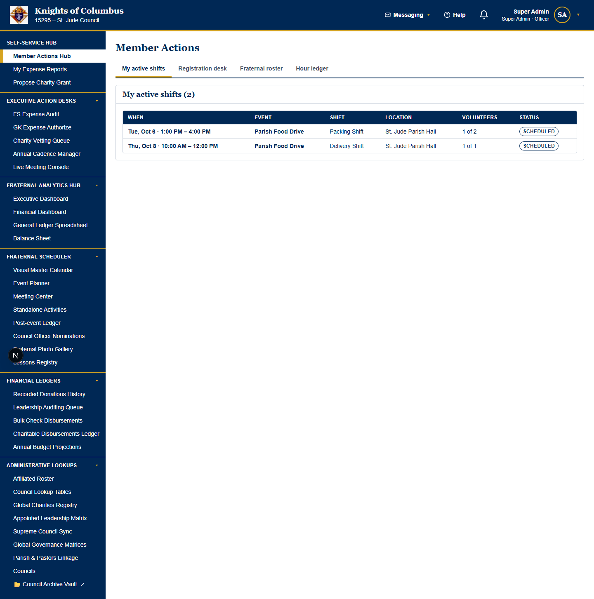
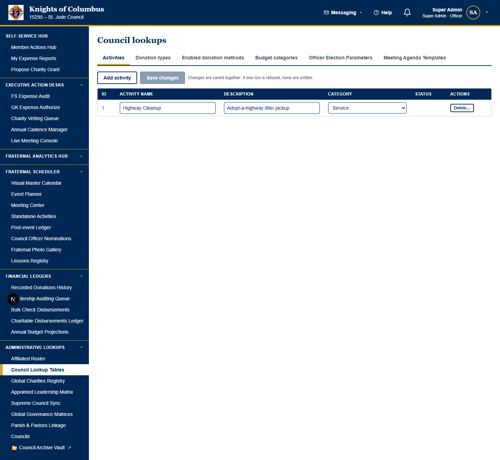
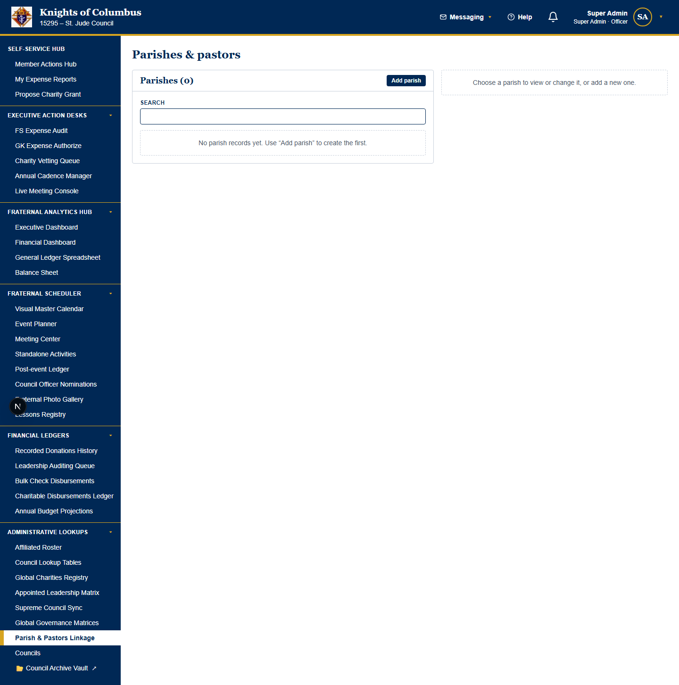
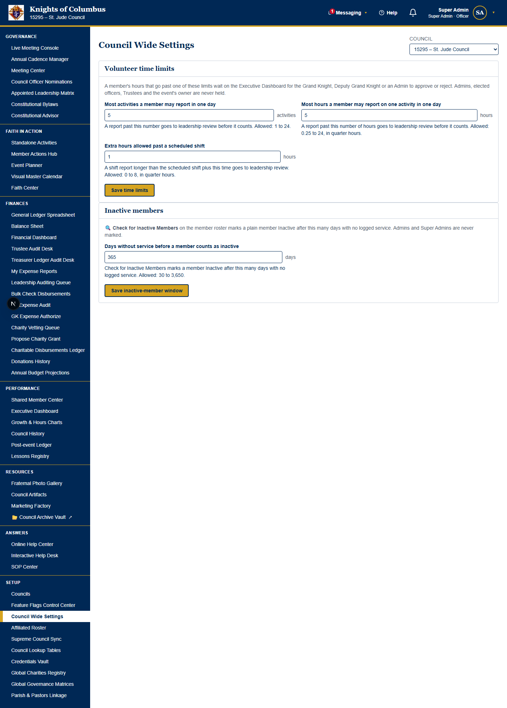

# Fraternal Council Archives™ — Administrator User Guide

**Audience:** council Admins and the pilot facilitator who keeps the council's copy of the platform running.

**Covers:** council system maintenance only: roles and access, lookup tables, the parishes and pastors with the home parish link, service connections, Council Wide Settings, View As Member and remote help, the three local databases, the hub laptop, database resets, network ports, firewall clearance and the software bill of materials.

> **Officer work is in the role manuals.** Payments, ledgers, budgets, meetings and desks are in the [Treasurer Manual](TREASURER_MANUAL.md), the [Financial Secretary Manual](FINANCIAL_SECRETARY_MANUAL.md) and the [Executive Governance Manual](EXECUTIVE_GOVERNANCE_MANUAL.md).
> **Every administrator is also a member.** Signing up, logging hours and taking donations are in the [Member User Guide](MEMBER_USER_GUIDE.md).
> The full access table is in the [Role Permissions Matrix](ROLE_PERMISSIONS_MATRIX.md).
> **Platform work is in the Super Admin System Manual.** Module switches for every council, parent organizations, Global System Parameters, platform settings, council access requests, Admin impersonation and the Super Admin Desk are in the [Super Admin System Manual](SUPER_ADMIN_SYSTEM_MANUAL.md).

> **Numbering and shared tasks:** this manual numbers its own chapters from 1. A task that several officers do is printed word for word in the manual of each of those officers. A reference to a section in another manual names that manual. The [manual map](#manual-map) lists the chapters of all four officer manuals.

---

## Contents

- [1. Roles and access](#1-roles-and-access)
- [2. Module feature flags (moved)](#2-module-feature-flags)
- [3. The Google Drive archive vault](#3-the-google-drive-archive-vault)
- [4. SOP publishing](#4-sop-publishing)
- [5. Lookup tables, service connections and global lists](#5-lookup-tables-service-connections-and-global-lists)
- [6. Data protection rules](#6-data-protection-rules)
- [7. Troubleshooting reference](#7-troubleshooting-reference)
- [8. Council Wide Settings](#8-council-wide-settings)
- [9. View As Member and remote help](#9-view-as-member-and-remote-help)
- [10. Feedback loops](#10-feedback-loops)
- [11. Run a room pilot on the hub laptop](#11-run-a-room-pilot-on-the-hub-laptop)
- [11.3 Build the desktop trial executable](#113-build-the-desktop-trial-executable)
- [12. Reset the database to the seed data](#12-reset-the-database-to-the-seed-data)
- [13. Network addresses, ports and configuration keys](#13-network-addresses-ports-and-configuration-keys)
- [14. Firewall clearance](#14-firewall-clearance)
- [15. The software bill of materials (SBOM)](#15-the-software-bill-of-materials-sbom)
- [16. The Admin Desk](#16-the-admin-desk)
- [17. Regional oversight](#17-regional-oversight)
- [18. Testing and training sandboxes](#18-testing-and-training-sandboxes)
- [Appendix: QR code files](#appendix-qr-code-files)
- [Manual map](#manual-map)

### How to read a tutorial

Every tutorial starts with a **Prerequisite (who can do this)** line. The line states the access privilege that the task needs. Stop when your role is not on the line.

Every tutorial then has five parts: **Goal**, **Start point**, **Steps**, **Expected result** and **Common problems**.
A **Warning** line comes before the steps when the task deletes data, sends messages, posts money or cannot be undone.

---

## 1. Roles and access

### 1.1 Member types and officer roles
A member has one member type. A member may also hold one or more officer roles.

| Member type | Scope |
| --- | --- |
| **Member** | The member's own records and the shared member pages. |
| **Admin** | The Admin's own council only. |
| **Super Admin** | Every council. |

> **Note:** only a Super Admin makes a council Admin. A council Admin adds members of the type **Member** only, and cannot change the member type of another Admin.

| Officer role | Extra access |
| --- | --- |
| **Grand Knight** and **Deputy Grand Knight** | The executive dashboard and the charity vetting desk. Both counter-sign expenses, appoint officers and keep the cadence, the agenda templates, the bylaws, the meeting check-in and the base dues rate. The Deputy Grand Knight (DGK) has the same access as the Grand Knight (GK). |
| **Financial Secretary** | Issues payment requests on expenses. Posts to the general ledger. Pays checks. |
| **Treasurer** | Posts to the general ledger. Pays checks. |
| **Trustee** | Vets charity requests. Follows up on grants after 6 months. |
| **Recorder** | Edits the live agenda. Records hand tallies. |
| Any other seated officer | Reads the dashboards. Schedules meetings. Runs the live console. |

### 1.2 Access rules
- An Admin acts only on the Admin's own council. A Super Admin acts on any council.
- The data service checks every rule. A refused action shows a message and changes nothing.
- Nobody signs or pays an expense report that the same person submitted. The rule includes Super Admins.
- One person never signs both lines of the same expense report.

> **Caution:** finance access follows the role names **Treasurer** and **Financial Secretary**.
> A renamed role removes finance access from the officers who hold the role. Keep both names exactly as written.

<!-- KEEP_IMAGE: member actions hub with the role-filtered sidebar -->

<!-- /KEEP_IMAGE -->

### 1.3 Choose the council
Most management pages have a **Council** selector at the top.

- An Admin sees the Admin's own council.
- A Super Admin may choose any council.

The navy header shows your own council, your name, your member type and your officer status.

- On the **Council Roster**, **Add Member** is disabled while the **Council** list reads **All councils on the platform** or **All: my council and sister councils**. Choose one council first. The new member joins that council.
- In the sidebar, the Finances pillar starts with the two links every member uses: **My Expense Reports** and **Propose Charity Grant**. They always stay at the top, above the accordions. Below them are two separate accordions. **FINANCIAL REPORTS** holds the views that only show information: **Chart of Accounts & GL**, **Balance Sheet**, **Financial Dashboard** and **Annual Budget Center**. **FINANCIAL ACTIONS** holds the desks where officers must act: **Treasurer Ledger Audit**, **FS Expense Audit Queue**, **GK Expense Authorize**, **Trustee Semiannual Audit**, **Disbursed Check Registry**, **Charitable Grants Registry** and **Donations History**. The **Charity Vetting Queue** is in the **Governance** pillar.
- **Financial Inspections** is now **Trustee Semiannual Audit**: the sidebar link, the page title, the Financial Secretary Desk drawer and the module switch.
- A Super Admin has full Admin access on the **Admin Desk** and every one of its drawers. In **Council Wide Settings**, choose the council in the **Council** list. The **Secure Access Vault** drawer shows only your own home council.
- Navigation and headings show plain words only, with no icons, emojis or brackets: sidebar links, the two Finances accordions (**FINANCIAL REPORTS** and **FINANCIAL ACTIONS**), the **Active Desks** folder tabs, desk drawer names, page titles, panel headings, notices, buttons and tabs. Data markers keep their icons: the calendar day markers (the **⚑** needs-volunteers flag, holidays, feast days, birthdays and the **🟥 HOLY DAY OF OBLIGATION** badge) and the member badges (**🆕 New Member** and **📜 Charter Member**, both shown on the roster rows).
- The Faith In Action link **Standalone Activities** is now **Member Activities**. The page title reads **Member Activities**, and its first tab reads **Current Activities**.
- The **Admin Desk** opens from its tab on the **Active Desks** row. The System Settings pillar has no **Admin Desk** link, because the link only opened the same desk again.
- Every Super Admin opens the **Application Advisory Panel** again, and every Super Admin can invite panelists. The platform owner restriction is gone.
- The ledger page is now **General Ledger**. It has no **Financial Dashboard** link and no Equity box (Equity is on the **Balance Sheet**). The FS, the Treasurer and Super Admins add, edit and delete accounts on the page.
- The **Payment QR Codes** card lists only the active payment methods that take a QR code. Cash, Check, card readers, Physical Items and inactive methods have no row.
- The **Secure Access Vault** shows a **Document storage provider** list with only the provider chosen under **File Repository Mode** (8.5), and only that provider's key panel.
- Council 15295 starts with **Expense reporting** and **Charity proposals** off. While a switch is off, its drawers and workflow rows leave every desk.
- The Faith In Action link and the page title read **Motion Request**. The member's own requests are in **My Motion Requests** at the bottom of the page and on the **Member Desk**.
- Sidebar links show plain words only, with no icons and no brackets. A long name ends in "…".
- **Activities** and **Meeting Center** list their rows in full-width tables. Each table has a search box and shows 15 rows per page.
- The sidebar stays in place when you scroll a page. A long sidebar scrolls on its own. The left rail of each desk (the **Admin Desk** drawers and the folder list of each officer desk) also stays in place while the panel on the right scrolls. The open drawer keeps a gold and navy border, so you always see which drawer you work in.
- **Motion Request** has its own module switch, **Motion requests**. It no longer follows **Meeting management**. When the switch is off, the Faith In Action link, the **My Motion Requests** panel on the **Member Desk** and the **Motion Requests** drawer of the **Grand Knight Desk** are hidden. A new council starts with the switch off.
- A council Admin's sidebar no longer repeats the **Admin Desk** drawers. **Council Wide Settings**, **Council Lookups**, **Secure Access Vault**, **Global Charities Registry** and **Council Asset Management** open from the **Admin Desk**. The **Navigation Guide** still lists them. Super Admins keep every link.
- **Historical Chronology** is again **Fraternal Annals & Oral History**: the sidebar link, the page title and the module switch (**[ 📜 Fraternal Annals & Oral History ]**).
- The **'How Do I...' Local Help Search** ranks answers by keyword weight. It ignores filler words such as *how*, *please* and *I want to*, matches word forms (*submitted* finds *submit*) and puts tasks with the keyword in the title first.
- In the Form 1728 popup, the list of every line shows 12 rows (it showed 6). When no suggestion is at least 60% sure, no line is selected. Choose a line before you select **Confirm line and save**. The **Activities** grid of **Council Lookup Tables** shows the Form 1728 line of each row.

---

## 2. Module feature flags

> **Moved to the Super Admin System Manual.** Only a Super Admin switches the modules of a council. The flag table and the **Master Feature Deployment Grid** steps are in chapter 2 of the [Super Admin System Manual](SUPER_ADMIN_SYSTEM_MANUAL.md). A council Admin sees the council's own switches, read-only, on **Council Wide Settings** → **Council Feature Deployment Matrix** (8.2.2).

---

## 3. The Google Drive archive vault

### 3.1 Concept: backend logic of the Drive archive vault
The vault files council documents in the council's shared Google Drive. The vault has one root folder and three sub-folders.

| Folder path | Holds | Filled from | Accepted files |
| --- | --- | --- | --- |
| `Fraternal Enterprise Suite / Minutes` | Meeting minutes | **Meeting Center** → **Upload minutes** | PDF, text, Word |
| `Fraternal Enterprise Suite / Vouchers` | Expense receipts | **My Expense Reports** | PDF, images |
| `Fraternal Enterprise Suite / Media` | Event photos and video | **Fraternal Photo Gallery** | Images, video, PDF |

The vault follows five rules.

1. Only Admin and Super Admin uploads go to the vault.
2. The largest accepted file is 25 MB.
3. The record stores only the Drive file id. The id goes in the record's existing link column.
4. The web server holds the Drive credentials. The browser never sees the credentials.
5. Live uploads are off by default. The server needs four settings to turn uploads on.

| Server setting | Value |
| --- | --- |
| `GOOGLE_DRIVE_CLIENT_EMAIL` | The service account email |
| `GOOGLE_DRIVE_PRIVATE_KEY` | The service account private key |
| `GOOGLE_DRIVE_SHARED_DRIVE_ID` | The shared drive id. The service account must be a Content manager. |
| `DRIVE_VAULT_LIVE` | `1` |

> **Security warning:** the portal has no server-side sessions yet. The upload route cannot confirm that the caller is an Admin.
> Set `DRIVE_VAULT_LIVE=1` only behind an authenticating proxy. Without the four settings, the screen keeps a browser link for the file.

### 3.2 Turn on live Drive uploads
> **Prerequisite (who can do this):** You must be the platform's server operator. A Super Admin approves the change.
> **Warning:** an open upload route lets anyone who reaches the server write files to the shared drive.

**Goal:** Send Admin uploads to the shared Google Drive.

**Start point:** The web server's environment settings.

**Steps:**
1. Create a Google service account.
2. Add the service account to the shared drive as a Content manager.
3. Set `GOOGLE_DRIVE_CLIENT_EMAIL`, `GOOGLE_DRIVE_PRIVATE_KEY` and `GOOGLE_DRIVE_SHARED_DRIVE_ID`.
4. Put the portal behind an authenticating proxy.
5. Set `DRIVE_VAULT_LIVE` to `1`.
6. Restart the web server.

**Expected result:** A new Admin upload creates a file under `Fraternal Enterprise Suite`.

A council can use its own Drive private key instead of the server key. A council Admin saves the key on the **Secure Access Vault** page (5.2).

**Common problems:**
| Problem | Cause | Fix |
| --- | --- | --- |
| Files stay as browser links. | A setting is missing, or `DRIVE_VAULT_LIVE` is not `1`. | Check all four settings. |
| *"… is larger than 25 MB."* | The file is too large. | Compress or split the file. |

---

## 4. SOP publishing

### 4.1 Publish a standard operating procedure
> **Prerequisite (who can do this):** You must be a platform maintainer with write access to the code repository.
> **Warning:** the SOP Center reads the files when the portal is built. A new SOP shows only after a rebuild.

**Goal:** Add a procedure to the **SOP Center**.

**Start point:** The repository folder `docs/sop/`.

**Steps:**
1. Create a Markdown file in `docs/sop/`.
2. Start the file with a `# ` title.
3. Write each task with **Goal**, **Start point**, **Steps**, **Expected result** and **Common problems**.
4. Rebuild the web portal.

**Expected result:** The SOP shows in Sidebar → Answers → **SOP Center**.

**Common problems:**
| Problem | Cause | Fix |
| --- | --- | --- |
| The SOP is missing. | The portal was not rebuilt. | Run the web build again. |
| A test fails. | The SOP lacks a title or one of the five headings. | Add the missing heading. |

The SOP Center holds the full procedure: **Publish a standard operating procedure**.

---

## 5. Lookup tables, service connections and global lists

### 5.1 Keep the council lookup tables
> **Prerequisite (who can do this):** You must be a council Admin or a Super Admin for every tab. The Treasurer and the FS may edit the donation tabs only.
> **Warning:** **Save changes** saves every row together. One refused row saves nothing.

**Goal:** Keep the council's own lists.

**Start point:** Sidebar → System Settings → **Council Lookup Tables**.

**Steps:**
1. Open the tab: **Activities**, **Donation types**, **Enabled donation methods**, **Meeting Agenda Templates** or **Merit Tier Milestones** (5.5).
2. Edit the rows. Each changed row shows **Edited** under its ID.
3. In **Status**, select **Active** or **Inactive**. An **Inactive** row stays for the old records, but members cannot pick it for new hours or new donations.
4. On **Enabled donation methods**, select the **Account**. **Council Account** is the default. The other choices are the rows of the **Account Owners Matrix** (8.6). A **Parish** account shows **(Parish)** and an **Affiliated Entity** account shows **(Affiliated Entity)**. Their gifts are not the council's. They stay off the Treasurer's batch coder.
5. For a QR method, select the **QR code** check box. Select **Upload** and choose the image. A small preview shows the code. The check box is disabled for **Cash**, **Check**, **Credit Card** and **Physical Items**.
6. Select **Save changes**.

<!-- KEEP_IMAGE: council lookup tables capture -->

<!-- /KEEP_IMAGE -->

**Expected result:** The changes save. Phones show the new values on the next load. If **Account Name Members See** is empty, it takes the name of the selected account.

Budget categories are not on this page. Keep them on the **Annual Budget Center** (Sidebar → Finances → **FINANCIAL REPORTS** → **Annual Budget Center**). On **Meeting Agenda Templates**, the **Preview** box under the outline shows the agenda with its formatting while you type.

The outbound email settings are not on this page. Set them on the **Secure Access Vault** page (5.2). The base dues rate is not on this page either. A Super Admin sets the rate (3.2 of the Super Admin System Manual).

**Common problems:**
| Problem | Cause | Fix |
| --- | --- | --- |
| *"Your role cannot maintain this council's lookups."* | You are on another council, or you have no finance role. | Ask a council Admin. |
| A budget category will not delete. | Budget lines use the category. | Move the lines to another category. |

### 5.2 Connect the council email, Google Drive, Microsoft Co-Pilot and receipt reading
> **Prerequisite (who can do this):** You must be a council Admin or a Super Admin to save or remove a connection. Seated officers see the status lines only. Other members do not see the **Secure Access Vault**.
> **Note:** the page opens only your own home council's keys. The portal server refuses any other council's keys with **403 Forbidden**, for Super Admins too.
> **Warning:** **Remove** deletes the saved password or key at once. The council goes back to the portal default.

**Goal:** Connect the council's own mail account, Google Drive, Copilot Studio agent and Azure receipt reader.

**Start point:** Sidebar → System Settings → **Secure Access Vault**.

**Steps:**
1. Read the status lines at the top. A line with is a connection that is on.
2. For email, go to the **Outbound email** panel.
3. Choose the **Email service**. Google Workspace and Microsoft 365 fill in the **Mail server**.
4. Enter the **Sign-in email** and the **Password**. Use an app password if the service asks for one.
5. Select **Save**.
6. For Google Drive, see step 11.
7. For the Microsoft Co-Pilot, paste the Direct Line secret in **Co-Pilot key**. Select **Save**. Copilot Studio shows the secret under Settings → Security → Web channel security.
8. For receipt reading, open the council's Azure Document Intelligence resource in the Azure portal. Go to **Keys and Endpoint**.
9. Paste the endpoint in **Azure endpoint**. Select **Save**. The endpoint looks like `https://name.cognitiveservices.azure.com/`.
10. Paste **KEY 1** in **Azure key**. Select **Save**.
11. For the council's file repository (8.5), read the **Document storage provider** list. It shows only the provider chosen under **File Repository Mode**. Save that provider's key in the panel below it: **Google Drive** (Drive key), **Network file server** (service account password), **OneDrive / SharePoint** (client secret) or **Dropbox Business** (access token). Select **Save**.

**Expected result:** The status line of each saved connection shows . **Receipt reading** shows only when both Azure values are saved. The page never shows a saved password or key again.

**Common problems:**
| Problem | Cause | Fix |
| --- | --- | --- |
| The panels are missing. | You are an officer but not an Admin. | Ask a council Admin. |
| A message about the mail server or the sign-in email shows. | The mail server name or the email is not valid. | Copy both values from your mail service. |
| Saved keys stop working after a server restart. | The server has no fixed vault secret. | Ask the server operator to set `CREDENTIALS_VAULT_SECRET`. Save the keys again. |
| A message says the endpoint must be a cognitiveservices.azure.com address. | The value is not the Azure endpoint. | Copy **Endpoint** from **Keys and Endpoint**. |

### 5.3 Concept: verified charities
A verified charity is a **Global Charities Registry** entry that an Admin trusts. Only verified charities show on the **Propose Charity Grant** form.
On that form, a member selects a **State** and then an **Organization**. The form then fills in the charity's name, mission, mailing address, Employer Identification Number (EIN) and contact details from the registry.
The registry keeps the date of each verification and the Admin who verified the charity.

### 5.4 Verify a charity for the grant form
> **Who can do this:** council Admins and Super Admins. Other members do not see the **Global Charities Registry**.

**Goal:** Let members pick a charity on the **Propose Charity Grant** form, with its details filled in.

**Start point:** Sidebar → System Settings → **Global Charities Registry** → **Search the registry**.

**Steps:**
1. Type the charity's name or EIN in **Name or EIN**.
2. Select **Search**.
3. Check the charity's address, contact and EIN. Correct an empty field when the council pays the charity.
4. In the **Verified** column, select **Verify**.
5. To take a charity off the form, select **Remove verification**.

**Expected result:** The row shows **Verified**. Members see the charity in the **Organization** list for its state.

**Common problems:**
| Problem | Cause | Fix |
| --- | --- | --- |
| The charity is not in the registry. | No council added the charity yet. | Select **Can't find it? Add a new charity**. Then verify the new entry. |
| Members see the charity under the wrong state. | The registry entry has the wrong state. | Ask a Super Admin to correct the entry. |

---

### 5.5 Set the merit tier milestones and the institution date
> **Prerequisite (who can do this):** You must be a council Admin of the council, or a Super Admin. Other members do not see the **Merit Tier Milestones** tab.
> **Note:** the counts start again at 0 every July 1. The tiers count only the current fraternal year (July 1 to June 30).

**Goal:** Set the numbers that give members a merit tier in your council, and the date that marks charter members.

Each member holds the highest tier that the member qualifies for:

| Tier | Name | What the member needs |
| --- | --- | --- |
| 1 | New Member | 180 days or fewer since the **First Degree / Initiation Date**. Fixed. |
| 2 | Active Knight | Hours, events and meetings this year. Default: 1 hour, 1 event, 1 meeting. |
| 3 | Anchor Knight | Default: 20 hours, 4 events, 4 meetings. |
| 4 | Fraternal Champion | Default: 60 hours, 8 events, 8 meetings. |
| 5 | Shining Armor Companion | Meetings, separate events and new members recruited this year. Default: 3 meetings, 3 events, 1 recruit. |
| 6 | Shield Circle / Honorary | The Grand Knight or Deputy Grand Knight seat, or 25 or more years since the join date. Fixed. |

**Locked checkboxes on the member record:** The **📜 Charter Member** and **Shield Circle / Honorary (Tier 6)** checkboxes are locked. You cannot tick them. The portal ticks them from the dates on the record:
- **📜 Charter Member:** the **First Degree / Initiation Date** is on or before the council's institution date + 30 days.
- **Shield Circle / Honorary (Tier 6):** the join date is 25 or more years ago.

To change a checkbox, correct the date. A checkbox that was ticked before the lock stays ticked.

A meeting counts when the member checks in to it. A recruit counts when the recruit's member record names the member in **Recruited by** and the recruit joined in this fraternal year.

**Start point:** **Active Desks** row → **Admin Desk** → **Council Lookup Tables** drawer → **Merit Tier Milestones** tab.

**Steps:**
1. Enter the **Council institution date**: the date of the council's charter.
2. For Tiers 2, 3 and 4, enter the **Hours**, **Events** and **Meetings**. Use whole numbers. A higher tier must not ask for less than the tier below it.
3. For Tier 5, enter the **Meetings**, **Separate events** and **Recruits**.
4. Select **Save milestones**.

**Expected result:** The message **Merit tier milestones saved.** shows. Every member's tier uses the new numbers at once. When a member record or a roster import is saved, a member whose **First Degree / Initiation Date** is on or before the institution date + 30 days gets the **📜 Charter Member** badge.

**Common problems:**
| Problem | Cause | Fix |
| --- | --- | --- |
| The milestones are refused. | A value is not a whole number, or a higher tier asks for less than a lower tier. | Correct the value. |
| A founding member has no **📜 Charter Member** badge. | The institution date or the member's **First Degree / Initiation Date** is empty. | Enter both dates. Save the member record again. |
| The tab is missing. | You are not an Admin of this council. | Ask a council Admin. |

### 5.6 Keep the parishes and pastors, and link the home parish (Parish & Pastors Linkage)
> **Prerequisite (who can do this):** You must be a council Admin of the council, or a Super Admin. Other members can open the page but cannot change it.
> **Note:** the council can link to one parish at a time. When you link a different parish, the old link ends.
> **Warning:** **Link as home parish** adds accounts to the council's General Ledger at once. Unlinking does not remove them.

**Goal:** Keep the council's list of parishes and pastors, assign each pastor to the parishes that the pastor serves, and link the council to its home parish.

**Concept: the parish matrix.** The page keeps three kinds of records:
- **Parishes:** the parishes that your council keeps. The council can keep many parishes.
- **Council pastors:** the pastors that your council keeps. A pastor can serve more than one parish.
- **Pastor assignments:** one line for each pastor and each parish that the pastor serves.

**Concept: the home parish and its ledger accounts.** One parish can be the council's **Home parish**. When you link a parish, the portal adds these accounts to the council's General Ledger in the same step:
- The parish's account owner: an **Asset** account named `Parish - ` and the parish name (for example `Parish - St. Mary's Cathedral Parish`). It is owned by **Parish**. Its **Name members see** is the parish name. Its contact number is the parish phone.
- Two baseline **Asset** accounts under the account owner: `Parish - <parish name> - Electronic Giving` and `Parish - <parish name> - Cash & Check Collections`.

Money in these accounts belongs to the parish. Gifts paid into them stay off the Treasurer's batch coder. The accounts show in the **Account Owners Matrix** (8.6) and on the **Account** list of **Enabled donation methods** (5.1). When you link the same parish again, the portal uses the accounts that are already there. It does not add them twice.

**Start point:** Sidebar → System Settings → **Parish & Pastors Linkage**.

**Steps:**
1. Super Admins: in the council list at the top of the page, select the council.
2. To add a parish, select **Add parish** under **Parishes**. Enter the name, street address, city, state and phone. Select **Save**.
3. To add a pastor, select **Add pastor** under **Council pastors**. Enter the name, phone and email. Select **Save**.
4. In **Parishes**, select the parish row. The parish panel opens under the list.
5. In the parish panel, choose the pastor in **Assign a pastor**. Select **Assign**. Do this step again for each pastor who serves the parish.
6. To end an assignment, select **End assignment** beside the pastor's name.
7. To link the council to the parish, select **Link as home parish**.
8. Read the message. It names the General Ledger accounts that were added, or says that they were already on file.

<!-- KEEP_IMAGE: parishes and pastors capture -->

<!-- /KEEP_IMAGE -->

**Expected result:** The parish row shows the **Home parish** badge. The **Council pastors** list shows the parishes that each pastor serves. The new accounts show in the General Ledger and in the **Account Owners Matrix** with the owner **Parish**.

**Common problems:**
| Problem | Cause | Fix |
| --- | --- | --- |
| *"… is kept by another council …"* | The parish belongs to the list of a different council. | Add the parish to your own council first. Then link it. |
| *"… already has an account named … that is not a parish account."* | A council account has the same name as the parish's account owner. | Rename that account in the **Account Owners Matrix** (8.6). Then select **Link as home parish** again. |
| A parish will not delete. | Pastors are still assigned to it, or it is the home parish. | End each pastor assignment. Select **Unlink home parish**. Then delete the parish. |
| The parish's account owner will not delete from the **Account Owners Matrix**. | The parish record still names the account. | Keep the account. It holds the parish's money history. |
| The assign list says *"Add the pastor under Council pastors first"*. | Every council pastor already serves this parish, or the council has no pastors. | Add the pastor under **Council pastors**. |

## 6. Data protection rules
- **Nothing cascades.** The platform refuses to delete a record that other records use. The message names the record in use.
- Examples: a shift with sign-ups, a member with logged hours, a lookup value in use.
- One exception: a deleted distribution list also deletes the list's member entries.
- **Time windows** protect records. Shift hours and activity hours close after the council's logging window. The default is 90 days (section 8.3).
- **Approved budgets** are frozen for everyone.

---

## 7. Troubleshooting reference
| Symptom or message | Cause | Fix |
| --- | --- | --- |
| A page is missing from the sidebar | Your role has no access, or a feature flag is off. | Check section 1 and section 2. |
| *"…cannot …"* refusal on save | You act outside your council or role. | Switch the **Council** selector, or ask a Super Admin. |
| Delete refused (record in use) | Other records depend on the record. | Clear the dependants first, or keep the record. |
| New member cannot create a password | The setup code expired or the email is wrong. | Select **Send new setup code**. |
| Drive uploads stay as browser links | Live uploads are off. | See 3.2. |
| Other devices cannot reach the hub | The firewall blocks port 3000, or the Wi-Fi is set to Public. | See section 14. |
| *"The hub vault is at database version ..."* | The vault is older than this build. | Archive the vault (section 12.2). |
| Every member is signed out after a restart | `PORTAL_SESSION_SECRET` is not set. | Set the key (section 13). |
| Saved council credentials are gone after a restart | `CREDENTIALS_VAULT_SECRET` is not set. | Set the key (section 13). Enter the credentials again. |
| `npm run build:pilot` stops with `[sbom] ...` | The lockfile is missing or belongs to another project. | Run `npm install` (section 15.2). |
| An officer cannot find a task | Officer tasks are in the role manuals. | Open the manual from the officer's desk header. |

Quick answers are also in **Answers → Online Help Center**. Officer problems are in the Common problems tables of the role manuals.

---

## 8. Council Wide Settings

### 8.1 Concept: council settings
Some numbers belong to one council. A council's Admins keep them here. The numbers that every council shares (the platform settings, the base dues rate and the organization type) belong to the Super Admins and are in chapter 4 of the [Super Admin System Manual](SUPER_ADMIN_SYSTEM_MANUAL.md).

| Kind | Who changes it | Where | What it holds |
| --- | --- | --- | --- |
| Council Wide Settings | The council's Admins and officers, or a Super Admin | Sidebar → System Settings → **Council Wide Settings** | The volunteer time limits, the time windows and the reminder timing of one council. The **Roster Inactivity Sweep** card (council Admins and Super Admins run it). |

A new council starts with the default values. A change applies to the next entry that a member saves. A change never moves hours that are already logged or held.

The time windows and reminder days were fixed numbers in earlier versions. Each council now sets its own numbers.

The page address is `/system-settings/council-settings`. Every administration and setup page sits under the System Settings pillar. An old bookmark to `/setup/council-settings` opens the new address.

### 8.2 Concept: the setting cards and the (i) help
The settings page groups the fields into cards. Each card has a navy title bar and its own save button.

| Page | Cards, in order |
| --- | --- |
| **Council Wide Settings** | **Financial Submissions**, **Volunteer & Meeting Operations**, **Reminder Cadences** |

Each field has a round **(i)** button beside its label. Select **(i)** to open a help window. The help window tells where the number is used and what the number changes. The help window also shows the allowed values. Select **Close**, press **Esc** or select outside the window to close it.

Some fields show a red **Not used yet** tag. The portal saves the number for a future feature. The number changes nothing today. The help window of the field says the same.

<!-- KEEP_IMAGE: council wide settings capture -->

<!-- /KEEP_IMAGE -->

The screenshot above shows the page before the cards were added. The fields and their labels are the same.

### 8.2.1 Concept: the settings drawers
**Council Wide Settings** is a stack of seven drawers. The first drawer is the read-only **Council Instance Record**. The last drawer is **Council Setup**. Select a drawer's title to open or close it. All the drawers are closed when the page opens. More than one drawer can be open at the same time.

A number that you typed but did not save stays in its card when you close the drawer. Save each card before you leave the page.

| Drawer | What the drawer holds |
| --- | --- |
| **Council Instance Record** | Read-only council facts and the database schema version. |
| **Standard Bank Accounts** | The **Account Owners Matrix** (8.6) and the **Payment QR Codes** card (8.8). |
| **User Access & Roster Control** | The **Roster Inactivity Sweep** card. The merit tier milestones are on **Council Lookup Tables** → **Merit Tier Milestones** (5.5). The meeting PIN is on the **Recorder Desk** (and the **Grand Knight Desk** when the Recorder is absent). |
| **System Settings** | The **Financial Submissions**, **Volunteer & Meeting Operations** and **Reminder Cadences** cards (section 8.3), the **File Repository Mode** card (8.5) and the **Custom User Guides** card. |
| **Feature Controls** | The **Shared Equipment Library Sharing** card and the **Module & Platform Switches** links. |
| **Council Feature Deployment Matrix** | The matrix only (section 8.2.2). |
| **Council Setup** | **Run Setup Wizard** (16.4) and the **Practice Sandbox** switch (16.5). Your home council only. |

The page has no **Global Revenue Splits** tab and no **Reference Archives** links. The **Annual Budget Planner** banner is on the **Annual Budget Center** (Sidebar → Finances → **FINANCIAL REPORTS**).

The text in each card wraps inside the card. On a narrow screen, the **Council Feature Deployment Matrix** scrolls sideways. Its columns keep their width, so no column stacks its words one per line.

The page has no links to **Council Lookups** or the **Secure Access Vault**. Open them from the sidebar (System Settings).

The **Council Instance Record** shows the council number and name, the organization type, the district, the EIN, the base dues rate, the email gateway, the date the bylaws were last saved and the database schema version. You cannot change these facts here. Each fact changes on its own page.

### 8.2.2 Concept: the Council Feature Deployment Matrix
The **Council Feature Deployment Matrix** has its own drawer. The matrix shows which advanced capabilities and modules are on for the council. Each row has a status badge.

| Badge | Meaning |
| --- | --- |
| **DEPLOYED** | The capability or module is on for this council. |
| **AVAILABLE / OFF** | The platform has the capability, but this council has it off. |

**Advanced capabilities** rows:

| Row | DEPLOYED when | Where it is switched |
| --- | --- | --- |
| **Cross-Council Shared Asset Libraries** | Loaner library sharing is on. | **Shared Equipment Library Sharing** card, in the **Feature Controls** drawer |
| **Biometric Authentication** | Members may sign in on the phone with Face ID or a fingerprint. This is the default. | The **Turn off** or **Turn on** button in the row (section 8.4.1) |
| **Council Email Gateway** | The council has an outgoing mail server. | **Secure Access Vault** → **Email Gateway** (the link opens the vault) |

**Council modules** rows: one row for each of the nineteen module switches. Council Admins see the status only. A Super Admin changes the switches (chapter 2 of the [Super Admin System Manual](SUPER_ADMIN_SYSTEM_MANUAL.md)).

The card counts the rows that are on, for example *"14 of 17 deployed"*. The matrix changes nothing by itself, except the **Biometric Authentication** button.

### 8.3 Concept: the council settings
**Financial Submissions** card:

| On-screen label | Default | Allowed values | What the setting controls |
| --- | --- | --- | --- |
| **Days after an event or meeting to submit expenses** | 30 days | 1 to 365 | The expense filing window (section 4 of the Executive Governance Manual). A report that names an event or a meeting can be submitted from its first day through this many days after it ends. |
| **Days before an unsubmitted expense draft expires** | 90 days | 7 to 730 | **Not used yet.** Drafts do not expire today. |
| **Days a charity proposal stays open for a vote** | 14 days | 1 to 90 | **Not used yet.** The council votes at the next Monthly meeting at least 10 days away. |

**Volunteer & Meeting Operations** card:

| On-screen label | Default | Allowed values | What the setting controls |
| --- | --- | --- | --- |
| **Most activities a member may report in one day** | 5 | 1 to 24 | The 5-activity rule (section 10.2 of the Executive Governance Manual) |
| **Most hours a member may report on one activity in one day** | 5.0 hours | 0.25 to 24, in quarter hours | The 5.0-hour rule (section 10.2 of the Executive Governance Manual) |
| **Extra hours allowed past a scheduled shift** | 1.0 hour | 0 to 8, in quarter hours | The shift padding rule (section 10.3 of the Executive Governance Manual) |
| **Days without service before a member counts as inactive** | 365 days | 30 to 3,650 | **Check for Inactive Members** (section 3.4 of the Financial Secretary Manual) |
| **Days back a member may log volunteer time** | 90 days | 7 to 730 | The logging window. A member may log shift time and activity time this many days back. |
| **Hours before an event that gate donations open** | 2 hours | 0 to 72, in quarter hours | How long before an event begins the phone's **Collect** screen offers it for gate donations. With 0, an event is offered only once it is under way. Members may still sign up until a shift ends. |
| **Days after a meeting that the minutes are due** | 7 days | 1 to 60 | The **Recorder Desk** counts down to the due date: the meeting's last day plus this number. Minutes not published by then show as overdue. |
| **Days of notice before a special election** | 60 days | 1 to 365 | **Not used yet.** A mid-year nomination stays open for 14 days. |
| **Days before a meeting a motion request must be in** | 5 days | 1 to 60 | An approved motion request goes on the first Monthly meeting at least this many days after the member submits it. |

**Reminder Cadences** card:

| On-screen label | Default | Allowed values | What the setting controls |
| --- | --- | --- | --- |
| **Days after a shift before the first hours reminder** | 5 days | 1 to 60 | The first text reminder to a volunteer with no logged hours (section 8 of the Executive Governance Manual) |
| **Days between follow-up hours reminders** | 7 days | 1 to 60 | The follow-up text reminders (section 8 of the Executive Governance Manual) |
| **Days before an officer is reminded to sign an expense report** | 3 days | 1 to 60 | **Not used yet.** No signature reminder is sent today. |

A value of 0 for **Extra hours allowed past a scheduled shift** sends every report longer than the scheduled shift to review.

The logging window replaces two older limits: 3 months for shift time and 6 months for activity time. A council that wants the old activity limit can enter `183` days.

The logging window also ends the hours reminders. A shift older than the window shows **Closed** on the **Shifts awaiting hours** panel, and the reminders stop.

### 8.4 Change the Council Wide Settings
> **Prerequisite (who can do this):** You must be a council Admin or a council officer of the council, or a Super Admin. Other members do not see this page.

**Goal:** Set your council's volunteer time limits, time windows and reminder timing.

**Start point:** Sidebar → System Settings → **Council Wide Settings**.

**Steps:**
1. Super Admins only: choose the council in **Council** at the top of the page.
2. Open the **System Settings** drawer. Find the card that holds the setting (section 8.3).
3. Optional: select **(i)** beside the field to read what the setting does. Select **Close**.
4. Enter the new number.
5. Select the save button of the card, for example **Save Financial Submissions**.

**Expected result:** A message says "Saved for council" with the council number. The new numbers apply from now on.

**Common problems:**
| Problem | Cause | Fix |
| --- | --- | --- |
| The page is not in the sidebar. | You are not an Admin or an officer of the council. | Ask a council Admin to make the change. |
| A number in another card went back to its old value. | Each card saves only its own fields. | Enter the number again and select the save button of that card. |
| The message says the value "must be a multiple of 0.25 hours". | Hours use 15-minute steps. | Enter a value such as `4.5` or `4.75`. |
| The message says the value must be "from" one number "to" another. | The value is outside the allowed range (section 8.3). | Enter a value inside the range. |
| The message says "Nothing changed." | Every number in the card is the same as the saved value. | Change a number, then save. |
| A field with **Not used yet** has no effect. | No feature reads the number yet. | No fix is needed. Keep the default. |
| You cannot find the cards. | A different tab is selected. | Select the tab that holds the card (section 8.2.1). |

### 8.4.1 Turn biometric sign-in on or off for the council
> **Prerequisite (who can do this):** You must be a council Admin or a council officer of the council, or a Super Admin.

**Goal:** Allow or stop Face ID and fingerprint sign-in on the phones of the council's members.

**Start point:** Sidebar → System Settings → **Council Wide Settings** → **Council Feature Deployment Matrix** drawer.

**Steps:**
1. Super Admins only: choose the council in **Council** at the top of the page.
2. Find the **Biometric Authentication** row.
3. Select **Turn off** to stop biometric sign-in. Select **Turn on** to allow it again.

**Expected result:** The badge changes to **AVAILABLE / OFF** or **DEPLOYED**. While it is off, a phone makes no new biometric key for a member of the council. A key that a phone already holds is deleted at its next use, and the member signs in with the password.

**Common problems:**
| Problem | Cause | Fix |
| --- | --- | --- |
| The row has no button. | You are not an Admin or an officer of the council. | Ask a council Admin to make the change. |
| A member still sees the **Enable FaceID / Biometric Login** switch. | The phone does not know the member's council before the sign-in. | No action. The phone makes no key after the sign-in. |
| A member reads *"Your council has turned off biometric sign-in."* | Biometric sign-in is off for the council. | The member signs in with the password. |

### 8.5 Choose where uploaded files are kept
> **Who can do this:** council Admins and Super Admins. Other readers of the page see the provider only.
> **Warning:** the change applies to new uploads only. Files already uploaded stay with the provider that took them, and their links keep working while that provider's settings and key stay saved.

**Goal:** Send the council's uploads to Google Drive, OneDrive / SharePoint, Dropbox Business or the council's own file server.

**Start point:** Sidebar → System Settings → **Council Wide Settings** → **System Settings** drawer → **File Repository Mode**.

The card shows only the settings of the provider you choose:

| Provider | Settings on the card | Key saved on the Secure Access Vault page |
| --- | --- | --- |
| **Google Drive** | None | **Drive service-account key** (optional) |
| **OneDrive / SharePoint** | **SharePoint Site URL**, **Application (Client) ID** | **Client Secret** |
| **Dropbox Business** | **Team Folder Path** | **Access Token** |
| **Local Network Server** | **Server Network Address (UNC/IP Path)**, **Service Account Username** (optional) | **Service Account Password** (optional) |

**Steps:**
1. Choose the provider in **File Repository Provider**. The card shows that provider's settings and hides all others.
2. Fill in the settings, for example `https://stmarys.sharepoint.com/sites/kofc` for **SharePoint Site URL**, `/KofC Council 15295` for **Team Folder Path** or `\\hall-server\kofc` for **Server Network Address (UNC/IP Path)**.
3. Select **Save file repository**.
4. Select **Open the Secure Access Vault**. Save the provider's key in its panel (5.2).

**Expected result:** The message **Saved. New uploads go to …** names the provider. Receipts, minutes, gallery and meeting photos, oral histories, asset photos and check photos are sent by the portal server to the provider. Nothing is kept on the uploader's computer or phone. A record keeps a portal link to the file, which only signed-in members of the council and Super Admins can open.

**Common problems:**
| Problem | Cause | Fix |
| --- | --- | --- |
| *"Enter the SharePoint site URL …"* | The address is not a `sharepoint.com/sites/…` or `/teams/…` address. | Copy the site address from SharePoint. |
| *"Enter the Application (Client) ID …"* | The ID is not the app registration's GUID. | Copy the **Application (client) ID** from the Azure portal. |
| *"Enter the team folder path, starting with a slash …"* | The Dropbox path does not start with `/`. | Type it like `/KofC Council 15295`. |
| *"Enter the server network address as a UNC path"* | The address does not start with two backslashes, a server and a share. | Type it like `\\hall-server\kofc`. |
| An upload fails with *"The council file repository did not accept the file."* | The provider refused the file, or its key is missing or wrong. | Check the settings and the key saved in the Secure Access Vault. |

### 8.6 Keep the Account Owners Matrix
> **Who can do this:** council Admins and Super Admins.

**Goal:** Record each money account the council uses, who owns it, and who to call about it.

**Start point:** Sidebar → System Settings → **Council Wide Settings** → **Standard Bank Accounts** drawer → **Account Owners Matrix**.

The matrix shows the council's money (Asset) accounts from the chart of accounts. There is no separate list. A row you add here is a new account in the Treasurer's chart.

**Steps:**
1. Select **Add account**.
2. Type the **Ledger account** name, for example `Venmo`.
3. Type the **Name members see**, for example `St. Mary's Knights Venmo`.
4. In **Owned by**, choose **Council**, **Parish** or **Affiliated Entity**. A white-label chapter sees **Internal Operating**, **Parent Organization** or **Affiliated Entity**.
5. Type the **Contact name**, **Contact number** and **Contact email**.
6. Type the account holder's **EIN**, for example `12-3456789`.
7. Select **Save**. To change a row, select **Edit**. To remove it, select **Delete**.

**Expected result:** The row shows in the matrix with its **Owned by** tag. Each council sees only its own rows. A payment method linked to a **Parish** account becomes a **Parish account**. A payment method linked to an **Affiliated Entity** account becomes a **Third-party account**. Gifts paid by either method stay off the Treasurer's batch coder. The account keeps its own **Name members see**.

**Common problems:**
| Problem | Cause | Fix |
| --- | --- | --- |
| *"The council's chart already has an account named …"* | Each ledger name is used once in a council's chart. | Edit the existing row, or choose another name. |
| *"… is still used by a …"* | A payment method, a journal entry or a split still uses the account. | Pick another account on that payment method first. An account with postings stays. |
| *"… is not an email address."* | The contact email is not in name@domain form. | Correct the email. |

### 8.7 Print a council's custom guides
> **Who can do this:** the council's Admins and officers, and Super Admins.

**Goal:** Print a user guide or a role manual with the council's own numbers, and keep a copy in the council's file repository.

**Start point:** Sidebar → System Settings → **Council Wide Settings** → **System Settings** drawer → **Custom User Guides**.

**Steps:**
1. Save any changed card first.
2. Select the guide's button, for example **Generate Custom Treasurer Manual PDF**.
3. Wait a few seconds while the server compiles the PDF.

**Expected result:** The PDF downloads. The server also files a copy in the **Official Manuals** folder of the council's file repository (8.5): Google Drive, OneDrive / SharePoint, Dropbox Business or the Local Network Server. A newer copy of the same guide replaces the older one where the provider allows it. The message names the place, or says why the copy was not filed.

**Common problems:**
| Problem | Cause | Fix |
| --- | --- | --- |
| The message says the copy was not filed. | The repository has no key or location saved, or Google Drive is not connected. | Check **File Repository Mode** (8.5) and the key in the Secure Access Vault. The download still works. |

### 8.8 Upload a payment QR code image
> **Who can do this:** council Admins, the Financial Secretary and the Treasurer, and Super Admins.

**Goal:** Give donors the council's own Venmo, Zelle or Square QR code on the phone.

**Start point:** Sidebar → System Settings → **Council Wide Settings** → **Standard Bank Accounts** drawer → **Payment QR Codes**.

**Steps:**
1. Find the payment method's row, for example **Venmo**. Only active methods that take a QR code have a row.
2. Drag the QR code image onto **Upload QR Code Image**, or click the box and choose the image (PNG, JPEG or WebP, up to 5 MB).
3. Wait for the message.

**Expected result:** The new code shows in the row. The phone's collection screen shows it to donors. Before an upload, a row shows the sample code that comes with the portal, marked **Sample code**. The image is kept in the council's file repository, or on the portal server for a Google Drive council.

**Common problems:**
| Problem | Cause | Fix |
| --- | --- | --- |
| *"Upload the QR code as a PNG, JPEG or WebP image."* | The file is another type. | Save the code as a PNG or JPEG image. |
| The method is not in the list. | The method is not enabled, is set to Inactive, or takes no QR code (Cash, Check, card readers, Physical Items). | Enable it and set it to Active on **Council Lookup Tables** → **Enabled donation methods** (5.1). |

## 9. View As Member and remote help

### 9.1 See what a member of your council sees (View As Member)
> **Who can do this:** council Admins and Super Admins, for members of their own council only.

**Goal:** Check which pages and desks one member of your council gets, without signing in as the member.

**Start point:** Sidebar → System Settings → **View As Member**.

**Steps:**
1. Type part of the member's name or number in **Search by name or number**.
2. Select the member in **Members of your council**.
3. Read **Their sidebar**, **Their Active Desks** and **Their coming shifts**.

**Expected result:** A read-only picture of the member's portal shows. You stay signed in as yourself. Nothing on the page changes the member's account.

**Common problems:**
| Problem | Cause | Fix |
| --- | --- | --- |
| A member of another council is not in the list. | **View As Member** shows only the members whose council matches your own council. | Ask that council's Admin. |
| The message says "View As Member shows only members of your own council." | The member belongs to another council. | Ask that council's Admin. |
| A Super Admin of your council is not in the list. | A council Admin never sees a Super Admin's account. | No fix is needed. |

### 9.2 Concept: co-watching remote assistance
An officer or Admin who needs help can share a copy of the screen with the Super Admins. The officer starts and stops the sharing. Nothing is shared until the officer selects **Share my screen**.

- The copy refreshes every 5 seconds while the officer shares.
- The copy never contains what the officer types in form fields. Passwords are never sent.
- The copy cannot run on the Super Admin's computer. The desk shows the copy as a still picture of the page.
- Sharing stops when the officer selects **Stop sharing**, when a Super Admin closes the request, or after 30 minutes without an update.

### 9.3 Ask for remote help
> **Who can do this:** Officers and Admins. Members and Super Admins do not see the button.

**Goal:** Let a Super Admin see your screen while you get help.

**Start point:** The portal header → **Request Remote Officer Assistance**.

**Steps:**
1. Select **Request Remote Officer Assistance**.
2. Enter what you need in **What do you need help with? (optional)**.
3. Select **Share my screen**.
4. Go to the page you need help with. The Super Admin sees each page you open.
5. Select **Stop sharing** when you finish.

**Expected result:** The header button turns red and says **● Sharing screen · Stop sharing**. After **Stop sharing**, the button goes back to **Request Remote Officer Assistance**.

**Common problems:**
| Problem | Cause | Fix |
| --- | --- | --- |
| The request fails with a session message. | Your server session ended. | Sign out, then sign in again. |
| The red button changed back by itself. | A Super Admin closed the request, or 30 minutes passed. | Send a new request if you still need help. |

## 10. Feedback loops

### 10.1 Concept: the Administrative Feedback Loops
Feedback travels in two steps:

| Step | Who writes | Where | Who answers |
| --- | --- | --- | --- |
| 1. Member feedback | Any member | Sidebar → Answers → **Feedback Support**, or the **Feedback Support** drawer of the **Member Desk** | The council's Admins, in the **Member Feedback Queue** drawer of the **Admin Desk** (10.3) |
| 2. Platform feedback | Council Admins | The **Administrative Feedback Loops** drawer of the **Admin Desk** | The platform owner |

Each member ticket has a ticket number and its own chat log. Only the member and the council's Admins (and Super Admins) read it. A ticket never shows in the Communications Hub.
Only sessions with Admin clearance or higher see **Administrative Feedback Loops**. A member, an officer without Admin rights and a phone user do not see it.

### 10.2 Send a note to the platform owner
> **Who can do this:** council Admins and Super Admins. Other members do not see this page.

**Goal:** Report a problem or ask for a change to the platform.

**Start point:** **Active Desks** row → **Admin Desk** → **Administrative Feedback Loops** drawer → **Send a Note to the Platform Owner**. A council Admin's sidebar has no link to the page: the drawer holds it.

**Steps:**
1. Check your name, council, phone and email. Change these details in **My Profile**.
2. Describe the problem in **What happened, or what would help?** Use up to 2,000 characters.
3. Select **Send note**.

**Expected result:** The message *"Thank you. Your note was sent to the platform owner."* shows.

**Common problems:**
| Problem | Cause | Fix |
| --- | --- | --- |
| The drawer is not on your desk. | Your member type is not Admin or Super Admin. | Ask your council's Admin to send the note. |

### 10.3 Answer member feedback (Member Feedback Queue)
> **Who can do this:** the council's Admins and Super Admins. An Admin reads only the tickets of the Admin's own council.

**Goal:** Read, answer and close the feedback tickets that the council's members send.

**Start point:** **Active Desks** row → **Admin Desk** → **Member Feedback Queue** drawer.

**Steps:**
1. Read the ticket table. **Open** tickets are first and have a red edge. Then **In Progress**, then **Resolved**.
2. Optional: choose a status in **Show** to see only those tickets.
3. Select **Chat log** on a row. The ticket's chat log opens in a drawer on the right.
4. Type your answer in **Reply**. Select **Send**.
5. To change the status, choose it in **Change the status (Admins)**. Your reply, if any, is saved as the note on the change. Select **Send**.
6. Optional: change the status directly in the **Status** list of the row.

**Expected result:** The member sees your reply and the new status on the ticket's history card.

**Common problems:**
| Problem | Cause | Fix |
| --- | --- | --- |
| The message says the reader may not read the council's feedback tickets. | Your account is not an Admin of this council. | Sign in with an Admin account of the council. |
| A ticket is not in the table. | The member belongs to another council. | Ask that council's Admin. |

### 10.4 Use the Application Advisory Panel
> **Who can do this:** Super Admins and the members of any council who hold the **Application Advisory Panelist** role.

**Goal:** Share the roadmap and the coming releases with the advisory panel, set its meeting dates and read its feedback.

**Start point:** Sidebar → **Application Advisory Panel** (under **Navigation Guide**).

The panel has five views:

| View | What it holds |
| --- | --- |
| **Development Roadmap** | Platform phases, a status and a target date for each item. |
| **Future Feature List** | Ranked feature list. Super Admins edit it. Panelists submit ideas, rate and comment. |
| **Platform Calendar** | Scheduled releases, advisory meetings and pilot milestones, by date. |
| **Panel Meeting Dates** | The panel's meetings. Super Admins add, edit and delete them. |
| **Consultation Feedback** | The notes panelists send. Every panelist and Super Admin reads them. |

**Steps:**
1. Select a view.
2. To add a meeting, select **Add meeting** on **Panel Meeting Dates**. Enter the date and the title. Select **Save meeting**.
3. To send feedback, open **Consultation Feedback**. Type the **Topic** and **Your feedback**. Select **Send feedback**.
4. To add a panelist (Super Admins), choose the **Council** and the **Member** under **Panelists**. Select **Add panelist**.
5. To submit a feature idea, open **Future Feature List**. Select **Submit idea**. Type the feature. Select **Submit idea**. The idea shows with the status **Idea**.
6. To rate an entry, select a number from 1 (low) to 5 (high) beside **Your rating**. Select another number to change your rating.
7. To comment on an entry, select **Comments**. Type the **Review comment**. Select **Post**.
8. To add or edit an entry (Super Admins), select **Add entry** or **Edit**. Enter the feature, the target date, the status and the notes. Select **Save entry**. On an empty list, select **Load starter list** to add the starter entries.

The list sorts by priority rank. The rank comes from the average of all panelist ratings. Rank 1 is the highest priority. Entries with no rating come last.
5. To invite a member of any council (Super Admins), select **Invite Panelist**. Choose the **Council** and the **Member**. Select **Post invitation**. No email is sent: the invitation card appears on the member's alert bell and **Home**, and on their phone's **Home**. It stays open for 14 days.
6. The invited member selects **Accept** on the card. The member becomes a panelist at once, and **Application Advisory Panel** appears in the sidebar.

**Expected result:** The meeting shows in the list. The feedback shows at the top of **Feedback received**. A panelist added under **Panelists** sees the panel after the next sign-in; a member who selects **Accept** on an invitation sees it at once.

**Common problems:**
| Problem | Cause | Fix |
| --- | --- | --- |
| The sidebar has no **Application Advisory Panel** link. | You are not a panelist or a Super Admin, or you signed in before you were added. | Ask a Super Admin. Sign out and sign in again. |
| **Add meeting** is missing. | Only Super Admins keep the meeting dates. | Ask a Super Admin. |
| *"This invitation is older than 14 days."* | The invitation expired. | Ask the platform owner for a new invitation. |
| An alert cannot use the title **Advisory Panel invitation**. | The title is reserved for invitations. | Choose another title for the alert. |

## 11. Run a room pilot on the hub laptop

### Concept: the hub laptop and the vault
In a room pilot, one laptop is the hub. The hub holds the council's data in one file on its disk:
`packages/backend/data/central-hub-vault.db`. This file is the vault.

Every other laptop and phone on the room Wi-Fi works on the vault. No device keeps its own copy. A record saved on one device is on every device at once.

The vault keeps every record from every session:
- donations, expense reports, hours and charity requests;
- meeting logs, check-ins and ballots;
- check photos. The photos are kept in a `photos` folder beside the vault.

The vault never clears itself. A restart of the hub laptop keeps every record that was saved before the restart.

The pilot scripts use seeded records, for example report 21 at the Financial Secretary's gate. After a session, those records are already worked. Start each scripted rehearsal on a fresh vault. The command `npm run hub:archive` moves the old vault into an `archive` folder. It deletes nothing.

| Command | What it does |
| --- | --- |
| `npm run build:pilot` | Builds the web portal as the hub. |
| `npm run dev:pilot` | Starts the hub. It prints the portal address, for example `http://10.0.0.167:3000`. A fresh vault pulls council 15295 from the simulated central database (11.1.1). |
| `npm run dev:pilot -- --council <number>` | Starts the hub. A fresh vault pulls the named council instead. |
| `npm run dev:pilot -- --no-sync` | Starts the hub. A fresh vault holds the seed data only. |
| `npm run dev:mobile:pilot` | Starts the phone app server. The phones work on the hub. |
| `npm run hub:archive` | Moves the vault into `packages/backend/data/archive`. The next start makes a fresh vault. |

### 11.1 Start the hub before a pilot session
> **Who can do this:** the pilot facilitator, on the hub laptop. Other members do not do this task.

**Goal:** Start the hub, so that every laptop and phone works on the vault.

**Start point:** The hub laptop → a terminal in the project folder.

**Steps:**
1. Connect the hub laptop to the room Wi-Fi.
2. Run `npm run build:pilot`. Wait for the build to finish.
3. To start the scripted rehearsal on fresh records, run `npm run hub:archive`.
4. Run `npm run dev:pilot`. Keep this terminal open.
5. Read the line `[pilot] Hub mode: every device works on packages/backend/data/central-hub-vault.db.` Write down the portal address on that line.
6. On a fresh vault, read the line `[pilot] Live data: council 15295 ...`. The line counts the members, the hour entries and the switches that the hub pulled in (11.1.1).
7. In a second terminal, run `npm run dev:mobile:pilot`. Keep this terminal open.
8. On each laptop, open the portal address in the browser. Sign in.
9. On each phone, scan the QR code in the second terminal with Expo Go. Sign in.

**Expected result:** Every device shows the same records. A donation recorded on a phone shows on the Treasurer's laptop after the page reloads.

**Common problems:**
| Problem | Cause | Fix |
| --- | --- | --- |
| The terminal shows `WARNING: not a hub build`. | The portal was built with `npm run build:web`. | Stop the hub. Run `npm run build:pilot`. Run `npm run dev:pilot` again. |
| A device shows *"The pilot hub laptop cannot be reached."* | The device is not on the room Wi-Fi, or the hub is stopped. | Connect the device to the room Wi-Fi. Check that `npm run dev:pilot` runs. |
| The phone app cannot sign in. | The phone server has the wrong hub address. | Stop `npm run dev:mobile:pilot`. Run `npm run dev:mobile:pilot -- --hub http://<hub address>:3000`. |
| The hub stops with *"The hub vault is at database version ..."*. | The vault is from an older version of the platform. | Run `npm run hub:archive`. Start the hub again. The old vault stays in the archive folder. |
| Windows asks if Node.js can use the network. | The firewall protects the laptop. | Allow access on private networks. |
| The terminal shows `[pilot] No sync receipt`. | The vault was there before the start. The hub never syncs over a vault. Or the handshake failed. | To pull live data, stop the hub, run `npm run hub:archive`, and start the hub again. If the line stays, read the `[hub]` line in the terminal. |
| The terminal shows `--council needs a council number`. | The value after `--council` is not a number. | Type the council number, for example `npm run dev:pilot -- --council 15295`. |

### 11.1.1 Concept: the live data handshake
- The simulated central database is one file, `packages/backend/data/simulated-central.db`. It holds every council. It stands in for the production database until the production connection is ready.
- The hub makes the central file from the seed data the first time it needs the file. After that, the hub keeps the file. `npm run hub:archive` does not move it. Changes in the central file go into the next fresh vault.
- When `npm run dev:pilot` makes a fresh vault, the hub pulls one council from the central file: the roster, the logged event and activity hours, the module switches, and the parent organization.
- The hub adds members that the vault does not have and refreshes the members that it has. It deletes nothing. The seven `@stmarys.org` pilot personas stay as the seed made them, so the pilot scripts still work.
- The hub never syncs over a vault that is already there. To pull again, archive the vault first.
- The charts, the merit badges, the leaderboard and the Admin Desk read the vault rows, so they show the synced data. When the parent organization is `KofC`, the Form 1728 popups show. When it is `SECULAR_CHARITY`, the screens show the organization matrices instead.
- The hub keeps a receipt of the handshake beside the vault: `hub-sync-receipt.json`.

### 11.2 Keep or archive the vault after a session
> **Who can do this:** the pilot facilitator, on the hub laptop. Other members do not do this task.
> **Warning:** do not delete or move the vault file by hand. Use `npm run hub:archive`. A vault that you delete cannot be recovered.

**Goal:** Keep the records for the next session, or put them aside for a fresh rehearsal.

**Start point:** The hub laptop → the terminal that runs `npm run dev:pilot`.

**Steps:**
1. Press Ctrl+C in the terminal that runs `npm run dev:pilot`. The hub stops. Every saved record stays in the vault.
2. To keep adding to the same records next session, do nothing more. The next `npm run dev:pilot` opens the same vault.
3. To start the next rehearsal on fresh records, run `npm run hub:archive`.

**Expected result:** With step 2, the next session shows every record from this session. With step 3, the terminal shows `[hub] Archived the vault to ...`. The next session starts from the seeded records.

**Common problems:**
| Problem | Cause | Fix |
| --- | --- | --- |
| `hub:archive` shows *"The hub is running."* | The hub holds the vault file open. | Stop `npm run dev:pilot` with Ctrl+C. Run `npm run hub:archive` again. |
| You need a record from an archived session. | The archive keeps the old vault as a file. | Ask the developer to open the vault file in the dated folder under `packages/backend/data/archive`. |
| The hub stops with *"The hub vault is at database version 98, but this build needs version 99 …"* | A new release changed the tables. The hub never rebuilds the vault. | Stop the hub. Run `npm run hub:archive`. Start the hub again. |

### 11.3 Build the desktop trial executable
> **Who can do this:** the developer or the pilot facilitator, on a Windows computer with the project folder. Other members do not do this task.

**Goal:** Make one program file that runs the full portal on a computer with no network and no Node.js.

**Start point:** A terminal in the project folder.

**Steps:**
1. Run `npm install` once, so that Electron and electron-builder are on the computer.
2. Run `npm run build:exe`. The build does five steps: the type checks, the schema check, the portal build, the asset copy and the packaging. A failed step stops the build.
3. Wait for the line `[build:exe] done: see dist-desktop/`.
4. Copy `dist-desktop\KofC-Tracking-Platform-1.0.0-portable.exe` to the trial computer.
5. On the trial computer, open the file. Sign in with a pilot persona.

**Expected result:** The portal opens in its own window. The records stay in the vault of that computer after the program closes.

> **Note:** the program file is compact. The build packs the file with maximum compression. The build keeps only the US English language pack of the window shell. The build leaves out source maps, build caches and test tool folders. The portal does not use these files when it runs.

**Common problems:**
| Problem | Cause | Fix |
| --- | --- | --- |
| Windows shows *"Windows protected your PC"*. | The file has no code-signing certificate. | Select **More info**, then **Run anyway**. |
| The program shows *"The portal stopped unexpectedly"*. | The portal server stopped. | Read `portal.log` in `%APPDATA%\kofc-tracking-platform`. Send the file to the developer. |
| The sign-in page asks for a code, but no code arrives. | The phone number on file is not a cell phone, or the provider refused the message. | Select **Start over** and sign in again. If no code arrives, ask a Super Admin to check the phone number on your record. |
| The program shows *"This version needs a new database"*. | The program file is newer than the records on this computer. | Select **Start a new database**. The old records stay in a `vault-archive-...` folder in `%APPDATA%\kofc-tracking-platform`. To keep working on the old records, select **Quit** and use the older program file. |
| The build stops at step 1 or step 2. | A type error, or the generated database files do not match `Schema.sql`. | Fix the error. For step 2, run `node scripts/gen-db-assets.mjs`. Run the build again. |

> **Note:** after `npm run build:exe`, run `npm run build:web` or `npm run build:pilot` again before you use `npm run dev:pilot`. The desktop build replaces the normal portal build.

---

## 12. Reset the database to the seed data

### 12.1 Concept: where the records live
The platform has three kinds of build. Each kind keeps its records in a different place.

| Build | Command | Where the records live | What resets them |
| --- | --- | --- | --- |
| Demo portal | `npm run build:web` | In each browser tab. Each tab has its own copy. | A reload of the tab (F5). |
| Room pilot hub | `npm run build:pilot` | In one vault file on the hub laptop: `packages/backend/data/central-hub-vault.db`. | `npm run hub:archive` (section 12.2). |
| Production | `NEXT_PUBLIC_DATA_DRIVER=remote` | In the council's Azure SQL database. | Never from the platform. Ask the database owner. |
| Desktop trial executable | `npm run build:exe` | In one vault file on each trial computer: `%APPDATA%\kofc-tracking-platform\vault\central-hub-vault.db`. | Close the program. Delete the `vault` folder. The next start makes a fresh vault. |

Every new database starts from two files: `Schema.sql` makes the tables, and `Seed.sql` adds the seed records. The seed records include the pilot personas and the scripted records of the pilot kit.

The database version is 110. A hub vault made by an older version is refused at start (section 11.2).

### 12.2 Reset the hub vault to the seed data
> **Who can do this:** the pilot facilitator, on the hub laptop. Other members do not do this task.
> **Warning:** the next session starts without the records of every earlier session. The old vault stays in the archive folder.

**Goal:** Start the next pilot session on a fresh vault made from `Seed.sql`.

**Start point:** The hub laptop → a terminal in the project folder.

**Steps:**
1. Press Ctrl+C in the terminal that runs `npm run dev:pilot`. The hub stops.
2. Run `npm run hub:archive`.
3. Read the line `[hub] Archived the vault to ...`. Write down the folder name.
4. Run `npm run dev:pilot`. The hub makes a fresh vault from the seed data.

**Expected result:** Seeded records show again in their first state, for example report 21 at the Financial Secretary's gate.

**Common problems:**
| Problem | Cause | Fix |
| --- | --- | --- |
| `hub:archive` shows *"The hub is running."* | The hub holds the vault file open. | Stop `npm run dev:pilot`. Run `npm run hub:archive` again. |
| `hub:archive` shows *"No vault in ..."*. | The vault was archived before, or the hub never started. | No action. The next `npm run dev:pilot` makes a fresh vault. |

### 12.3 Rebuild the seed files after a change to Seed.sql
> **Who can do this:** a platform maintainer with write access to the code repository.

**Goal:** Make the portal and the phone app use the changed seed records.

**Start point:** The developer laptop → a terminal in the project folder.

**Steps:**
1. Save the change to `Schema.sql` or `Seed.sql`.
2. Run `npm run gen:db --workspace=apps/web`. The command writes the seed files of the portal and the phone app.
3. Run `npm run gen:db:check --workspace=apps/web`. The command must end without an error.
4. Run `npm test`.
5. On a hub laptop, reset the vault (section 12.2).

**Expected result:** A reloaded demo tab and a fresh hub vault show the changed seed records.

**Common problems:**
| Problem | Cause | Fix |
| --- | --- | --- |
| `gen:db` stops on a statement. | The generator reads only the statement kinds it knows. A foreign key points at a missing table or column. | Correct the statement that the message names. Run `gen:db` again. |
| `gen:db:check` exits with an error. | The seed files are older than `Seed.sql`. | Run `npm run gen:db --workspace=apps/web`. |

---

## 13. Network addresses, ports and configuration keys

### 13.1 Concept: the 0.0.0.0 address
`npm run dev:pilot` serves the portal on the address `0.0.0.0`, port `3000`. The address `0.0.0.0` means every network address of the hub laptop. Laptops and phones on the room Wi-Fi reach the portal at `http://<hub laptop address>:3000`.

Use `npm run dev:pilot` for every pilot. `npm run dev:web` is the developer server of the demo portal. It is not a pilot hub.

| Port | Program | Opened by | Reached by |
| --- | --- | --- | --- |
| TCP `3000` | The web portal (Node.js) | `npm run dev:pilot` (`next start -H 0.0.0.0 -p 3000`) | Every laptop and phone of the pilot |
| TCP `8081` | The phone app bundler (Expo, Node.js) | `npm run dev:mobile:pilot` | The phones in Expo Go |

### 13.2 Concept: the configuration keys
The launchers set most keys. Set the other keys in the terminal or in `.env`. Never commit `.env` to the repository.

| Key | Set by | What it does |
| --- | --- | --- |
| `NEXT_PUBLIC_DATA_DRIVER` | `npm run build:pilot` sets `hub` | Chooses where the records live: `memory` (default), `hub` or `remote`. The value is fixed at build time. |
| `PORTAL_ALLOW_HTTP_COOKIES` | `npm run dev:pilot` sets `1` | Lets the session cookie travel over plain `http` on the room Wi-Fi. Never set it on a server that the internet can reach. |
| `HUB_VAULT_DIR` | You, when needed | Moves the vault folder away from `packages/backend/data`. `npm run hub:archive` uses the same folder. |
| `PILOT_SYNC_COUNCIL` | `npm run dev:pilot` sets `15295`, or the `--council` number | The council that a fresh vault pulls from the simulated central database (11.1.1). Without it, a fresh vault holds the seed data only. |
| `PILOT_CENTRAL_DIR` | You, when needed | Moves the simulated central database away from the vault folder. |
| `HUB_URL` | You, when needed | The hub address for `npm run dev:mobile:pilot`, the same as `--hub http://<address>:3000`. |
| `EXPO_PUBLIC_DATA_DRIVER`, `EXPO_PUBLIC_HUB_URL` | `npm run dev:mobile:pilot` | Point the phone app at the hub. |
| `PORTAL_SESSION_SECRET` | You | Signs the session cookies. Use 32 characters or more. Without the key, every session ends when the server restarts. |
| `CALENDAR_FEED_SECRET` | You, optional | Signs the personal calendar feed links. Without the key, the session key signs them. A change breaks every subscribed link. |
| `CREDENTIALS_VAULT_SECRET` | You | Seals the saved council credentials. Without the key, every saved credential must be entered again after a restart. |
| `FORM_1295_PYTHON` | You, optional | The Python program for the PDF reports and the custom guides. The default is `py` on Windows and `python3` elsewhere. |
| `TWILIO_ACCOUNT_SID`, `TWILIO_AUTH_TOKEN`, `TWILIO_FROM_NUMBER` | You, optional | Send sign-in codes by text message. All three are necessary. With them, Admins and Super Admins type a code at each password sign-in. |
| `SENDGRID_API_KEY`, `SENDGRID_LIVE` | You, optional | Send email through SendGrid (`SENDGRID_LIVE=1`). Sign-in codes go by email when no text can be sent. Platform notices always come from `tim@fairmissionsoftware.com`. |
| `TWO_FACTOR_REQUIRED` | You, optional | Set `1` to ask **every** member, officer and admin for a sign-in code at each password sign-in. Without it, only Admins and Super Admins type a code. The switch needs the Twilio keys or the SendGrid keys (13.2.1). |

### 13.2.1 Concept: sign-in codes and the universal switch
- **Switch off (default):** the code step applies to **Admin** and **Super Admin** accounts only. Other members sign in with a password.
- **Switch on (`TWO_FACTOR_REQUIRED=1`):** the code step applies to every account: members, officers, Admins and Super Admins. Restart the portal server after you change the switch.
- The step is on only when the server holds the Twilio keys or the SendGrid keys in the table above. When the switch is on and the server has no keys, sign-in has one step and the server log shows a warning. A missing key never locks out the platform.
- When the switch is on, the server has keys, and a member has no valid cell phone or email on file, the portal refuses that member's sign-in. The member reads *"Ask your council admin to add your cell phone."* Add the cell phone on the **Council Roster** page.
- The code goes by text message to the phone on file. When the server has no Twilio keys, or the phone number is not valid, the code goes by email to the address on file.
- A code has 6 digits. It expires after 5 minutes. After 5 wrong codes, the member must sign in again for a new code.
- **1-tap fill:** on iPhone, iPad and Android, the texted code shows above the keyboard. The member taps it once to fill the box.
- **Sign in with FaceID** (web passkey) and the phone's Face ID or fingerprint sign-in do not ask for a code. The passkey or the phone key is the second step.
- A phone that works on the hub laptop asks for the code. A phone that keeps its own records signs in on the phone itself and does not ask for a code, because the code keys stay on the server.
- The **Secure Access Vault** shows the switch in the **Two-Factor Authentication: delivery channels** card.

### 13.2.2 Concept: which address sends the mail
| Mail | Sent from | Through |
| --- | --- | --- |
| Platform notices (council access requests) and sign-in codes | `tim@fairmissionsoftware.com` | SendGrid |
| Council mail (welcome email, password reset) | The council's own address | The council's mail server in the **Secure Access Vault**, when it is connected |

The portal refuses council mail that names `tim@fairmissionsoftware.com` as the sender. Only a Super Admin may send from that address.

### 13.3 Find the hub laptop address
> **Who can do this:** the pilot facilitator, on the hub laptop.

**Goal:** Know the address that every device of the pilot opens.

**Start point:** The hub laptop → the terminal that runs `npm run dev:pilot`.

**Steps:**
1. Read the line `[pilot] Hub mode: every device works on ... Portal: http://<address>:3000`.
2. If the line does not show, open a second terminal. Run `ipconfig`.
3. Read the **IPv4 Address** of the Wi-Fi adapter, for example `10.0.0.167`.

**Expected result:** A laptop on the room Wi-Fi opens `http://<address>:3000` and shows the sign-in page.

**Common problems:**
| Problem | Cause | Fix |
| --- | --- | --- |
| The address starts with `169.254`. | The laptop has no Wi-Fi connection. | Connect the hub laptop to the room Wi-Fi. Read the address again. |
| The address changes between sessions. | The Wi-Fi router gives a new address at each connection. | Read the address at the start of each session, or ask the router owner for a fixed address. |

---

## 14. Firewall clearance

### 14.1 Concept: why the firewall blocks the pilot
Windows Defender Firewall blocks connections from other devices by default. The pilot needs two connections into the hub laptop: TCP port `3000` for the portal and TCP port `8081` for the phone bundler.

Allow the ports on **Private** networks only. Never allow them on **Public** networks, for example the Wi-Fi of a café or a hotel.

### 14.2 Clear the pilot ports in Windows Defender Firewall
> **Who can do this:** the pilot facilitator, with an administrator account on the hub laptop.
> **Warning:** the rule opens the ports to every device on private networks. Remove the rules after the pilot (step 5).

**Goal:** Let the laptops and phones of the pilot reach the hub laptop.

**Start point:** The hub laptop → **Start** → **Windows PowerShell** → **Run as administrator**.

**Steps:**
1. Set the room Wi-Fi to **Private**: **Settings** → **Network & internet** → **Wi-Fi** → the network → **Private network**.
2. Run `New-NetFirewallRule -DisplayName "KofC pilot portal" -Direction Inbound -Protocol TCP -LocalPort 3000 -Profile Private -Action Allow`.
3. Run `New-NetFirewallRule -DisplayName "KofC pilot phone bundler" -Direction Inbound -Protocol TCP -LocalPort 8081 -Profile Private -Action Allow`.
4. When Windows asks if Node.js can use the network, select **Private networks** only. Select **Allow access**.
5. After the pilot, run `Remove-NetFirewallRule -DisplayName "KofC pilot portal","KofC pilot phone bundler"`.

**Expected result:** A phone on the room Wi-Fi opens `http://<hub laptop address>:3000` and shows the sign-in page.

**Common problems:**
| Problem | Cause | Fix |
| --- | --- | --- |
| `New-NetFirewallRule` shows *"Access is denied"*. | PowerShell does not run as administrator. | Close PowerShell. Open it again with **Run as administrator**. |
| A device still cannot reach the portal. | The room Wi-Fi is set to **Public**. | Do step 1 again. |
| A device still cannot reach the portal. | The Wi-Fi isolates the devices from each other (guest Wi-Fi). | Use a Wi-Fi network without client isolation, or a phone hotspot. |
| Another security program blocks the ports. | The laptop has a second firewall. | Allow TCP `3000` and `8081` on the private network in that program too. |

---

## 15. The software bill of materials (SBOM)

### 15.1 Concept: the SBOM file
A software bill of materials (SBOM) lists every software package that a build contains. Auditors use the list to check licenses and known security problems.

`npm run build:pilot` writes the file `sbom.json` to the project folder before it builds the portal. The file follows the CycloneDX 1.5 standard. A failed SBOM stops the build.

| The file lists | Detail |
| --- | --- |
| Every package of the portal, the phone app and the shared code | Name, version and package URL (purl) |
| The SHA-512 hash of each package | From `package-lock.json` |
| The license that each package declares | For example `MIT` |
| The download address of each package | The npm registry address |
| The scope of each package | `required` (shipped), `optional` (a platform-only package) or `excluded` (a build tool) |
| The dependencies of each package | Which packages each package uses |

The script reads only `package.json` and `package-lock.json`. It opens no network connection and runs no other program. The file is not kept in the code repository, because every build stamps it with a new date and serial number.

### 15.2 Make the SBOM for an audit
> **Who can do this:** a platform maintainer or the pilot facilitator, on the laptop that builds the portal.

**Goal:** Give an auditor the list of the packages in the pilot build.

**Start point:** The build laptop → a terminal in the project folder.

**Steps:**
1. Run `npm run build:pilot`. To make the SBOM without a build, run `npm run sbom`.
2. Read the line `[sbom] Wrote ...: CycloneDX 1.5, ... components`.
3. Send the file `sbom.json` to the auditor.

**Expected result:** The project folder has a new `sbom.json`. The file names the build date in `metadata.timestamp`.

**Common problems:**
| Problem | Cause | Fix |
| --- | --- | --- |
| The build stops with `[sbom] package-lock.json could not be read`. | The packages were never installed. | Run `npm install`. Run the build again. |
| The build stops with `[sbom] package-lock.json names ...`. | The lockfile belongs to another project. | Run `npm install` in the project folder. Run the build again. |

---

## 16. The Admin Desk

### 16.1 Concept: one desk for the council's Admin work
The **Admin Desk** collects the council Admin's tools in one page. The drawers are down the left side. All drawers are closed when the page opens.
Select a drawer to open its panel on the right. Select another drawer to change the panel.

Two kinds of drawer are on the desk. A **file cabinet** holds reference material and has a blue left edge. A **functional drawer** is where you do work and has a gold left edge. The Super Admin Desk uses the same colors.

| Drawer | Kind | What the panel holds |
| --- | --- | --- |
| **Setup Wizard** | Functional drawer | **Run Setup Wizard** (16.4). The drawer leaves the desk after the wizard runs |
| **Administration Manual** | File cabinet | This guide as a PDF, and the **Regenerate Manuals On-Demand** button |
| **'How Do I...' Help Search** | File cabinet | A search over the tasks of this guide |
| **Council Wide Settings** | Functional drawer | The same drawers as **System Settings** → **Council Wide Settings**, with the **Council Instance Record** first and **Council Setup** last |
| **Council Lookup Tables** | Functional drawer | Activities, donation types and payment methods. Each row is **Active** or **Inactive**. The **Merit Tier Milestones** tab sets the merit tiers (5.5) |
| **Secure Access Vault** | Functional drawer | The keys of your home council only |
| **Global Charities Registry** | Functional drawer | Verified charities, suggestions, search, filters and the add form |
| **Council Asset Management** | Functional drawer | The council's assets inventory. Trustees add the asset photos |
| **Member Feedback Queue** | Functional drawer | The council's member feedback tickets, their status and their chat logs (section 10.3) |
| **Administrative Feedback Loops** | Functional drawer | The note to the platform owner (section 10.2) |

The server rebuilds every manual PDF each night at 2:00. The **Regenerate Manuals On-Demand** button rebuilds them at once.
To stop the nightly rebuild, set the server key `KOFC_NIGHTLY_MANUALS` to `off`.

### 16.2 Open a drawer of the Admin Desk
> **Who can do this:** council Admins and Super Admins. Other members do not see the Admin Desk.

**Goal:** Work in one Admin tool without leaving the desk.

**Start point:** **Active Desks** row → **Admin Desk**.

**Steps:**
1. Select a drawer on the left, for example **Council Lookup Tables**.
2. Work in the panel on the right.
3. To close the panel, select the same drawer again.

**Expected result:** The panel of the drawer shows on the right. The drawer is dark blue while its panel is open.

**Common problems:**
| Problem | Cause | Fix |
| --- | --- | --- |
| **Admin Desk** is not in the sidebar. | Your member type is not Admin or Super Admin. | Ask your council's Admin. |
| The **Secure Access Vault** panel shows another council's keys. | This does not happen. The vault opens your home council only. | Sign in to the other council's Admin account. |

### 16.3 Rebuild the manuals now
> **Who can do this:** council Admins and Super Admins.

**Goal:** Rebuild every manual PDF from the current manual text.

**Start point:** **Active Desks** row → **Admin Desk** → **Administration Manual** drawer.

**Steps:**
1. Select **Regenerate Manuals On-Demand**.
2. Wait until the button reads **Regenerate Manuals On-Demand** again. A full rebuild takes up to 10 minutes.

**Expected result:** The message *"Every manual was rebuilt."* shows with the time the rebuild finished.

**Common problems:**
| Problem | Cause | Fix |
| --- | --- | --- |
| The message says Python with ReportLab is not installed. | The server has no Python or no ReportLab. | Run `pip install -r scripts/requirements.txt` on the server. |
| The message says the manuals could not be rebuilt. | A manual failed its wording check. | Run `py scripts/compile_all_manuals.py --check` and correct the lines it prints. |

### 16.4 Run the Council Setup Wizard
> **Who can do this:** council Admins and Super Admins. The wizard always works on your own home council.

**Goal:** Set up a new council in five steps.

**Start point:** **Active Desks** row → **Admin Desk** → **Setup Wizard** drawer → **Run Setup Wizard**. After the wizard runs, use **Council Wide Settings** → **Council Setup** → **Run Setup Wizard**. The wizard also opens by itself the first time you open the desk of a council with no accounts and no other members.

**Steps:**
1. **Supreme CSV Roster Ingestion:** drop the Supreme roster CSV file. Select **Sync**.
2. **File Storage and Email Gateway:** choose the file repository provider. Type the mail server, the sign-in email and the password. Select **Save**. The password goes to the **Secure Access Vault** for your home council only.
3. **Clone Founding Template:** select **Clone Founding Template**. The platform copies the chart of accounts, the **Council Lookup Tables** rows and the **Council Wide Settings** of Founding Council 15295.
4. **Practice Sandbox:** to try the desks first, select **Activate Safe Practice Sandbox**.
5. **Quick-Start Guide:** select **Download the Quick-Start Intake Guide**. Select **Open the Admin Desk**.

**Expected result:** The wizard closes and the Admin Desk shows. Select **Skip for now** to close the wizard before the end. Select **?** beside a field to read what the field does.

**Common problems:**
| Problem | Cause | Fix |
| --- | --- | --- |
| The clone copied 0 items. | Your council already has every item. | No action. The clone copies only what is missing. |
| The clone says Council 15295 cannot be cloned. | You are signed in to the founding council. | No action. The founding council is the template. |

### 16.5 Turn off the Practice Sandbox
> **Who can do this:** council Admins and Super Admins.

**Goal:** Remove all practice members and practice fundraisers.

**Start point:** **Active Desks** row → **Admin Desk** → **Council Wide Settings** → **Council Setup** → **Practice Sandbox** switch.

**Steps:**
1. Turn off the **Practice Sandbox** switch.

**Expected result:** The 10 practice members, the 3 practice fundraisers, and their shifts, sign-ups and logins are removed. Real records stay.

**Common problems:**
| Problem | Cause | Fix |
| --- | --- | --- |
| The switch says a donation is recorded. | A donation names a practice fundraiser. | Remove the donation. Turn off the switch again. |

---

## 17. Regional oversight

### 17.1 Concept: District Deputies, State Officers and State Councils
A member can hold one regional office. The office opens a desk that reads the councils of a district or a state.

| Office | Desk | Councils the desk reads |
| --- | --- | --- |
| **District Deputy** | **District Deputy Desk** | The councils bound to the office |
| **State Officer** | **State Oversight Desk** | Every council in the state, and any bound council |
| **State Admin** | **State Oversight Desk** | The same as a State Officer. A State Admin also assigns offices in the state |

A **State Council** is a council record of the level **State**, for example the **Oregon State Council**. A State Council has its own checking account and books. Its members work from the **State Oversight Desk**.

The desks only read data. Nothing on a desk changes a council.

### 17.2 Assign a regional office
> **Who can do this:** Super Admins, in every state. A State Admin, in their own state only. Only a Super Admin makes a State Admin.

**Goal:** Make a member a District Deputy, State Officer or State Admin.

**Start point:** Sidebar → System Settings → **Regional Jurisdiction Assignments**.

**Steps:**
1. In **Member**, choose the member.
2. In **Office**, choose the office.
3. In **State**, type the state, for example `OR`. A State Admin's state is filled in.
4. In **Bound councils**, check the councils. A District Deputy needs at least one council.
5. Select **Save Assignment**.

**Expected result:** The office shows in **Current jurisdictions**. The member sees the new desk the next time they sign in.

**Common problems:**
| Problem | Cause | Fix |
| --- | --- | --- |
| The message says the council is outside your state. | You are a State Admin and checked a council of another state. | Clear that council. Ask a Super Admin to assign it. |
| **State Admin** is not in the **Office** list. | You are a State Admin. | Ask a Super Admin. |

To end an office, select **Remove** on its row. The member loses the desk at the next sign-in.

### 17.3 Read the District Deputy Desk or the State Oversight Desk
> **Who can do this:** District Deputies (District Deputy Desk), State Officers and State Admins (State Oversight Desk), and Super Admins (both desks, every council).

**Goal:** See the totals and details of the councils you oversee.

**Start point:** Sidebar → Performance → **District Deputy Desk** or **State Oversight Desk**.

The **top deck** shows four totals: councils, volunteer hours this fraternal year, gross cash balances and physical assets. The top deck is always open. It updates every minute. Select **Refresh** to update it now.

Below the top deck, eight drawers are down the left side. All drawers are closed when the page opens.

| Drawer | What the panel holds |
| --- | --- |
| **1. Council Directory & Affiliation Networks** | Each council, its state, district and active members, and the sister-council links |
| **2. Financial & Budgetary Balance Rollups** | Cash balance, and this year's revenue, costs and net, for each council |
| **3. Activity & Volunteer Hours Summary** | Shift hours, activity hours and volunteers for each council |
| **4. Charitable Contributions & Grant Audits** | Grants paid this year, with the check numbers |
| **5. Master Regional Calendar** | Coming events and meetings. Check councils to filter the list |
| **6. Combined Physical Asset Ledger** | Each council's equipment and its cost |
| **7. Council Goals Progress Center** | Hours, new members and fundraising against each council's targets |
| **8. Top Performers & Volunteer Leaderboards** | The Top 10 volunteers of the region. Choose a council to see its Top 5 |

**Steps:**
1. Select a drawer on the left.
2. Read the panel on the right.
3. In drawer 8, choose a council in **Show** to see its Top 5 volunteers.

**Expected result:** The panel of the drawer shows on the right.

**Common problems:**
| Problem | Cause | Fix |
| --- | --- | --- |
| The desk says you hold no jurisdiction. | Your office was removed, or you have not signed in again since it changed. | Sign out and sign in. Ask a Super Admin if the problem stays. |
| A council is missing from the District Deputy Desk. | The council is not bound to your office. | Ask a Super Admin or your State Admin to bind it. |

### 17.4 Test logins for regional work
The pilot data has three regional test logins. The password of each is `Fraternal2026!`.

| Login | Office |
| --- | --- |
| `tim@fairmissionsoftware.com` | Super Admin, every council |
| `dd.test@fairmissionsoftware.com` | District Deputy of Councils 15295, 4100 and 7224 |
| `state.test@fairmissionsoftware.com` | State Officer of the Oregon State Council |

> **Warning:** These passwords are printed in this guide and in the project files. Change them, or remove the logins, before real council data goes on the server.

---

## 18. Testing and training sandboxes

### 18.1 Concept: the three record sets
The desktop program keeps three separate sets of records on every laptop. At start-up it asks which set to open.

| Choice at start-up | File | Banner at the top of every page | Who sees your saves |
| --- | --- | --- | --- |
| **Production** | `central-hub-vault.db` | None | The council: these are the real records. |
| **Testing (hall Wi-Fi)** | `testing-sandbox.db` | Amber **Testing Mode** banner | The other testing laptops in the same hall, while you share its Wi-Fi |
| **Training (practice)** | `training-playground.db` | Cobalt blue **Training Mode** banner | Nobody. The file is erased and built again at every start. |

A save in one set never shows in another set. Practice in Testing or Training. Do real work only in Production.

### 18.2 Practice with other officers in the same hall (Testing Mode)
> **Prerequisite (who can do this):** Every officer. Each laptop must have the desktop program and the same testing key file (a council Admin copies it, Administrator User Guide 18.4).
> **Warning:** testing laptops share saves only while they are on the same Wi-Fi at the same time.

**Goal:** Practice a workflow together, for example a cash count or an expense sign-off, without touching the real records.

**Start point:** Start the desktop program.

**Steps:**
1. Connect the laptop to the hall Wi-Fi.
2. At the question *"Which records do you want to open?"*, select **Testing (hall Wi-Fi)**.
3. Make sure the amber **Testing Mode** banner shows at the top of the page.
4. Sign in with your own account and do the practice work.

**Expected result:** Your saves show on the other testing laptops in the hall within a few seconds.

**Working alone (standalone):** away from the hall, or with no Wi-Fi, Testing Mode still works. Your saves are kept in `testing-sandbox.db` on your laptop only. They are not sent later: a laptop that was away does not receive the saves it missed, and the other laptops do not receive its saves. Do shared practice while every laptop is in the hall.

**Common problems:**
| Problem | Cause | Fix |
| --- | --- | --- |
| Another officer's save does not show. | The laptops are on different Wi-Fi networks, or the passphrase is not set. | Join the same Wi-Fi. Ask a council Admin to set the passphrase. |
| Two laptops show different records. | One laptop worked alone for a while. | Practice from a fresh start, or keep using one laptop for that work. |

### 18.3 Practice alone with a training account (Training Mode)
> **Prerequisite (who can do this):** Everyone. No account of your own is needed.
> **Warning:** everything in Training Mode is erased when the program starts again.

**Goal:** Learn a role on practice records: ten practice members, three upcoming practice fundraisers and three training cash boxes.

**Start point:** Start the desktop program.

**Steps:**
1. At the question *"Which records do you want to open?"*, select **Training (practice)**.
2. Make sure the cobalt blue **Training Mode** banner shows at the top of the page.
3. Under the sign-in card, find the **Training Profile Selection Board**.
4. Select the role to practice. The program signs in at once.

| Board button | Email | Password |
| --- | --- | --- |
| **Council Admin** | `admin@training` | `training` |
| **Grand Knight** | `gk@training` | `training` |
| **Financial Secretary** | `fs@training` | `training` |
| **Treasurer** | `tr@training` | `training` |
| **Recorder** | `rec@training` | `training` |
| **Council Historian** | `hist@training` | `training` |
| **Member** | `mem@training` | `training` |

**Expected result:** The desks and sidebar of that role open on the practice records. The Council Admin account signs in without a sign-in code in Training Mode only.

**Common problems:**
| Problem | Cause | Fix |
| --- | --- | --- |
| The board is not shown. | The program opened Production or Testing. | Restart the program. Select **Training (practice)**. |
| Yesterday's practice work is gone. | Training Mode starts fresh at every start. | No fix is needed. Use Testing Mode to keep practice work. |
| A training email does not sign in on Production. | The training accounts exist only in Training Mode. | Restart in Training Mode. |

### 18.4 Share the testing key with every laptop in the hall
> **Prerequisite (who can do this):** You must be a council Admin with access to each laptop's vault folder.
> **Warning:** keep the key file private. A laptop with the key can send saves to every testing laptop in the hall.

**Goal:** Let the laptops in one hall share the testing sandbox.

**Concept: the testing key.** The first time a laptop starts in **Testing (hall Wi-Fi)**, the program makes the file `.testing-key.json` in the vault folder. The file holds a random passphrase. The program never replaces a key file that is already there. All laptops in the hall must have the same file. A laptop with a different key works alone.

**Start point:** File Explorer → `%APPDATA%\KofC Tracking Platform\vault` on the first laptop.

**Steps:**
1. On the first laptop, start the program. Choose **Testing (hall Wi-Fi)**. Close the program.
2. In the vault folder, find `.testing-key.json`. If File Explorer hides the file, select **View** → **Show** → **Hidden items**.
3. Copy the file to the vault folder of each other laptop. Replace the file if the laptop already made one.
4. Restart the program on each laptop. Choose **Testing (hall Wi-Fi)**.

**Expected result:** Your saves show on the other testing laptops in the hall within a few seconds.

**Common problems:**
| Problem | Cause | Fix |
| --- | --- | --- |
| Saves stay on one laptop. | The laptops have different `.testing-key.json` files. Each laptop made its own key. | Copy the first laptop's file to every laptop. Restart the program. |
| Saves stay on one laptop after the key is copied. | The Windows firewall blocks UDP port 41295, or the Wi-Fi blocks broadcasts between devices. | Allow UDP port 41295 for the program. Use a network that allows devices to see each other. |
| An old passphrase text file is in the vault folder. | Earlier versions used a text file for the passphrase. The program no longer reads it. | Delete the old file. Use `.testing-key.json`. |

---

## Appendix: QR code files
The two onboarding codes are in `apps/web/public/assets/images/qr/`. Print or project the codes for new members.
The phone **Collect** screen shows the collection codes. The phone shows the council's image link first.
When the link is missing or broken, the phone shows the code that ships with the app.

To put a real code in place, replace the file. Keep the file name.

<!-- KEEP_IMAGE: QR code file table -->
| Code | File |
|---|---|
|  | `apps/web/public/assets/images/qr/expo-go-sync.png` |
|  | `apps/web/public/assets/images/qr/member-sign-up.png` |
|  | `apps/mobile/assets/images/qr/parishsoft-collection.png` |
|  | `apps/mobile/assets/images/qr/venmo-collection.png` |
|  | `apps/mobile/assets/images/qr/zeffy-collection.png` |
|  | `apps/mobile/assets/images/qr/zelle-collection.png` |
<!-- /KEEP_IMAGE -->

---

## Manual map

The chapters of the four officer manuals. A shared task is printed in each manual that lists its chapter.

**Administrator User Guide**

- 1. Roles and access
- 2. Module feature flags
- 3. The Google Drive archive vault
- 4. SOP publishing
- 5. Lookup tables, service connections and global lists
- 6. Data protection rules
- 7. Troubleshooting reference
- 8. Council Wide Settings
- 9. View As Member and remote help
- 10. Feedback loops
- 11. Run a room pilot on the hub laptop
- 12. Reset the database to the seed data
- 13. Network addresses, ports and configuration keys
- 14. Firewall clearance
- 15. The software bill of materials (SBOM)
- 16. The Admin Desk
- 17. Regional oversight
- 18. Testing and training sandboxes
- Appendix: QR code files

**Executive Governance Manual**

- 1. Left navigation map
- 2. Governance
- 3. Faith In Action
- 4. Finances: release, vetting and endorsement
- 5. Performance
- 6. Resources
- 7. Find members with a trade skill
- 8. Automated messages reference
- 9. Member engagement
- 10. Flagged hours review
- 11. Council Wide Settings
- 12. Asset photos and remote help
- 13. Annual roadmap, meeting check-in and meeting photos
- 14. The Active Desks dashboard
- 15. The Shared Equipment Library and the colour-coded calendar
- 16. Planning workflows and bilateral council affiliations
- 17. The Operations Knowledge Vault
- 18. Parish fundraiser split setup
- 19. The global search bar
- 20. The Navigation Guide screen
- 21. Testing and training sandboxes

**Financial Secretary Manual**

- 1. Finances: the Financial Secretary's work
- 2. Members, setup codes, the Supreme roster sync and Supreme forms
- 3. The roster lifecycle
- 4. Payment methods, checks, asset photos and remote help
- 5. The Three-Signature Expense Flow
- 6. The Active Desks and the Financial Secretary Desk
- 7. The budget review and vote
- 8. The Operations Knowledge Vault
- 9. Revenue split profiles
- 10. Payment account ownership
- 11. Budget categories and payment account names
- 12. Testing and training sandboxes

**Treasurer Manual**

- 1. Double-entry bookkeeping primer
- 2. Finances: the Treasurer's work
- 3. Supreme forms
- 4. Payment methods, checks, revenue, asset photos and remote help
- 5. The Three-Signature Expense Flow
- 6. The Active Desks and the Treasurer Desk
- 7. The budget review and vote
- 8. The Operations Knowledge Vault
- 9. Parish fundraiser splits
- 10. Batch coding and cash box audits
- 11. Account ownership and parish-held revenue
- 12. Split accounts, budget categories and payment account names
- 13. Testing and training sandboxes
