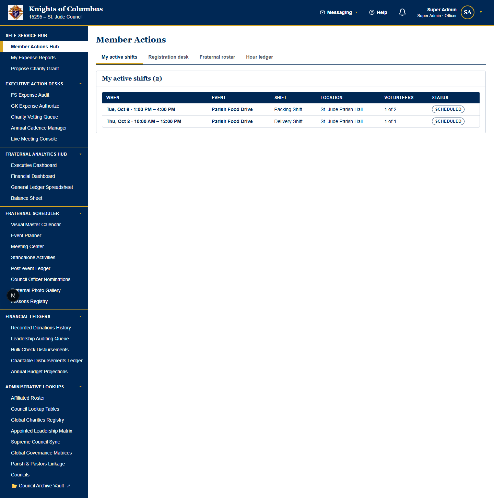
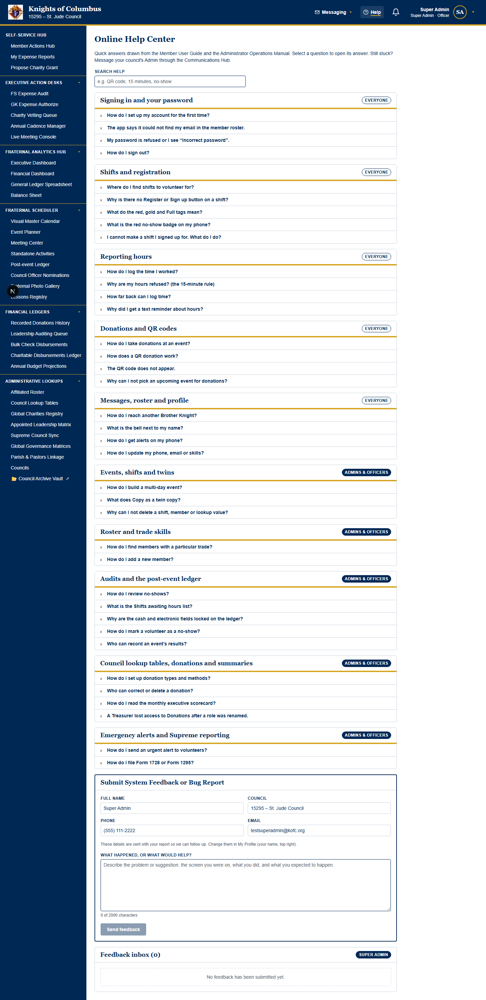
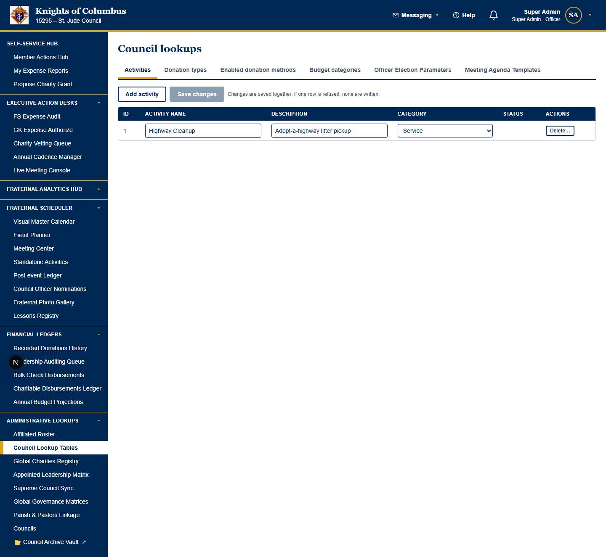
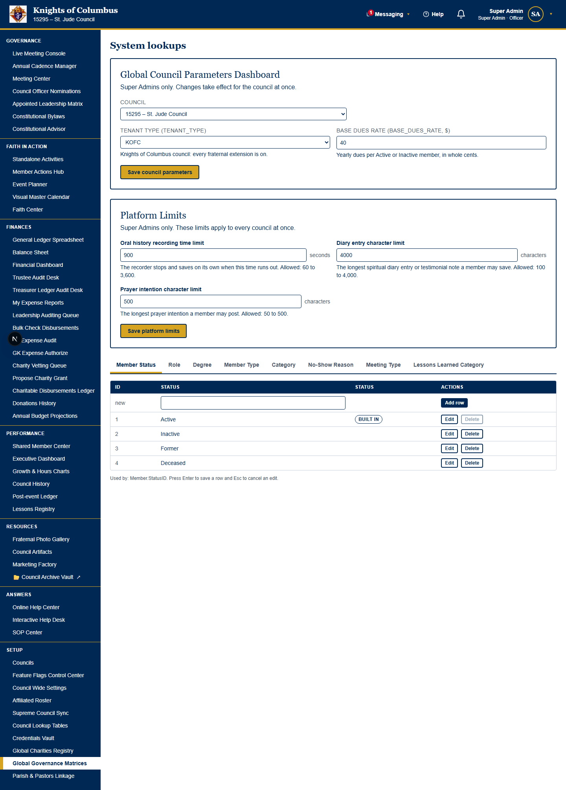
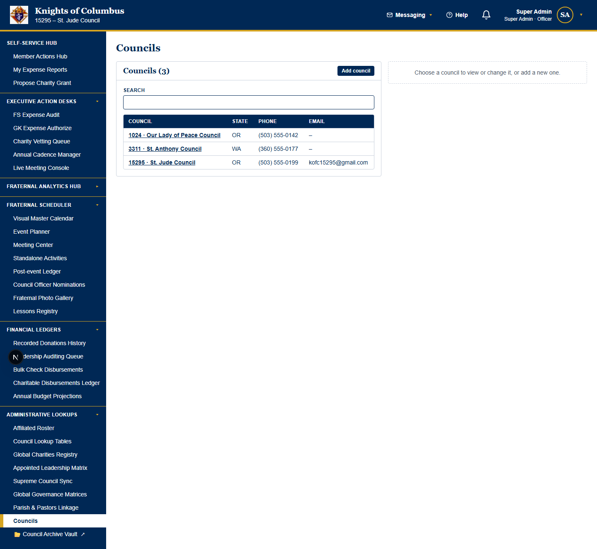
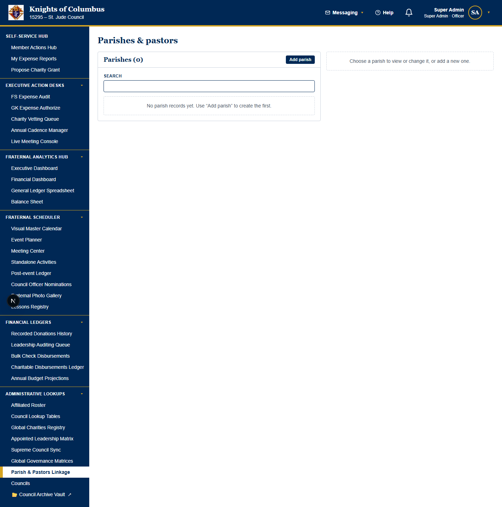
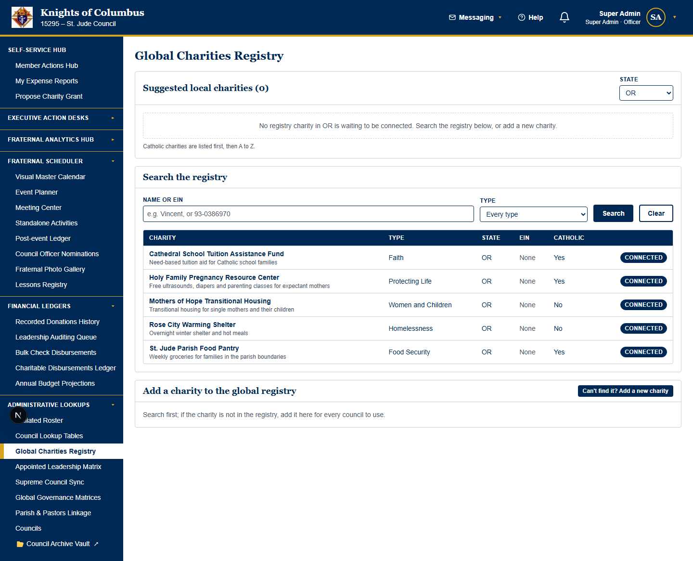
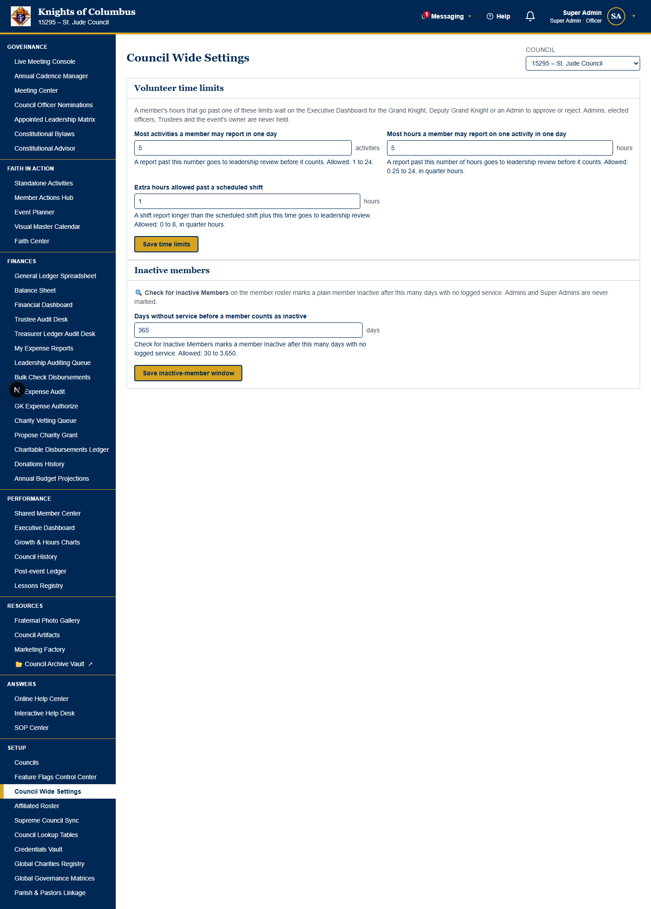

# Fraternal Council Archives™ — Administrator User Guide

**Audience:** Super Admins, council Admins and the pilot facilitator who keeps the platform running.

**Covers:** system maintenance only: roles and access, module switches, lookup tables, service connections, council and platform settings, impersonation and remote help, the hub laptop, database resets, network ports, firewall clearance and the software bill of materials.

> **Officer work is in the role manuals.** Payments, ledgers, budgets, meetings and desks are in the [Treasurer Manual](TREASURER_MANUAL.md), the [Financial Secretary Manual](FINANCIAL_SECRETARY_MANUAL.md) and the [Executive Governance Manual](EXECUTIVE_GOVERNANCE_MANUAL.md).
> **Every administrator is also a member.** Signing up, logging hours and taking donations are in the [Member User Guide](MEMBER_USER_GUIDE.md).
> The full access table is in the [Role Permissions Matrix](ROLE_PERMISSIONS_MATRIX.md).

> **Numbering and shared tasks:** this manual numbers its own chapters from 1. A task that several officers do is printed word for word in the manual of each of those officers. A reference to a section in another manual names that manual. The [manual map](#manual-map) lists the chapters of all four officer manuals.

---

## Contents

- [1. Roles and access](#1-roles-and-access)
- [2. Module feature flags](#2-module-feature-flags)
- [3. The Google Drive archive vault](#3-the-google-drive-archive-vault)
- [4. The feedback inbox and SOP publishing](#4-the-feedback-inbox-and-sop-publishing)
- [5. Lookup tables, service connections and global lists](#5-lookup-tables-service-connections-and-global-lists)
- [6. Data protection rules](#6-data-protection-rules)
- [7. Troubleshooting reference](#7-troubleshooting-reference)
- [8. Council Wide Settings and platform settings](#8-council-wide-settings-and-platform-settings)
- [9. Access requests, impersonation and remote help](#9-access-requests-impersonation-and-remote-help)
- [10. Feedback loops and the Super Admin Desk](#10-feedback-loops-and-the-super-admin-desk)
- [11. Run a room pilot on the hub laptop](#11-run-a-room-pilot-on-the-hub-laptop)
- [12. Reset the database to the seed data](#12-reset-the-database-to-the-seed-data)
- [13. Network addresses, ports and configuration keys](#13-network-addresses-ports-and-configuration-keys)
- [14. Firewall clearance](#14-firewall-clearance)
- [15. The software bill of materials (SBOM)](#15-the-software-bill-of-materials-sbom)
- [16. The Admin Desk](#16-the-admin-desk)
- [Appendix: QR code files](#appendix-qr-code-files)
- [Manual map](#manual-map)

### How to read a tutorial

Every tutorial starts with a **Prerequisite (who can do this)** line. The line states the access privilege that the task needs. Stop when your role is not on the line.

Every tutorial then has five parts: **Goal**, **Start point**, **Steps**, **Expected result** and **Common problems**.
A **Warning** line comes before the steps when the task deletes data, sends messages, posts money or cannot be undone.

---

## 1. Roles and access

### 1.1 Member types and officer roles
A member has one member type. A member may also hold one or more officer roles.

| Member type | Scope |
| --- | --- |
| **Member** | The member's own records and the shared member pages. |
| **Admin** | The Admin's own council only. |
| **Super Admin** | Every council. |

| Officer role | Extra access |
| --- | --- |
| **Grand Knight** and **Deputy Grand Knight** | The executive dashboard and the charity vetting desk. Both counter-sign expenses, appoint officers and keep the cadence, the agenda templates, the bylaws, the meeting check-in and the base dues rate. The Deputy Grand Knight (DGK) has the same access as the Grand Knight (GK). |
| **Financial Secretary** | Issues payment requests on expenses. Posts to the general ledger. Pays checks. |
| **Treasurer** | Posts to the general ledger. Pays checks. |
| **Trustee** | Vets charity requests. Follows up on grants after 6 months. |
| **Recorder** | Edits the live agenda. Records hand tallies. |
| Any other seated officer | Reads the dashboards. Schedules meetings. Runs the live console. |

### 1.2 Access rules
- An Admin acts only on the Admin's own council. A Super Admin acts on any council.
- The data service checks every rule. A refused action shows a message and changes nothing.
- Nobody signs or pays an expense report that the same person submitted. The rule includes Super Admins.
- One person never signs both lines of the same expense report.

> **Caution:** finance access follows the role names **Treasurer** and **Financial Secretary**.
> A renamed role removes finance access from the officers who hold the role. Keep both names exactly as written.

<!-- KEEP_IMAGE: member actions hub with the role-filtered sidebar -->

<!-- /KEEP_IMAGE -->

### 1.3 Choose the council
Most management pages have a **Council** selector at the top.

- An Admin sees the Admin's own council.
- A Super Admin may choose any council.

The navy header shows your own council, your name, your member type and your officer status.

---

## 2. Module feature flags

### 2.1 Concept: backend logic of the flags
Each council row has twelve on/off columns. Each column is a module feature flag. A new council has every flag on.

| Flag column | Label in the Feature Flags Control Center | Web pages hidden when off | Phone items hidden when off |
| --- | --- | --- | --- |
| `flag_mobile_elections` | **Officer elections** | Council Election Center, Appointed Leadership Matrix | None |
| `flag_fundraising_inflow` | **Fundraising inflow** | Donations History | **Collect** |
| `flag_charity_proposals` | **Charity proposals** | Propose Charity Grant, Charity Vetting Queue | None |
| `flag_complex_shifts` | **Event shifts** | Event Planner, the shift tabs of the Member Actions Hub | **Signup**, and the shift mode of **Report** |
| `flag_meeting_management` | **Meeting management** | Meeting Center, Recurring Meetings, Live Meeting Console | **Mtgs** |
| `feature_expense_reporting` | **Expense reporting** | My Expense Reports, Leadership Auditing Queue, FS Expense Audit, Treasurer Ledger Audit Desk, GK Expense Authorize, Bulk Check Payments Made | The expense screen and the **Expense reports** card on **Home** |
| `feature_faith_center` | **Faith Center** | Faith Center | The feast-day banner, the Daily Bible Quote, the praying hands and the prayer intentions |
| `feature_constitutional_advisor` | **Constitutional Advisor** | Constitutional Advisor | None |
| `feature_council_bylaws` | **Council bylaws** | Constitutional Bylaws | None |
| `feature_council_history` | **Council history** | Council history (Team Legacy) | None |
| `feature_live_meeting_console` | **Live meeting console** | Live Meeting Console | None |
| `feature_volunteer_quarantine` | **Flagged hours review** | The **Flagged Hours Review** drawer on the **Grand Knight Desk** of the dashboard. Members' hours also stop going to review (section 10 of the Executive Governance Manual). | None |

The flags follow four rules.

1. A flag that is off hides the module from every member of the council. The rule includes Admins.
2. A hidden desk is gone from the sidebar.
3. A hidden page refuses a typed web address. The phone sends a member on a hidden screen back to **Home**.
4. A flag never deletes data. A flag that is switched back on restores the module with all records.

The general ledger, the budget and the activity hour log have no flag. They stay on for every council.

### 2.2 Switch a module on or off
> **Prerequisite (who can do this):** You must have Super Admin privileges. Council Admins do not see the Feature Flags Control Center.
> **Warning:** a switched-off module disappears at once for every member of the council, on the web and on the phone.

**Goal:** Turn one optional module on or off for one council.

**Start point:** Sidebar → System Settings → **Feature Flags Control Center**.

**Steps:**
1. Find the row of the module. Each row shows the label, the flag column and the pages the flag hides.
2. Find the column of the council. Each column shows the council number and how many modules are on.
3. Clear the box to hide the module. Select the box to show the module.

**Expected result:** The platform saves each switch at once. Members of the council see the change the next time each page loads.

**Common problems:**
| Problem | Cause | Fix |
| --- | --- | --- |
| A member still sees a phone tab. | The phone read the flags before the change. | Ask the member to sign out and sign in again. |
| *"… is not a feature flag"* | The request named an unknown flag. | Use one of the twelve flags in 3.1. |

---

## 3. The Google Drive archive vault

### 3.1 Concept: backend logic of the Drive archive vault
The vault files council documents in the council's shared Google Drive. The vault has one root folder and three sub-folders.

| Folder path | Holds | Filled from | Accepted files |
| --- | --- | --- | --- |
| `Fraternal Enterprise Suite / Minutes` | Meeting minutes | **Meeting Center** → **Upload minutes** | PDF, text, Word |
| `Fraternal Enterprise Suite / Vouchers` | Expense receipts | **My Expense Reports** | PDF, images |
| `Fraternal Enterprise Suite / Media` | Event photos and video | **Fraternal Photo Gallery** | Images, video, PDF |

The vault follows five rules.

1. Only Admin and Super Admin uploads go to the vault.
2. The largest accepted file is 25 MB.
3. The record stores only the Drive file id. The id goes in the record's existing link column.
4. The web server holds the Drive credentials. The browser never sees the credentials.
5. Live uploads are off by default. The server needs four settings to turn uploads on.

| Server setting | Value |
| --- | --- |
| `GOOGLE_DRIVE_CLIENT_EMAIL` | The service account email |
| `GOOGLE_DRIVE_PRIVATE_KEY` | The service account private key |
| `GOOGLE_DRIVE_SHARED_DRIVE_ID` | The shared drive id. The service account must be a Content manager. |
| `DRIVE_VAULT_LIVE` | `1` |

> **Security warning:** the portal has no server-side sessions yet. The upload route cannot confirm that the caller is an Admin.
> Set `DRIVE_VAULT_LIVE=1` only behind an authenticating proxy. Without the four settings, the screen keeps a browser link for the file.

### 3.2 Turn on live Drive uploads
> **Prerequisite (who can do this):** You must be the platform's server operator. A Super Admin approves the change.
> **Warning:** an open upload route lets anyone who reaches the server write files to the shared drive.

**Goal:** Send Admin uploads to the shared Google Drive.

**Start point:** The web server's environment settings.

**Steps:**
1. Create a Google service account.
2. Add the service account to the shared drive as a Content manager.
3. Set `GOOGLE_DRIVE_CLIENT_EMAIL`, `GOOGLE_DRIVE_PRIVATE_KEY` and `GOOGLE_DRIVE_SHARED_DRIVE_ID`.
4. Put the portal behind an authenticating proxy.
5. Set `DRIVE_VAULT_LIVE` to `1`.
6. Restart the web server.

**Expected result:** A new Admin upload creates a file under `Fraternal Enterprise Suite`.

A council can use its own Drive private key instead of the server key. A council Admin saves the key on the **Credentials Vault** page (5.2).

**Common problems:**
| Problem | Cause | Fix |
| --- | --- | --- |
| Files stay as browser links. | A setting is missing, or `DRIVE_VAULT_LIVE` is not `1`. | Check all four settings. |
| *"… is larger than 25 MB."* | The file is too large. | Compress or split the file. |

---

## 4. The feedback inbox and SOP publishing

### 4.1 Read the feedback inbox
> **Prerequisite (who can do this):** You must have Super Admin privileges.

**Goal:** Read the notes and bug reports that council Admins send.

**Start point:** Sidebar → System Settings → **Administrative Feedback Loops** → **Feedback inbox**. The platform owner also reads the notes on the **Super Admin Desk** (10.3).

**Steps:**
1. Scroll below **Send a Note to the Platform Owner**.
2. Read each note. The newest note shows first.

The Online Help Center has no feedback form since Sprint 8O. Section 10.1 explains the change.

<!-- KEEP_IMAGE: online help center capture -->

<!-- /KEEP_IMAGE -->

**Expected result:** Each report shows the sender's name, council, phone, email and time (UTC).

**Common problems:**
| Problem | Cause | Fix |
| --- | --- | --- |
| The inbox is missing. | Only Super Admins see the inbox. | Ask a Super Admin. |
| The inbox is not on the Online Help Center. | The inbox moved to **Administrative Feedback Loops** in Sprint 8O. | Open Sidebar → System Settings → **Administrative Feedback Loops**. |

### 4.2 Publish a standard operating procedure
> **Prerequisite (who can do this):** You must be a platform maintainer with write access to the code repository.
> **Warning:** the SOP Center reads the files when the portal is built. A new SOP shows only after a rebuild.

**Goal:** Add a procedure to the **SOP Center**.

**Start point:** The repository folder `docs/sop/`.

**Steps:**
1. Create a Markdown file in `docs/sop/`.
2. Start the file with a `# ` title.
3. Write each task with **Goal**, **Start point**, **Steps**, **Expected result** and **Common problems**.
4. Rebuild the web portal.

**Expected result:** The SOP shows in Sidebar → Answers → **SOP Center**.

**Common problems:**
| Problem | Cause | Fix |
| --- | --- | --- |
| The SOP is missing. | The portal was not rebuilt. | Run the web build again. |
| A test fails. | The SOP lacks a title or one of the five headings. | Add the missing heading. |

The SOP Center holds the full procedure: **Publish a standard operating procedure**.

---

## 5. Lookup tables, service connections and global lists

### 5.1 Keep the council lookup tables
> **Prerequisite (who can do this):** You must be a council Admin or a Super Admin for every tab. The Treasurer and the FS may edit the donation tabs only.
> **Warning:** **Save changes** saves every row together. One refused row saves nothing.

**Goal:** Keep the council's own lists.

**Start point:** Sidebar → System Settings → **Council Lookup Tables**.

**Steps:**
1. Open the tab: **Activities**, **Donation types**, **Enabled donation methods** or **Meeting Agenda Templates**.
2. Edit the rows. Each changed row shows **Edited** under its ID.
3. In **Status**, select **Active** or **Inactive**. An **Inactive** row stays for the old records, but members cannot pick it for new hours or new donations.
4. On **Enabled donation methods**, select the **Account**. **Council Account** is the default. The other choices are the rows of the **Account Owners Matrix** (8.10). A **Parish** account shows **(Parish)** and an **Affiliated Entity** account shows **(Affiliated Entity)**. Their gifts are not the council's. They stay off the Treasurer's batch coder.
5. For a QR method, select the **QR code** check box. Select **Upload** and choose the image. A small preview shows the code. The check box is disabled for **Cash**, **Check**, **Credit Card** and **Physical Items**.
6. Select **Save changes**.

<!-- KEEP_IMAGE: council lookup tables capture -->

<!-- /KEEP_IMAGE -->

**Expected result:** The changes save. Phones show the new values on the next load. If **Account Name Members See** is empty, it takes the name of the selected account.

Budget categories are not on this page. Keep them on the **Annual Budget Center** (Sidebar → Finances → **Budget**). On **Meeting Agenda Templates**, the **Preview** box under the outline shows the agenda with its formatting while you type.

The outbound email settings are not on this page. Set them on the **Credentials Vault** page (5.2). The base dues rate is not on this page either. A Super Admin sets the rate on **Global System Parameters** (8.8).

**Common problems:**
| Problem | Cause | Fix |
| --- | --- | --- |
| *"Your role cannot maintain this council's lookups."* | You are on another council, or you have no finance role. | Ask a council Admin. |
| A budget category will not delete. | Budget lines use the category. | Move the lines to another category. |

### 5.2 Connect the council email, Google Drive, Microsoft Co-Pilot and receipt reading
> **Prerequisite (who can do this):** You must be a council Admin or a Super Admin to save or remove a connection. Seated officers see the status lines only. Other members do not see the **Credentials Vault**.
> **Note:** the page opens only your own home council's keys. The portal server refuses any other council's keys with **403 Forbidden**, for Super Admins too.
> **Warning:** **Remove** deletes the saved password or key at once. The council goes back to the portal default.

**Goal:** Connect the council's own mail account, Google Drive, Copilot Studio agent and Azure receipt reader.

**Start point:** Sidebar → System Settings → **Credentials Vault**.

**Steps:**
1. Read the status lines at the top. A line with ✓ is a connection that is on.
2. For email, go to the **Outbound email** panel.
3. Choose the **Email service**. Google Workspace and Microsoft 365 fill in the **Mail server**.
4. Enter the **Sign-in email** and the **Password**. Use an app password if the service asks for one.
5. Select **Save**.
6. For Google Drive, paste the key in **Drive key** in the **Google Drive** panel. Select **Save**.
7. For the Microsoft Co-Pilot, paste the Direct Line secret in **Co-Pilot key**. Select **Save**. Copilot Studio shows the secret under Settings → Security → Web channel security.
8. For receipt reading, open the council's Azure Document Intelligence resource in the Azure portal. Go to **Keys and Endpoint**.
9. Paste the endpoint in **Azure endpoint**. Select **Save**. The endpoint looks like `https://name.cognitiveservices.azure.com/`.
10. Paste **KEY 1** in **Azure key**. Select **Save**.
11. For the council's file repository (8.9), save its key in its panel: **Network file server** (service account password), **OneDrive / SharePoint** (client secret) or **Dropbox Business** (access token). Select **Save**.

**Expected result:** The status line of each saved connection shows ✓. **Receipt reading** shows ✓ only when both Azure values are saved. The page never shows a saved password or key again.

**Common problems:**
| Problem | Cause | Fix |
| --- | --- | --- |
| The panels are missing. | You are an officer but not an Admin. | Ask a council Admin. |
| A message about the mail server or the sign-in email shows. | The mail server name or the email is not valid. | Copy both values from your mail service. |
| Saved keys stop working after a server restart. | The server has no fixed vault secret. | Ask the server operator to set `CREDENTIALS_VAULT_SECRET`. Save the keys again. |
| A message says the endpoint must be a cognitiveservices.azure.com address. | The value is not the Azure endpoint. | Copy **Endpoint** from **Keys and Endpoint**. |

### 5.3 Keep the global lists, councils, parishes and charities
> **Prerequisite (who can do this):** You must be a Super Admin for **Global Lookup Tables** and **Councils**. You must be a council Admin or a Super Admin for **Parish & Pastors Linkage**. You must be a charity registry keeper for **Global Charities Registry**.
> **Warning:** a value marked **Built in** cannot be renamed or deleted.

**Goal:** Keep the lists that every council shares.

**Start point:** Sidebar → System Settings.

**Steps:**
1. Open the page.
2. Edit the row.
3. Save.

<!-- KEEP_IMAGE: global governance matrices capture -->

<!-- /KEEP_IMAGE -->

<!-- KEEP_IMAGE: councils capture -->

<!-- /KEEP_IMAGE -->

<!-- KEEP_IMAGE: parishes and pastors capture -->

<!-- /KEEP_IMAGE -->

<!-- KEEP_IMAGE: global charities registry capture -->

<!-- /KEEP_IMAGE -->

The base dues rate, the tenant type and the **Platform Settings** are not on **Global Lookup Tables**. A Super Admin sets them on **Global System Parameters** (sections 8.5 to 8.8).

**Expected result:** Every council sees the new value.

**Common problems:**
| Problem | Cause | Fix |
| --- | --- | --- |
| Finance officers lost access. | A role named Treasurer or Financial Secretary was renamed. | Restore the exact role name. |

### 5.4 Concept: verified charities
A verified charity is a **Global Charities Registry** entry that an Admin trusts. Only verified charities show on the **Propose Charity Grant** form.
On that form, a member selects a **State** and then an **Organization**. The form then fills in the charity's name, mission, mailing address, Employer Identification Number (EIN) and contact details from the registry.
The registry keeps the date of each verification and the Admin who verified the charity.

### 5.5 Verify a charity for the grant form
> **Who can do this:** council Admins and Super Admins. Other members do not see the **Global Charities Registry**.

**Goal:** Let members pick a charity on the **Propose Charity Grant** form, with its details filled in.

**Start point:** Sidebar → System Settings → **Global Charities Registry** → **Search the registry**.

**Steps:**
1. Type the charity's name or EIN in **Name or EIN**.
2. Select **Search**.
3. Check the charity's address, contact and EIN. Correct an empty field when the council pays the charity.
4. In the **Verified** column, select **Verify**.
5. To take a charity off the form, select **Remove verification**.

**Expected result:** The row shows **✓ Verified**. Members see the charity in the **Organization** list for its state.

**Common problems:**
| Problem | Cause | Fix |
| --- | --- | --- |
| The charity is not in the registry. | No council added the charity yet. | Select **Can't find it? Add a new charity**. Then verify the new entry. |
| Members see the charity under the wrong state. | The registry entry has the wrong state. | Ask a Super Admin to correct the entry. |

---

## 6. Data protection rules
- **Nothing cascades.** The platform refuses to delete a record that other records use. The message names the record in use.
- Examples: a shift with sign-ups, a member with logged hours, a lookup value in use.
- One exception: a deleted distribution list also deletes the list's member entries.
- **Time windows** protect records. Shift hours and activity hours close after the council's logging window. The default is 90 days (section 8.3).
- **Approved budgets** are frozen for everyone.

---

## 7. Troubleshooting reference
| Symptom or message | Cause | Fix |
| --- | --- | --- |
| A page is missing from the sidebar | Your role has no access, or a feature flag is off. | Check section 1 and section 2. |
| *"…cannot …"* refusal on save | You act outside your council or role. | Switch the **Council** selector, or ask a Super Admin. |
| Delete refused (record in use) | Other records depend on the record. | Clear the dependants first, or keep the record. |
| New member cannot create a password | The setup code expired or the email is wrong. | Select **Send new setup code**. |
| Drive uploads stay as browser links | Live uploads are off. | See 3.2. |
| Other devices cannot reach the hub | The firewall blocks port 3000, or the Wi-Fi is set to Public. | See section 14. |
| *"The hub vault is at database version ..."* | The vault is older than this build. | Archive the vault (section 12.2). |
| Every member is signed out after a restart | `PORTAL_SESSION_SECRET` is not set. | Set the key (section 13). |
| Saved council credentials are gone after a restart | `CREDENTIALS_VAULT_SECRET` is not set. | Set the key (section 13). Enter the credentials again. |
| `npm run build:pilot` stops with `[sbom] ...` | The lockfile is missing or belongs to another project. | Run `npm install` (section 15.2). |
| An officer cannot find a task | Officer tasks are in the role manuals. | Open the manual from the officer's desk header. |

Quick answers are also in **Answers → Online Help Center**. Officer problems are in the Common problems tables of the role manuals.

---

## 8. Council Wide Settings and platform settings

### 8.1 Concept: council settings and platform settings
Some numbers belong to one council. Other numbers belong to every council at once.

| Kind | Who changes it | Where | What it holds |
| --- | --- | --- | --- |
| Council Wide Settings | The council's Admins and officers, or a Super Admin | Sidebar → System Settings → **Council Wide Settings** | The volunteer time limits, the time windows and the reminder timing of one council. The **Roster Inactivity Sweep** card (council Admins and Super Admins run it). |
| Platform Settings | Super Admins only | Sidebar → System Settings → **Global System Parameters** → **Platform Settings** | The invitation lead time, the sign-in length, the record retention, the recording time limit and two character limits for every council |
| Base dues rate and tenant type | Super Admins only | Sidebar → System Settings → **Global System Parameters** → **Global Council Parameters Dashboard** | The dues rate and the organization type of one council |

A new council starts with the default values. A change applies to the next entry that a member saves. A change never moves hours that are already logged or held.

The time windows and reminder days were fixed numbers in earlier versions. Each council now sets its own numbers.

The page address is `/system-settings/council-settings`. Every administration and setup page sits under the System Settings pillar. An old bookmark to `/setup/council-settings` opens the new address.

### 8.2 Concept: the setting cards and the (i) help
Both settings pages group the fields into cards. Each card has a navy title bar and its own save button.

| Page | Cards, in order |
| --- | --- |
| **Council Wide Settings** | **Financial Submissions**, **Volunteer & Meeting Operations**, **Reminder Cadences** |
| **Global System Parameters** → **Platform Settings** | **Reminder Cadences**, **Sign-in & Records**, **Recording & Text Limits** |

Each field has a round **(i)** button beside its label. Select **(i)** to open a help window. The help window tells where the number is used and what the number changes. The help window also shows the allowed values. Select **Close**, press **Esc** or select outside the window to close it.

Some fields show a red **Not used yet** tag. The portal saves the number for a future feature. The number changes nothing today. The help window of the field says the same.

<!-- KEEP_IMAGE: council wide settings capture -->

<!-- /KEEP_IMAGE -->

The screenshot above shows the page before the cards were added. The fields and their labels are the same.

### 8.2.1 Concept: the settings drawers
The read-only **Council Instance Record** is at the top of **Council Wide Settings**. It always shows, and you cannot close it. Under it is a stack of five drawers. Select a drawer's title to open or close it. All the drawers are closed when the page opens. More than one drawer can be open at the same time.

A number that you typed but did not save stays in its card when you close the drawer. Save each card before you leave the page.

| Drawer | What the drawer holds |
| --- | --- |
| **Standard Bank Accounts** | The **Account Owners Matrix** (8.10) and the **Payment QR Codes** card (8.12). |
| **User Access & Roster Control** | The **Roster Inactivity Sweep** and **Canonization Rank Benchmarks** cards. The meeting PIN is on the **Recorder Desk** (and the **Grand Knight Desk** when the Recorder is absent). |
| **System Settings** | The **Financial Submissions**, **Volunteer & Meeting Operations** and **Reminder Cadences** cards (section 8.3), the **File Repository Mode** card (8.9) and the **Custom User Guides** card. |
| **Feature Controls** | The **Cross-Council Loaner Library Sharing** card and the **Module & Platform Switches** links. |
| **Council Feature Deployment Matrix** | The matrix only (section 8.2.2). |

The page has no **Global Revenue Splits** tab and no **Reference Archives** links. The **Annual Budget Planner** banner is on the **Annual Budget Center** (Sidebar → Finances).

The text in each card wraps inside the card. On a narrow screen, the **Council Feature Deployment Matrix** scrolls sideways. Its columns keep their width, so no column stacks its words one per line.

The page has no links to **Council Lookups** or the **Credentials Vault**. Open them from the sidebar (System Settings). The **Module & Platform Switches** links show **Feature Flags Control Center** and **Global System Parameters** to Super Admins.

The **Council Instance Record** shows the council number and name, the organization type, the district, the EIN, the base dues rate, the email gateway, the date the bylaws were last saved and the database schema version. You cannot change these facts here. Each fact changes on its own page.

### 8.2.2 Concept: the Council Feature Deployment Matrix
The **Council Feature Deployment Matrix** has its own drawer. The matrix shows which advanced capabilities and modules are on for the council. Each row has a status badge.

| Badge | Meaning |
| --- | --- |
| **🟢 DEPLOYED** | The capability or module is on for this council. |
| **⚪ AVAILABLE / OFF** | The platform has the capability, but this council has it off. |

**Advanced capabilities** rows:

| Row | 🟢 DEPLOYED when | Where it is switched |
| --- | --- | --- |
| **Cross-Council Shared Asset Libraries** | Loaner library sharing is on. | **Cross-Council Loaner Library Sharing** card, in the **Feature Controls** drawer |
| **Biometric Authentication** | Members may sign in on the phone with Face ID or a fingerprint. This is the default. | The **Turn off** or **Turn on** button in the row (section 8.4.1) |
| **Council Email Gateway** | The council has an outgoing mail server. | **Credentials Vault** → **Email Gateway** (the link opens the vault) |

**Council modules** rows: one row for each of the twelve module switches (section 2). A Super Admin changes them on the **Feature Flags Control Center**.

The card counts the rows that are on, for example *"14 of 17 deployed"*. The matrix changes nothing by itself, except the **Biometric Authentication** button.

### 8.3 Concept: the council settings
**Financial Submissions** card:

| On-screen label | Default | Allowed values | What the setting controls |
| --- | --- | --- | --- |
| **Days after an event or meeting to submit expenses** | 30 days | 1 to 365 | The expense filing window (section 4 of the Executive Governance Manual). A report that names an event or a meeting can be submitted from its first day through this many days after it ends. |
| **Days before an unsubmitted expense draft expires** | 90 days | 7 to 730 | **Not used yet.** Drafts do not expire today. |
| **Days a charity proposal stays open for a vote** | 14 days | 1 to 90 | **Not used yet.** The council votes at the next Monthly meeting at least 10 days away. |

**Volunteer & Meeting Operations** card:

| On-screen label | Default | Allowed values | What the setting controls |
| --- | --- | --- | --- |
| **Most activities a member may report in one day** | 5 | 1 to 24 | The 5-activity rule (section 10.2 of the Executive Governance Manual) |
| **Most hours a member may report on one activity in one day** | 5.0 hours | 0.25 to 24, in quarter hours | The 5.0-hour rule (section 10.2 of the Executive Governance Manual) |
| **Extra hours allowed past a scheduled shift** | 1.0 hour | 0 to 8, in quarter hours | The shift padding rule (section 10.3 of the Executive Governance Manual) |
| **Days without service before a member counts as inactive** | 365 days | 30 to 3,650 | **🔍 Check for Inactive Members** (section 3.4 of the Financial Secretary Manual) |
| **Days back a member may log volunteer time** | 90 days | 7 to 730 | The logging window. A member may log shift time and activity time this many days back. |
| **Hours before an event that gate donations open** | 2 hours | 0 to 72, in quarter hours | How long before an event begins the phone's **Collect** screen offers it for gate donations. With 0, an event is offered only once it is under way. Members may still sign up until a shift ends. |
| **Days after a meeting that the minutes are due** | 7 days | 1 to 60 | The **Recorder Desk** counts down to the due date: the meeting's last day plus this number. Minutes not published by then show as overdue. |
| **Days of notice before a special election** | 60 days | 1 to 365 | **Not used yet.** A mid-year nomination stays open for 14 days. |

**Reminder Cadences** card:

| On-screen label | Default | Allowed values | What the setting controls |
| --- | --- | --- | --- |
| **Days after a shift before the first hours reminder** | 5 days | 1 to 60 | The first text reminder to a volunteer with no logged hours (section 8 of the Executive Governance Manual) |
| **Days between follow-up hours reminders** | 7 days | 1 to 60 | The follow-up text reminders (section 8 of the Executive Governance Manual) |
| **Days before an officer is reminded to sign an expense report** | 3 days | 1 to 60 | **Not used yet.** No signature reminder is sent today. |

A value of 0 for **Extra hours allowed past a scheduled shift** sends every report longer than the scheduled shift to review.

The logging window replaces two older limits: 3 months for shift time and 6 months for activity time. A council that wants the old activity limit can enter `183` days.

The logging window also ends the hours reminders. A shift older than the window shows **Closed** on the **Shifts awaiting hours** panel, and the reminders stop.

### 8.4 Change the Council Wide Settings
> **Prerequisite (who can do this):** You must be a council Admin or a council officer of the council, or a Super Admin. Other members do not see this page.

**Goal:** Set your council's volunteer time limits, time windows and reminder timing.

**Start point:** Sidebar → System Settings → **Council Wide Settings**.

**Steps:**
1. Super Admins only: choose the council in **Council** at the top of the page.
2. Open the **System Settings** drawer. Find the card that holds the setting (section 8.3).
3. Optional: select **(i)** beside the field to read what the setting does. Select **Close**.
4. Enter the new number.
5. Select the save button of the card, for example **Save Financial Submissions**.

**Expected result:** A message says "Saved for council" with the council number. The new numbers apply from now on.

**Common problems:**
| Problem | Cause | Fix |
| --- | --- | --- |
| The page is not in the sidebar. | You are not an Admin or an officer of the council. | Ask a council Admin to make the change. |
| A number in another card went back to its old value. | Each card saves only its own fields. | Enter the number again and select the save button of that card. |
| The message says the value "must be a multiple of 0.25 hours". | Hours use 15-minute steps. | Enter a value such as `4.5` or `4.75`. |
| The message says the value must be "from" one number "to" another. | The value is outside the allowed range (section 8.3). | Enter a value inside the range. |
| The message says "Nothing changed." | Every number in the card is the same as the saved value. | Change a number, then save. |
| A field with **Not used yet** has no effect. | No feature reads the number yet. | No fix is needed. Keep the default. |
| You cannot find the cards. | A different tab is selected. | Select the tab that holds the card (section 8.2.1). |

### 8.4.1 Turn biometric sign-in on or off for the council
> **Prerequisite (who can do this):** You must be a council Admin or a council officer of the council, or a Super Admin.

**Goal:** Allow or stop Face ID and fingerprint sign-in on the phones of the council's members.

**Start point:** Sidebar → System Settings → **Council Wide Settings** → **Council Feature Deployment Matrix** drawer.

**Steps:**
1. Super Admins only: choose the council in **Council** at the top of the page.
2. Find the **Biometric Authentication** row.
3. Select **Turn off** to stop biometric sign-in. Select **Turn on** to allow it again.

**Expected result:** The badge changes to **⚪ AVAILABLE / OFF** or **🟢 DEPLOYED**. While it is off, a phone makes no new biometric key for a member of the council. A key that a phone already holds is deleted at its next use, and the member signs in with the password.

**Common problems:**
| Problem | Cause | Fix |
| --- | --- | --- |
| The row has no button. | You are not an Admin or an officer of the council. | Ask a council Admin to make the change. |
| A member still sees the **[ 🔘 Enable FaceID / Biometric Login ]** switch. | The phone does not know the member's council before the sign-in. | No action. The phone makes no key after the sign-in. |
| A member reads *"Your council has turned off biometric sign-in."* | Biometric sign-in is off for the council. | The member signs in with the password. |

### 8.5 Concept: the Global System Parameters page
The **Global System Parameters** page holds the numbers that sit above the settings of one council. Only Super Admins see the page.

| Card | What the card holds | Applies to |
| --- | --- | --- |
| **Global Council Parameters Dashboard** | The base dues rate and the tenant type (Knights of Columbus council or a white-labelled organization) | One council at a time |
| **Platform Settings** | Three cards of numbers (section 8.6) | Every council at once |

The **Platform Settings** card had the name **Platform Limits** in earlier versions. The cards were on **Global Lookup Tables** before that. The **Feature Flags Control Center** holds only the on/off module switches.

### 8.6 Concept: the platform settings
| Card | On-screen label | Default | Allowed values | What the setting controls |
| --- | --- | --- | --- | --- |
| **Reminder Cadences** | **Days before a scheduled meeting that invitations appear** | 5 days | 1 to 60 | When the invitations of a cadence meeting reach the members (section 2 of the Executive Governance Manual). Meetings that are already built keep their release dates. |
| **Sign-in & Records** | **Hours a portal sign-in lasts** | 8 hours | 1 to 168 | When the portal server ends a web sign-in. The member then signs in again. |
| **Sign-in & Records** | **Days to keep audit records** | 180 days | 30 to 3,650 | **Not used yet.** The portal keeps every record today. |
| **Recording & Text Limits** | **Oral history recording time limit** | 900 seconds | 60 to 3,600 | The oral history recorder |
| **Recording & Text Limits** | **Diary entry character limit** | 4,000 characters | 100 to 4,000 | The spiritual diary and the testimonial note |
| **Recording & Text Limits** | **Prayer intention character limit** | 500 characters | 50 to 500 | The Council Prayer Intentions List |

A sign-in that already started keeps its old end time. The new sign-in length applies from the next sign-in.

### 8.7 Change the platform settings
> **Prerequisite (who can do this):** You must be a Super Admin.
> **Warning:** the settings apply to every council at once.

**Goal:** Set the numbers that every council shares.

**Start point:** Sidebar → System Settings → **Global System Parameters** → **Platform Settings**.

**Steps:**
1. Find the card that holds the setting (section 8.6).
2. Optional: select **(i)** beside the field to read what the setting does. Select **Close**.
3. Enter the new number.
4. Select the save button of the card, for example **Save Sign-in & Records**. The new numbers apply to every council at once.

**Expected result:** A message says "Platform settings saved." When you change **Hours a portal sign-in lasts**, the message also says that the portal server uses the new sign-in length from the next sign-in.

**Common problems:**
| Problem | Cause | Fix |
| --- | --- | --- |
| A character limit does not go above its default. | The default is the largest size that the council records can store. | Keep the limit at the default or lower. |
| A recording stopped early. | The recording time limit is lower than the speaker needed. | Raise the limit. The largest value is 3,600 seconds (60 minutes). |
| The message says that the portal server did not take the new sign-in length. | Your web sign-in on the server ended. | Sign out. Sign in again. Save the number again. |
| Meeting invitations still appear 5 days before the meeting. | The meetings were built before the change. | No fix is needed. Meetings built after the change use the new number. |

### 8.8 Set a council's base dues rate and tenant type
> **Prerequisite (who can do this):** You must be a Super Admin.
> **Warning:** a new tenant type changes the sidebar and the labels of every member of the council at once.

**Goal:** Set the base dues rate and the tenant type of one council.

**Start point:** Sidebar → System Settings → **Global System Parameters** → **Global Council Parameters Dashboard**.

**Steps:**
1. Choose the council in **Council**.
2. Choose the **Tenant type**: `KOFC` or `GENERIC`.
3. Enter the **Base dues rate** in dollars.
4. Select **Save council parameters**.

**Expected result:** A message shows the council number, the tenant type and the new base dues. The council's dues figures use the new rate.

**Common problems:**
| Problem | Cause | Fix |
| --- | --- | --- |
| The message says "Enter a base dues rate." | The rate box is empty. | Enter the rate, then save. |
| The Faith Center and the Supreme Council Sync left the sidebar. | The tenant type is a white-labelled organization. | Choose the Knights of Columbus tenant type again. |

---

### 8.9 Choose where uploaded files are kept
> **Who can do this:** council Admins and Super Admins. Other readers of the page see the provider only.
> **Warning:** the change applies to new uploads only. Files already uploaded stay with the provider that took them, and their links keep working while that provider's settings and key stay saved.

**Goal:** Send the council's uploads to Google Drive, OneDrive / SharePoint, Dropbox Business or the council's own file server.

**Start point:** Sidebar → System Settings → **Council Wide Settings** → **System Settings** drawer → **File Repository Mode**.

The card shows only the settings of the provider you choose:

| Provider | Settings on the card | Key saved on the Credentials Vault page |
| --- | --- | --- |
| **Google Drive** | None | **Drive service-account key** (optional) |
| **OneDrive / SharePoint** | **SharePoint Site URL**, **Application (Client) ID** | **Client Secret** |
| **Dropbox Business** | **Team Folder Path** | **Access Token** |
| **Local Network Server** | **Server Network Address (UNC/IP Path)**, **Service Account Username** (optional) | **Service Account Password** (optional) |

**Steps:**
1. Choose the provider in **File Repository Provider**. The card shows that provider's settings and hides all others.
2. Fill in the settings, for example `https://stmarys.sharepoint.com/sites/kofc` for **SharePoint Site URL**, `/KofC Council 15295` for **Team Folder Path** or `\\hall-server\kofc` for **Server Network Address (UNC/IP Path)**.
3. Select **Save file repository**.
4. Select **Open the Credentials Vault**. Save the provider's key in its panel (5.2).

**Expected result:** The message **Saved. New uploads go to …** names the provider. Receipts, minutes, gallery and meeting photos, oral histories, asset photos and check photos are sent by the portal server to the provider. Nothing is kept on the uploader's computer or phone. A record keeps a portal link to the file, which only signed-in members of the council and Super Admins can open.

**Common problems:**
| Problem | Cause | Fix |
| --- | --- | --- |
| *"Enter the SharePoint site URL …"* | The address is not a `sharepoint.com/sites/…` or `/teams/…` address. | Copy the site address from SharePoint. |
| *"Enter the Application (Client) ID …"* | The ID is not the app registration's GUID. | Copy the **Application (client) ID** from the Azure portal. |
| *"Enter the team folder path, starting with a slash …"* | The Dropbox path does not start with `/`. | Type it like `/KofC Council 15295`. |
| *"Enter the server network address as a UNC path"* | The address does not start with two backslashes, a server and a share. | Type it like `\\hall-server\kofc`. |
| An upload fails with *"The council file repository did not accept the file."* | The provider refused the file, or its key is missing or wrong. | Check the settings and the key saved in the Credentials Vault. |

### 8.10 Keep the Account Owners Matrix
> **Who can do this:** council Admins and Super Admins.

**Goal:** Record each money account the council uses, who owns it, and who to call about it.

**Start point:** Sidebar → System Settings → **Council Wide Settings** → **Standard Bank Accounts** drawer → **Account Owners Matrix**.

The matrix shows the council's money (Asset) accounts from the chart of accounts. There is no separate list. A row you add here is a new account in the Treasurer's chart.

**Steps:**
1. Select **Add account**.
2. Type the **Ledger account** name, for example `Venmo`.
3. Type the **Name members see**, for example `St. Mary's Knights Venmo`.
4. In **Owned by**, choose **Council**, **Parish** or **Affiliated Entity**. A white-label chapter sees **Internal Operating**, **Parent Organization** or **Affiliated Entity**.
5. Type the **Contact name**, **Contact number** and **Contact email**.
6. Type the account holder's **EIN**, for example `12-3456789`.
7. Select **Save**. To change a row, select **Edit**. To remove it, select **Delete**.

**Expected result:** The row shows in the matrix with its **Owned by** tag. Each council sees only its own rows. A payment method linked to a **Parish** account becomes a **Parish account**. A payment method linked to an **Affiliated Entity** account becomes a **Third-party account**. Gifts paid by either method stay off the Treasurer's batch coder. The account keeps its own **Name members see**.

**Common problems:**
| Problem | Cause | Fix |
| --- | --- | --- |
| *"The council's chart already has an account named …"* | Each ledger name is used once in a council's chart. | Edit the existing row, or choose another name. |
| *"… is still used by a …"* | A payment method, a journal entry or a split still uses the account. | Pick another account on that payment method first. An account with postings stays. |
| *"… is not an email address."* | The contact email is not in name@domain form. | Correct the email. |

### 8.11 Print a council's custom guides
> **Who can do this:** the council's Admins and officers, and Super Admins.

**Goal:** Print a user guide or a role manual with the council's own numbers, and keep a copy in the council's file repository.

**Start point:** Sidebar → System Settings → **Council Wide Settings** → **System Settings** drawer → **Custom User Guides**.

**Steps:**
1. Save any changed card first.
2. Select the guide's button, for example **📥 Generate Custom Treasurer Manual PDF**.
3. Wait a few seconds while the server compiles the PDF.

**Expected result:** The PDF downloads. The server also files a copy in the **Official Manuals** folder of the council's file repository (8.9): Google Drive, OneDrive / SharePoint, Dropbox Business or the Local Network Server. A newer copy of the same guide replaces the older one where the provider allows it. The message names the place, or says why the copy was not filed.

**Common problems:**
| Problem | Cause | Fix |
| --- | --- | --- |
| The message says the copy was not filed. | The repository has no key or location saved, or Google Drive is not connected. | Check **File Repository Mode** (8.9) and the key in the Credentials Vault. The download still works. |

### 8.12 Upload a payment QR code image
> **Who can do this:** council Admins, the Financial Secretary and the Treasurer, and Super Admins.

**Goal:** Give donors the council's own Venmo, Zelle or Square QR code on the phone.

**Start point:** Sidebar → System Settings → **Council Wide Settings** → **Standard Bank Accounts** drawer → **Payment QR Codes**.

**Steps:**
1. Find the payment method's row, for example **Venmo**.
2. Drag the QR code image onto **📁 Upload QR Code Image**, or click the box and choose the image (PNG, JPEG or WebP, up to 5 MB).
3. Wait for the message.

**Expected result:** The new code shows in the row. The phone's collection screen shows it to donors. The image is kept in the council's file repository, or on the portal server for a Google Drive council.

**Common problems:**
| Problem | Cause | Fix |
| --- | --- | --- |
| *"Upload the QR code as a PNG, JPEG or WebP image."* | The file is another type. | Save the code as a PNG or JPEG image. |
| The method is not in the list. | The council has not enabled the method. | Enable it on **Council Lookup Tables** → **Enabled donation methods** (5.1). |

## 9. Access requests, impersonation and remote help

### 9.1 Concept: council access requests
A council that is not on the platform can ask for access from the sign-in page. The sign-in page has a small **[ 🔑 Request Access ]** link under the sign-in prompts, on the web and on the phone. Select the link to open the form.

The form asks for four items: the council name, a contact email, the city and the state. Anyone can send the form. The person does not need an account.

The platform saves each request as **Pending**. The platform also emails a notice to `council15295@stmarys.org`. The platform owner reads the requests on the **Super Admin Desk**, in the **[ 🔑 Council Access Request Approval Queue ]** folder. Since Sprint 10, the **Grand Knight Desk** has no **Inbound Council Mail Center** drawer.

Approving a request marks the request as reviewed. Approving does not create the council. A Super Admin adds the council on the **Councils** page.

| Rule | Value |
| --- | --- |
| Requests from one contact email | 3 in one hour |
| Requests from one network address | 10 in one hour |
| Status values | Pending, Approved |

> The web portal keeps requests on the portal server. A server restart clears them until the production database is connected. A request sent from the phone stays on that phone.

### 9.2 Approve a council access request
> **Who can do this:** the platform owner (the Super Admin who owns the **Super Admin Desk**). Other members do not see the **Inbound Council Mail Center**.

**Goal:** Mark a council's access request as reviewed.

**Start point:** **Active Desks** row → **Super Admin Desk** → **[ 🔑 Council Access Request Approval Queue ]**.

**Steps:**
1. Read the council name, the city, the state and the contact email of the request.
2. Select the contact email to write to the council, if you need more information.
3. Select **Approve**.
4. Open Sidebar → System Settings → **Councils** to add the council.

**Expected result:** The request shows a gold **Approved** label. The pending count in the card title goes down by 1.

**Common problems:**
| Problem | Cause | Fix |
| --- | --- | --- |
| The card says "No council has asked for access yet." | No request reached the portal server. | Ask the council to send the form again from the web sign-in page. |
| The card shows an error about the session. | Your server session ended. | Sign out, then sign in again. |

### 9.3 Concept: user impersonation (view as a member)
A Super Admin can see the portal exactly as one member sees the portal. Use this to check a member's sidebar, pages and permissions.

| Rule | Value |
| --- | --- |
| Who can start the view | Active Super Admins only |
| Who can be viewed | Council Admins only. Use **View As Member** (9.4.2) to see what any other member sees |
| Saving in the view | Not possible. Every save is refused. |
| Longest view | 60 minutes, or until your own sign-in ends |
| Record | The portal server logs each start and stop |

The portal server holds both sign-ins in signed cookies. The browser cannot read or change them. A gold bar across the top of the portal shows whose view is open.

The view uses the member's own council. The member can belong to a council other than your council. The portal then switches to that council's settings before the first page opens:

- the council's modules (the feature flags)
- the council's organization type and its labels
- the council's timing settings, for example the expense filing window
- the council's ledgers, desks and rosters

The gold bar names the member's council. When you select **Return to my account**, the portal switches back to your own council.

Impersonation is only for a Super Admin who helps a local council Admin. Super Admins find the Admin in two places. The **Member Roster** shows the **👥 Impersonate Admin** button on each council Admin's row. The **Impersonate Council Admin** page shows the Admins of every council in one tree.

### 9.4 View the portal as a council Admin
> **Who can do this:** Super Admins. Other members do not see the **👥 Impersonate Admin** button.

**Goal:** See the portal with one council Admin's sidebar, pages and permissions while you help the Admin.

**Start point:** Sidebar → Faith In Action → **Member Roster**.

**Steps:**
1. Choose the Admin's council in **Council**, or keep **All councils on the platform**.
2. Find the Admin in the roster table.
3. Select **👥 Impersonate Admin** in the **Actions** column.
4. Look at the pages. The portal opens on the Admin's **Home**.
5. Select **Return to my account** in the gold bar to end the view.

**Expected result:** The gold bar says "You are viewing the portal as" and the Admin's name. After **Return to my account**, your own sidebar comes back.

**Common problems:**
| Problem | Cause | Fix |
| --- | --- | --- |
| A save fails with "You are viewing the portal as another member, so nothing can be saved." | The view is read-only. | Select **Return to my account**, then make the change as yourself. |
| The row has no **👥 Impersonate Admin** button. | The member is not a council Admin, or is you. | Impersonate council Admins only. To see a member's view, ask the council's Admin to use **View As Member**. |
| An error says "The server did not answer, so the view could not start." | The portal server cannot see the member or your session ended. | Sign out, sign in again, then try again. |

### 9.4.1 Find a council Admin in any council and impersonate the Admin
> **Who can do this:** Super Admins. Other members do not see this page.

**Goal:** Find one council Admin among all councils without a long scroll, then view the portal as that Admin.

**Start point:** Sidebar → System Settings → **Impersonate Council Admin**.

**Steps:**
1. Type part of a name, member number, email, role or council number in the search box.
2. Read the suggested names under the box. Names that start with your text come first.
3. Select **👥 Impersonate** beside the Admin. Go to step 7.
4. To browse without a search, select a council in the **Council directory**. The council opens.
5. Select a group in the council. Each group lists only the council's Admins.
6. Select **👥 Impersonate** beside the Admin.
7. Look at the pages. The portal opens on the Admin's **Home**, with the Admin's council settings.
8. Select **Return to my account** in the gold bar to end the view.

**Expected result:** The gold bar names the Admin and the Admin's council. The sidebar, desks and settings are the Admin's own.

**Common problems:**
| Problem | Cause | Fix |
| --- | --- | --- |
| A member is not in the tree. | The member is not a council Admin, or is you. | Impersonate council Admins only. |
| *"No council Admin matches"* | No Admin matches every word you typed. | Type fewer words. |
| An Admin shows in one group only. | Each Admin shows in the group of the highest seat. A Grand Knight who is also an Admin shows under **Executive Officers**. | Look in the group of the Admin's highest seat. |

### 9.4.2 See what a member of your council sees (View As Member)
> **Who can do this:** council Admins and Super Admins, for members of their own council only.

**Goal:** Check which pages and desks one member of your council gets, without signing in as the member.

**Start point:** Sidebar → System Settings → **View As Member**.

**Steps:**
1. Type part of the member's name or number in **Search by name or number**.
2. Select the member in **Members of your council**.
3. Read **Their sidebar**, **Their Active Desks** and **Their coming shifts**.

**Expected result:** A read-only picture of the member's portal shows. You stay signed in as yourself. Nothing on the page changes the member's account.

**Common problems:**
| Problem | Cause | Fix |
| --- | --- | --- |
| A member of another council is not in the list. | **View As Member** shows only your own council. | Ask that council's Admin. |
| The message says "View As Member shows only members of your own council." | The member belongs to another council. | Ask that council's Admin. |

### 9.5 Concept: co-watching remote assistance
An officer or Admin who needs help can share a copy of the screen with the Super Admins. The officer starts and stops the sharing. Nothing is shared until the officer selects **Share my screen**.

- The copy refreshes every 5 seconds while the officer shares.
- The copy never contains what the officer types in form fields. Passwords are never sent.
- The copy cannot run on the Super Admin's computer. The desk shows the copy as a still picture of the page.
- Sharing stops when the officer selects **Stop sharing**, when a Super Admin closes the request, or after 30 minutes without an update.

### 9.6 Ask for remote help
> **Who can do this:** Officers and Admins. Members and Super Admins do not see the button.

**Goal:** Let a Super Admin see your screen while you get help.

**Start point:** The portal header → **❓ Request Remote Officer Assistance**.

**Steps:**
1. Select **❓ Request Remote Officer Assistance**.
2. Enter what you need in **What do you need help with? (optional)**.
3. Select **Share my screen**.
4. Go to the page you need help with. The Super Admin sees each page you open.
5. Select **Stop sharing** when you finish.

**Expected result:** The header button turns red and says **● Sharing screen · Stop sharing**. After **Stop sharing**, the button goes back to **❓ Request Remote Officer Assistance**.

**Common problems:**
| Problem | Cause | Fix |
| --- | --- | --- |
| The request fails with a session message. | Your server session ended. | Sign out, then sign in again. |
| The red button changed back by itself. | A Super Admin closed the request, or 30 minutes passed. | Send a new request if you still need help. |

### 9.7 Watch an officer's screen
> **Who can do this:** Super Admins. Other members do not see the Remote Assistance Desk.

**Goal:** See the screen an officer shares and guide the officer.

**Start point:** Sidebar → System Settings → **Remote Assistance Desk**.

**Steps:**
1. Select a request in **Open requests**.
2. Read the officer's note and the page name.
3. Look at the screen copy in the right panel. The copy refreshes every 5 seconds.
4. Guide the officer by phone or by message.
5. Select **Close request** when the officer has the answer.

**Expected result:** The right panel shows the officer's page at the officer's window size. After **Close request**, the request leaves the list.

**Common problems:**
| Problem | Cause | Fix |
| --- | --- | --- |
| The panel says "That request is closed." | The officer stopped sharing. | Ask the officer to send a new request. |
| The form fields in the copy are empty. | The platform never sends what the officer types. | Ask the officer to read the values to you. |

---

## 10. Feedback loops and the Super Admin Desk

### 10.1 Concept: the Administrative Feedback Loops
Members no longer send feedback from the Online Help Center. A member brings a problem to the council's Admin through the Communications Hub.
The council's Admin sends a note to the platform owner from **Administrative Feedback Loops**.
Only sessions with Admin clearance or higher see the page. A member, an officer without Admin rights and a phone user do not see the page.

### 10.2 Send a note to the platform owner
> **Who can do this:** council Admins and Super Admins. Other members do not see this page.

**Goal:** Report a problem or ask for a change to the platform.

**Start point:** Sidebar → System Settings → **Administrative Feedback Loops** → **Send a Note to the Platform Owner**.

**Steps:**
1. Check your name, council, phone and email. Change these details in **My Profile**.
2. Describe the problem in **What happened, or what would help?** Use up to 2,000 characters.
3. Select **Send note**.

**Expected result:** The message *"Thank you. Your note was sent to the platform owner."* shows.

**Common problems:**
| Problem | Cause | Fix |
| --- | --- | --- |
| The page is not in the sidebar. | Your member type is not Admin or Super Admin. | Ask your council's Admin to send the note. |

### 10.3 Use the Super Admin Desk
> **Who can do this:** the platform owner only. The tab shows only for the owner's own Super Admin sign-in. Other Super Admins do not see the tab.

**Goal:** Read Admin notes, approve council licenses and switch council modules from one desk.

**Start point:** **Active Desks** row → **Super Admin Desk**.

The desk has three folders across the top:

| Folder | What it does |
| --- | --- |
| **[ 📥 Feedback Communication Center ]** | Shows the notes that council Admins send, newest first. |
| **[ 🔑 Council Access Request Approval Queue ]** | Shows the councils that ask to join the platform. Each pending request has an **Approve** button. |
| **[ 🛠️ System Feature Flag Control Panel ]** | Shows each council's modules. A checkbox switches a module on or off at once. |

Under the folders, the desk has four drawers. Select a drawer's title to open or close it:

| Drawer | What it holds |
| --- | --- |
| **Global System Parameters** | Each council's base dues rate and organization type, and the platform settings every council shares. |
| **Global Lookup Tables** | The platform-wide lookup tables, one tab for each table. |
| **Global Charities Registry** | The registry every council shares: search, verify and add charities. |
| **Credentials Vault** | The sealed connection keys of your own home council only. The drawer never opens another council's keys. |

**Steps:**
1. Select a folder.
2. Read the notes, or select **Approve** on a request, or select a module checkbox.
3. To change a platform setting, a lookup table, a registry entry or your council's keys, open its drawer.

**Expected result:** The folder opens under the folder row. The browser remembers the last folder you opened. A drawer shows its page when you open it.

**Common problems:**
| Problem | Cause | Fix |
| --- | --- | --- |
| The **Super Admin Desk** tab is missing. | You signed in with another account, or you view the portal as another member. | Sign in with the platform owner's account. Stop the view-as session. |
| A module switch has no effect on a council. | The council's members must reload the portal. | Ask the members to reload the page. |

---

### 10.4 Use the Application Advisory Panel
> **Who can do this:** Super Admins and the members of any council who hold the **Application Advisory Panelist** role.

**Goal:** Share the roadmap and the coming releases with the advisory panel, set its meeting dates and read its feedback.

**Start point:** Sidebar → **🔊 Application Advisory Panel** (under **Navigation Guide**).

The panel has four views:

| View | What it holds |
| --- | --- |
| **Development Roadmap** | Where the platform is heading, by phase, with a status for each item. |
| **Future Feature Releases** | What is planned, in testing or released, for the panel to review. |
| **Panel Meeting Dates** | The panel's meetings. Super Admins add, edit and delete them. |
| **Consultation Feedback** | The notes panelists send. Every panelist and Super Admin reads them. |

**Steps:**
1. Select a view.
2. To add a meeting, select **Add meeting** on **Panel Meeting Dates**. Enter the date and the title. Select **Save meeting**.
3. To send feedback, open **Consultation Feedback**. Type the **Topic** and **Your feedback**. Select **Send feedback**.
4. To add a panelist (Super Admins), choose the **Council** and the **Member** under **Panelists**. Select **Add panelist**.
5. To invite a member of any council (the platform owner), select **✉️ Invite Panelist**. Choose the **Council** and the **Member**. Select **Post invitation**. No email is sent: the invitation card appears on the member's alert bell and **Home**, and on their phone's **Home**. It stays open for 14 days.
6. The invited member selects **Accept** on the card. The member becomes a panelist at once, and **🔊 Application Advisory Panel** appears in the sidebar.

**Expected result:** The meeting shows in the list. The feedback shows at the top of **Feedback received**. A panelist added under **Panelists** sees the panel after the next sign-in; a member who selects **Accept** on an invitation sees it at once.

**Common problems:**
| Problem | Cause | Fix |
| --- | --- | --- |
| The sidebar has no **🔊 Application Advisory Panel** link. | You are not a panelist or a Super Admin, or you signed in before you were added. | Ask a Super Admin. Sign out and sign in again. |
| **Add meeting** is missing. | Only Super Admins keep the meeting dates. | Ask a Super Admin. |
| *"This invitation is older than 14 days."* | The invitation expired. | Ask the platform owner for a new invitation. |
| An alert cannot use the title **Advisory Panel invitation**. | The title is reserved for invitations. | Choose another title for the alert. |

## 11. Run a room pilot on the hub laptop

### Concept: the hub laptop and the vault
In a room pilot, one laptop is the hub. The hub holds the council's data in one file on its disk:
`packages/backend/data/central-hub-vault.db`. This file is the vault.

Every other laptop and phone on the room Wi-Fi works on the vault. No device keeps its own copy. A record saved on one device is on every device at once.

The vault keeps every record from every session:
- donations, expense reports, hours and charity requests;
- meeting logs, check-ins and ballots;
- check photos. The photos are kept in a `photos` folder beside the vault.

The vault never clears itself. A restart of the hub laptop keeps every record that was saved before the restart.

The pilot scripts use seeded records, for example report 21 at the Financial Secretary's gate. After a session, those records are already worked. Start each scripted rehearsal on a fresh vault. The command `npm run hub:archive` moves the old vault into an `archive` folder. It deletes nothing.

| Command | What it does |
| --- | --- |
| `npm run build:pilot` | Builds the web portal as the hub. |
| `npm run dev:pilot` | Starts the hub. It prints the portal address, for example `http://10.0.0.167:3000`. |
| `npm run dev:mobile:pilot` | Starts the phone app server. The phones work on the hub. |
| `npm run hub:archive` | Moves the vault into `packages/backend/data/archive`. The next start makes a fresh vault. |

### 11.1 Start the hub before a pilot session
> **Who can do this:** the pilot facilitator, on the hub laptop. Other members do not do this task.

**Goal:** Start the hub, so that every laptop and phone works on the vault.

**Start point:** The hub laptop → a terminal in the project folder.

**Steps:**
1. Connect the hub laptop to the room Wi-Fi.
2. Run `npm run build:pilot`. Wait for the build to finish.
3. To start the scripted rehearsal on fresh records, run `npm run hub:archive`.
4. Run `npm run dev:pilot`. Keep this terminal open.
5. Read the line `[pilot] Hub mode: every device works on packages/backend/data/central-hub-vault.db.` Write down the portal address on that line.
6. In a second terminal, run `npm run dev:mobile:pilot`. Keep this terminal open.
7. On each laptop, open the portal address in the browser. Sign in.
8. On each phone, scan the QR code in the second terminal with Expo Go. Sign in.

**Expected result:** Every device shows the same records. A donation recorded on a phone shows on the Treasurer's laptop after the page reloads.

**Common problems:**
| Problem | Cause | Fix |
| --- | --- | --- |
| The terminal shows `WARNING: not a hub build`. | The portal was built with `npm run build:web`. | Stop the hub. Run `npm run build:pilot`. Run `npm run dev:pilot` again. |
| A device shows *"The pilot hub laptop cannot be reached."* | The device is not on the room Wi-Fi, or the hub is stopped. | Connect the device to the room Wi-Fi. Check that `npm run dev:pilot` runs. |
| The phone app cannot sign in. | The phone server has the wrong hub address. | Stop `npm run dev:mobile:pilot`. Run `npm run dev:mobile:pilot -- --hub http://<hub address>:3000`. |
| The hub stops with *"The hub vault is at database version ..."*. | The vault is from an older version of the platform. | Run `npm run hub:archive`. Start the hub again. The old vault stays in the archive folder. |
| Windows asks if Node.js can use the network. | The firewall protects the laptop. | Allow access on private networks. |

### 11.2 Keep or archive the vault after a session
> **Who can do this:** the pilot facilitator, on the hub laptop. Other members do not do this task.
> **Warning:** do not delete or move the vault file by hand. Use `npm run hub:archive`. A vault that you delete cannot be recovered.

**Goal:** Keep the records for the next session, or put them aside for a fresh rehearsal.

**Start point:** The hub laptop → the terminal that runs `npm run dev:pilot`.

**Steps:**
1. Press Ctrl+C in the terminal that runs `npm run dev:pilot`. The hub stops. Every saved record stays in the vault.
2. To keep adding to the same records next session, do nothing more. The next `npm run dev:pilot` opens the same vault.
3. To start the next rehearsal on fresh records, run `npm run hub:archive`.

**Expected result:** With step 2, the next session shows every record from this session. With step 3, the terminal shows `[hub] Archived the vault to ...`. The next session starts from the seeded records.

**Common problems:**
| Problem | Cause | Fix |
| --- | --- | --- |
| `hub:archive` shows *"The hub is running."* | The hub holds the vault file open. | Stop `npm run dev:pilot` with Ctrl+C. Run `npm run hub:archive` again. |
| You need a record from an archived session. | The archive keeps the old vault as a file. | Ask the developer to open the vault file in the dated folder under `packages/backend/data/archive`. |
| The hub stops with *"The hub vault is at database version 98, but this build needs version 99 …"* | A new release changed the tables. The hub never rebuilds the vault. | Stop the hub. Run `npm run hub:archive`. Start the hub again. |

---

## 12. Reset the database to the seed data

### 12.1 Concept: where the records live
The platform has three kinds of build. Each kind keeps its records in a different place.

| Build | Command | Where the records live | What resets them |
| --- | --- | --- | --- |
| Demo portal | `npm run build:web` | In each browser tab. Each tab has its own copy. | A reload of the tab (F5). |
| Room pilot hub | `npm run build:pilot` | In one vault file on the hub laptop: `packages/backend/data/central-hub-vault.db`. | `npm run hub:archive` (section 12.2). |
| Production | `NEXT_PUBLIC_DATA_DRIVER=remote` | In the council's Azure SQL database. | Never from the platform. Ask the database owner. |

Every new database starts from two files: `Schema.sql` makes the tables, and `Seed.sql` adds the seed records. The seed records include the pilot personas and the scripted records of the pilot kit.

The database version is 99. A hub vault made by an older version is refused at start (section 11.2).

### 12.2 Reset the hub vault to the seed data
> **Who can do this:** the pilot facilitator, on the hub laptop. Other members do not do this task.
> **Warning:** the next session starts without the records of every earlier session. The old vault stays in the archive folder.

**Goal:** Start the next pilot session on a fresh vault made from `Seed.sql`.

**Start point:** The hub laptop → a terminal in the project folder.

**Steps:**
1. Press Ctrl+C in the terminal that runs `npm run dev:pilot`. The hub stops.
2. Run `npm run hub:archive`.
3. Read the line `[hub] Archived the vault to ...`. Write down the folder name.
4. Run `npm run dev:pilot`. The hub makes a fresh vault from the seed data.

**Expected result:** Seeded records show again in their first state, for example report 21 at the Financial Secretary's gate.

**Common problems:**
| Problem | Cause | Fix |
| --- | --- | --- |
| `hub:archive` shows *"The hub is running."* | The hub holds the vault file open. | Stop `npm run dev:pilot`. Run `npm run hub:archive` again. |
| `hub:archive` shows *"No vault in ..."*. | The vault was archived before, or the hub never started. | No action. The next `npm run dev:pilot` makes a fresh vault. |

### 12.3 Rebuild the seed files after a change to Seed.sql
> **Who can do this:** a platform maintainer with write access to the code repository.

**Goal:** Make the portal and the phone app use the changed seed records.

**Start point:** The developer laptop → a terminal in the project folder.

**Steps:**
1. Save the change to `Schema.sql` or `Seed.sql`.
2. Run `npm run gen:db --workspace=apps/web`. The command writes the seed files of the portal and the phone app.
3. Run `npm run gen:db:check --workspace=apps/web`. The command must end without an error.
4. Run `npm test`.
5. On a hub laptop, reset the vault (section 12.2).

**Expected result:** A reloaded demo tab and a fresh hub vault show the changed seed records.

**Common problems:**
| Problem | Cause | Fix |
| --- | --- | --- |
| `gen:db` stops on a statement. | The generator reads only the statement kinds it knows. A foreign key points at a missing table or column. | Correct the statement that the message names. Run `gen:db` again. |
| `gen:db:check` exits with an error. | The seed files are older than `Seed.sql`. | Run `npm run gen:db --workspace=apps/web`. |

---

## 13. Network addresses, ports and configuration keys

### 13.1 Concept: the 0.0.0.0 address
`npm run dev:pilot` serves the portal on the address `0.0.0.0`, port `3000`. The address `0.0.0.0` means every network address of the hub laptop. Laptops and phones on the room Wi-Fi reach the portal at `http://<hub laptop address>:3000`.

Use `npm run dev:pilot` for every pilot. `npm run dev:web` is the developer server of the demo portal. It is not a pilot hub.

| Port | Program | Opened by | Reached by |
| --- | --- | --- | --- |
| TCP `3000` | The web portal (Node.js) | `npm run dev:pilot` (`next start -H 0.0.0.0 -p 3000`) | Every laptop and phone of the pilot |
| TCP `8081` | The phone app bundler (Expo, Node.js) | `npm run dev:mobile:pilot` | The phones in Expo Go |

### 13.2 Concept: the configuration keys
The launchers set most keys. Set the other keys in the terminal or in `.env`. Never commit `.env` to the repository.

| Key | Set by | What it does |
| --- | --- | --- |
| `NEXT_PUBLIC_DATA_DRIVER` | `npm run build:pilot` sets `hub` | Chooses where the records live: `memory` (default), `hub` or `remote`. The value is fixed at build time. |
| `PORTAL_ALLOW_HTTP_COOKIES` | `npm run dev:pilot` sets `1` | Lets the session cookie travel over plain `http` on the room Wi-Fi. Never set it on a server that the internet can reach. |
| `HUB_VAULT_DIR` | You, when needed | Moves the vault folder away from `packages/backend/data`. `npm run hub:archive` uses the same folder. |
| `HUB_URL` | You, when needed | The hub address for `npm run dev:mobile:pilot`, the same as `--hub http://<address>:3000`. |
| `EXPO_PUBLIC_DATA_DRIVER`, `EXPO_PUBLIC_HUB_URL` | `npm run dev:mobile:pilot` | Point the phone app at the hub. |
| `PORTAL_SESSION_SECRET` | You | Signs the session cookies. Use 32 characters or more. Without the key, every session ends when the server restarts. |
| `CALENDAR_FEED_SECRET` | You, optional | Signs the personal calendar feed links. Without the key, the session key signs them. A change breaks every subscribed link. |
| `CREDENTIALS_VAULT_SECRET` | You | Seals the saved council credentials. Without the key, every saved credential must be entered again after a restart. |
| `FORM_1295_PYTHON` | You, optional | The Python program for the PDF reports and the custom guides. The default is `py` on Windows and `python3` elsewhere. |

### 13.3 Find the hub laptop address
> **Who can do this:** the pilot facilitator, on the hub laptop.

**Goal:** Know the address that every device of the pilot opens.

**Start point:** The hub laptop → the terminal that runs `npm run dev:pilot`.

**Steps:**
1. Read the line `[pilot] Hub mode: every device works on ... Portal: http://<address>:3000`.
2. If the line does not show, open a second terminal. Run `ipconfig`.
3. Read the **IPv4 Address** of the Wi-Fi adapter, for example `10.0.0.167`.

**Expected result:** A laptop on the room Wi-Fi opens `http://<address>:3000` and shows the sign-in page.

**Common problems:**
| Problem | Cause | Fix |
| --- | --- | --- |
| The address starts with `169.254`. | The laptop has no Wi-Fi connection. | Connect the hub laptop to the room Wi-Fi. Read the address again. |
| The address changes between sessions. | The Wi-Fi router gives a new address at each connection. | Read the address at the start of each session, or ask the router owner for a fixed address. |

---

## 14. Firewall clearance

### 14.1 Concept: why the firewall blocks the pilot
Windows Defender Firewall blocks connections from other devices by default. The pilot needs two connections into the hub laptop: TCP port `3000` for the portal and TCP port `8081` for the phone bundler.

Allow the ports on **Private** networks only. Never allow them on **Public** networks, for example the Wi-Fi of a café or a hotel.

### 14.2 Clear the pilot ports in Windows Defender Firewall
> **Who can do this:** the pilot facilitator, with an administrator account on the hub laptop.
> **Warning:** the rule opens the ports to every device on private networks. Remove the rules after the pilot (step 5).

**Goal:** Let the laptops and phones of the pilot reach the hub laptop.

**Start point:** The hub laptop → **Start** → **Windows PowerShell** → **Run as administrator**.

**Steps:**
1. Set the room Wi-Fi to **Private**: **Settings** → **Network & internet** → **Wi-Fi** → the network → **Private network**.
2. Run `New-NetFirewallRule -DisplayName "KofC pilot portal" -Direction Inbound -Protocol TCP -LocalPort 3000 -Profile Private -Action Allow`.
3. Run `New-NetFirewallRule -DisplayName "KofC pilot phone bundler" -Direction Inbound -Protocol TCP -LocalPort 8081 -Profile Private -Action Allow`.
4. When Windows asks if Node.js can use the network, select **Private networks** only. Select **Allow access**.
5. After the pilot, run `Remove-NetFirewallRule -DisplayName "KofC pilot portal","KofC pilot phone bundler"`.

**Expected result:** A phone on the room Wi-Fi opens `http://<hub laptop address>:3000` and shows the sign-in page.

**Common problems:**
| Problem | Cause | Fix |
| --- | --- | --- |
| `New-NetFirewallRule` shows *"Access is denied"*. | PowerShell does not run as administrator. | Close PowerShell. Open it again with **Run as administrator**. |
| A device still cannot reach the portal. | The room Wi-Fi is set to **Public**. | Do step 1 again. |
| A device still cannot reach the portal. | The Wi-Fi isolates the devices from each other (guest Wi-Fi). | Use a Wi-Fi network without client isolation, or a phone hotspot. |
| Another security program blocks the ports. | The laptop has a second firewall. | Allow TCP `3000` and `8081` on the private network in that program too. |

---

## 15. The software bill of materials (SBOM)

### 15.1 Concept: the SBOM file
A software bill of materials (SBOM) lists every software package that a build contains. Auditors use the list to check licenses and known security problems.

`npm run build:pilot` writes the file `sbom.json` to the project folder before it builds the portal. The file follows the CycloneDX 1.5 standard. A failed SBOM stops the build.

| The file lists | Detail |
| --- | --- |
| Every package of the portal, the phone app and the shared code | Name, version and package URL (purl) |
| The SHA-512 hash of each package | From `package-lock.json` |
| The license that each package declares | For example `MIT` |
| The download address of each package | The npm registry address |
| The scope of each package | `required` (shipped), `optional` (a platform-only package) or `excluded` (a build tool) |
| The dependencies of each package | Which packages each package uses |

The script reads only `package.json` and `package-lock.json`. It opens no network connection and runs no other program. The file is not kept in the code repository, because every build stamps it with a new date and serial number.

### 15.2 Make the SBOM for an audit
> **Who can do this:** a platform maintainer or the pilot facilitator, on the laptop that builds the portal.

**Goal:** Give an auditor the list of the packages in the pilot build.

**Start point:** The build laptop → a terminal in the project folder.

**Steps:**
1. Run `npm run build:pilot`. To make the SBOM without a build, run `npm run sbom`.
2. Read the line `[sbom] Wrote ...: CycloneDX 1.5, ... components`.
3. Send the file `sbom.json` to the auditor.

**Expected result:** The project folder has a new `sbom.json`. The file names the build date in `metadata.timestamp`.

**Common problems:**
| Problem | Cause | Fix |
| --- | --- | --- |
| The build stops with `[sbom] package-lock.json could not be read`. | The packages were never installed. | Run `npm install`. Run the build again. |
| The build stops with `[sbom] package-lock.json names ...`. | The lockfile belongs to another project. | Run `npm install` in the project folder. Run the build again. |

---

## 16. The Admin Desk

### 16.1 Concept: one desk for the council's Admin work
The **Admin Desk** collects the council Admin's tools in one page. The page has two parts.

The **top deck** is a row of three panels at the top of the page. The panels are always open. You cannot close them.

| Panel | What the panel holds |
| --- | --- |
| **A. Council Instance Identity Record** | Your home council's name, number, state, EIN, phone, email and record number |
| **B. Administration Manual PDF** | This guide as a PDF, and the **Regenerate Manuals On-Demand** button |
| **C. 'How Do I...' Local Help Search** | A search over the tasks of this guide |

Below the top deck, six drawers are down the left side. All drawers are closed when the page opens.
Select a drawer to open its panel on the right. Select another drawer to change the panel.

| Drawer | What the panel holds |
| --- | --- |
| **1. Council Wide Settings** | The same panels as **System Settings** → **Council Wide Settings**, with **Standard Bank Accounts** first |
| **2. Council Lookup Tables** | Activities, donation types and payment methods. Each row is **Active** or **Inactive** |
| **3. Credentials Vault** | The keys of your home council only |
| **4. Global Charities Registry** | Verified charities, suggestions, search, filters and the add form |
| **5. Council Asset Management** | The council's assets inventory. Trustees add the asset photos |
| **6. Administrative Feedback Loops** | The note to the platform owner (section 10.2) |

The server rebuilds every manual PDF each night at 2:00. The **Regenerate Manuals On-Demand** button rebuilds them at once.
To stop the nightly rebuild, set the server key `KOFC_NIGHTLY_MANUALS` to `off`.

### 16.2 Open a drawer of the Admin Desk
> **Who can do this:** council Admins and Super Admins. Other members do not see the Admin Desk.

**Goal:** Work in one Admin tool without leaving the desk.

**Start point:** Sidebar → System Settings → **Admin Desk**.

**Steps:**
1. Select a drawer on the left, for example **Council Lookup Tables**.
2. Work in the panel on the right.
3. To close the panel, select the same drawer again.

**Expected result:** The panel of the drawer shows on the right. The drawer is dark blue while its panel is open. The three panels of the top deck stay open above the drawers.

**Common problems:**
| Problem | Cause | Fix |
| --- | --- | --- |
| **Admin Desk** is not in the sidebar. | Your member type is not Admin or Super Admin. | Ask your council's Admin. |
| The **Credentials Vault** panel shows another council's keys. | This does not happen. The vault opens your home council only. | Sign in to the other council's Admin account. |

### 16.3 Rebuild the manuals now
> **Who can do this:** council Admins and Super Admins.

**Goal:** Rebuild every manual PDF from the current manual text.

**Start point:** Sidebar → System Settings → **Admin Desk** → top deck → **B. Administration Manual PDF**.

**Steps:**
1. Select **Regenerate Manuals On-Demand**.
2. Wait until the button reads **Regenerate Manuals On-Demand** again. A full rebuild takes up to 10 minutes.

**Expected result:** The message *"Every manual was rebuilt."* shows with the time the rebuild finished.

**Common problems:**
| Problem | Cause | Fix |
| --- | --- | --- |
| The message says Python with ReportLab is not installed. | The server has no Python or no ReportLab. | Run `pip install -r scripts/requirements.txt` on the server. |
| The message says the manuals could not be rebuilt. | A manual failed its wording check. | Run `py scripts/compile_all_manuals.py --check` and correct the lines it prints. |

### 16.4 Run the Council Setup Wizard
> **Who can do this:** council Admins and Super Admins. The wizard always works on your own home council.

**Goal:** Set up a new council in five steps.

**Start point:** Sidebar → System Settings → **Admin Desk** → **Run Setup Wizard**. The wizard also opens by itself the first time you open the desk of a council with no accounts and no other members.

**Steps:**
1. **Supreme CSV Roster Ingestion:** drop the Supreme roster CSV file. Select **Sync**.
2. **File Storage and Email Gateway:** choose the file repository provider. Type the mail server, the sign-in email and the password. Select **Save**. The password goes to the **Credentials Vault** for your home council only.
3. **Clone Founding Template:** select **⚡ Clone Founding Template**. The platform copies the chart of accounts, the **Council Lookup Tables** rows and the **Council Wide Settings** of Founding Council 15295.
4. **Practice Sandbox:** to try the desks first, select **Activate Safe Practice Sandbox**.
5. **Quick-Start Guide:** select **Download the Quick-Start Intake Guide**. Select **Open the Admin Desk**.

**Expected result:** The wizard closes and the Admin Desk shows. Select **Skip for now** to close the wizard before the end. Select **?** beside a field to read what the field does.

**Common problems:**
| Problem | Cause | Fix |
| --- | --- | --- |
| The clone copied 0 items. | Your council already has every item. | No action. The clone copies only what is missing. |
| The clone says Council 15295 cannot be cloned. | You are signed in to the founding council. | No action. The founding council is the template. |

### 16.5 Turn off the Practice Sandbox
> **Who can do this:** council Admins and Super Admins.

**Goal:** Remove all practice members and practice fundraisers.

**Start point:** Sidebar → System Settings → **Admin Desk** → **Practice Sandbox** switch.

**Steps:**
1. Turn off the **Practice Sandbox** switch.

**Expected result:** The 10 practice members, the 3 practice fundraisers, and their shifts, sign-ups and logins are removed. Real records stay.

**Common problems:**
| Problem | Cause | Fix |
| --- | --- | --- |
| The switch says a donation is recorded. | A donation names a practice fundraiser. | Remove the donation. Turn off the switch again. |

---

## Appendix: QR code files
The two onboarding codes are in `apps/web/public/assets/images/qr/`. Print or project the codes for new members.
The phone **Collect** screen shows the collection codes. The phone shows the council's image link first.
When the link is missing or broken, the phone shows the code that ships with the app.

To put a real code in place, replace the file. Keep the file name.

<!-- KEEP_IMAGE: QR code file table -->
| Code | File |
|---|---|
|  | `apps/web/public/assets/images/qr/expo-go-sync.png` |
|  | `apps/web/public/assets/images/qr/member-sign-up.png` |
|  | `apps/mobile/assets/images/qr/parishsoft-collection.png` |
|  | `apps/mobile/assets/images/qr/venmo-collection.png` |
|  | `apps/mobile/assets/images/qr/zeffy-collection.png` |
|  | `apps/mobile/assets/images/qr/zelle-collection.png` |
<!-- /KEEP_IMAGE -->

---

## Manual map

The chapters of the four officer manuals. A shared task is printed in each manual that lists its chapter.

**Administrator User Guide**

- 1. Roles and access
- 2. Module feature flags
- 3. The Google Drive archive vault
- 4. The feedback inbox and SOP publishing
- 5. Lookup tables, service connections and global lists
- 6. Data protection rules
- 7. Troubleshooting reference
- 8. Council Wide Settings and platform settings
- 9. Access requests, impersonation and remote help
- 10. Feedback loops and the Super Admin Desk
- 11. Run a room pilot on the hub laptop
- 12. Reset the database to the seed data
- 13. Network addresses, ports and configuration keys
- 14. Firewall clearance
- 15. The software bill of materials (SBOM)
- 16. The Admin Desk
- Appendix: QR code files

**Executive Governance Manual**

- 1. Left navigation map
- 2. Governance
- 3. Faith In Action
- 4. Finances: release, vetting and endorsement
- 5. Performance
- 6. Resources
- 7. Find members with a trade skill
- 8. Automated messages reference
- 9. Member engagement
- 10. Flagged hours review
- 11. Council Wide Settings
- 12. Asset photos and remote help
- 13. Annual roadmap, meeting check-in and meeting photos
- 14. The Active Desks dashboard
- 15. The Cross-Council Loaner Library and the colour-coded calendar
- 16. Planning workflows and bilateral council affiliations
- 17. The Operations Knowledge Archive
- 18. Parish fundraiser split setup
- 19. The global search bar
- 20. The Navigation Guide screen

**Financial Secretary Manual**

- 1. Finances: the Financial Secretary's work
- 2. Members, setup codes, the Supreme roster sync and Supreme forms
- 3. The roster lifecycle
- 4. Payment methods, checks, asset photos and remote help
- 5. The Three-Signature Expense Flow
- 6. The Active Desks and the Financial Secretary Desk
- 7. The budget review and vote
- 8. The Operations Knowledge Archive
- 9. Revenue split profiles
- 10. Payment account ownership
- 11. Budget categories and payment account names

**Treasurer Manual**

- 1. Double-entry bookkeeping primer
- 2. Finances: the Treasurer's work
- 3. Supreme forms
- 4. Payment methods, checks, revenue, asset photos and remote help
- 5. The Three-Signature Expense Flow
- 6. The Active Desks and the Treasurer Desk
- 7. The budget review and vote
- 8. The Operations Knowledge Archive
- 9. Parish fundraiser splits
- 10. Batch coding and cash box audits
- 11. Account ownership and parish-held revenue
- 12. Split accounts, budget categories and payment account names
