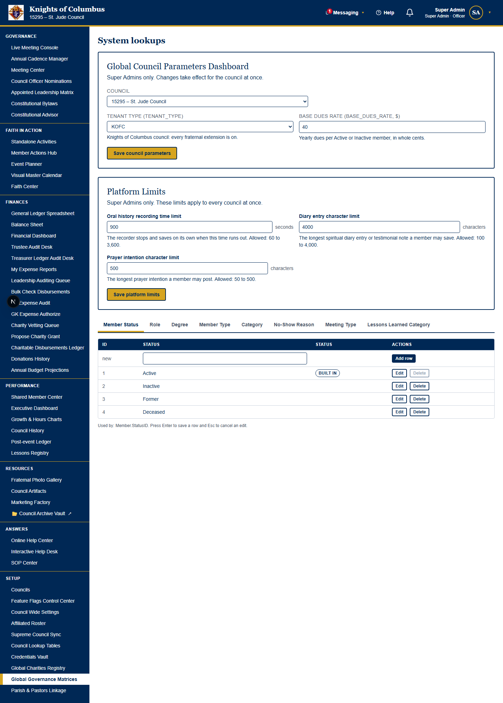
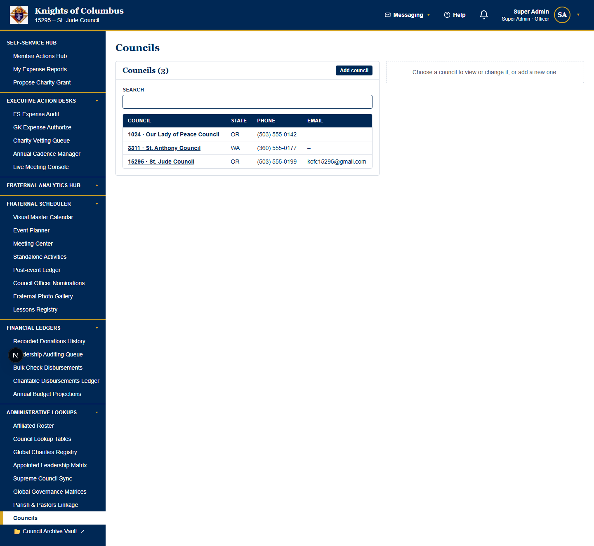
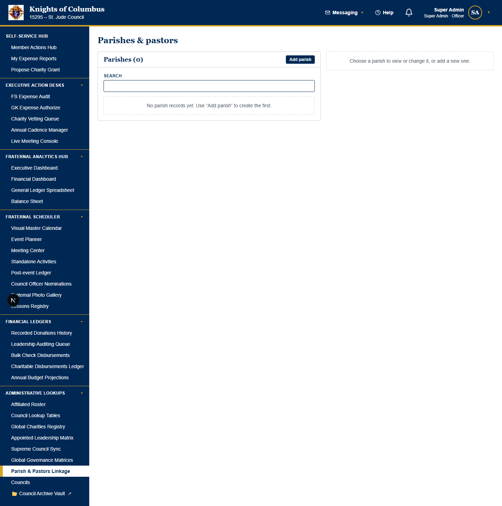
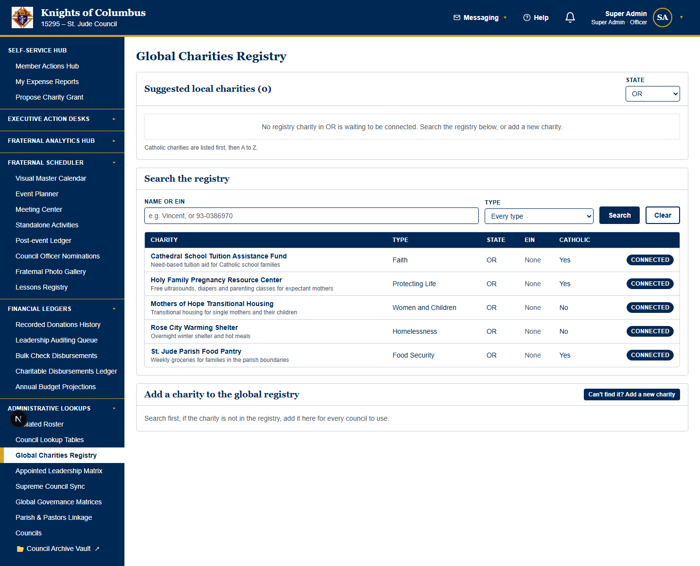
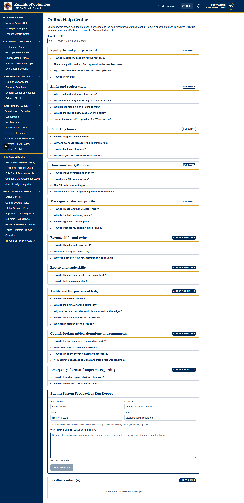

# Fraternal Council Archives™ — Super Admin System Manual

**Audience:** Super Admins: the platform owner and the people who run the platform for every council.

**Covers:** platform work only: the Super Admin Desk, the module switches of every council, parent organizations and their schema, Global System Parameters and the platform settings, the AI suggestion cutoff, council access requests, Admin impersonation, screen watching, the platform feedback inbox and the three local database files.

> **Council work is in the Administrator User Guide.** A council Admin's settings, lookups, vault, View As Member, the Admin Desk, the hub laptop, resets, ports and the firewall are in the [Administrator User Guide](ADMIN_USER_GUIDE.md). Officer work is in the [Treasurer Manual](TREASURER_MANUAL.md), the [Financial Secretary Manual](FINANCIAL_SECRETARY_MANUAL.md) and the [Executive Governance Manual](EXECUTIVE_GOVERNANCE_MANUAL.md).
> **Numbering:** this manual numbers its own chapters from 1. A reference to a section in another manual names that manual.

---

## Contents

- [1. The Super Admin Desk](#1-the-super-admin-desk)
- [2. Module feature flags for every council](#2-module-feature-flags-for-every-council)
- [3. Parent organizations](#3-parent-organizations)
- [4. Global System Parameters and the AI suggestion cutoff](#4-global-system-parameters-and-the-ai-suggestion-cutoff)
- [5. Council access requests](#5-council-access-requests)
- [6. Impersonation and screen watching](#6-impersonation-and-screen-watching)
- [7. The platform feedback inbox](#7-the-platform-feedback-inbox)
- [8. The three local database files](#8-the-three-local-database-files)

---

## 1. The Super Admin Desk

### 1.1 Concept: the operational lifecycle of the desk
The **Super Admin Desk** is the platform owner's workspace. Every Active Super Admin sign-in gets the **Super Admin Desk** tab on the **Active Desks** row. The tab is not shown while a Super Admin views the portal as another member. Council Admins never see the tab.

A council moves through the desk in this order:

| Stage | Drawer or page | What the Super Admin does | Section |
| --- | --- | --- | --- |
| 1. Request | **Communications Cabinet** → **Council Access Request Approval Queue** | Reads the council's request and selects **Approve**. The council and its first Admin are created. | 5.2 |
| 2. Map | **Global System Parameters** → **Parent organizations** | Maps the council to its parent organization (`KofC` or `SECULAR_CHARITY`), and to a parent council when it is a chapter. | 3.3 |
| 3. Price | **Global System Parameters** → **Global Council Parameters Dashboard** | Sets the base dues rate. | 3.2 |
| 4. Deploy | **System Feature Flag Control Panel** or the **Master Feature Deployment Grid** | Switches on the premium modules the council bought. A new council starts with the core systems only. | 2.2 |
| 5. Tune | **Global System Parameters** → **Platform Settings** | Keeps the shared numbers, or one parent organization's numbers, including the AI suggestion cutoff. | 4.4 |
| 6. Listen | **Communications Cabinet** → **Feedback Communication Center** | Reads the notes that council Admins send to the platform owner. | 7.1 |
| 7. Support | **Impersonate Council Admin**, **Remote Assistance** | Sees the portal as a council Admin, or watches an officer's shared screen. | 6.2, 6.4 |

The desk never holds a council's own member feedback. Members send that to their own council's Admins on **Feedback Support**, and the Admins answer it in the **Member Feedback Queue** drawer of the **Admin Desk** (section 10 of the Administrator User Guide).

### 1.2 Use the Super Admin Desk
> **Who can do this:** Super Admins. The **Super Admin Desk** tab shows on the **Active Desks** row for every Super Admin sign-in, beside the council desks. Council Admins do not see the tab. A Super Admin also has the **Admin Desk** tab beside it. The System Settings pillar has no **Admin Desk** link: the tab opens the desk.

**Goal:** Read Admin notes, approve council licenses, change platform settings and switch council modules from one desk.

**Start point:** **Active Desks** row → **Super Admin Desk**.

The desk has a filing spine on the left. Each drawer on the spine opens on the stage to the right. The spine holds two cabinets and one freestanding drawer:

| Cabinet | Drawer | What it holds |
| --- | --- | --- |
| **Communications Cabinet** | **Feedback Communication Center** | The notes that council Admins send, newest first. |
| **Communications Cabinet** | **Council Access Request Approval Queue** | The councils that ask to join the platform. Each pending request has an **Approve** button. |
| **Settings Cabinet** | **Global System Parameters** | Each council's base dues rate and organization type, and the platform settings every council shares. |
| **Settings Cabinet** | **Global Lookup Tables** | The platform-wide lookup tables, one tab for each table. |
| **Settings Cabinet** | **System Feature Flag Control Panel** | Each council's modules. A checkbox switches a module on or off at once. |
| **Settings Cabinet** | **Secure Access Vault** | The sealed server connection keys of your own home council only. The drawer never opens another council's keys. |
| (freestanding) | **Global Charities Registry** | The registry every council shares: search, verify and add charities. |

**Steps:**
1. Select a drawer on the filing spine.
2. Do the work on the stage: read the notes, select **Approve**, change a setting or select a module checkbox.
3. Select **Back to Desk Blotter** to close the drawer.

**Expected result:** The drawer opens on the stage beside the spine. The desk has no row of folders across the top.

**Common problems:**
| Problem | Cause | Fix |
| --- | --- | --- |
| The **Super Admin Desk** tab is missing. | Your account is not a Super Admin, or you view the portal as another member. | Sign in with a Super Admin account. Stop the view-as session. |
| A module switch has no effect on a council. | The council's members must reload the portal. | Ask the members to reload the page. |
| The **Application Advisory Panel** link is missing. | Your account is not a Super Admin and you have not accepted an invitation. | Sign in with a Super Admin account, or accept an invitation. |

---

## 2. Module feature flags for every council

### 2.1 Concept: backend logic of the flags
Each council row has nineteen on/off columns. Each column is a module feature flag. A Super Admin sets them on the **Master Feature Deployment Grid**.

Six modules are **core systems**. They have no flag and always show: service hours, event communications (messages and distribution lists), calendars, event shifts, flagged hours review and the financial management dashboards. The grid lists them at the top under **Core systems (always on)**.

A new council starts with the **lightweight footprint**: the core systems only. Every flag is a premium module and stays off until a Super Admin turns it on. A council that was on file before this release keeps its own switches.

| Flag column | Label in the Master Feature Deployment Grid | Web pages hidden when off | Phone items hidden when off |
| --- | --- | --- | --- |
| `flag_mobile_elections` | **Officer elections** | Council Election Center, Appointed Leadership Matrix | None |
| `flag_fundraising_inflow` | **Fundraising inflow** | Donations History | **Collect** |
| `flag_charity_proposals` | **Charity proposals** | Propose Charity Grant, Charity Vetting Queue, Charity Check Issuance (the Charitable Grants Registry drawers) | None |
| `flag_meeting_management` | **Meeting management** | Meeting Center, Recurring Meetings, Live Meeting Console | **Mtgs** |
| `feature_expense_reporting` | **Expense reporting** | My Expense Reports, Leadership Auditing Queue, FS Expense Audit Queue, Treasurer Ledger Audit, GK Expense Authorize, Disbursed Check Registry | The expense screen and the **Expense reports** card on **Home** |
| `feature_faith_center` | **Faith Center** | Faith Center | The feast-day banner, the Daily Bible Quote, the praying hands and the prayer intentions |
| `feature_constitutional_advisor` | **Constitutional Advisor** | Constitutional Advisor | None |
| `feature_council_bylaws` | **Council bylaws** | Constitutional Bylaws | None |
| `feature_council_history` | **[ 📜 Fraternal Annals & Oral History ]** | Council history (Team Legacy), the **Fraternal Diary Entry Logs** and **Oral History Recordings** drawers of the **Historian Desk** | None |
| `feature_live_meeting_console` | **Live meeting console** | Live Meeting Console | None |
| `feature_capital_assets` | **Capital asset tracking** | Council Asset Management, the **Council Asset Management** drawer of the **Admin Desk** | The **Council assets** button and screen |
| `feature_charity_registry` | **Global charity registry** | Global Charities Registry, the **Global Charities Registry** drawer of the **Admin Desk** | None |
| `feature_document_compilation` | **Document compilation pipelines** | The **Custom user guides** card on **Council Wide Settings**. The server also refuses the guide requests. | None |
| `feature_photo_gallery` | **Media & Memory Center** | Photo Gallery, the **Google Drive Media Gallery Sync Board** and **Meeting Photos** drawers of the **Historian Desk** | None |
| `feature_lessons_registry` | **Lessons & Knowledge Registries** | Lessons Registry, Operations Knowledge Vault, the archive drawers of the officer desks | None |
| `feature_marketing_factory` | **Recruitment Factory** | Recruitment Factory. The server also refuses the flyer co-pilot requests. | None |
| `feature_loaner_library` | **Shared Equipment Library** | Loaner Library, the **Shared Equipment Library** drawer of the **Grand Knight Desk** | None |
| `flag_motion_requests` | **Motion requests** | Motion Request, the **My Motion Requests** panel of the **Member Desk** and the **Motion Requests** drawer of the **Grand Knight Desk** | None |
| `feature_advanced_audits` | **Trustee Semiannual Audit** | Financial Audits; the **Trustee Semiannual Audit**, **Expense Report (ER) Routing Track** and **Charitable Donation Records** drawers of the **Financial Secretary Desk**; the **Cash Box Audit Closure Panel** and **Bank Statement Match-Window** drawers of the **Treasurer Desk** | None |

The retired columns `flag_complex_shifts`, `feature_volunteer_quarantine` and `feature_financial_management` stay in the database, but the portal does not read them. Their modules are core systems now.

The flags follow four rules.

1. A flag that is off hides the module from every member of the council. The rule includes Admins.
2. A hidden desk is gone from the sidebar, the officer desks and the **Navigation Guide**.
3. A hidden page refuses a typed web address. The phone sends a member on a hidden screen back to **Home**.
4. A flag never deletes data. A flag that is switched back on restores the module with all records.

The council's custom manuals follow the flags too. When an Admin prints a council copy (8.7 of the Administrator User Guide), each section about a switched-off module starts with the banner **This premium module is currently disabled**. The general guides always describe every module.

### 2.2 Switch a module on or off
> **Prerequisite (who can do this):** You must have Super Admin privileges. Council Admins do not see the **Master Feature Deployment Grid**.
> **Warning:** a switched-off module disappears at once for every member of the council, on the web and on the phone.

**Goal:** Turn one optional module on or off for one council.

**Start point:** Sidebar → System Settings → **Master Feature Deployment Grid**. The address `/super-admin` opens the same grid.

**Steps:**
1. Select the parent organization tab above the grid, for example **Knights of Columbus council**. The tab shows how many councils it has. The grid shows only the councils of that parent organization.
2. Find the row of the module. The rows are in two groups: **Core systems (always on)** and **Premium modules**. Each row shows the label, the flag column and the pages the flag hides.
3. To change one council, find the column of the council. Each column shows the council number and how many modules are on. Clear the box to hide the module. Select the box to show the module.
4. To change every council of the parent organization, use the box in the **Every council in** column. A row with some councils on shows, for example, *2 of 5* under the box.
5. To put a council back to the lightweight footprint, select **Lightweight** under the council number.

**Expected result:** The platform saves each switch at once. Members of the council see the change the next time each page loads.

**Common problems:**
| Problem | Cause | Fix |
| --- | --- | --- |
| A member still sees a phone tab. | The phone read the flags before the change. | Ask the member to sign out and sign in again. |
| *"… is not a feature flag"* | The request named an unknown flag. | Use one of the nineteen flags in 2.1. |
| *"… is switched off for this council."* | A premium module is off. | Ask a Super Admin to turn it on in the **Master Feature Deployment Grid**. |
| A council is not in the grid. | The grid shows one parent organization at a time. | Select the tab of the council's parent organization. |

---

## 3. Parent organizations

### 3.1 Concept: the ParentOrganizations schema logic
Schema 112 files every council under one parent organization. Two tables hold the hierarchy:

| Table | Columns | What a row means |
| --- | --- | --- |
| `ParentOrganizations` | `id`, `org_name`, `org_code`, `vertical_type` (`FRATERNAL` or `SECULAR_NONPROFIT`), `created_at` | One parent organization. The seed holds the Knights of Columbus (`KofC`, `FRATERNAL`) and the Secular Charity (`SECULAR_CHARITY`, `SECULAR_NONPROFIT`). |
| `CouncilParentMappings` | `id`, `council_id`, `parent_org_id`, `parent_council_id`, `mapped_at` | One row for each council: its parent organization and, for a chapter, the parent council above it. |

The platform finds a council's parent organization in this order:

1. The council's `CouncilParentMappings` row.
2. Else the council's stored `Council.parent_organization` code.
3. Else the council's tenant type: `GENERIC` is the Secular Charity, anything else the Knights of Columbus.

A mapping write keeps `Council.parent_organization` and `Council.tenant_type` in step, so older screens read the same answer. Only the Knights of Columbus is fraternal: its councils get the fraternal areas, the four degrees and the Form 1728 suggestions.

The eight global lookup tables and `PlatformSettings` each carry `parent_org_id`. A row with `parent_org_id` NULL is shared by every organization. A row with a value is read only by that organization's councils, and an organization's own row overrides the shared row of the same name. The four fraternal degrees belong to the Knights of Columbus.

### 3.2 Set a council's base dues rate and parent organization
> **Prerequisite (who can do this):** You must be a Super Admin.
> **Warning:** a new parent organization changes the sidebar and the labels of every member of the council at once.

**Goal:** Set the base dues rate and the parent organization of one council.

| Parent organization | What the council sees |
| --- | --- |
| `KofC` | The Knights of Columbus council: the Knights lookups, every fraternal area and the Form 1728 suggestion windows on events and activities. |
| `SECULAR_CHARITY` | A non-denominational charity: the fraternal areas and Form 1728 are hidden, the labels say Chapter and President, and the settings page is **Organization Settings** with the **Organization Feature Matrix**. |

The older tenant type changes with the parent organization: `KofC` is `KOFC`, and `SECULAR_CHARITY` is `GENERIC`.

**Start point:** Sidebar → System Settings → **Global System Parameters** → **Global Council Parameters Dashboard**.

**Steps:**
1. Choose the council in **Council**.
2. Choose the **Parent organization**: `KofC` or `SECULAR_CHARITY`.
3. Enter the **Base dues rate** in dollars.
4. Select **Save council parameters**.

**Expected result:** A message shows the council number, the parent organization and the new base dues. The council's dues figures use the new rate.

**Common problems:**
| Problem | Cause | Fix |
| --- | --- | --- |
| The message says "Enter a base dues rate." | The rate box is empty. | Enter the rate, then save. |
| The Faith Center and the Supreme Council Sync left the sidebar. | The parent organization is `SECULAR_CHARITY`. | Choose `KofC` again. |

The council's parent organization mapping (3.3) moves with the new code.

### 3.3 Add a parent organization and map a council
> **Prerequisite (who can do this):** You must be a Super Admin.
> **Warning:** only the Knights of Columbus (code `KofC`) turns on the fraternal features. A council mapped to any other organization sees the white-labelled portal.

**Goal:** Add an umbrella organization, and put a council (chapter) under it.

**Start point:** Sidebar → System Settings → **Global System Parameters** → **Parent organizations**. The same card is in the **Settings Cabinet** of the **Super Admin Desk**.

**Steps:**
1. To add an organization, enter the **Name**, for example `Elks Lodge`.
2. Enter the **Code**, for example `ELKS_LODGE`. The code starts with a letter and has only letters, digits and underscores.
3. Choose the **Vertical**: **Fraternal order** or **Secular nonprofit**.
4. Select **Add parent organization**.
5. To map a council, choose the **Council** and the **Parent organization**.
6. Optional: choose the **Parent council** when the council is a chapter under another council.
7. Select **Save mapping**.

**Expected result:** The **Parent organizations** table shows the organization and its number of councils. The **Council parent mappings** table shows the council under its parent organization and parent council.

**Common problems:**
| Problem | Cause | Fix |
| --- | --- | --- |
| *"A parent organization named … already exists"* | The name or the code is taken. | Use another name or code. |
| *"A council cannot be its own parent council."* | The same council is chosen twice. | Choose another parent council, or **None (top level)**. |
| A council cannot be deleted. | A chapter is mapped under it. | Map the chapter to another parent council first. |

### 3.4 Keep the global lists, councils, parishes and charities
> **Prerequisite (who can do this):** You must be a Super Admin for **Global Lookup Tables** and **Councils**. You must be a council Admin or a Super Admin for **Parish & Pastors Linkage** (the parish matrix and the home parish link: 3.5, and section 5.6 of the Administrator User Guide). You must be a charity registry keeper for **Global Charities Registry**.
> **Warning:** a value marked **Built in** cannot be renamed or deleted.

**Goal:** Keep the lists that every council shares, or the lists of one parent organization.

**Start point:** Sidebar → System Settings.

**Steps:**
1. Open the page.
2. On **Global Lookup Tables**, choose the **Parent organization**. Choose **Shared by every organization** for a row that every council reads. Choose an organization for a row that only its councils read.
3. Edit the row, or add a new row. A new row is filed under the parent organization that you chose.
4. Save.

<!-- KEEP_IMAGE: global governance matrices capture -->

<!-- /KEEP_IMAGE -->

<!-- KEEP_IMAGE: councils capture -->

<!-- /KEEP_IMAGE -->

<!-- KEEP_IMAGE: parishes and pastors capture -->

<!-- /KEEP_IMAGE -->

<!-- KEEP_IMAGE: global charities registry capture -->

<!-- /KEEP_IMAGE -->

The base dues rate, the tenant type and the **Platform Settings** are not on **Global Lookup Tables**. A Super Admin sets them on **Global System Parameters** (sections 4.1 to 8.8).

**Expected result:** Every council sees a shared value. Only the councils of a parent organization see a value filed under it.

**Common problems:**
| Problem | Cause | Fix |
| --- | --- | --- |
| Finance officers lost access. | A role named Treasurer or Financial Secretary was renamed. | Restore the exact role name. |
| *"… already exists"* when you add a row for one organization. | A shared row has the same name. Every council already reads it. | Use the shared row, or give the new row a different name. |
| A council does not see a new row. | The row is filed under another parent organization. | Choose the council's parent organization in the list and add the row there, or add it as shared. |

### 3.5 Concept: Parish & Pastors Linkage and the parish ledger accounts
Schema 113 keeps parishes and pastors in three tables:

| Table | What it holds | Key rule |
| --- | --- | --- |
| `Parishes` | The parishes that a council keeps (`council_id`). `associated_council_id` marks the one council linked to the parish (its home parish). `gl_account_id` names the parish's account owner in that council's General Ledger. | `associated_council_id` is unique. A council links to one parish, and a parish to one council. |
| `Pastors` | The pastors that a council keeps (`council_id`). | A pastor no longer belongs to one parish. |
| `PastorParishMappings` | One row for each pastor and each parish that the pastor serves. | The pastor and parish pair is unique. The rows go with the pastor when the pastor is deleted. |

When an Admin or a Super Admin selects **Link as home parish**, the portal does these steps in one transaction (`parishes.setCouncilAssociation`):
1. It ends the council's link to any other parish.
2. It finds the parish's account owner: first the account that `gl_account_id` names, then an account named `Parish - ` and the parish name. If there is none, it adds one: an **Asset** account, owned by **Parish** (`PARENT_ORGANIZATION`), with the parish name as **Name members see** and the parish phone as the contact number.
3. It adds the missing baseline **Asset** accounts under the account owner: `Parish - <parish name> - Electronic Giving` and `Parish - <parish name> - Cash & Check Collections`.
4. It sets `associated_council_id` and `gl_account_id` on the parish.

The link refuses a parish that another council keeps. It refuses an account of the same name that is not a Parish **Asset** account; the Admin renames that account first. **Unlink home parish** clears `associated_council_id` only. The ledger accounts and their postings stay. A linked parish cannot move to another council or be deleted until it is unlinked. Its account owner cannot be deleted while the parish names it.

A Super Admin uses the same page as a council Admin, and picks the council at the top. The step-by-step task is in the Administrator User Guide, section 5.6.

<!-- KEEP_IMAGE: parish matrix capture -->

<!-- /KEEP_IMAGE -->

---

## 4. Global System Parameters and the AI suggestion cutoff

### 4.1 Concept: the Global System Parameters page
The **Global System Parameters** page holds the numbers that sit above the settings of one council. Only Super Admins see the page.

| Card | What the card holds | Applies to |
| --- | --- | --- |
| **Global Council Parameters Dashboard** | The base dues rate and the tenant type (Knights of Columbus council or a white-labelled organization) | One council at a time |
| **Parent organizations** | The parent organizations, the form that adds one and the council mappings (section 3.3) | The whole platform |
| **Platform Settings** | Three cards of numbers (section 4.2) | Every council, or the councils of one parent organization |

The **Platform Settings** card had the name **Platform Limits** in earlier versions. The cards were on **Global Lookup Tables** before that. The **Master Feature Deployment Grid** holds only the on/off module switches.

### 4.2 Concept: the platform settings
| Card | On-screen label | Default | Allowed values | What the setting controls |
| --- | --- | --- | --- | --- |
| **Reminder Cadences** | **Days before a scheduled meeting that invitations appear** | 5 days | 1 to 60 | When the invitations of a cadence meeting reach the members (section 2 of the Executive Governance Manual). Meetings that are already built keep their release dates. |
| **Sign-in & Records** | **Hours a portal sign-in lasts** | 8 hours | 1 to 168 | When the portal server ends a web sign-in. The member then signs in again. |
| **Sign-in & Records** | **Days to keep audit records** | 180 days | 30 to 3,650 | **Not used yet.** The portal keeps every record today. |
| **Suggestion Engines** | **Form 1728 suggestion confidence cutoff** | 60 percent | 0 to 100 | A Form 1728 suggestion card shows only when the engine is at least this sure. The popup can show fewer than three cards, or none. |
| **Recording & Text Limits** | **Oral history recording time limit** | 900 seconds | 60 to 3,600 | The oral history recorder |
| **Recording & Text Limits** | **Diary entry character limit** | 4,000 characters | 100 to 4,000 | The spiritual diary and the testimonial note |
| **Recording & Text Limits** | **Prayer intention character limit** | 500 characters | 50 to 500 | The Council Prayer Intentions List |

A sign-in that already started keeps its old end time. The new sign-in length applies from the next sign-in.

### 4.3 Concept: the AI suggestion cutoff
The Form 1728 suggestion engine reads the title of an event or an activity and suggests the Form 1728 program lines it counts toward. Each suggestion carries a confidence score from 0 to 100 percent.

| Item | Value |
| --- | --- |
| Column | `PlatformSettings.global_ai_confidence_cutoff` |
| Label | **Form 1728 suggestion confidence cutoff** on the **Suggestion Engines** card |
| Default | 60 percent |
| Allowed values | 0 to 100 |
| Scope | The shared row (every organization), or one parent organization's own row (section 3.1) |
| Who reads it | The Form 1728 suggestion popup on events and activities, for Knights of Columbus councils only |

A suggestion below the cutoff is not shown. The popup can show three cards, fewer, or none. With no card, the officer sees *"No suggestion is at least 60% sure"* (with the current cutoff) and chooses the line from the list. A lower cutoff shows more guesses; a higher cutoff shows only clear matches. The engine is an intent classifier that runs on the device or the server with no outside service: it weighs the phrases in the title (the description at half weight) and the event's mission area. No record leaves the platform.

### 4.4 Change the platform settings
> **Prerequisite (who can do this):** You must be a Super Admin.
> **Warning:** the shared settings apply to every council that has no settings of its own.

**Goal:** Set the numbers that every council shares, or the numbers of one parent organization.

**Start point:** Sidebar → System Settings → **Global System Parameters** → **Platform Settings**.

**Steps:**
1. Choose the **Parent organization**. **Shared by every organization (platform default)** changes the numbers of every council. An organization changes only the numbers of its councils. Its first save copies the shared numbers, then changes the numbers that you entered.
2. Find the card that holds the setting (section 4.2).
3. Optional: select **(i)** beside the field to read what the setting does. Select **Close**.
4. Enter the new number.
5. Select the save button of the card, for example **Save Sign-in & Records**.

**Expected result:** A message says "Platform settings saved." and names the councils that use them. When you change **Hours a portal sign-in lasts** in the shared settings, the message also says that the portal server uses the new sign-in length from the next sign-in. The sign-in length of the portal server is always the shared value.

**Common problems:**
| Problem | Cause | Fix |
| --- | --- | --- |
| A character limit does not go above its default. | The default is the largest size that the council records can store. | Keep the limit at the default or lower. |
| A recording stopped early. | The recording time limit is lower than the speaker needed. | Raise the limit. The largest value is 3,600 seconds (60 minutes). |
| The message says that the portal server did not take the new sign-in length. | Your web sign-in on the server ended. | Sign out. Sign in again. Save the number again. |
| Meeting invitations still appear 5 days before the meeting. | The meetings were built before the change. | No fix is needed. Meetings built after the change use the new number. |

---

## 5. Council access requests

### 5.1 Concept: council access requests
A council that is not on the platform can ask for access from the sign-in page. The sign-in page has a small **Request Access** link under the sign-in prompts, on the web and on the phone. Select the link to open the form.

The form asks for four items: the council name, a contact email, the city and the state. Anyone can send the form. The person does not need an account.

The platform saves each request as **Pending**. The platform also emails a notice to `council15295@stmarys.org`. Super Admins read the requests on the **Super Admin Desk**, in the **Council Access Request Approval Queue** drawer of the **Communications Cabinet**. Since Sprint 10, the **Grand Knight Desk** has no **Inbound Council Mail Center** drawer.

Approving a request marks the request as reviewed. Approving does not create the council. A Super Admin adds the council on the **Councils** page.

| Rule | Value |
| --- | --- |
| Requests from one contact email | 3 in one hour |
| Requests from one network address | 10 in one hour |
| Status values | Pending, Approved |

> The web portal keeps requests on the portal server. A server restart clears them until the production database is connected. A request sent from the phone stays on that phone.

### 5.2 Approve a council access request
> **Who can do this:** Super Admins (every Super Admin has the **Super Admin Desk** tab). Other members do not see the **Inbound Council Mail Center**.

**Goal:** Mark a council's access request as reviewed.

**Start point:** **Active Desks** row → **Super Admin Desk** → **Communications Cabinet** → **Council Access Request Approval Queue**.

**Steps:**
1. Read the council name, the city, the state and the contact email of the request.
2. Select the contact email to write to the council, if you need more information.
3. Select **Approve**.
4. Open Sidebar → System Settings → **Councils** to add the council.

**Expected result:** The request shows a gold **Approved** label. The pending count in the card title goes down by 1.

**Common problems:**
| Problem | Cause | Fix |
| --- | --- | --- |
| The card says "No council has asked for access yet." | No request reached the portal server. | Ask the council to send the form again from the web sign-in page. |
| The card shows an error about the session. | Your server session ended. | Sign out, then sign in again. |

---

## 6. Impersonation and screen watching

### 6.1 Concept: user impersonation (view as a member)
A Super Admin can see the portal exactly as one member sees the portal. Use this to check a member's sidebar, pages and permissions.

| Rule | Value |
| --- | --- |
| Who can start the view | Active Super Admins only |
| Who can be viewed | Council Admins only. Use **View As Member** (9.1 of the Administrator User Guide) to see what any other member sees |
| Saving in the view | Not possible. Every save is refused. |
| Longest view | 60 minutes, or until your own sign-in ends |
| Record | The portal server logs each start and stop |

The portal server holds both sign-ins in signed cookies. The browser cannot read or change them. A gold bar across the top of the portal shows whose view is open.

The view uses the member's own council. The member can belong to a council other than your council. The portal then switches to that council's settings before the first page opens:

- the council's modules (the feature flags)
- the council's organization type and its labels
- the council's timing settings, for example the expense filing window
- the council's ledgers, desks and rosters

The gold bar names the member's council. When you select **Return to my account**, the portal switches back to your own council.

Impersonation is only for a Super Admin who helps a local council Admin. Super Admins find the Admin in two places. The **Council Roster** shows the **Impersonate Admin** button on each council Admin's row. The **Impersonate Council Admin** page shows the Admins of every council in one tree.

### 6.2 View the portal as a council Admin
> **Who can do this:** Super Admins. Other members do not see the **Impersonate Admin** button.

**Goal:** See the portal with one council Admin's sidebar, pages and permissions while you help the Admin.

**Start point:** Sidebar → Faith In Action → **Council Roster**.

**Steps:**
1. Choose the Admin's council in **Council**, or keep **All councils on the platform**.
2. Find the Admin in the roster table.
3. Select **Impersonate Admin** in the **Actions** column.
4. Look at the pages. The portal opens on the Admin's **Home**.
5. Select **Return to my account** in the gold bar to end the view.

**Expected result:** The gold bar says "You are viewing the portal as" and the Admin's name. After **Return to my account**, your own sidebar comes back.

**Common problems:**
| Problem | Cause | Fix |
| --- | --- | --- |
| A save fails with "You are viewing the portal as another member, so nothing can be saved." | The view is read-only. | Select **Return to my account**, then make the change as yourself. |
| The row has no **Impersonate Admin** button. | The member is not a council Admin, or is you. | Impersonate council Admins only. To see a member's view, ask the council's Admin to use **View As Member**. |
| An error says "The server did not answer, so the view could not start." | The portal server cannot see the member or your session ended. | Sign out, sign in again, then try again. |

### 6.3 Find a council Admin in any council and impersonate the Admin
> **Who can do this:** Super Admins. Other members do not see this page.

**Goal:** Find one council Admin among all councils without a long scroll, then view the portal as that Admin.

**Start point:** Sidebar → System Settings → **Impersonate Council Admin**.

**Steps:**
1. Type part of a name, member number, email, role or council number in the search box.
2. Read the suggested names under the box. Names that start with your text come first.
3. Select **Impersonate** beside the Admin. Go to step 7.
4. To browse without a search, select a council in the **Council directory**. The council opens.
5. Select a group in the council. Each group lists only the council's Admins.
6. Select **Impersonate** beside the Admin.
7. Look at the pages. The portal opens on the Admin's **Home**, with the Admin's council settings.
8. Select **Return to my account** in the gold bar to end the view.

**Expected result:** The gold bar names the Admin and the Admin's council. The sidebar, desks and settings are the Admin's own.

**Common problems:**
| Problem | Cause | Fix |
| --- | --- | --- |
| A member is not in the tree. | The member is not a council Admin, or is you. | Impersonate council Admins only. |
| *"No council Admin matches"* | No Admin matches every word you typed. | Type fewer words. |
| An Admin shows in one group only. | Each Admin shows in the group of the highest seat. A Grand Knight who is also an Admin shows under **Executive Officers**. | Look in the group of the Admin's highest seat. |

### 6.4 Watch an officer's screen
> **Who can do this:** Super Admins. Other members do not see the Remote Assistance Desk.

**Goal:** See the screen an officer shares and guide the officer.

**Start point:** Sidebar → System Settings → **Remote Assistance Desk**.

**Steps:**
1. Select a request in **Open requests**.
2. Read the officer's note and the page name.
3. Look at the screen copy in the right panel. The copy refreshes every 5 seconds.
4. Guide the officer by phone or by message.
5. Select **Close request** when the officer has the answer.

**Expected result:** The right panel shows the officer's page at the officer's window size. After **Close request**, the request leaves the list.

**Common problems:**
| Problem | Cause | Fix |
| --- | --- | --- |
| The panel says "That request is closed." | The officer stopped sharing. | Ask the officer to send a new request. |
| The form fields in the copy are empty. | The platform never sends what the officer types. | Ask the officer to read the values to you. |

---

## 7. The platform feedback inbox

### 7.1 Read the feedback inbox
> **Prerequisite (who can do this):** You must have Super Admin privileges.

**Goal:** Read the notes and bug reports that council Admins send.

**Start point:** Sidebar → System Settings → **Administrative Feedback Loops** → **Feedback inbox**. Super Admins also read the notes on the **Super Admin Desk**, in the **Communications Cabinet** (1.2).

**Steps:**
1. Scroll below **Send a Note to the Platform Owner**.
2. Read each note. The newest note shows first.

The Online Help Center has no feedback form since Sprint 8O. Section 10.1 explains the change.

<!-- KEEP_IMAGE: online help center capture -->

<!-- /KEEP_IMAGE -->

**Expected result:** Each report shows the sender's name, council, phone, email and time (UTC).

**Common problems:**
| Problem | Cause | Fix |
| --- | --- | --- |
| The inbox is missing. | Only Super Admins see the inbox. | Ask a Super Admin. |
| The inbox is not on the Online Help Center. | The inbox moved to **Administrative Feedback Loops** in Sprint 8O. | Open Sidebar → System Settings → **Administrative Feedback Loops**. |

---

## 8. The three local database files

### 8.1 Concept: production, testing and training files
Every desktop installation keeps three SQLite files in its vault folder (`%APPDATA%\KofC Tracking Platform\vault`). The program asks which one to open at start-up.

| Mode | File | Network | Kept |
| --- | --- | --- | --- |
| Production | `central-hub-vault.db` | WAN sync with the central database | Always |
| Testing | `testing-sandbox.db` | Shared with laptops in the same hall over the Wi-Fi (encrypted UDP broadcasts) | Always |
| Training | `training-playground.db` | None | Deleted and seeded again at every start |

The server creates all three files on its first start. `KOFC_DATA_MODE` (`production`, `testing` or `training`) picks the file without the start-up question. `npm run dev:pilot -- --mode testing` does the same on the hub laptop.

Testing mode shares saves only when every laptop has the same mesh passphrase: `KOFC_MESH_PASSPHRASE` in the environment, or the file `.testing-key.json` in the vault folder, at least 12 characters. When testing mode starts with neither, the server (and `npm run dev:pilot -- --mode testing`) writes a new `.testing-key.json` with a random 256-bit passphrase, readable by the signed-in Windows user only. An existing key file is never replaced. Copy the first laptop's file to every laptop in the hall. A laptop with a different key works alone on its own file. The old `testing-mesh-passphrase.txt` file is no longer read. Each packet is sealed with AES-256-GCM. A laptop without the passphrase cannot read or forge a packet. Reads, sign-ins and passkeys are never sent. A packet older than five minutes, or one already heard, is dropped.

Training mode builds a practice council every start: the ten Practice Sandbox members, three upcoming practice fundraisers with volunteers, three training cash boxes (names and amounts in `packages/shared/src/fixtures/training-seed.json`) and seven generic sign-in accounts (`admin@training`, `gk@training`, `fs@training`, `tr@training`, `rec@training`, `hist@training`, `mem@training`, password `training`). The sign-in screen lists them on the **Training Profile Selection Board**. These accounts skip the Admin sign-in code, in training mode only.

The window shows an amber **Testing Mode** banner or a cobalt blue **Training Mode** banner across the top of every page. Production shows no banner.
