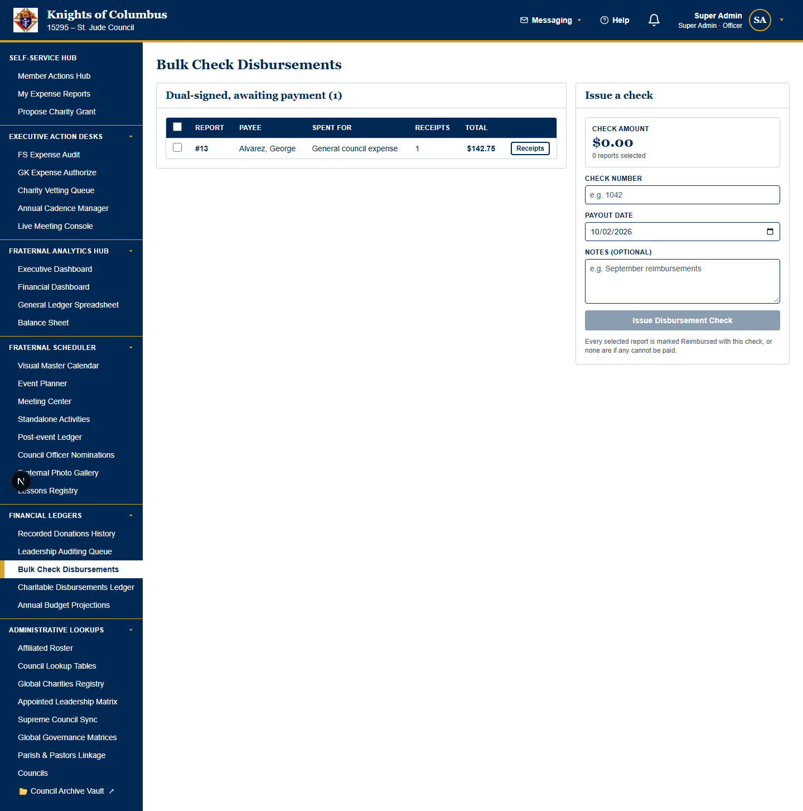
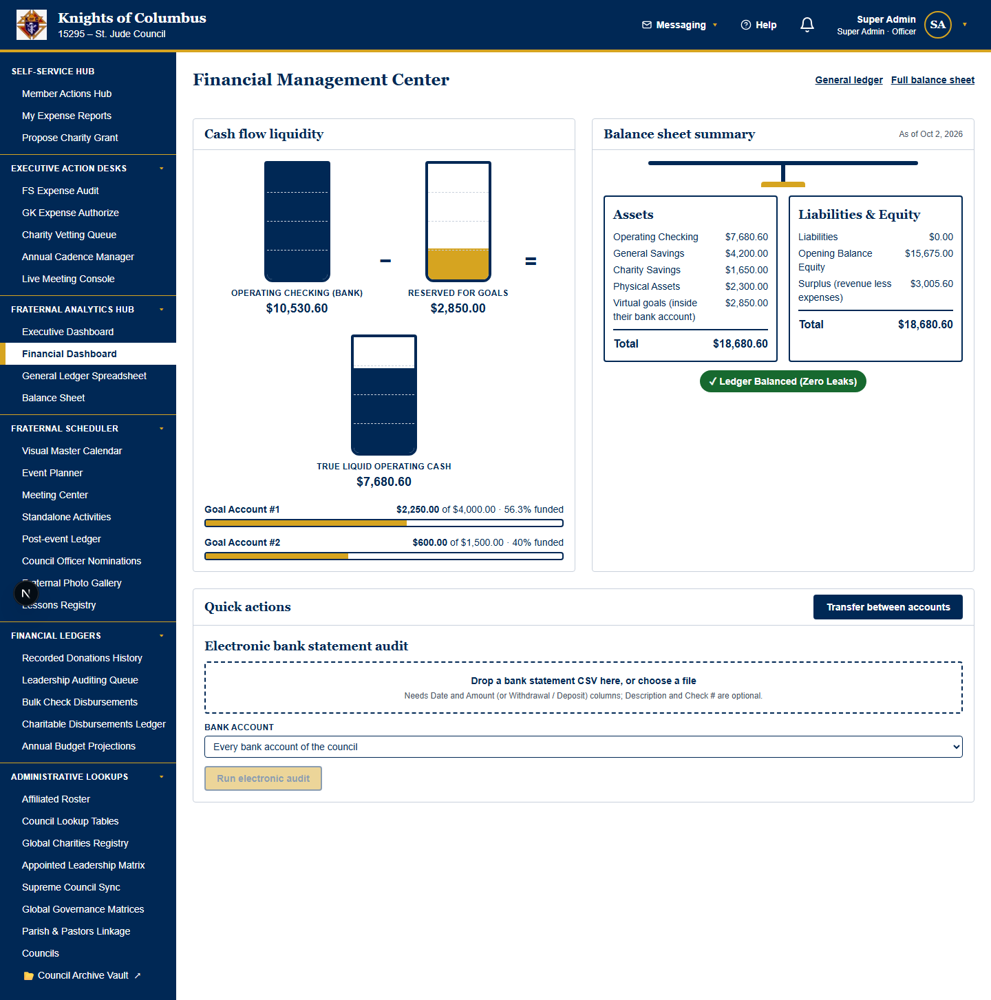
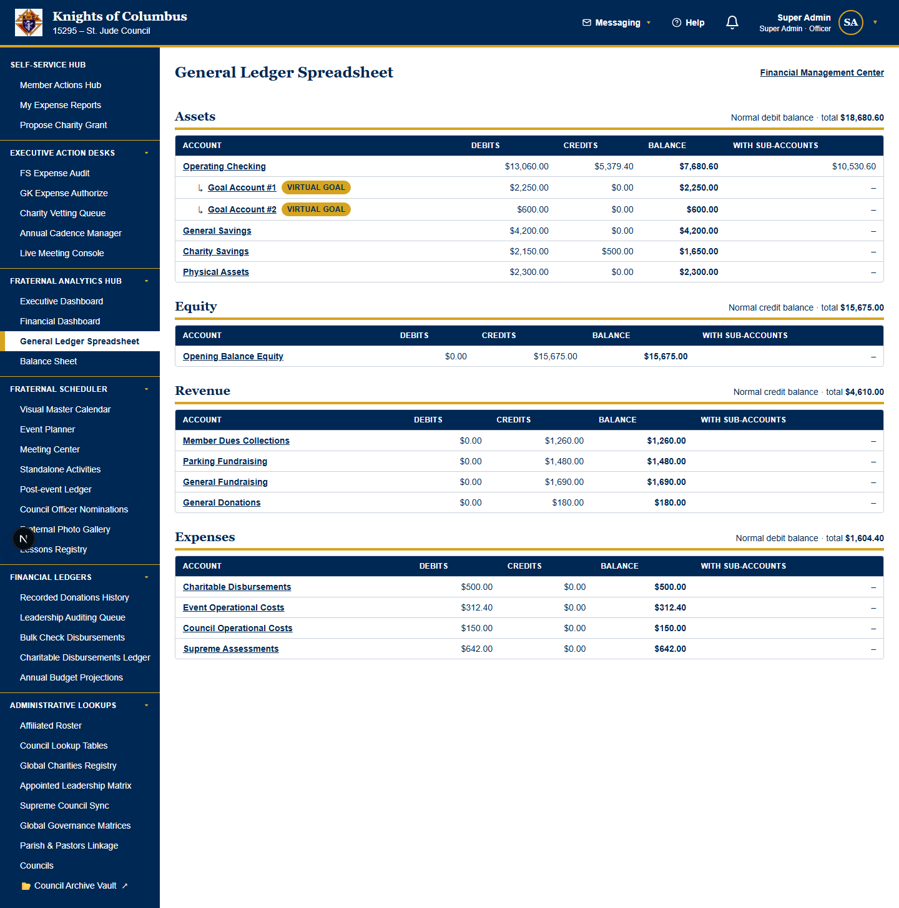
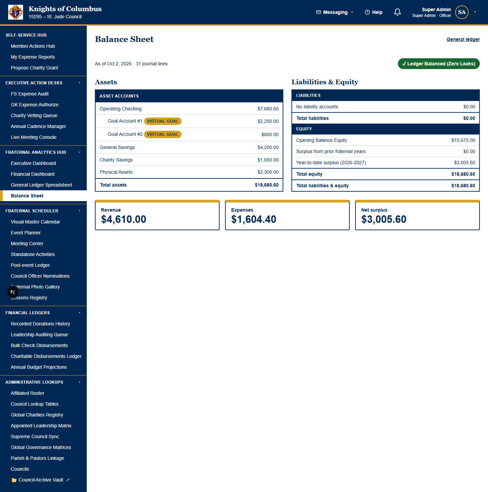
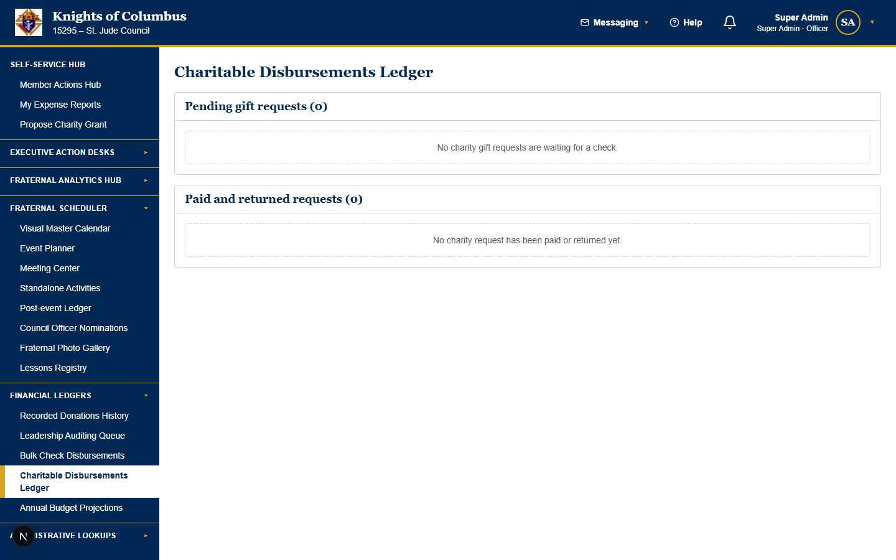
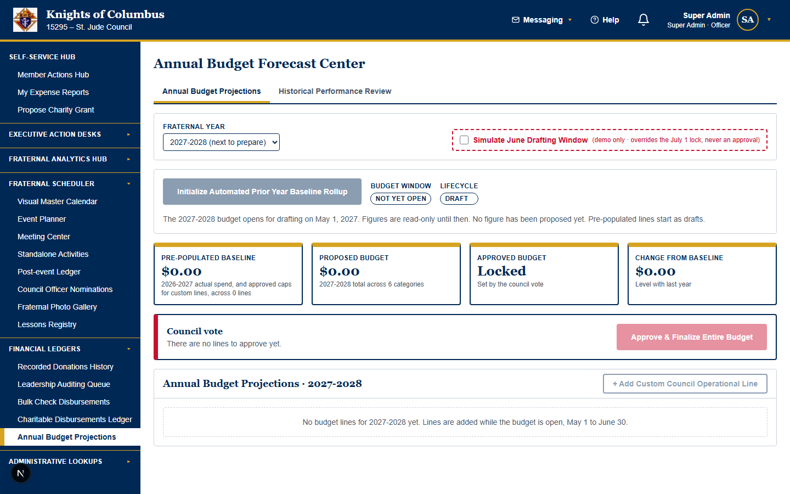

# Knights of Columbus Tracking Platform — Treasurer Manual

**Audience:** the council Treasurer.

**Covers:** the double-entry primer, the Treasurer Desk, coding sheets to a budget line and a ledger account, paying by check, batch coding of electronic donations (bulk coding), cash box audits, parish splits, split accounts (GL splits), the annual budget and the chart of accounts.

> **Open this manual from your desk.** The Treasurer Desk header has **📘 Treasurer Manual (PDF)** and a **How do I…** search that answers from this manual only.
> Signing up, logging hours and taking donations are in the [Member User Guide](MEMBER_USER_GUIDE.md).

> **Section numbers:** the four officer manuals share one numbering. Section 6.3 is the same section in whichever manual holds it. The [manual map](#manual-map) shows which manual holds each chapter.

---

## Contents

- [Primer: double-entry bookkeeping for the Treasurer](#primer-double-entry-bookkeeping-for-the-treasurer)
- [6. Finances: the Treasurer's work](#6-finances-the-treasurers-work)
- [17. Payment methods and revenue](#17-payment-methods-and-revenue)
- [19. The Treasurer Desk](#19-the-treasurer-desk)
- [23. Parish fundraiser splits](#23-parish-fundraiser-splits)
- [24. Batch coding and cash box audits](#24-batch-coding-and-cash-box-audits)
- [25. Account ownership and parish-held revenue](#25-account-ownership-and-parish-held-revenue)
- [29. Split accounts, budget categories and payment account names](#29-split-accounts-budget-categories-and-payment-account-names)
- [Manual map](#manual-map)

### How to read a tutorial

Every tutorial starts with a **Prerequisite (who can do this)** line. The line states the access privilege that the task needs. Stop when your role is not on the line.

Every tutorial then has five parts: **Goal**, **Start point**, **Steps**, **Expected result** and **Common problems**.
A **Warning** line comes before the steps when the task deletes data, sends messages, posts money or cannot be undone.

---

## Primer: double-entry bookkeeping for the Treasurer

This primer explains the bookkeeping rules behind every screen in this manual. Read it before your first coding session.

### Concept: the two sides of every transaction

The council's general ledger is a double-entry ledger. Every transaction has two sides:

- a **debit** side, on the left of the ledger;
- a **credit** side, on the right of the ledger.

The debits of a transaction always equal its credits. A transaction with unequal sides cannot be saved.

Each side names a ledger account. The accounts are listed in the chart of accounts (section 19.7.1).

### Concept: the five account types

| Account type | Holds | A debit | A credit |
| --- | --- | --- | --- |
| **Assets** | Money and property the council owns, for example the checking account | Increases the balance | Decreases the balance |
| **Liabilities** | Money the council owes, for example a parish share not yet paid | Decreases the balance | Increases the balance |
| **Equity** | The council's net worth | Decreases the balance | Increases the balance |
| **Revenue** | Money the council earns, for example fish fry sales | Decreases the balance | Increases the balance |
| **Expenses** | Money the council spends, for example food supplies | Increases the balance | Decreases the balance |

Assets equal liabilities plus equity. The **Balance Sheet** page shows this equation for the council.

### Concept: three examples from the Treasurer Desk

| Event | Debit | Credit |
| --- | --- | --- |
| A member gives a $50 cash donation. | Cash (Assets) $50 | Donation revenue (Revenue) $50 |
| The council pays a $120 expense report by check. | The coded expense account (Expenses) $120 | Checking (Assets) $120 |
| A $1,000 fish fry deposit posts to a 60% / 40% split account (section 29). | Checking (Assets) $1,000 | Council fish fry revenue (Revenue) $600 and Parish fish fry revenue (Revenue) $400 |

The third example is a GL split. One debit line meets two credit lines. The credits still add up to the debit. The split account itself takes no posting.

### Concept: coding, bulk coding and GL splits

- **Coding** gives one expense report a budget line and a ledger account. The Treasurer codes each report before the Grand Knight signs it (section 19.7).
- **Bulk coding** gives one ledger account to a batch of electronic donations in one step (section 24.5).
- **A GL split** shares each posting to one Revenue line among 1 to 10 other Revenue lines by fixed percentages that add up to 100% (section 29).

Coding is mandatory. A report without a budget line and a ledger account does not reach the Grand Knight.

### Check that the books balance

> **Prerequisite (who can do this):** You must be the council's Treasurer or Financial Secretary, a seated officer, an Admin of the council, or a Super Admin.

**Goal:** Confirm that the council's debits equal its credits before an audit or a meeting report.

**Start point:** Sidebar → Finances → **Financial Dashboard**.

**Steps:**
1. Open the **Financial Dashboard**.
2. Read the balance banner at the top of the page.
3. Open the **Balance Sheet**. Compare the total assets with the total liabilities and equity.

**Expected result:** The dashboard shows **✓ Ledger Balanced (Zero Leaks)**. The two totals of the **Balance Sheet** are equal.

**Common problems:**
| Problem | Cause | Fix |
| --- | --- | --- |
| The banner does not show **✓ Ledger Balanced (Zero Leaks)**. | A posting has unequal sides, or a cash box variance is not closed. | Read the newest postings in the **General Ledger Spreadsheet**. Close the cash box audit (section 24.6). |
| An account has an unexpected negative balance. | A debit and a credit were swapped. | Post a correcting transaction with the sides reversed (section 6.7). |

---

## 6. Finances: the Treasurer's work

### 6.5 Pay approved reports by check

> **Prerequisite (who can do this):** You must be the council's Financial Secretary or Treasurer, or a Super Admin. An Admin without a finance role does not see the page.
> **Warning:** a recorded check is permanent money out of the council's books.

**Goal:** Record the checks for dual-signed reports.

**Start point:** Sidebar → Finances → **Bulk Check Payments Made**.

**Steps:**
1. Tick the reports to pay. The page lists only reports with both signatures.
2. Enter the check number and the payout date for each report.
3. Save.

<!-- KEEP_IMAGE: bulk check payments made capture -->

<!-- /KEEP_IMAGE -->

**Expected result:** The member sees **Reimbursed** with the check number.

**Common problems:**
| Problem | Cause | Fix |
| --- | --- | --- |
| A report is missing. | The report lacks a signature. | Follow the report in the auditing queue (section 6.4). |

### 6.6 Concept: the general ledger

The general ledger is a double-entry ledger. Every transaction has debit lines and credit lines that balance.
A shared transaction id groups the lines.

| Page | Shows |
| --- | --- |
| **General Ledger Spreadsheet** | The chart of accounts with every posting |
| **Balance Sheet** | Assets against liabilities and equity |
| **Financial Dashboard** | Cash flow liquidity, the balance sheet summary, **Quick actions** and the **Electronic bank statement audit** |

Seated officers and Admins read the three pages. Only the FS, the Treasurer and Super Admins post, transfer or upload bank statements.

<!-- KEEP_IMAGE: financial dashboard capture -->

<!-- /KEEP_IMAGE -->

<!-- KEEP_IMAGE: general ledger spreadsheet capture -->

<!-- /KEEP_IMAGE -->

<!-- KEEP_IMAGE: balance sheet capture -->

<!-- /KEEP_IMAGE -->

### 6.7 Post to the ledger or reconcile a bank statement

> **Prerequisite (who can do this):** You must be the council's Financial Secretary or Treasurer, or a Super Admin.
> **Warning:** a posting changes the council's books for every reader.

**Goal:** Record a transaction, move funds or match a bank statement.

**Start point:** Sidebar → Finances → **Financial Dashboard** → **Quick actions**.

**Steps:**
1. To post: choose the debit account and the credit account. Enter the amount and the description. Save.
2. To transfer: choose two asset accounts. Enter the amount. Save.
3. To reconcile: open **Electronic bank statement audit**. Upload the bank CSV file.
4. Read the matched rows and the unmatched rows.

**Expected result:** The dashboard shows **✓ Ledger Balanced (Zero Leaks)** when debits equal credits.

**Common problems:**
| Problem | Cause | Fix |
| --- | --- | --- |
| The transfer is refused. | The amount exceeds the source account balance. | Lower the amount. |
| The CSV file is refused. | The file has no Date column, or no Amount or Withdrawal/Deposit columns. | Export the statement again with a header row. |
| A bank row stays unmatched. | No posting has the same check number, or the same amount within 5 days. | Post the missing transaction. Upload again. |

### 6.9 Pay an approved charity grant

> **Prerequisite (who can do this):** You must be the council's Financial Secretary or Treasurer, or a Super Admin. You cannot pay a request that you endorsed or that you shepherd.
> **Warning:** the check is permanent money out of the council's books.

**Goal:** Pay a grant that the council approved and an FS or GK endorsed. This is the **[ ⛪ Treasurer Check Settlement ]** step.

**Start point:** **Active Desks** → **Treasurer Desk** → **Charitable Contribution Matches**, or **Financial Secretary Desk** → **Charity Check Issuance Console**. The same console is on Sidebar → Finances → **Charity Payments Made Ledger**.

**Steps:**
1. Find the request in **Approved requests awaiting payment**. A request without its endorsement shows **Waiting for the FS/GK compliance endorsement** and has no pay button (section 6.8.1).
2. Click **Pay approved request**.
3. Type the **Check number**. Check the **Payout date**.
4. Choose the **Charity type (if not registered yet)**. The portal uses it only when the organization is not in the Global Charities Registry.
5. Optional: type **Notes (optional)**.
6. Click **Issue check for** the approved amount.

The check is always for the amount the council approved. The Knight Shepherd of the request cannot pay it.

<!-- KEEP_IMAGE: charity funding queue capture -->

<!-- /KEEP_IMAGE -->

**Expected result:** The request leaves **Approved requests awaiting payment**. The check is listed against the charity, the charity is added to the registry if it was not there, the request's target budget line is charged, and the Shepherd's **My requests** shows the request as paid.

**Common problems:**
| Problem | Cause | Fix |
| --- | --- | --- |
| The request is missing. | The council has not passed the motion. | Check the motion in the meeting. |
| The request shows **Waiting for the FS/GK compliance endorsement**. | No FS, GK or DGK has endorsed it. | Ask one of them to endorse it (section 6.8.1). |
| The request shows "You endorsed this request". | The officer who endorses a request cannot pay it. | Ask another finance officer to write the check. |
| The check is refused with "already recorded check". | The council used that check number before. | Type the next unused check number. |
| The check is refused with "choose its charity type". | The organization is not in the registry yet. | Choose the **Charity type (if not registered yet)**. |

### 6.11 Concept: the annual budget

The budget covers one fraternal year, July 1 to June 30.

| Badge | When | What editors can do |
| --- | --- | --- |
| **Not Yet Open** | Before May 1 | Read only |
| **Draft** | May 1 (00:00) to June 30 (midnight) | Run the rollup, add lines, edit proposed amounts |
| **Finalized** | From July 1 | Read only |
| **Approved** | After the council vote | Frozen for everyone |

- Every member reads the budget. Non-editors see a **Transparency view** marked **Read only**.
- Editors are the council Admins, the Treasurer, the FS, the **Designated Budget Director** and Super Admins.
- Only a Super Admin override changes a budget outside the window. No override reopens an approved budget.

<!-- KEEP_IMAGE: annual budget projections capture -->

<!-- /KEEP_IMAGE -->

### 6.12 Prepare the budget with the rollup

> **Prerequisite (who can do this):** You must be a council Admin, the Treasurer, the Financial Secretary, the Designated Budget Director or a Super Admin. The year must be in **Draft**.

**Goal:** Fill the next year's budget from last year's actual spend.

**Start point:** Sidebar → Finances → **Annual Budget Projections**.

**Steps:**
1. Choose the **Fraternal year**.
2. Select **Initialize Automated Prior Year Baseline Rollup**.
3. Type the proposed amount and **Notes** on each line. Each change saves when you leave the box.
4. Pick the **Category** of each line.
5. For a running cost, select **+ Add Custom Council Operational Line**. Enter the **Line item name** and the **Proposed budget amount**.

**Expected result:** Each line shows a **Pre-Populated Baseline**. The rollup reads three sources.

| Source | Baseline |
| --- | --- |
| Each event tagged **Is Annual** | Last year's approved expenses linked to the event |
| Each charity tagged **Is Annual** | Last year's charity checks |
| Last year's custom lines | Last year's approved amount |

A new rollup refreshes the baselines only. The rollup never changes proposed amounts, approved amounts or notes.

**Common problems:**
| Problem | Cause | Fix |
| --- | --- | --- |
| *"The … budget opens for drafting on May 1"* | The window has not opened. | Wait for May 1. |
| An annual event is missing. | The event has no **Is Annual** tag, or the event started outside last year. | Tick **Is Annual**. Run the rollup again. |
| *"…already has a line named…"* | The custom line exists. | Edit the existing line. |

### 6.13 Approve and finalize the budget

> **Prerequisite (who can do this):** You must be a council Admin, the Treasurer, the Financial Secretary or a Super Admin. The Designated Budget Director cannot approve.
> **Warning:** approval freezes the whole year for everyone. Nothing reopens an approved budget.

**Goal:** Record the council's vote on the budget.

**Start point:** Sidebar → Finances → **Annual Budget Projections**.

**Steps:**
1. Check every proposed amount.
2. Select **Approve & Finalize Entire Budget**.
3. Select **Yes, approve and finalize**. You cannot undo this step.

**Expected result:** Each proposed amount becomes the approved amount. The year shows **Approved**. The dashboard gauges use the approved amounts as caps.

**Common problems:**
| Problem | Cause | Fix |
| --- | --- | --- |
| The button is greyed out. | The year has no lines, or the year opens after May 1. | Run the rollup first. |

---

## 17. Payment methods and revenue

### 17.3 Concept: payment methods in the ledger

The ledger records how money came in. The **Payment method** list on the revenue card uses the same payment methods as the donation screens.

| Payment method | Kind | Check number |
| --- | --- | --- |
| Cash | Paper money | No |
| Credit Card | Card payment | No |
| Venmo | Electronic payment by QR code | No |
| Zelle | Electronic payment by QR code | No |
| Zeffy | Electronic payment by QR code | No |
| Parishsoft | Electronic payment by QR code | No |
| Check | Paper check | Yes, required |

- The list shows only the methods that the council turned on. An Admin turns methods on in Sidebar → System Settings → **Council Lookup Tables**.
- **Physical Items** is never a payment method, because items are not money.
- An older ledger line, or a line that is not a payment, has no payment method.

A donation by check counts in the cash column of the event, because the council deposits checks with the cash. The donation records the check number too (section 17.3.1).

### 17.4 Log revenue and its payment method

> **Who can do this:** The council's Treasurer or a Super Admin.
> **Warning:** The revenue posts to the general ledger at once.

**Goal:** Record event or activity revenue and how the council received the money.

**Start point:** Sidebar → Finances → **Financial Dashboard** → **💰 Log Concluded Event Revenues**.

**Steps:**
1. Select the event or activity in **Event or activity**.
2. Enter the amount in **Funds collected**.
3. Select the **Revenue account** and the **Deposited to** account.
4. Select the method in **Payment method**: Cash, Credit Card, Venmo, Zelle, Zeffy, Parishsoft or Check.
5. If you selected **Check**, enter the number in **Check number**.
6. Select **Save to the ledger**. The revenue posts to the ledger at once.

**Expected result:** A message shows the amount and the revenue account. Both ledger lines show the payment method. A check payment also shows the check number.

**Common problems:**
| Problem | Cause | Fix |
| --- | --- | --- |
| The message says "Enter the check number of a payment by check." | The **Check number** box is empty. | Enter the check number, then save. |
| A method, such as Zeffy, is not in the **Payment method** list. | The council did not turn that method on. | Ask an Admin to turn the method on in **Council Lookup Tables**. |
| The message says the method "is not one this council has enabled for payments." | An Admin turned the method off after the page opened. | Reload the page, then choose an enabled method. |

---

## 19. The Treasurer Desk

### 19.7 Code sheets from the Treasurer Desk

> **Who can do this:** the council's Treasurer and Super Admins code sheets. The council's Admins read the desk.

**Goal:** Code the waiting sheets and pay the fully signed sheets without leaving the desk.

**Start point:** **Active Desks** row → **Treasurer Desk**.

**Steps:**
1. Select the **Treasurer Desk** tab.
2. Select the **Ledger Line Coder** tile. A red border means that a sheet waits for your coding.
3. Pick the ledger account for each sheet in **Assign General Ledger Account**.
4. Read the green line under the account, for example **[ Inferred Budget: Automatically Mapped to Monthly Council Meetings ]**. A long line name wraps onto more lines inside the card. The account decides the budget line. You do not pick the line.
5. Select **🏷️ Categorize & Lock Expense**. The sheet goes to the Grand Knight.
6. Select **[ 🔀 Back to Desk Blotter ]**.
7. Select the **Expense Report (ER) Settlement** tile. A red border means that a fully signed sheet waits for your check.
8. Select the sheets, type the check number and the payout date, and issue the check.
9. To pay a charity request, select the **Charitable Contribution Matches** tile. The same tile pays endorsed charity grants (section 6.9). The **Charitable Donation Workflow** folder under **[ 📖 Reference Workflows ]** only shows where each grant waits.

**Expected result:** The coded sheets leave the coding queue and show on the **Grand Knight Desk**. The paid sheets show **Reimbursed**. The counts on the tiles drop when you close each drawer.

**Common problems:**
| Problem | Cause | Fix |
| --- | --- | --- |
| The **Treasurer Desk** tab does not show. | You do not hold the Treasurer seat on this council, and you are not an Admin. | Ask the Treasurer to code the sheets. |
| **Log its concluded revenue** does not show in the **Ledger Line Coder** drawer. | Only the Treasurer and Super Admins log concluded revenue. | Ask the Treasurer to log the revenue. |
| A sheet shows no pay control in **Expense Report (ER) Settlement**. | You submitted that sheet. | Ask the Financial Secretary to pay the sheet. |
| The green line reads **[ Inferred Budget: choose a general ledger account first ]**. | No ledger account is chosen. | Pick an account in **Assign General Ledger Account**. |

**How the account decides the budget line:**

| Ledger account | Budget line |
| --- | --- |
| An event cost account, for example **Event Operational Costs** | The event's own budget line. A sheet with no event line goes to **Miscellaneous Others**. |
| A charity account, for example **Charitable Disbursements** | The line of the linked charity request, else **Miscellaneous Others**. |
| A council operations account, for example **Council Operational Costs** | The meetings line under Fraternal Activities, for example **Monthly Council Meetings**. |
| A Supreme assessment, fee or postage account | The Administrative Operations line that names per capita or an assessment. |
| The physical property account (a long-term asset) | The line that names equipment, else the first Capital Projects line. |
| Any other account | **Miscellaneous Others**. |

#### 19.7.1 Review the chart of accounts

> **Who can do this:** the council's Treasurer, the council's Admins and Super Admins. The folder does not change any account.

**Goal:** Check the council's general ledger accounts and their posted balances before you code sheets.

**Start point:** **Active Desks** row → **Treasurer Desk** → **[ 🔧 Accounting Configuration ]** → **Chart of Accounts & GL Setup**.

**Steps:**
1. Select the **Treasurer Desk** tab.
2. Select the **Chart of Accounts & GL Setup** folder under **[ 🔧 Accounting Configuration ]**.
3. Read the **Assets** grid. Goal accounts show indented under their bank account, with the **Virtual goal** tag.
4. Read the **Revenue** and **Expenses** grids. The **Ledger Line Coder** offers the Expense accounts.
5. To read every posting of an account, select the account name.

**Expected result:** The Desk Blotter shows one grid for each account type, with the debits, credits and balance of each account.

**Common problems:**
| Problem | Cause | Fix |
| --- | --- | --- |
| The grid reads **This council has no chart of accounts yet.** | The council has no general ledger accounts. | Ask a Super Admin to load the council's chart of accounts. |
| The **Cash Over/Short** account is not in the grid. | The platform adds the account at the first cash box variance. | No action. The account shows after the first variance (section 24). |

The chart of accounts is not on **Council Wide Settings**. The **Treasurer Desk** is its one home.

---

## 23. Parish fundraiser splits

### 23.1 Concept: the parish fundraiser split

Some fundraisers use parish property, for example the cathedral parking lot. The council then owes the parish a share of the money collected. The parish split calculates that share and pays it by check.

Each council sets its own split on **Council Wide Settings** → **Global Revenue Splits** → **Parish Fundraiser Split**:

| Setting | What it does | Default |
| --- | --- | --- |
| **The parish split is on** / **off** | Switches the split on or off. | Off |
| **Parish share (%)** | The parish's percentage of each event's collections, from 0.01 to 100. | 50 |
| **General ledger line for the parish share** | The ledger line that the payment to the parish is charged to. The line is a revenue line or an expense line. | None |

The split cannot be on without a ledger line. When the switch is on and no line is chosen, the card shows a red message and **Save parish split** stays unavailable.

A revenue line takes the parish share back out of the fundraiser's revenue. The St. Mary's pilot data has the revenue line **Parish Fundraiser Share** for this purpose.

### 23.2 Concept: the Church Disbursement Request

The split moves in two signatures:

| Step | Who | Where | What happens |
| --- | --- | --- | --- |
| 1 | Treasurer | **Treasurer Desk** → **⛪ Parish Fundraiser Revenue Split Console** | The Treasurer issues a **Church Disbursement Request** for the parish share. The request is **Pending**. The ledger does not change yet. |
| 2 | Financial Secretary (FS) | **Financial Secretary Desk** → **⛪ Church Disbursement Requests** | The FS enters the check number and records the payment. The request is **Paid**. |

The console counts each event's money donations. Physical items do not count. The **To request** amount is the parish share less the shares already requested for the event. New collections at a later date make a new amount available.

When the FS records the payment, the ledger gets one posting. The posting is a debit to the split's ledger line and a credit to the council's first cash account. Both lines carry the check number.

The officer who issues a request cannot also pay the request.

### 23.3 Set up the parish split

> **Who can do this:** the council's officers, the council's Admins and Super Admins.

**Goal:** Switch the parish split on with a percentage and a ledger line.

**Start point:** Sidebar → System Settings → **Council Wide Settings** → **Global Revenue Splits** → **Parish Fundraiser Split**. The Treasurer can also select **Switch it on in Council Wide Settings** on the console.

**Steps:**
1. Select the switch. The switch shows **The parish split is on**.
2. Enter the percentage in **Parish share (%)**, for example `50`.
3. Select the line in **General ledger line for the parish share**.
4. Select **Save parish split**.

**Expected result:** The message **Saved for council … The split is on.** shows. The Treasurer's console names the line and the percentage.

**Common problems:**
| Problem | Cause | Fix |
| --- | --- | --- |
| A red message shows and **Save parish split** is unavailable. | The split is on, but no ledger line is chosen. | Select a line in **General ledger line for the parish share**. |
| The line you want is not in the list. | Only revenue lines and expense lines of your council show. | Ask the Treasurer to add the line to the chart of accounts. |

### 23.5 Pay a Church Disbursement Request

> **Who can do this:** the council's Financial Secretary and Super Admins. The officer who issued the request cannot pay the request.
> **Warning:** Recording the payment posts money to the general ledger. You cannot undo the payment.

**Goal:** Record the check that pays the parish share.

**Start point:** **Active Desks** row → **Financial Secretary Desk** → **⛪ Church Disbursement Requests**.

**Steps:**
1. Find the request. Check the event, the amount, the ledger line and the issuer.
2. Write the check to the parish.
3. Enter the check number in **Check number**.
4. Select **Record Payment Made**. You cannot undo the payment.

**Expected result:** The message **Check … for $… is recorded against …** shows. The request leaves the card. The Treasurer's console shows **Paid · check …**.

**Common problems:**
| Problem | Cause | Fix |
| --- | --- | --- |
| **Record Payment Made** is unavailable. | The check number is empty, or you issued the request. | Enter the check number, or ask another finance officer to pay. |

---

## 24. Batch coding and cash box audits

### 24.1 Concept: the event collection lifecycle

Each event's donations form one collection. The collection moves through three states:

| State | Set by | What it means |
| --- | --- | --- |
| **Session open** | Default | Phones can log donations for the event. Members can change their donations. |
| **Concluded** | A member on the phone, or the Treasurer's audit | The logs are locked. No phone can add, change or delete a donation for the event. The gate intake closes. |
| **Reconciled** | The Treasurer | The Treasurer counted the cash box and closed the audit. Nothing can change the collection after this. |

A member concludes the collection with **[ 🛑 Conclude Event Session & Lock Logs ]** on the phone. The Treasurer's audit concludes a collection that no phone concluded. Standalone donations are not part of any collection. Members can always log standalone donations.

### 24.2 Concept: batch coding of electronic donations

Card and QR-code donations (Venmo, Zelle, Zeffy and ParishSoft) arrive one by one. The Treasurer codes these donations to the general ledger in groups.

The **🧮 High-Volume Batch Transaction Coder** on the **Treasurer Desk** lists every electronic donation that has no ledger line yet. The Treasurer selects donations and picks one Revenue line. One action codes the whole selection.

Each batch posts one transaction to the general ledger:

| Line | Account | Amount |
| --- | --- | --- |
| Debit | The council's first cash account, for example **Operating Checking** | The total of the selected donations |
| Credit | The Revenue line that the Treasurer picked | The same total |

Each donation in the batch keeps the Revenue line and the batch number. Nobody can change or delete a coded donation.

Cash, check and physical-item donations do not show in the coder. The pilot data codes the rally, picnic and pancake breakfast donations already, because the ledger holds their deposits.

### 24.3 Concept: the cash box audit and the Over/Short Reconciliation Line

The phones log each cash donation. At the end of the event, the Treasurer counts the paper currency in the cash box. The count can differ from the logs.

The **💵 Cash Box Audit Closure Panel** on the **Treasurer Desk** compares the count with the logs. The difference is the variance:

- **Over $…**: the cash box holds more than the logs.
- **Short $…**: the cash box holds less than the logs.
- **Balanced**: the count matches the logs to the cent.

When the variance is not zero, the platform posts an **Over/Short Reconciliation Line** to the general ledger. The posting uses the **Cash Over/Short** ledger line. The platform adds the **Cash Over/Short** line to the chart of accounts the first time a council needs it.

| Variance | Debit | Credit |
| --- | --- | --- |
| Over | Cash account | **Cash Over/Short** |
| Short | **Cash Over/Short** | Cash account |

The phone logs never change. The adjustment lives only in the general ledger. The event row keeps the counted amount, the reason for the difference and the name of the Treasurer.

Four figures show at the top of the panel: **Events awaiting the count**, **Logged cash to verify**, **Concluded on a phone** and **Net over / short**.

### 24.4 Conclude an event session on the phone

> **Who can do this:** any active member of a council that the event belongs to.
> **Warning:** Concluding locks the donation logs for every phone. You cannot open the session again.

**Goal:** Close the event's donation intake at the end of the event.

**Start point:** Phone → **Collect** tab → the **ACCEPTING DONATIONS** card.

**Steps:**
1. Record the last donation, for example the cash box drop.
2. Tap **[ 🛑 Conclude Event Session & Lock Logs ]**.
3. Read the warning.
4. Put your thumb on the gold circle at the left of **Slide to Conclude & Lock**.
5. Drag the circle to the right end of the bar. Then let go. You cannot undo this.

**Expected result:** The message **… is concluded and its logs are locked. The Treasurer can now count the cash box.** shows. The phone leaves the session. The event is no longer in the **EVENT** list of **Start accepting donations**.

**Common problems:**
| Problem | Cause | Fix |
| --- | --- | --- |
| You tapped the button by mistake. | The warning card is open. | Tap **Cancel**. |
| The circle springs back. Nothing happens. | You let go before the right end of the bar. | Drag the circle all the way to the right end. |
| A donation is refused with "collection session is concluded". | Another phone concluded the session. | Record the gift as a standalone donation and tell the Treasurer. |

### 24.5 Code electronic donations in a batch

> **Who can do this:** the council's Treasurer and Super Admins. Other officers and Admins read the coder.
> **Warning:** Coding posts money to the general ledger. You cannot undo the coding.

**Goal:** Code many electronic donations to one Revenue line in one action.

**Start point:** **Active Desks** row → **Treasurer Desk** → **🧮 High-Volume Batch Transaction Coder**.

**Steps:**
1. Read the un-coded total.
2. Select **[✓ Select All Un-coded Transactions]**, or select the checkbox on each donation.
3. Select the line in **Revenue GL line for the selection**.
4. Check the count and the total on the button.
5. Select **Code selected to this Revenue line**. You cannot undo this.

**Expected result:** The message **Coded … donations ($…) to … as one posting.** shows. The coded donations leave the grid.

**Common problems:**
| Problem | Cause | Fix |
| --- | --- | --- |
| The button is unavailable. | No donation is selected, or no Revenue line is chosen. | Select donations and a line. |
| A cash donation is not in the grid. | The coder lists only card and QR-code donations. | Count cash on the **💵 Cash Box Audit Closure Panel** (24.6). |
| The refusal says the donation is coded. | Another batch coded the donation already. | Reload the desk. |

### 24.6 Close a cash box audit

> **Who can do this:** the council's Treasurer and Super Admins. Other officers and Admins read the panel.
> **Warning:** Closing the audit posts any difference to the general ledger and locks the event's logs. You cannot undo the closure.

**Goal:** Record the counted cash for an event and balance any difference.

**Start point:** **Active Desks** row → **Treasurer Desk** → **💵 Cash Box Audit Closure Panel**.

**Steps:**
1. Count the paper currency from the event's cash box.
2. Find the event row. Read **Logged cash**.
3. Enter the count in **Counted cash**.
4. Read **Variance**.
5. If the variance is not **Balanced**, enter the reason in **Reason for a difference**.
6. Select **Close cash audit & lock**. You cannot undo this.

**Expected result:** The message **… is reconciled** shows. The event moves to **Closed cash box audits** with the count, the variance and your name. **Net over / short** includes the new variance.

**Common problems:**
| Problem | Cause | Fix |
| --- | --- | --- |
| **Close cash audit & lock** is unavailable. | The count is empty, or the variance needs a reason. | Enter the count and the reason. |
| An event is not on the panel. | The event has no cash donations. | No count is needed. |
| The session still shows **Session open**. | No phone concluded the session. | Close the audit. The closure concludes the session. |

---

## 25. Account ownership and parish-held revenue

### 25.1 Concept: who owns a payment account

Each payment method that a council turns on pays into one account. A card reader, a Venmo page, a Zelle profile and a parish giving portal are examples.
The **Account owner** column on **Enabled donation methods** records who owns that account.

| Account owner | Meaning |
| --- | --- |
| **Council account** | The money lands in the council's own account. The council's books record the money as revenue. |
| **Parish account** | The money lands in the parish's account. The parish already holds the money. |
| **Third-party account** | The money lands in the account of a vendor or a partner charity. |

The portal does not guess the owner. A new payment method starts with no owner. The editor does not save until you choose one.
Methods that were set up before Sprint 8O read as **Council account**.

Each donation keeps the owner that its payment method had at the moment the donation was recorded.
A later change to the owner does not change past donations. The change applies only to donations recorded after the change.
Past parish splits and batch coding therefore stay the same when you correct a payment method.
An edit that moves a donation to a different payment method takes that method's owner at the moment of the edit.

### 25.2 Set the account owner of a payment method

> **Who can do this:** council Admins, the council's Financial Secretary and Treasurer, and Super Admins.

**Goal:** Record who owns the account that each payment method pays into.

**Start point:** Sidebar → System Settings → **Council Lookups** → **Enabled donation methods**.

**Steps:**
1. Find the payment method. To add a method, select **Add donation method**.
2. In **Account owner**, select **Council account**, **Parish account** or **Third-party account**.
3. Select **Save changes**.

**Expected result:** The message **Saved … donation method rows.** shows. The owner shows on the row.

**Common problems:**
| Problem | Cause | Fix |
| --- | --- | --- |
| **Save changes** is unavailable and a red message says *"Choose who owns the account each payment method pays into (Council, Parish or Third party) before you save."* | A changed row shows **Choose…** in **Account owner**. | Choose the owner on each row with a red border. |
| A parish fundraiser shows no parish-held revenue. | The parish's giving method was set to **Council account** when the donations were recorded. | Set the method to **Parish account** before the next event. Past donations keep their recorded owner. |
| You changed the owner, but past events did not change. | Each donation keeps the owner it was recorded under. | No fix is needed. Only new donations use the new owner. |

### 25.3 Settle a parish split when the parish already holds the money

> **Who can do this:** the council's Treasurer and Super Admins. Other general ledger readers see the console.

**Goal:** Settle the parish share without a check for revenue that the parish already holds.

**Start point:** **Active Desks** row → **Treasurer Desk** → **⛪ Parish Fundraiser Revenue Split Console**.

An electronic donation given through a **Parish account** method is revenue held by the parish. The council never receives the money.
The console subtracts that money from the parish share first. A check covers only the rest.
The batch coder (24.5) never lists these donations. The council's books therefore never post the money twice.

**Steps:**
1. Find the event row. Read **Held by parish** and **Check to request**.
2. Read the **Revenue Held by Parish Settlement Notice** under the row.
3. Select **[ ⛪ Log Parish-Held Settlement Credit ]**.
4. If **Check to request** is more than $0.00, select **[ 📋 Issue Church Disbursement Request ]**. The Financial Secretary pays the check (23.5).

**Expected result:** The message **Tracking credit #… logged** shows. The request list shows the credit as **Held by parish · no check**. The general ledger does not change.

**Common problems:**
| Problem | Cause | Fix |
| --- | --- | --- |
| The notice says the parish holds more than its share. | The parish-owned donations are larger than the parish share. | Collect the difference from the parish outside the portal. |
| The button is unavailable. | The share is fully settled, or the split is off. | Check the split in Council Wide Settings (23.3). |

---

## 29. Split accounts, budget categories and payment account names

### 29.1 Concept: the split account

A split account is a Revenue line that shares each posting with other Revenue lines. Only Revenue lines can be split accounts. Asset, Liability, Equity and Expense lines cannot.

The split profile names the destination accounts and the share of each one. The shares add up to exactly 100%.

| Rule | Detail |
| --- | --- |
| Destination type | Each destination is another Revenue line. |
| Destinations not allowed | The split account itself, another split account and a virtual goal. |
| Number of destinations | 1 to 10. |
| Rounding | Each share is rounded to the cent. The last destination takes the leftover cent. |

Every posting to a split account goes to its destinations at once. The split applies to all ways of posting:

- a batch of donations on the **🧮 High-Volume Batch Transaction Coder**;
- revenue logged for a concluded event or activity;
- a manual double-entry transaction;
- any other posting to the general ledger.

For example, a $810.00 posting on a 40% / 60% split credits $324.00 and $486.00. The split account itself takes no posting. Coded donations still show the split account as their coded line.

A change to the profile applies to the next batch only. Postings made before the change stay as they are.

### 29.2 Set up a split account

> **Who can do this:** the council's Treasurer and Super Admins. Other officers and Admins see the profiles.

**Goal:** Make a ledger line share its postings with other lines.

**Start point:** **Active Desks** row → **Treasurer Desk** → **[ 🔧 Accounting Configuration ]** → **Chart of Accounts & GL Setup**.

**Steps:**
1. Find the Revenue account. Select **Edit split** on its row. Only Revenue rows show the button.
2. In **Destination 1**, choose the first account. Enter its share in **Share (%)**.
3. Repeat step 2 for each destination. Select **Add destination** for more rows.
4. Check that **Total** reads **100%**.
5. Select **Save split profile**.

**Expected result:** The account shows the **Split Account** tag. The line **Split: …** under the account name lists each destination and its share.

**Common problems:**
| Problem | Cause | Fix |
| --- | --- | --- |
| *"The shares of … must add up to 100%; …"* | The shares do not total 100. | Correct the shares. |
| *"… must be a Revenue account."* | A destination is not a Revenue line. | Choose a Revenue line. |
| **Edit split** does not show on a row. | The account is not a Revenue line. | Only Revenue lines can split. |
| *"… receives a share of …, so it cannot be a Split Account itself."* | The account is a destination of another split account. | Remove the account from the other profile first. |
| **Edit split** does not show. | You are not the Treasurer. | Ask the Treasurer. |

An account is a split account while it has destinations. The editor has no on/off switch.

To stop a split, select **Edit split**. Select **Remove** on each destination. Select **Save with no split**.

### 29.2.1 Override the split for one event's batch

> **Who can do this:** the council's Treasurer and Super Admins.
> **Warning:** Coding posts money to the general ledger. You cannot undo the coding.

**Goal:** Split one event's batch of donations by different shares, one time only.

**Start point:** **Active Desks** row → **Treasurer Desk** → **🧮 High-Volume Batch Transaction Coder**.

**Steps:**
1. Select the donations of one event only.
2. Select the line in **Revenue GL line for the selection**.
3. Select **⚖️ Override Event Split**. The share table opens with the line's split, if the line has one.
4. Change the destinations and the shares. Check that **Total** reads **100%**.
5. Select **Code selected to this Revenue line**. You cannot undo this.

**Expected result:** The message ends with **Event Split Override: …** and the amount for each destination. The line's own split does not change. The next batch uses the line's split again.

**Common problems:**
| Problem | Cause | Fix |
| --- | --- | --- |
| **⚖️ Override Event Split** is unavailable. | No line is chosen, or the selection holds donations of more than one event or no event. | Select one event's donations and a line. |
| *"An Event Split Override codes the donations of one event at a time: …"* | The selection changed after you opened the override. | Select only that event's donations. |
| *"… is a Split Account, so it cannot receive a share."* | A destination is a split account. | Choose an ordinary Revenue line. |

An override can also split an ordinary Revenue line. The line itself can be one of the destinations.

### 29.3 Concept: the council's budget categories

The council keeps its own list of budget categories, for example **Youth Programs** or **Charities**. Each budget line can be filed under one category. A line without a category shows under **Uncategorized**.

The **📊 Budget Allocation & YOY Variance Analyzer** groups the year by these categories in two charts:

| Chart | What the chart shows |
| --- | --- |
| **Allocation Pie** | Each category's share of the year's budget. Before the vote, the pie uses the proposed figures. After the vote, it uses the approved figures. |
| **Year-to-date spending against each cap** | Each category's spending since July 1 against its approved cap. **✖ Over** marks a category over its cap. |

A table under the charts lists each category with its figures. The first eight categories keep their colors. More categories show together as **Other**.

### 29.4 Keep the budget categories

> **Who can do this:** the council's Financial Secretary (FS), Treasurer and Admins, and Super Admins.
> **Warning:** **Delete** removes the category at once. The portal refuses to delete a category that a budget line still uses.

**Goal:** Add, rename or delete the council's budget categories.

**Start point:** Sidebar → Finances → **Budget** → **Budget categories** panel.

**Steps:**
1. To add a category, enter the name in **New category**. Select **Add category**.
2. To rename a category, change its name. Select **Rename**.
3. To delete a category, select **Delete**. You cannot undo this.
4. In **Annual Budget Projections**, choose the category on each line.

**Expected result:** A message confirms the change. The category list and the line pickers show the change.

**Common problems:**
| Problem | Cause | Fix |
| --- | --- | --- |
| The panel does not show. | You are not the FS, the Treasurer or an Admin. | Ask the FS or the Treasurer. |
| A category cannot be deleted. | A budget line still uses the category. | Choose another category on those lines first. |
| The charts do not show on the analyzer. | You may not read the budget progress. | Ask the Grand Knight or the Treasurer. |

### 29.5 Name the account behind a payment method

> **Who can do this:** council Admins, the council's Financial Secretary and Treasurer, and Super Admins.

**Goal:** Show donors whose account a QR code pays into.

**Start point:** Sidebar → System Settings → **Council Lookups** → **Enabled donation methods**.

**Steps:**
1. Find the payment method, for example **Venmo**.
2. Check the **Account owner** (25.2).
3. In **Account name donors see**, enter the account name as the payment app shows it, for example `St. Mary's Cathedral Parish`.
4. Select **Save changes**.

**Expected result:** On the phone, the QR code screen shows *"Pays into St. Mary's Cathedral Parish (Parish account)"* under the heading.

**Common problems:**
| Problem | Cause | Fix |
| --- | --- | --- |
| The phone shows *"Pays into the council's account"* only. | The method has no account name. | Enter the account name (step 3). |
| The phone shows the wrong owner. | The **Account owner** is wrong. | Correct the owner (25.2). |

---

## Manual map

Each chapter and the manual that holds it. A chapter split between manuals is listed once for each manual.

| Chapter | Manual |
| --- | --- |
| Primer: double-entry bookkeeping for the Treasurer | Treasurer Manual |
| 1. Roles and access | Administrator User Guide |
| 2. Left navigation map | Executive Governance Manual |
| 3. Module feature flags | Administrator User Guide |
| 4. Governance | Executive Governance Manual |
| 5. Faith In Action | Executive Governance Manual |
| 6. Finances: release, vetting and endorsement | Executive Governance Manual |
| 6. Finances: the Financial Secretary's work | Financial Secretary Manual |
| 6. Finances: the Treasurer's work | Treasurer Manual |
| 7. Performance | Executive Governance Manual |
| 8. The Google Drive archive vault | Administrator User Guide |
| 8. Resources | Executive Governance Manual |
| 9. The feedback inbox and SOP publishing | Administrator User Guide |
| 10. Lookup tables, service connections and global lists | Administrator User Guide |
| 10. Find members with a trade skill | Executive Governance Manual |
| 10. Members, setup codes and the Supreme roster sync | Financial Secretary Manual |
| 11. Data protection rules | Administrator User Guide |
| 12. Troubleshooting reference | Administrator User Guide |
| 13. Automated messages reference | Executive Governance Manual |
| 14. Member engagement | Executive Governance Manual |
| 14. The roster lifecycle | Financial Secretary Manual |
| 15. Flagged hours review | Executive Governance Manual |
| 16. Council Wide Settings and platform settings | Administrator User Guide |
| 17. Access requests, impersonation and remote help | Administrator User Guide |
| 17. Asset photos | Executive Governance Manual |
| 17. Donations by check | Financial Secretary Manual |
| 17. Payment methods and revenue | Treasurer Manual |
| 18. Annual roadmap, meeting check-in and meeting photos | Executive Governance Manual |
| 19. The Active Desks dashboard | Executive Governance Manual |
| 19. The Financial Secretary Desk | Financial Secretary Manual |
| 19. The Treasurer Desk | Treasurer Manual |
| 20. The Cross-Council Loaner Library and the colour-coded calendar | Executive Governance Manual |
| 21. Planning workflows and bilateral council affiliations | Executive Governance Manual |
| 22. The Operations Knowledge Archive | Executive Governance Manual |
| 23. Church Disbursement Requests | Financial Secretary Manual |
| 23. Parish fundraiser splits | Treasurer Manual |
| 24. Batch coding and cash box audits | Treasurer Manual |
| 25. Feedback loops and the Super Admin Desk | Administrator User Guide |
| 25. Account ownership and parish-held revenue | Treasurer Manual |
| 26. The global search bar | Executive Governance Manual |
| 27. The Navigation Guide screen | Executive Governance Manual |
| 28. Run a room pilot on the hub laptop | Administrator User Guide |
| 29. Split accounts, budget categories and payment account names | Treasurer Manual |
| 30. Reset the database to the seed data | Administrator User Guide |
| 31. Network addresses, ports and configuration keys | Administrator User Guide |
| 32. Firewall clearance | Administrator User Guide |
| 33. The software bill of materials (SBOM) | Administrator User Guide |
| Appendix: QR code files | Administrator User Guide |
